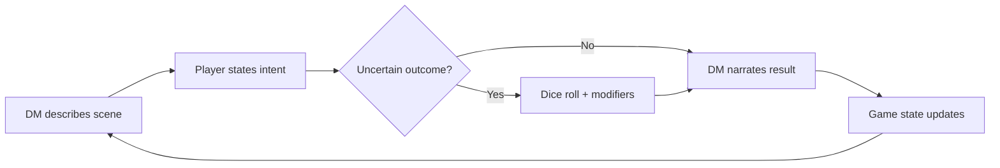
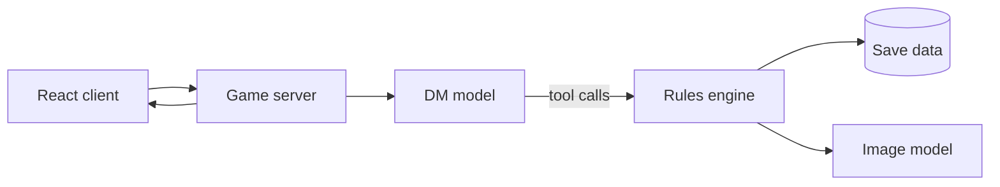

# LLM D&D — Canon export, 2026-10-14

Every page of the Notion space **LLM D&D — Game Design** plus every row of the Canon Ledger, bundled for claude.ai Project knowledge. Each page starts with a heading carrying its title and Notion URL, then its last-edited time.

**How to use this file (Session protocol, steps 2 and 11):**
- **Notion is the source of truth; this is a dated copy.** It reflects the space as of 2026-10-14. Any page edited after that date must be re-fetched before you rely on it: check the Changelog for entries after 2026-10-14.
- Reading a page here counts as a read for the "Read:" line: cite it as "canon export 2026-10-14" plus the page title.
- Statuses: LOCKED (build against it), LEANING (build flexibly), OPEN (don't assume), REVERSED (history only). Only James can lock anything.

## Contents
- [LLM D&D — Game Design](https://app.notion.com/p/3ee2bc887e058131b6a0d79876f8f8fd)
  - [Changelog](https://app.notion.com/p/3ee2bc887e0581fa8ed9d727bcca3d03)
  - [Index & Map](https://app.notion.com/p/3f52bc887e05817098bfed7aea0221c3)
  - [Opening State](https://app.notion.com/p/3f92bc887e0581219114e251215faeff)
  - [Open Threads](https://app.notion.com/p/3ee2bc887e0581c28880f38d032ab68d)
  - [Content Standard](https://app.notion.com/p/3f62bc887e058158979ad7dcd954ef96)
  - [Vision](https://app.notion.com/p/3ee2bc887e0581e585abcd2887b38b94)
  - [Thesis](https://app.notion.com/p/3ee2bc887e058156a961de54ffb1f545)
  - [Pillars](https://app.notion.com/p/3ee2bc887e0581f2a8ecc9bcb9e1332e)
  - [References](https://app.notion.com/p/3ee2bc887e05813abcdbd4510fc9a5a2)
  - [World](https://app.notion.com/p/3ee2bc887e0581539a9bdd8cfb2c26d1)
    - [Races](https://app.notion.com/p/3ee2bc887e0581ac8807e203c6d1e87c)
      - [Orcs](https://app.notion.com/p/3ee2bc887e0581aaa462fec0eba23366)
      - [Elves](https://app.notion.com/p/3ee2bc887e05817ca5d4d0bcc4a0036d)
      - [Dwarves](https://app.notion.com/p/3ee2bc887e058191b56bd5f7c8d1c8b6)
    - [Regions](https://app.notion.com/p/3ee2bc887e05816f9602ecc3e25f5a4c)
      - [The Delta](https://app.notion.com/p/3ee2bc887e0581aaa427c2eb12a2c14d)
      - [The North](https://app.notion.com/p/3ee2bc887e0581edb484fba020bf9a20)
      - [Holy Region](https://app.notion.com/p/3ee2bc887e0581c2bae1c431ddcf47df)
      - [Mage City](https://app.notion.com/p/3ee2bc887e058145b352dc1b7d0eb677)
        - [Mage Voice](https://app.notion.com/p/3f32bc887e0581d0810fe7fd1ebf4bf3)
      - [Orc Badlands](https://app.notion.com/p/3ee2bc887e0581228ec1e36ee319f8af)
      - [Dwarven Mountains](https://app.notion.com/p/3ee2bc887e0581b5a85dc06d08f191e6)
      - [Small Towns](https://app.notion.com/p/3ee2bc887e0581838724f99d87748f77)
      - [Elven Court](https://app.notion.com/p/3f52bc887e05811888c4e4ae7ed8f2d4)
      - [The Honest God & Witchcraft](https://app.notion.com/p/3f52bc887e058113b029d05da197710d)
    - [Economy & Mobility](https://app.notion.com/p/3f52bc887e058137b7f8fbcef4db9f6c)
    - [Conspiracies](https://app.notion.com/p/3ee2bc887e0581bb95e5fa57cb78f744)
    - [Comedy](https://app.notion.com/p/3f42bc887e0581ab9d2ae70b15cf43ef)
  - [Story](https://app.notion.com/p/3ee2bc887e0581f0b3d7ed9de02be9c8)
    - [The Emperor's Crown](https://app.notion.com/p/3ee2bc887e0581368090ec0e233de852)
    - [The Hoarded Fountain](https://app.notion.com/p/3ee2bc887e0581b5b1b8db31ea4812c8)
    - [The Papal Election](https://app.notion.com/p/3ee2bc887e058146aa49facaaab076c4)
    - [Combustion](https://app.notion.com/p/3ee2bc887e0581dfba6eead40b618bb0)
    - [The da Vinci Dwarf](https://app.notion.com/p/3ee2bc887e058199b618f9d97fefb529)
    - [The North Rebellion](https://app.notion.com/p/3ee2bc887e0581a892e6fff1af0aa895)
    - [A Loved One's Debt](https://app.notion.com/p/3ee2bc887e058196bcd0d4b4f4f901dd)
    - [Orc Quests](https://app.notion.com/p/3ee2bc887e0581fca504dcaaf70e51b0)
    - [The Oracle Orb](https://app.notion.com/p/3f32bc887e0581fe93aee14c29d3d6ef)
  - [Mechanics](https://app.notion.com/p/3ee2bc887e058188a4d0d5b0d2322982)
    - [Feedback Log](https://app.notion.com/p/3ee2bc887e0581c0bb75fe5f4f8d9afa)
    - [Playtest Notes — Sep 2026](https://app.notion.com/p/3ee2bc887e0581b8bf19ec6d6517cfaa)
    - [Presentation & Visuals](https://app.notion.com/p/3ee2bc887e0581afa814c9f0f72d6a53)
    - [Architecture & Build Plan](https://app.notion.com/p/3ee2bc887e0581fc9decf2985c3a7759)
    - [Abilities & Spells](https://app.notion.com/p/3ee2bc887e05817896b2fcef3706b1d1)
  - [Canon Ledger](https://app.notion.com/p/35304918bbf94f3baf37bab69020ea41) (53 rows, at the end)


---

# 🎲 LLM D&D — Game Design — https://app.notion.com/p/3ee2bc887e058131b6a0d79876f8f8fd

*Last edited 2026-10-14*

> 🧭
> **Session protocol — both Claudes, every session.** *(Claude, James approved, 2026-10-11)*
> 1. **Start:** read the [Changelog](https://app.notion.com/p/3ee2bc887e0581fa8ed9d727bcca3d03) entries since your last session, then the [Index & Map](https://app.notion.com/p/3f52bc887e05817098bfed7aea0221c3).
> 2. **Fetch before you write *— or speak*.** Before you state, build on, propose, *or answer a question about* any region, race, character, keystone, quest or mechanic, fetch that subject's page *in this conversation*. **Answering a question counts** — the moment James turns the conversation to a subject ("let's talk about the prison," "what did we decide about X"), fetch its page *before your first substantive reply*, not after he points out it exists. Answering from memory feels safe but is how you contradict locked canon. The summaries on this page and in the Index are routing aids, not canon: if you haven't fetched the page this session, treat what's on it as unknown. When a subject spans pages, use the Index's "Where does X live?" list. (Caught live, 2026-10-13: answered a question about the opening prison from memory and contradicted the Story page's "standalone place between regions" with a guessed small-town lockup, before fetching.)
> 3. **Label provenance.** Every claim about the world is either sourced (name the page: "per The Delta") or marked as a *proposal*. Never let canon and invention blend unmarked.
> 4. **Silence isn't permission.** If the page doesn't cover something, say so ("the Orcs page doesn't define this") before proposing. Don't fill the gap quietly.
> 5. **Let James finish.** In conversation (especially voice), wait for James to complete his thought before responding. Don't jump in on a half-finished sentence or start building on a partial idea — a pause is not an invitation. Answer once he's actually done. *(James, 2026-10-13.)*
> 6. **Check every detail, not just the topic** *(James approved, 2026-10-13)*. Before sending any proposal, list each specific claim it uses or introduces about the world: people, institutions, currency, magic, who rules where, and *when*. Each must be found in the [Canon Ledger](https://app.notion.com/p/35304918bbf94f3baf37bab69020ea41) or a page fetched in this conversation, or be tagged **New** in the reply. End every pitch with a short **"New:"** line naming the invented specifics, so James can catch them at a glance. A proposal label doesn't cover the details inside it.
> 7. **Summaries are never a read.** Compaction summaries, chat memory, the Index and this page's summaries don't count as having read a page. After a conversation is compacted, re-fetch before relying on anything.
> 8. **Check the time.** For anything touching the story, confirm whether it's true **at the opening** or only **after a story event** (the ledger's time scope and the [Opening State](https://app.notion.com/p/3f92bc887e0581219114e251215faeff) page). Present-tense prose on a keystone page can describe a future event.
> 9. **Sweep after every decision.** When James decides or reverses something, search the space for references it affects, update them in the same turn, and add or update ledger rows.
> 10. **Read the whole neighbourhood before reviewing** *(James approved, 2026-10-14)*. Before auditing, reviewing or building on a page, fetch it **and every page it links to or depends on** (a questline and its keystone, a region and its races) before writing a single flag, question or proposal.
> 11. **End every flag, question and proposal with a "Read:" line** *(James approved, 2026-10-14)* naming the pages actually fetched in this conversation (or the dated canon export, once it's loaded as Project knowledge). **Questions count:** asking one assumes you know how that part of the system works. If what you're about to say touches a page that isn't on the list, fetch it first. The line makes a skipped read visible to James instead of relying on Claude to notice.
> *Caught live, 2026-10-14:* during the Emperor's Crown audit, asked whether a cellmate could be the debt companion without having read A Loved One's Debt (which already says the debt falls on whichever companion you're closest to), and added an unflagged causal link on The Delta. Steps 2 and 6 already covered both; the rules failed because they depended on Claude noticing in the moment. Steps 10–11 and the canon export take that decision away.
> *Caught live, 2026-10-13:* pitched cellmates using "crown coin" (the game has one currency), a traitor who served "the elven lord" (there is none at the opening), and mage "licensing" (not part of the world). Each was an unchecked detail inside a pitch that had been labeled as a proposal.
> *Why:* a confident guess reads exactly like a fact, so unsourced assumptions are the main way canon drifts. Making the source visible is what lets James catch it.

> 📍
> **This is the single source of truth** for the game's world, story, and mechanics, including James's feedback on how the game should play. If code and this space disagree, this space wins until it's updated.

## The game in one paragraph
A single-player, text-first tabletop RPG where an LLM is the dungeon master. It improvises scenes, makes DM-style judgement calls, and calls generative visuals via tool calls. It's about creativity, roleplay, and relationships rather than combat tactics. The world is a set of regions, each a civilization that sacrificed human connection to one pure idea; the player and their party are the people who choose each other over the idea.
## The world at a glance (read before worldbuilding)
**Fundamentals so no session misplaces a region or mistakes who holds power. Each region has its own page under World → Regions; this is the roster and the two load-bearing facts.**
- **The regions (8):** **Mage city** (knowledge) · **Holy region / the "Vatican"** (god, through an institution) · **The delta** (appetite) · **The north** (hard pride) · **Elven court** (performance and power) · **Dwarven mountains** (craft) · **Orc badlands** (the honest exception — no hidden idea) · **Small towns** (the in-between, devoted to no pure idea — candidate home for the thesis).
- **The crown is the ELVES. (LOCKED, James.)** The world's **one true monarchy belongs to the elves** — they are *the crown*, the actual seat of hereditary royal power. The human regions stay **fractured and self-governing, with no single human crown.** **How that fits together = federal vs. provincial (LOCKED, James, 2026-10-11):** the elves are the federal government, with supreme authority over the whole world; each human region is a province that runs its own affairs under its own leaders but ultimately answers to the crown. Analog: Game of Thrones' great houses — the Warden of the North governs the north, but ultimately bends the knee to the king. One edge: the orc badlands, which the crown leaves alone because taxing them isn't worth the cost. Full statement on [Regions](https://app.notion.com/p/3ee2bc887e05816f9602ecc3e25f5a4c) → Political shape. **The central conflict of the whole story is the elves (the crown) vs. the north** — built on the **elven fountain / immortality keystone** (the elves hoard a world-changing immortal water-source). When the story says "the crown" or "the monarchy," it means the elves, always.
- **The delta's "emperor" is NOT real monarchy. (LOCKED, James.)** He is a **self-crowned emperor** — that *is* the joke. A strongman who gave himself an imperial title and pageantry he has no legitimate claim to; the explicit analog is **Caesar in Fallout: New Vegas** (the man cosplaying Julius Caesar). His "empire" is appetite and spectacle wearing the trappings of royalty — the delta's purest expression of the one unifying sin (the costume of a virtue where the virtue has gone missing). He is emphatically **not** the crown; the elves are.
## Content standard
A mature (17+) game bounded only by store policy; the player's default answer is YES, with a short hard-refuse list. **The full statement, the canonical hard-refuse list, and the definitions of "animal" and "child" live on [Content Standard](https://app.notion.com/p/3f62bc887e058158979ad7dcd954ef96).** (LOCKED, James, 2026-10-10)
## Map
- [Canon Ledger](https://app.notion.com/p/35304918bbf94f3baf37bab69020ea41) — **the fact list:** one short fact per row, with status, time scope, entities and source. The authority on what's true and when; narrative pages hold the reasoning. Check before proposing (Session protocol, step 6).
- [Opening State](https://app.notion.com/p/3f92bc887e0581219114e251215faeff) — what's true when the player wakes in the cell, and which story events haven't happened yet.
- [Changelog](https://app.notion.com/p/3ee2bc887e0581fa8ed9d727bcca3d03) — dated sessions: who, context, what changed. Read the entries since your last session (Session protocol, step 1).
- [World](https://app.notion.com/p/3ee2bc887e0581539a9bdd8cfb2c26d1) — races and regions: what the world *is*.
- [Story](https://app.notion.com/p/3ee2bc887e0581f0b3d7ed9de02be9c8) — keystones and questlines: what *happens*. The page itself is the keystone index.
	- Keystones: [The Hoarded Fountain](https://app.notion.com/p/3ee2bc887e0581b5b1b8db31ea4812c8) · [The Papal Election](https://app.notion.com/p/3ee2bc887e058146aa49facaaab076c4) · [The North Rebellion](https://app.notion.com/p/3ee2bc887e0581a892e6fff1af0aa895) · [Combustion](https://app.notion.com/p/3ee2bc887e0581dfba6eead40b618bb0) · [The da Vinci Dwarf](https://app.notion.com/p/3ee2bc887e058199b618f9d97fefb529) · [A Loved One's Debt](https://app.notion.com/p/3ee2bc887e058196bcd0d4b4f4f901dd) · [Orc Quests](https://app.notion.com/p/3ee2bc887e0581fca504dcaaf70e51b0)
	- [The Emperor's Crown](https://app.notion.com/p/3ee2bc887e0581368090ec0e233de852) — the delta's main questline.
- [Mechanics](https://app.notion.com/p/3ee2bc887e058188a4d0d5b0d2322982) — the systems spec for implementation.
	- [Feedback Log](https://app.notion.com/p/3ee2bc887e0581c0bb75fe5f4f8d9afa) — James's gameplay feedback, dated.
	- [Playtest Notes — Sep 2026](https://app.notion.com/p/3ee2bc887e0581b8bf19ec6d6517cfaa) — the first prototype playtest, in full.
	- [Presentation & Visuals](https://app.notion.com/p/3ee2bc887e0581afa814c9f0f72d6a53) — layout dials, the vitals HUD, art direction.
	- [Architecture & Build Plan](https://app.notion.com/p/3ee2bc887e0581fc9decf2985c3a7759) — the stack and milestones. **Claude Code: start here.**
	- [Abilities & Spells](https://app.notion.com/p/3ee2bc887e05817896b2fcef3706b1d1) — mana vs. stamina, skills vs. abilities, proposed categories.
- [Vision](https://app.notion.com/p/3ee2bc887e0581e585abcd2887b38b94) — what the game is: pillars, core loop, the Sep 2026 tone draft.
- [Thesis](https://app.notion.com/p/3ee2bc887e058156a961de54ffb1f545) — what it's about: understanding people; the person or the principle.
- [Pillars](https://app.notion.com/p/3ee2bc887e0581f2a8ecc9bcb9e1332e) — design rules every system must obey.
- [References](https://app.notion.com/p/3ee2bc887e05813abcdbd4510fc9a5a2) — influences and what to take from each.
- [Open Threads](https://app.notion.com/p/3ee2bc887e0581c28880f38d032ab68d) — everything undecided, including conflicts between documents.
- [Content Standard](https://app.notion.com/p/3f62bc887e058158979ad7dcd954ef96) — the mature (17+) standard, the canonical hard-refuse list, and what counts as an animal or a child.
## Who works here
<table header-row="true">
<tr>
<td>Who</td>
<td>Where</td>
<td>What they do here</td>
</tr>
<tr>
<td>**James**</td>
<td>Notion app, Claude chat, Claude Code</td>
<td>Decides. Worldbuilding, mechanics feedback, reversals. Can edit any page directly.</td>
</tr>
<tr>
<td>**Claude (chat)**</td>
<td>[claude.ai](http://claude.ai), via the Notion connector</td>
<td>Worldbuilding and design conversations with James. Reads and edits these pages directly.</td>
</tr>
<tr>
<td>**Claude Code**</td>
<td>the repo, via the Notion MCP</td>
<td>Builds the game from these pages. Edits them when James directs it, when he makes or reverses a decision, or when they plan a mechanic together. Snapshots this space into the repo.</td>
</tr>
</table>
## Status markers
Every major decision carries one:
- **LOCKED** — James decided. Build against it.
- **LEANING** — Direction agreed, details may move. Build flexibly.
- **OPEN** — Undecided. Don't build assumptions on it.
- **REVERSED** — Was decided, now isn't. The full record lives in the Changelog; a page keeps a REVERSED breadcrumb only when the old idea is tempting to re-propose (see "Reversing a decision" below).
**Only James can make something LOCKED.** Either Claude can propose, draft, and mark things LEANING or OPEN, but locking needs James's say-so.
## Attribution
- *(James)* — his idea or decision.
- *(Claude, James approved)* / *(Claude Code, James approved)* — proposed by a Claude, accepted by James.
- *(Claude)* / *(Claude Code)* — proposed, not confirmed. LEANING at most.
## Making changes
- **New decision** — write it on the right page with a status and attribution, then add a Changelog line.
- **Reversing a decision (James, 2026-10-10 — revised).** History's permanent home is the **Changelog**: every reversal gets a full dated entry there (what changed, what replaced it, and why — the reasoning is design information). On the page itself you may **rewrite and merge freely** to describe current canon; you do *not* have to leave REVERSED scars everywhere. Leave a short one-line breadcrumb on the page ("was X, changed to Y — see Changelog") **only when the discarded idea is tempting enough that someone might re-propose it** — the breadcrumb's job is to stop a future session re-pitching a thing you already considered and rejected. Small or uninteresting reversals go to the Changelog alone.
- **Deleting or overwriting decided content is deliberate, never casual (James).** Freely rewriting prose to describe current canon is fine. But actually *removing* something the world decided — as opposed to restating it — is a real call: be clear that's the intent before doing it, and make sure the Changelog still carries what was there.
- **Mechanics feedback from James** — log it in the Feedback Log with the date, his words (lightly cleaned), and where it was applied. Then apply it to the relevant page.
- **Planning a mechanic in Claude Code** — the plan's design decisions come back here (usually Mechanics), not just into code comments. Implementation details stay in code.
- **Every change gets a Changelog entry.**
## Editing etiquette (for both Claudes)
Everyone edits the same live pages, so:
- **Check the docs before proposing (James, 2026-10-10; now steps 2–4 of the Session protocol at the top).** Before pitching a new idea for some part of the world, first check whether that subject is already defined — fetch the relevant page (and the [Index & Map](https://app.notion.com/p/3f52bc887e05817098bfed7aea0221c3) if unsure where it lives). Don't propose from memory and risk reinventing or contradicting locked canon. Build the proposal *on* what exists, or note explicitly that nothing was there. (Caught live: nearly re-pitched an "earned hierarchy" for the orcs when rule-by-the-Strongest was already fully locked on the Orcs page.)
- Fetch a page right before editing it; don't edit from an old read.
- Make the smallest edit that does the job. Never replace a whole page to change one section.
- Don't move, rename, or delete pages without James asking.
## Before you start a session
Follow the Session protocol at the top of this page. The other Claude may have changed things since you last worked here.
## Where things live
- **One subject, one page.** A fact about the orcs goes on the Orcs page, even mid-way through the north.
- **World vs Story.** What a place or people *is* goes under World. What *happens* there (quests, keystones) goes under Story.
- **Mechanics get pulled out.** When a world or story page implies a system (gambling mini-game, dice loading, capture instead of death), it's summarized under Mechanics with a link back to the source.
- **Undecided things** go in Open Threads as well as being marked OPEN in place.
## History and backups
Notion's free plan keeps only **7 days** of page history. So Claude Code regularly snapshots this whole space into the repo's `/design` folder as markdown, committed to git. That's the permanent history. The snapshot is read-only: edit here, never there.
- Child page: [Changelog](https://app.notion.com/p/3ee2bc887e0581fa8ed9d727bcca3d03)
- Child page: [World](https://app.notion.com/p/3ee2bc887e0581539a9bdd8cfb2c26d1)
- Child page: [Story](https://app.notion.com/p/3ee2bc887e0581f0b3d7ed9de02be9c8)
- Child page: [Mechanics](https://app.notion.com/p/3ee2bc887e058188a4d0d5b0d2322982)
- Child page: [Vision](https://app.notion.com/p/3ee2bc887e0581e585abcd2887b38b94)
- Child page: [Open Threads](https://app.notion.com/p/3ee2bc887e0581c28880f38d032ab68d)
- Child page: [Thesis](https://app.notion.com/p/3ee2bc887e058156a961de54ffb1f545)
- Child page: [Pillars](https://app.notion.com/p/3ee2bc887e0581f2a8ecc9bcb9e1332e)
- Child page: [References](https://app.notion.com/p/3ee2bc887e05813abcdbd4510fc9a5a2)
- Child page: [Index & Map](https://app.notion.com/p/3f52bc887e05817098bfed7aea0221c3)
- Child page: [Content Standard](https://app.notion.com/p/3f62bc887e058158979ad7dcd954ef96)
- Child database: [Canon Ledger](https://app.notion.com/p/35304918bbf94f3baf37bab69020ea41)
- Child page: [Opening State](https://app.notion.com/p/3f92bc887e0581219114e251215faeff)

---

# 📜 Changelog — https://app.notion.com/p/3ee2bc887e0581fa8ed9d727bcca3d03

*Last edited 2026-10-14*

## 2026-10-11 — Session protocol, Content Standard page, and the crown as a federal government
**Authors:** James, Claude (chat)
**Surface:** Claude chat
**Context:** James noticed Claude sessions sometimes skipped checking the docs and made subtle assumptions despite the "check the docs" rule. Diagnosis: the main page's canon summaries felt like enough, the rule was buried and had no clear trigger, two things both claimed to be "read first," and nothing asked Claude to separate canon from invention. Restructured the entry point and clarified one ambiguity that invited guessing.
- Main page — **New Session protocol callout at the very top** (Claude, James approved): (1) read Changelog since last session, then Index; (2) fetch a subject's page in this conversation before writing about it — summaries are routing aids, not canon; (3) label provenance: every world claim is sourced (name the page) or marked a proposal; (4) silence isn't permission — say a page is silent before proposing. Folded in the old "read the Index first" callout; resolved the competing "read first" instructions; pointed Editing etiquette and "Before you start a session" at the protocol.
- **New page: [Content Standard](https://app.notion.com/p/3f62bc887e058158979ad7dcd954ef96)** — the full content-standard section (mature 17+ standard, player freedom, hard-refuse list, animal/child definitions, refusal ladder) moved there verbatim from the main page, which keeps a one-line pointer. It's DM-runtime spec, and its length was burying the working rules. Now the canonical home of the hard-refuse list; Mechanics and the Index updated to point to it. (Claude, James approved)
- Regions (Political shape), main page world-at-a-glance, Elven Court, Index — **The crown rules as a federal government over self-governing provinces (LOCKED, James).** The elves hold supreme authority over the whole world; each human region runs its own affairs under its own leaders but ultimately answers to the crown. Analog: Game of Thrones' great houses — the Warden of the North governs the north but bends the knee to the king. Resolves the apparent conflict between "rules over every region" and "self-governing."
- Index & Map — Opening callout now states the one-liners are routing, not canon.
- Regions (Political shape), Economy & Mobility, main page, Index — **The orc badlands are the federation's one edge (James).** Orcs don't run on standard currency or agriculture. The crown *could* probably tax them and has likely considered it, but it would be met with confusion, require enormous military resources and yield limited value — so they're left alone as a cost-benefit call, not an impossibility. Refines the existing "blank spot on the crown's map" canon (which read as "can't be taxed") and reconciles it with the federal model. Added an OPEN story seed to Open Threads: the crown floating an orc tax in the story.
- Regions (Agriculture) — Orcs **don't farm in the standard way** (James); they feed themselves off the badlands' beasts (existing orc-cuisine canon). Replaces the earlier line that they farm fertile cooled volcanic ash.
- Open Threads — Fixed the Resolved content-ceiling line to point at the new Content Standard page.
## 2026-10-10 — Mage city architecture + the High Council gets names, a gender, and an Umbridge touchstone
**Authors:** James, Claude (chat)
**Surface:** Claude chat (voice)
**Context:** End-of-session cluster: named and gendered the three High Council mages, pinned the proceduralist's tone, and built the mage city's architecture (the hard one — making an invisible, internal trait visible).
- Mage Voice + Mage City — **Mazirian assigned to the vain council mage (James).** Lifted from *The Dying Earth* (Mazirian the Magician), spelling kept as a deliberate nod to the obscure source; fitting because the original is exactly that cold/vain/cruel sort. (More Dying Earth names likely as James reads on.)
- Mage Voice + Mage City — **Rimwald assigned to the zoned-out/oblivious council mage (James)** — the faded, drifting-off ring suits the detached one who takes the bullet in Combustion Act 3.
- Mage City — **The proceduralist is female; name still OPEN (James).** First concrete step on the world-wide **gender-politics** thread (flagged this session for later): the mage city has **equal gender politics**, which falls out of its being a meritocracy of talent/training rather than bloodline or brawn — female non-villain mages expected throughout, not just on the council.
- Mage City — **Proceduralist tone pinned: Umbridge as touchstone, held at arm's length (James).** Use Umbridge's velvet-gloved officiousness and procedure-as-weapon manner; **drop her sadism and malice** — the proceduralist is sincere, believes she's being *more* ethical, harm is a byproduct not a goal. **Emotional gut-check:** the player should feel the exasperated "oh my God, *fuck off*" of a DMV jobsworth — annoyance, not the skin-crawling hatred Umbridge is built to provoke. If the player wants to *murder* her rather than shove past her, she's been written too cruel.
- Mage City — **Architecture LEANING: knowledge over a place that should not support it (James).** The tough region (its defining trait is internal/invisible), so the architecture makes the abstraction visible: **the triumph of intellect over a desert that offers nothing** — the mages build to *prove they can* ("make it impossible," vs. the north's "it only has to hold" and the dwarves' "make it perfectly"). Key distinction: **ornament as demonstration/argument** ("look what we know"), never beauty-for-its-own-sake — which keeps it clear of the elves (ornament as love language) and the delta (spectacle). Components: **impossible-by-hand shapes** (geometrically wrong for the material — keystoneless arches, top-heavy towers, cantilevers over nothing — reads as *magic built this* and flouts the structural truths the dwarves revere); **floating bridges and floating staircases** (James) as the **signature motif** — ostentation applied to the most mundane problem (getting between floors) purely to show off, the structural twin of the flowery-vocabulary bit, and in play a vertical web of magic-dependent crossings that gates space and stages well; **material transmuted from the ground** (sand fused to glass/vitrified stone, hardened dust — a pale, glassy, bone-and-silica mesa city, the aridity-sin made into sealed walls); **turned inward and upward** (inward-facing spires vs. the dwarves' outward cantilever; a skyline of competing towers rendering the status-ranking-among-mages); and **responsive architecture on a few special buildings** (James) — rationed to the holy-of-holies structures (the **High Council** chief among them), **not** the whole city: these have **no obvious entrance at all** (the façade is the puzzle — "is there even a door?"), and morph open — bricks into a doorway, a stair or bridge materializing — only for someone with a **genuine reason to be there** (summons, token, legitimate business). It responds to *legitimacy, not a trick*, making it the class-wall and bureaucratic-wall at once (you get in by belonging or being sent for). Calibration: imperious and cold, never a whimsical Hogwarts staircase. **Visual reference: Zaha Hadid** (James, Hadid-dominant with a little Gehry) — sleek, flowing, alien, gravity-defying forms that *feel computed*, executed in transmuted **desert** materials and palette (fused sand, vitrified stone, bone/dust/silica) so it reads as *this world* and not a Hadid photo; framed as "pomposity for its own sake but not a diss on the architect" — real mastery bent to vanity, beautiful buildings built for the wrong reason. **Commoner housing — humble desert domes (James):** the burgher/underclass majority live in simple, cheap, unornamented rounded domes (Tatooine moisture-farm reference, drawn from real mudbrick desert domes) that **flow with** the grand architecture so the region reads cohesively — same curved language, opposite reason (a dome is the smart cheap desert shelter, not a brag); possibly also magically raised from fused sand (mass housing by magic, quietly damning); they cluster *low* while the mage towers reach *up*, so the silhouette states the class line. Calibration: humble and solid, not squalid — the city's poverty is the ceiling (shut out by the magic-wall), not misery. Written as a new Architecture section on the Mage City page.
- Mage City — **The cantina: a fantasy Mos Eisley fueled by magic not aliens (James).** The commoner quarter's beating heart — a sensory-overload, anything-goes bar among the low domes; the Mos Eisley translation is **magic where Star Wars has aliens** (wild visuals/interactions from a world saturated in cheap magic). **The mages don't party; the commoners party hard** — so the bar has the most *humanity* in the city (thesis rhyme: the lesser-treated are the ones actually living). Magic *leaks* here (botched enchantments, loose familiars, a drink that changes your voice, a creature working the bar) — the opposite of the gatekept, sterile magic up top. **In play: the city's hub** (rumors, fixers, off-the-record quests, dubious companions) and a pointed inversion of the entrance-less council hall — one admits only the legitimate, this admits everyone, and the real business happens *because* it's outside proper channels. Calibration: keep the overload magical/wondrous-dangerous, not just rowdy. Written as a new section on the Mage City page.
- Mage City — **The cantina gets a name and a spine (James).** Named **The Wizard's Sleeve** (LOCKED — tongue-in-cheek pub name, "something up the sleeve" wink, christened by drinkers not mages). Two more locks: it's **the one place the two classes actually MEET** (the off-duty low-level and useful mages come down to unwind — the magic-wall drops over a drink), and the **anchor sight is skeleton-familiar fights** (off-duty mages pitting their skeletons against each other — cantrip-scale, daft, genuinely magical, the signature image), now staged **in the center of the bar with a cheering ring around it** (James) — cockfight/boxing-pit energy that turns the sight into a scene: the two-classes-meeting idea made visible (commoners and mages screaming for the same bones, money crossing hands that never otherwise touch), a DM gravity well (bet, back a skeleton, clock the fixer at the edge, start/defuse the brawl), and the Sleeve's register in one tableau (a crowd roaring like a kingdom's at stake over two skeletons throwing clumsy haymakers). A spread of further sights (racing conjured familiars, party-trick transmutations, loose conjurations in the rafters, a sulky bound-elemental hearth, a mage doing useful cantrips for drink money) noted as a directional lean, not yet locked — register is "magic with the prestige drained out of it," warm not mean.
- Mage City — **The Sleeve sells novelty brews (James).** A locked category: minor, time-limited, playful potions (distinct from the alchemist's functional gear) — toys, not power; perfect for an LLM DM because the player *invents* the use (the "soil not rails" thesis in a tankard). Two canon examples: the cheap archetype is the **triple-jump ale** (jump 3× as high for a couple hours), and the top-shelf anchor is **liquid luck, Felix-Felicis-style** — a dice-layer luck bump + a narrative layer where the DM runs the world warmer (serendipitous encounters, coincidences break your way); expensive/scarce, time-limited, **luck never power**. A mid-range spread was brainstormed but left deliberately unlogged (James to curate); one keeper added — **instant beard** (goofy gag with a hidden analog-disguise use; imperfect, not foolproof — anyone who really knows you still recognizes you; nice north callback where beards read as earned manhood). Second keeper — **Twinkletoes** (dance at a professional level for a couple hours; a *social* toy with roleplay reach — pass as gentry, performance-as-distraction, win over a crowd; guardrail: gives the skill, not the will or judgment).
- Mechanics — **Commerce / shop-browsing system added as a LEANING implied-system** (James): browsing a shop shows each item's effectiveness and, for magical items, their effect — a readable, inspectable storefront. Surfaced by the Sleeve's potion menu but world-wide; OPEN how much stays hidden (cursed/unidentified items) and how it reads in a text-first UI.
- Mage City — **Novelty brews reframed as a cocktail menu (James, LOCKED metaphor):** each brew is a cocktail (liqueur base + magical ingredients) that's functionally a potion; the player browses it like a cocktail list — name + mix + effect. Sells the real-bar fiction, gives the menu a charming consistent format, and is the natural first in-game showcase of the commerce/shop-browsing mechanic.
- Mage City — **Novelty brew added: Beast Tongue (James, LOCKED)** — talk to any animal or monster for a short window; converse, not command. The most LLM-DM-native brew alongside liquid luck (every creature becomes an NPC). Guardrails: shared language not obedience (a hungry wolf stays a hungry wolf); creature talks like itself; monsters can lie, bargain, or refuse.
- Mage City — **Novelty brew added: powdered wine (James, LOCKED)** — tip the powder into water and it becomes a glass of wine. Mainly a roleplay object (produce a bottle anywhere, pass it off as a rare vintage, carry a feast as a dry pouch), with a latent practical use the player can discover: drinkable wine from untreated dungeon water. Glasses-per-pouch left OPEN.
- Mage City — **Novelty brew added: Lightweight (James, LOCKED)** — single-use; alcohol hits ~3x as hard for a couple hours. Party read (cheapest night out) plus practical/roleplay angles: drink someone under the table, get usefully drunk on almost nothing, or slip it in a mark's cup so their two drinks land like six. Guardrail: changes how hard drink hits, no magical compulsion.
- Mage City — **Triple-jump ale moved to the cocktail menu** as "Triple Jump" (working name) (James). **House ales added as their own line (James, LOCKED direction):** brewed from spent reagents and mage cast-offs bought cheap from the underclass trades; cheap, real-but-unpredictable effects with admitted side effects. Ties the bar menu to the absurd-jobs economy. Specific ales OPEN. **Revised (James):** leftovers + rotating tap combined — one house ale at a time, changing every week, each from a different discarded reagent with a different minor effect.
- **2026-10-13 — Mechanics: commerce system extended (James, LEANING).** Under the commerce/shop-browsing entry: two-tier shop reveal (list view vs. tap-to-expand); currency tracking with ambient coin pickup on kills (non-coin loot method OPEN; Claude's spoils-card suggestion unconfirmed); orc barter — trade from inventory, no coin, per the badlands' no-currency rule (Claude's valuation-flip riff unconfirmed).
- **2026-10-13 — Mechanics: spoils card approved + pursuit rule (James, LEANING).** Spoils card (gear offered after a fight, tap to take, hidden items earned by typed search) moved from Claude-unconfirmed to James-approved. New pursuit rule: no looting while actively pursued, or looting under pursuit costs you (more guards arrive). Which version is OPEN; Claude's weight-scaled-consequence lean unconfirmed.
- **2026-10-13 — Mechanics: pursuit rule resolved (Claude, James approved).** Consequence version chosen: looting under pursuit is allowed but costs you, scaled by item weight, with the risk telegraphed on the card. Coin stays automatic mid-chase.
- **2026-10-13 — Mechanics: what drops what (James approved).** Coin follows who uses coin (bandits/guards/mages yes; beasts and orcs no). Beasts drop parts (hides, fangs, scales) that feed orc barter and mage-city reagent trades. DM exception: a monster that ate someone may hide coin, found only by searching.
- **2026-10-13 — Session protocol sharpened (James).** Step 2 ("Fetch before you write") now explicitly covers *answering questions*, not just proposing: when James turns the conversation to a subject, fetch its page before the first substantive reply. Prompted by a live miss — answered about the opening prison from memory and contradicted canon before fetching the Story page.
- **2026-10-13 — Session protocol: "Let James finish" added as step 5 (James).** In conversation (especially voice), wait for James to complete his thought before responding — don't jump in on a half-finished sentence or build on a partial idea; a pause isn't an invitation. Prompted by repeated interruptions during the prison session.
- **2026-10-14 — Process fix: Session protocol steps 10–11 (James approved).** Step 10: before reviewing a page, fetch it and every page it links to or depends on. Step 11: every flag, question and proposal ends with a "Read:" line naming the pages actually fetched. Prompted by the Emperor's Crown pass, where Claude asked about the debt companion without reading A Loved One's Debt. Also added a Claude Code task to Open Threads: bundle the `/design` snapshot into one file for this Project's knowledge, so chat starts with the full canon.
- **2026-10-14 — Audit pass 3: The Emperor's Crown (James).** Added 7 ledger rows. Rulings: the emperor is called **the emperor**, never "Lord of the Delta" (that title is the formal Lord's); the "elves were born fake" line deleted (not James's, and wrong: elves are transformed humans); "lawless merchant city" reworded — **the crown has no practical reach in the delta, no law enforcement and no taxation; the Lord is only its formality** (added to The Delta and Opening State); who fills the vacuum after the emperor dies is **the DM's call** per playthrough; the debt falls on **whichever companion the player is closest to**, wherever they came from, per A Loved One's Debt (a Claude row saying "can be one of the cellmates" was wrong-framed and corrected). Also removed an unflagged Claude link on The Delta ("it's why the crown's executions are staged here").
- **2026-10-14 — Canon export built (Claude Code).** Refreshed the `/design` snapshot (45 pages, 53 Canon Ledger rows) and bundled it into `design/exports/canon-export-2026-10-14.md` for the "LLM DND" Project knowledge, ~200k tokens by a characters ÷ 4 estimate. Rebuild with `node scripts/canon-export.mjs`. Open Threads item ticked; the compaction test is still open.
- **2026-10-13 — Audit pass 2: The Delta (James).** Added 10 ledger rows; Opening State now has the Lord, the emperor and the thieves' guild in place at the opening. James's rulings: the fake monk asks for **"a few coins"** (was "$5"); delta gambling uses **plain coin, no chips or tokens**; **organized murder does occur in the delta, but never through the thieves' guild, and less prominently than theft or spectacle violence** (partly REVERSES "murder and assassination don't fit the delta"; no assassin clan still LOCKED; tension callout, tunnels and flood wording updated; Open Threads item moved to Resolved); the **Lord is also the crown's formality**, added to The Delta, with who appointed him OPEN.
- **2026-10-13 — Audit pass 1: the Fountain and the Elven Court (James).** Added 10 ledger rows; Opening State now records that only the elder elves know the secret at the opening. James's rulings on the flags: **(1) The source is the sacred lake**, not a potion from a grove of "immortality plants" (REVERSED); Greek-style aqueducts carry the lake's water into the drinking supply. The Fountain's "destroy the grove" choice became "destroy the source (the lake)", with how that would work left OPEN. "Grove" references swept on The North Rebellion, Story's interlocks and Mechanics. **(2) The monarchy is a bloodline, and elves are still transformed humans**; clarified on Elven Court (Claude note, unconfirmed: royal children are born human and become elves on the plateau). **(3) A reverting elf keeps the elven personality**; only the aging returns. The Fountain's "drifts back toward human" wording fixed. **(4) Elves page location** updated from "in the mountains or over the river" to the plateau. **(5) Typo** "Grease-style" corrected to Greek-style.
- **2026-10-13 — Canon-integrity system, part 1 (James approved the plan).** After repeated canon slips this session ("crown coin," an elven lord who doesn't exist yet, mage "licensing"), James asked for a structural fix. **Main page → Session protocol:** new steps 6–9: check every detail of a proposal and tag invented specifics with a "New:" line; summaries are never a read (re-fetch after compaction); check whether a fact holds at the opening or only after a story event; sweep for affected references after every decision. **Mechanics:** new "World canon for the DM" section: the Canon Ledger exported as code-owned canon, James's **per-turn canon check** (each turn checks for new required ledger searches), a timeline gate driven by story flags, constraints always in the prompt, and validation of new DM-invented world facts. **Sweep fixes:** Story's stale "Who runs it — OPEN, leaning elven" resolved to crown-owned, human jailers; "licensed" mage magic removed from The Honest God & Witchcraft and the Index (James: licensing doesn't fit the world); North Rebellion gains a timeline callout: at the opening the old general rules and there is **no elven lord yet**. **Part 2 (same day):** created the **Canon Ledger** database on the main page (fields: Fact, Kind incl. "Constraint (never)", Status, Time scope, Entities, Attribution, Source page, Notes, Last verified) and seeded it with 26 rows, each verified against a page fetched in this conversation (never-rules: one currency, no dark elves, no mage licensing, all cellmates human; crown and province structure; the north's opening state and pending events; the prison). Created the **Opening State** page (true at the opening; pending story events; regions not yet audited). Linked both from the Session protocol, the main page map and the Index. **Next:** a full audit of every page to finish seeding the ledger and flag contradictions and unmarked Claude wording (Claude Code is well placed to do the bulk pass; James reviews the flags in chat).
- **2026-10-13 — One currency (James, LOCKED) + Feedback Log entry.** **Mechanics → currency:** the game has a **single currency** everywhere (orcs don't use it); never invent rival or regional currencies, after "crown coin" vs. other coin confused James in a previous playthrough. Also corrected the NPC-traits entry to build on the playtest's "characters as people" notes rather than claiming NPCs only had an attitude. **Feedback Log:** new entry for this session (one currency, no suggestion bar, don't serve hidden things, NPC traits, no trivial authoring questions, lethal guards).
- **2026-10-13 — No suggestion bar: doc brought in line with the prototype (James).** **Mechanics → Interaction and onboarding:** there is **no suggestion bar**, which is how the current prototype already works; suggestions are only subtle hints woven into the DM's narration, because the player should be creative rather than moving through the world on autopilot. Added as a dated clarification callout at the top of the section. **Story:** the shiv line updated to match (narration and its hints never point at the shelf).
- **2026-10-13 — The cell's structure and the player's clothes (James, LEANING).** **Story (the cell):** room structure approved: about 3 × 2.5 m for three; plank shelf with straw fits two, the third on the floor; fieldstone walls, stone-flag floor, timber beam-and-plank ceiling; a small barred slit window high on the outer wall. The player **isn't asked** what they're wearing: they start in **generic peasant clothes roughly based on their class** (class = the archetype picked at character creation). **No extra items:** the guards miss nothing at intake, but a **perceptive** player can snap a piece of timber off the **plank shelf**, essentially **a poor shiv** (James). Finding it is a **Wits check rolled only if the player explicitly looks around**, never served up by narration or suggestion nudges (James); damp-softened timber filed as a Claude note.
- **2026-10-13 — Cellmates as the prison friend, NPC traits, no dark elves (James).** **Story:** the prison friend role is filled by **either or both cellmates**, and the player can escape with both (LEANING); contrasting traits, background-driven map knowledge and inter-cellmate friction filed as Claude proposals. **Mechanics:** new system entry, **NPC backgrounds and personality traits** (LEANING): named NPCs get a background and fixed, code-owned traits at spawn; attitude moves, and each DM-proposed change must cite a trait; the player's authored backstory counts alongside actions. Onboarding line "the dark elf in the next cell" replaced with the two cellmates. **Elves:** LOCKED, **no dark elves or elf subraces, only elves**.
- **2026-10-13 — Shared cells and the cell door (James, LEANING).** **Story (prison):** cells are **shared, three to a cell** (~16–17 cells for ~50 beds), and the player starts with **two cellmates**, a real chance to organize an escape and potentially leave with a party. Doors are **solid iron-banded timber with a small barred grille** at head height plus the food hatch; full barred fronts passed over as 19th-century. Corrected the interior's earlier "~50 cells" (James had said 50 *beds*) and the related guard-post and hatch wording. Open: whether the prison friend is one of the cellmates.
- **2026-10-13 — The prison town's church and priest (James, LEANING).** **Story (prison town):** the town has a **parish church and priest** (modest, everyday, per the Small Towns canon), with the **graveyard in the churchyard**, holding the town's dead and those who die in holding. The **priest doubles as the prison's chaplain**, hearing the condemned's confessions, which puts the "what are you in for?" question in a real person's mouth. Open: whether he's sincere, numbed or quietly troubled. Graveyard moved out of the unconfirmed-proposals list.
- **2026-10-13 — The cell: routine and contents (James, LEANING).** **Story (prison):** new subsection. Each cell has a water jug and a slop bucket. Food and water pass through a **small hatch** in the door several times a day; the **door opens once a day** for the bucket swap with two guards present, the one time each cell is physically open. Bedding (plank shelf with straw) and rations (crown gives bread and water; guards sell extras) filed as Claude proposals, unconfirmed.
- **2026-10-13 — Possessions, water and waste (James, LEANING).** **Story (prison):** prisoners' possessions are **held by the jail, then sold off** (likely through the town merchants; property room by intake or in the head guard's office, items going missing under loose bookkeeping, as Claude proposals). Prison and town drink from **wells, primarily**, enabled by the breadbasket's high water table; not the river. Waste follows the rural medieval pattern: privies over cesspits, night soil to the fields, composted stable manure, middens, and a slop bucket per cell emptied daily outside the walls. Notes the well/cesspit groundwater tension (wells upslope) and the closed-loop riff (the condemned fertilise their own last meals).
- **2026-10-13 — Prison interior, guard shifts, lethal arms & the prison town (James, LEANING).** **Story (prison) — lethal weapons:** guards carry real lethal arms (swords, maces), not batons or clubs, because a world where unarmed people can cast spells makes non-lethal control a fantasy, and because a baton-guard kills the intimidation (player psychology). **Interior:** no prison yard and no food hall, deliberately (transit, not penitentiary; prisoners fed in cells). Present: the cell block, a kitchen, guard quarters with the armoury, an intake/loading area, and a head guard's office (title open; "warden" may be too grand). **Guards:** the 1:10 ratio is now **per shift**: ~5 on duty at once, two ~12-hour shifts, thinner night watch, roster of ~10–12 plus the head guard. Day-shift posts: gate (1), cell block (2), armoury (1), escort/rover (1). **Prison town:** ~100–150 people; two economies (prison payroll + trade-road traffic); an **inn** with a stable for travelers and convoy horses; **one or two merchants** (food/domestic goods, building supplies, timber). Smithy, wagon yard, storehouse, staff housing and graveyard filed as Claude proposals, unconfirmed.
- **2026-10-13 — Prison texture + reversion recalibration (James, LEANING).** Continued the prison session. **The Hoarded Fountain + The North Rebellion — reversion recalibrated:** leaving the water isn't visible decay or rot, it's the **aging clock simply restarting** (you age at a normal human rate again); the **physical elven traits are permanent** (ears etc., irreversible, formed in the transformation years), so a reverting elf still *looks* like an elf and can't be spotted by sight. The tragedy is internal — only the elf himself feels it (his own body keeping time), which sharpens the fountain secret (the giveaway is private, not observable). Applied to the installed northern lord too. **Story (prison) — escape is local heat, not instant crown-wide fugitive status:** breaking out doesn't make you the most-wanted person in the world; crown-wide infamy is a *later* escalation. Protects the blank-outsider arrival (fiction) and means you can walk into cities freely (practical). Heat is **town-shaped** — relegated to the nearby prison town where you're known/unwelcome, barely radiating past it; **loose waystation bookkeeping** is the in-world reason you go anonymous fast (the machine barely recorded you). Pursuit mechanics left to the DM; rule is only the ceiling (local, not global). **Story (prison) — guards, arming, town, transport:** guards are **paid-not-loyal** (loyal as a paycheck, fitting a crown slowly losing its grip — kept as a live thread, lightly referenced); **crown-issued arming** (modest issued gear, inventoried into an armoury, not on every hip); **~1 guard per 10 prisoners** (~5 at a 50-bed depot) plus cooks/smith/drivers/suppliers/families; a **prison town** whose economy orbits the prison (lived-in, ordinary, a natural first destination, unnamed for now); **horse-drawn carriage transport with guards riding the convoy** = tier 2 of the three-tier escape.
- **2026-10-13 — The prison's architecture, scale & jailers + geographic immortality (James, LEANING).** A connected cluster that fell out of designing the opening prison properly. **Story (prison):** it's a **real purpose-built stone-and-timber prison** whose *walls* do the work (corrected — it sits on the world's busiest trade artery, so remoteness can't contain anyone); a **transit/holding depot, not a penitentiary**; **at grade, no basement** (no castle to inherit a cellar from; high water table floods a dug cellar); purely functional materials, imposed-stone-on-farmland as the thesis note; **~50 beds, one of several waystations** distributed along the routes (ordinary, not a chosen-one setpiece). **Jailers resolved (was long-OPEN): human contractors/conscripts, not elves** — keeps the elves distant/menacing, fits geographic immortality, and makes the first injustice "people like you." **The Hoarded Fountain:** new world rule — **elven immortality is geographic**; leave the plateau's water too long and you **slowly revert** toward human (known fact of the world; the *why* stays secret). Reversion is slow (seasons/years, symmetric with the couple-years it takes to become an elf), so a **furlough schedule** manages it — return every **year or two** to drink deep. Answers "do all elves live on the plateau?" (effectively yes — leaving is slowly mortal) and explains why humans do provincial groundwork. **The North Rebellion:** worked example — the **installed elven lord is slowly reverting**, posted to the farthest cold corner as an expendable; his once-a-year trip to the plateau hides inside Game-of-Thrones-style warden’s-fealty statecraft; delaying/cutting the road ages him (a latent lever); bitter irony that the north wants to kill the elves for immortality while their elf-lord quietly turns mortal in front of them. **Regions:** world is **geographically compressed** — neighbouring places days apart, full map a few *in-game* weeks corner-to-corner (never months); makes travel felt but the elven furlough plausible.
- **2026-10-13 — Story (the prison opening): three-tier escape + execution destination (James, LEANING).** The prison is a **holding-and-transport stop, not an execution site**: the condemned are collected and shipped onward to a public execution, giving the opening **three escape off-ramps** — at the prison (→ wilderness between regions), on the road/convoy (→ wherever it had reached), and at the destination (→ the execution city itself). Difficulty and stakes rise together; the destination is only reached on a double failure, so it's a backstop, not a default funnel. Grounded in the historical fact that medieval executions were deliberately *public* spectacles (Claude, confirmed against sources), which makes a remote prison implausible as an execution site. **Execution destination = the delta (James):** ruled out the breadbasket (too small to summon a crowd) and the elven kingdom (spends the fountain keystone on day one); the delta is the one place with a guaranteed crowd and appetite for spectacle. **James's reconciliation of the crown-control problem:** the delta keeps up the *appearance* of answering to the crown (its lord is a formality), so hosting the crown's executions is political stagecraft both sides perform — dissolving the public-spectacle mismatch. Noted that tier 3 is the one way the escape system delivers the player *into* a region (the delta/debt keystone) rather than merely pointing — accepted because it only happens on double failure. Written to the Story page as a new subsection after the prison-friend section.
## 2026-10-10 — The north's aesthetic: make-do architecture, the earned face, the Night's Watch palette
**Authors:** James, Claude (chat)
**Surface:** Claude chat (voice)
**Context:** Built the north's full visual identity — architecture, decoration, dress, body-marking and palette — as a single coherent aesthetic, the counterpart to the delta's permanent-fairground. All written to The North page as a new "Architecture, dress and the earned face" section.
- The North — **Architecture LOCKED: make-do, not mastery (James).** The north builds nothing to impress and everything to endure — "people making do with what they've got": patch the house and get back to living, because you can't spend a month on a better wall. Buildings are a **palimpsest of repairs** (mismatched patches, new timber lashed to old, hide over a gap) — *history worn, not erased*. A patched wall isn't failure; it's evidence you dealt with the problem — the no-masks creed in timber. **The deliberate anti-dwarf:** dwarves have a *surplus of care* (a month on a wall because perfecting *is* the meaning of life; history erased into a seamless finish); the north has *no surplus* (the wall only has to hold). Each finds the other's virtue incomprehensible.
- The North — **Materials gradient (James):** stone for the earned and permanent — the Lord of the North's seat and especially **military buildings**; timber, hide and canvas for where most people live.
- The North — **Decoration must *do* something — four permitted kinds, never ornamental (James).** The north rejects ornament-for-its-own-sake absolutely and permits only functional/true non-structural things: **(1) the hunting trophy** (antlers/furs/skulls — a record of deeds); **(2) the rune-and-herb folk layer** (carved lintel/roof-beam runes, drying herbs, charms, warding-marks, bones — warding and craft, i.e. function); **(3) fur** (warmth you can see — bedding, underfoot, worn; same beasts as the trophies, so you wear your deeds and your warmth at once); **(4) the earned facial tattoo and subtle piercing** (marks of standing granted by an elder/rite-keeper for a rite passed or beast killed — permanent, non-transferable, *the one ornament that cannot be a false trapping*).
- The North — **The folk-magic calibration, written explicitly (James):** the visible runes/herbs are the **folk tier** — the ambient everyday horseshoe-over-the-door practice, "ornamental and surface rather than serious cost" — and emphatically **NOT** the hidden, costly, equivalent-exchange blood-magic the real witchcraft system reserves for power. *The visible runes are the culture; the hidden rite is the power.* (Guards a future session from turning every rune-carved lintel into a site of blood-magic.) Also makes the religious divide visible at a glance — a holy-region traveler reads witch-marks on every ordinary home as a population of heretics.
- The North — **The earned face as a system, not fashion (James).** A face in the north is a **résumé** — readable lore; a bare unmarked adult face reads as *having done nothing*, giving the player a respect-through-contempt entry point and a quest to earn their first mark. Design language: simple/legible/stark — lines, dots, geometric strokes, lip-to-chin work (drawing on the shared logic of Inuit/kakiniit, Southeast-Asian and Amazonian facial marking, *the face records what you've done*). Piercings/subtle gauging in **bone**, earned not decorative.
- The North — **Dress and personal aesthetic (James):** Viking base (furs, leather, wool, iron, braids) + pagan symbolic layer (worn charms, warding-marks, bone tokens) + **black-metal severity**. *Calibration: black metal is a tonal dial — stark, severe, death-adjacent, drawn from the real Norse-pagan well black metal itself draws from — never literal corpse-paint or band-logo cosplay.* The look finally matches the theology (a blood-fed god, a no-kneeling creed).
- The North — **Palette LOCKED: dark and near-neutral, by the logic of make-do (James).** Dark browns, dark greys, black and undyed wool, raw leather, bone-white and antler-grey. *Nothing is colored on purpose* — saturation is a tell of surplus (vivid dye is a dwarf-move); the color is the honest natural color of the material. **Reference: the Night's Watch palette with the materials of the wildlings.** Explicit anti-reference: the brighter, gaudier, painted-and-dyed Nordic look (Skyrim-typical). **Bone is the signature material** (charms, beads, toggles, piercings) — a free byproduct of the hunt, meaningful, and the one pale note against the dark.
- The North — **Organized around shared warmth (James):** the great hall with a central fire is the north's most important building type (where standing is acknowledged, the social contract physically happens); trades worked in the open (huddling at the forge-heat is another gathering-at-warmth; fits no-hidden-back-rooms honesty). The inverse of the delta: the delta's warmth is a sales pitch; the north's is literal, scarce and real.
- The North — **The throughline:** nothing on a northerner's body or wall is there to look good — it's there because it's *true*. In a world whose unifying sin is the trappings of a virtue worn where the virtue has gone missing, the north is the one culture whose ornaments *cannot* be empty trappings. **Anti-delta to the skin:** the delta spends permanence on false fronts; the north spends it on the proof of a true deed.
## 2026-10-10 — The delta's city layout (the Strip, the market, the common quarter)
**Authors:** James, Claude (chat)
**Surface:** Claude chat (voice)
**Context:** Filled an obvious-but-missing hole: the delta had all its spectacle (arena, gambling, performers, tunnels) but no map of the city as a place people actually live. Added it via the Vegas Strip-vs-real-city distinction.
- The Delta — **New "City layout" section (LEANING, James).** The delta needs the thing every spectacle-city depends on: an actual city where the people who run the spectacle live ordinary lives (real Vegas = the Strip *plus* a half-million-person city). Three surface zones + the tunnels as a lower floor, a social gradient you can walk down: **(1) The Strip** — the tourist face and main entry; arena, gambling halls, performers, the emperor's pageantry, the spore-haze clubs (finally names the "strip" the page kept referencing). **(2) The market square** — a massive outdoor market, the *hinge* where Strip meets common quarter and the one place tourists and locals mix; commerce as the membrane between the two deltas; natural stage for the con texture (the fake Shaolin monk) and first contact with residents. **(3) The common/residential quarter** — where the workers (dealers, performers, cooks, dock-hands) go home; where the delta gains real stakes, where the **debt-keystone bonds** form, and where "the city eats you slowly" bites because you see who it's already half-eaten. **(4) The tunnels** — reframed as the *bottom of the same vertical gradient* (Strip → market → quarter → tunnels: the dream → the seam → the workers → the discarded), not a separate mystery. Appetite's city has a glittering mouth and a dark gut, same body. OPEN: exact geography vs. the river/trade-gate; whether the Lord's/emperor's seats sit on the Strip or apart; kept deliberately light (zones and their *relationship*, not a street grid).
- The Delta — **Tunnels are city-WIDE, not Strip-confined (LEANING, James; confirmed against the real Vegas tunnels).** Web-checked: the real Las Vegas tunnels are a valley-wide 500–600-mile *flood-drainage* network under the whole city, not a Strip feature. Adopted for the delta because it's both truer and better — it makes the underbelly the substrate of *every* zone (a "way down from anywhere") and reinforces the vertical gradient. **The in-world justification comes free and stronger:** a wet confluence-delta needs drainage even more than a desert, so the tunnels are load-bearing infrastructure, not a contrivance; densest under Strip/market, thinning but never gone toward the edges.
- The Delta — **The flood: latent environmental hazard + post-keystone quest seam (James).** Working storm drains in a wet delta flood when the river rises (why people die in the real tunnels). Best deployed *after* the delta keystone, once the tunnels hold people the player cares about — then rising water is "a clock with faces on it." Fits the delta's register exactly: it doesn't stab, it *rises* — slow, indifferent, mortal stakes with the no-organized-murder rule intact, and *nobody's villainy* (weather meeting geography, a threat that wants nothing in a city where everything else wants something). Latent cruelty available (unlocked): the flood kills in reverse order of who the city already failed (the deepest-down are least able to climb out).
- The Delta — **The spatial spine LOCKED (James).** One legible axis: **mainland → Strip → riverfront market → [bridge] → residential town on the far bank.** The land entrance funnels tourists straight onto the Strip (spectacle as the city's mouth, by design); the Strip resolves into the market right against the river (riverfront = where goods land, so the "seam" has a physical reason to be there); the bridge over the river divides spectacle (near bank) from home (far bank) — a threshold the player feels, where the two populations meet daily. The river as organizing axis also sharpens the flood (it hits the market and crossing — the city's center — not a far corner). Locked for structure, unlockable later; minor placements still open (Lord's/emperor's seats; orientation vs. the map's delta gate). Free latent staging on the bridge (toll, night-crossing rules, a body beneath it).
- The Delta — **Architecture LOCKED: a permanent fairground (James).** The delta's governing architectural idea, alongside dwarven "beauty without ornament" and elven Gaudí. **A carnival that never packs up** — *festive*, not fake-monumental (a painted castle reads as a real castle in one image and loses the point; tents and plank-type read instantly as spectacle/event). Materials: timber-type, canvas and rigging — raised boardwalks, tall painted **false fronts** (frontier-boomtown bravado, not deception), striped tents, banners, hand-painted signage, torchlight. Dazzling-and-cheap = the Vegas doubleness via honest fair materials. **The street IS the event** (matters more than buildings): the architecture's job is to be the *fairway* that pushes unending performance against you — promotes the street performers from decoration to the city's organizing principle. **Two-tier structure (Calgary Stampede model, James):** a sea of ephemeral stalls/tents accretes in the gaps between a few **permanent monuments** (arena, gambling halls, emperor's seat, warehouses) the fair organizes around — solves where the arena sits for free. **The thesis in stone and canvas:** permanence is spent *only* on appetite/violence/money/power; everything human is provisional canvas — "the only solid buildings are the ones that take your money or your blood." **Vegas pomp rationed to the anchors** (gold leaf/columns on the monuments only, where grandeur reads as intentional). **Two banks split by intensity:** Strip = fairway at full roar; far-bank town = the same materials as the fair *at rest*, worn and lived-in. **Deepest irony:** the only honest, permanent stone is the underground flood-drainage — the city's one solid building is the part nobody's meant to see, full of the people it spat out.
## 2026-10-10 — The north's religion & witchcraft (new page: The Honest God & Witchcraft)
**Authors:** James, Claude (chat)
**Surface:** Claude chat (voice)
- **New page under Regions: [The Honest God & Witchcraft](https://app.notion.com/p/3f52bc887e058113b029d05da197710d).** The north's religion and magic, defined as one thing. **The god:** real but not omnipotent — a powerful local *spirit*, amoral, that replies only through ritual/prophecy/listeners; the church calls it a demon. Its motive (Claude, James approved): it **is the ledger and wants to be paid** — sacrifice is its food, which is why it acts, why it's amoral, and why stolen blood spends like given blood. **Mantras (James):** "Nothing is given, everything is paid" (theology) + "Blood for blood, weight for weight" (liturgy); epithet "an honest god." **Mechanic:** equivalent exchange — cost scales with power. **Witchcraft** = the practice of the faith (alchemy + devotion), the inverse of mage-city academic magic (folk/sacrificial/hidden/devotional), tiered folk → practitioner → dark. **The dark line is "whose body"**: great workings (life-extension, limb-growing, resurrection, monstrous weapons) need a life, so only someone else's body pays — same continuous craft past the line. **Rogue witches** in the wilderness capture people; a **witch's den plays as a dungeon** where every skeleton/reanimated animal is a "receipt" (equivalent-exchange environmental storytelling, like Combustion). First magic tradition defined outside the mage city.
- Distinct from the orcs: the cousins diverge on faith (orcs have none; the north's god is *present* enough to feel).
- **The warding rite (added same day).** Grounded the keystone's trophy-hunt / wall-of-names in the god: the hunt is an **equivalent-exchange payment** (face one of the region's deadliest beasts so its lethality is warded *out* of the settlement); the god gives back a **visible, seasonal communal ward** (you pass through a subtle dome and feel it on your skin — the god's footprint, proving to outsiders what the church calls superstition). Guardrail: the ward is **per-transaction, no floating debt** (no paying later with a tooth — that would break the magic). Wall of names = a **ledger of who paid**, not a toughness leaderboard. A **lapsed ward exposes a town to real beast attacks** (street combat, escalating) — the north's long-missing "concrete situation," and the thing that chains the son's failed rite → father's dread → unwarded town → the "don't leave their kin" respect-beat into one crisis. Applied to both the witchcraft page and the North Rebellion keystone.
- **How northern magic casts (added same day).** Settled the casting model on the witchcraft page: it's **asynchronous ritual magic** (drawing/offerings/chants with real setup time) performed **out of combat** — you prepare the working and carry its **effect** (which can be hard combat numbers) into the fight; a *planning* layer vs. the mage's reactive casting. Key move: it's **the warrior's door into magic** — learnable, not gift-gated, an earned selectable ability, since the god only wants knowledge + willingness to pay (a warrior's finger spends like a witch's). Mechanics: a **spellbook** you learn from as you level, with **each spell's cost written plainly** (legible economy — the honest god down to the UI). **No casting roll**; the only failure state is an **insufficient or bad-faith offering** — try to pay a "finger" with a *lizard's* finger and the god rejects it with contempt (the offering bursts in your face). Fits an LLM DM judging the *spirit* of an offering, and enforces the dark line for free (can't underpay your way to a life-working). Open: whether a rejected offering is consumed anyway or just bursts (leaning crueler).
- **Where the prison sits + the opening fork (added same day; LEANING).** Located the game's prison opening: it's a **standalone place between regions, on the delta–breadbasket trade corridor** (the delta is a sea-gate all interior goods funnel through, so that road is the world's busiest artery — plausible home for a crown prison, and the natural place to be *between*). Escape → a **fork in the road**: downriver to the delta ("Sin City" / debt keystone) or inland through the breadbasket to the wider interior — so the opening commits to **no single keystone** and feeds several. Added: **the escape method itself authors the path** (lockpick vs. smash vs. bribe reads as a disposition the world honors — Pillars "soil, not rails" at beat one); and a **prison friend** who's the **diegetic map** — an implied-not-required escape companion who lays out the world's options and *asks* where you're headed (neutral, never nudging; can read back what the escape revealed), doubling as a first bond the LLM can watch. OPEN: who runs the prison (leaning crown/elven, James unsure); how far the friend travels / whether they recur. Written to the Story opening section.
- **"The Breadbasket" named (added same day; LEANING).** The central lowlands' actual in-world name — humble and affectionate, as the plains would name themselves. Added to Regions/agriculture.
- **Reference map built (added same day).** First visual map of the world as an HTML artifact: [The world, so far](https://claude.ai/artifact/HbJq5ePawZpW9YSUsnhjQ4). Purpose (James): a reference for making intelligent spatial decisions now; the player-facing map comes later in a cartography tool. Drawing it forced proposed calls (all OPEN): north = cold/up and sea = south; the north NW and orc badlands NE sharing a border; river one off the dwarven range, river two off the volcanic range; dwarves west of center with the mage desert beyond (implies an east wind); elven plateau east of center; jungle on the east bank above the delta; prison on the west-bank road at the jungle's edge; east edge unassigned; no scale yet. Linked from Regions/Geography and Index & Map.
- **The crown's persistence, the holy-army split, and the content standard (added same day; LEANING).** A cluster of connected decisions, several spotted off the new reference map:
	- **Immortality clarified (Elven Court):** infinite *natural lifespan*, NOT invulnerability — elves die to blades/battle, so the rebellion is winnable. Immortality only denies the crown's enemies a succession gap and gives the elves unlimited time to entrench. Why a hated crown still stands: no succession seams + infinite accrued wealth/power + a combined crown-and-holy army that's suicide to face + the church branding resistance as heresy.
	- **The monastery can turn against the crown (Holy Region):** the holy army isn't a monolith — the priesthood is the crown's, but the monastery believes it answers to God, not the king, and turns if commanded into a war it rejects. A second unlikely rebel ally beside the orcs; the knot is that the north's god is one the church calls a demon.
	- **The papal election = three geopolitical levers (Papal Election):** bureaucrat pope keeps the church the crown's (full wall); fanatic pope turns it militant *against* the crown; Daniel pope *withdraws* it from the field. The keystone stays its own complete story — the war-consequence is latent, inherited if/when the rebellion reaches it; keystones aren't a sequence. The crown meddles to install the bureaucrat.
	- **The Daniel figure gains sympathetic vices (Papal Election):** real appetites (the vice-den, sex workers, drugs) but *not cruelty* — harms only himself; renders the thesis (judge by conduct, not the surface fact of vice) and makes him blackmailable.
	- **The elite vice-den (Holy Region, delta-flavored):** one discreet pleasure-house where church and crown elites secretly fuse for appetite — proof of the hypocrisy, a shared-blackmail lever, told by implication.
	- **Contained war, global stakes (North Rebellion):** the north/orcs/plateau form a tight corridor, so the war is geographically self-contained — keeping the other regions themselves — but if the crown falls the whole monarchy (tithes, taxes, exported serfdom) falls globally. Most of the world quietly wants it gone, making them **free-riders on a rebellion others bleed for** (the thesis in blood). The crown's holy army's allegiance is a variable set elsewhere (the papal outcome), not something the rebellion controls.
	- **Content standard (main page + Mechanics):** dark fantasy **by implication, never depiction**; mature register (supersedes "PG-13 by default" and resolves the Open-Threads dark-tone conflict); one hard boundary = App-Store shippability (no explicit sexual content; absolute line against sexualizing minors), enforced in the DM system prompt since the DM improvises live.
- **Content standard upgraded to LOCKED — a mature (17+) game (James, 2026-10-10, same day, superseding the entry above).** James removed the PG-13 framing entirely: this is deliberately an adult game, and real vice/violence/fear are *features* that earn the rating and deepen immersion — not a register to tame. The only hard constraint is **store policy** (App Store / Google Play): no explicit sexual content, absolute line against sexualizing minors, 17+/Mature rating expected; a few more store-driven lines may surface and are handled case-by-case as compliance (not taste) questions. Implication-over-depiction stays as *method* — reframed as the better craft technique *and* the way an adult story stays store-compliant, not as a tameness ceiling. Enforced in the DM system prompt. Updated the main page's content standard, the Mechanics DM note, and the Open-Threads resolved line.
- **Player-facing enforcement: the hard-refuse list + two-rung refusal ladder (LOCKED, James, 2026-10-10).** Settled what happens when the *player* reaches for explicit/hard-line content in the sandbox. Freedom stays wide — players *can* have their character do dark, cruel, evil things (narrated by implication, answered with consequence); those are allowed, not blocked. A short **hard-refuse list** is prohibited outright no matter the framing, for store *and* moral reasons: sexual violence/assault, anything sexual involving minors, sexual content involving animals (canonical list on the main page's content standard; may grow). Refusals use a **two-rung ladder, in-fiction first:** Rung 1 = an outside-view redirect with no internal narration (the character turns away / freezes / the environment intervenes; moment doesn't proceed, fourth wall intact), identical for violent or sexual acts since only the exterior beat is shown. Rung 2 = only if the player pushes *again* on the same act, the DM drops character and says plainly the game doesn't allow it. Requires per-session state tracking that a hard-line topic was already redirected once, so rung 2 fires only on genuine persistence (flagged for Claude Code). Written to the main page's content standard and the Mechanics content register.
- **Clarified the allowed/refused line — default is YES; the refuse list is "taboo to simulate," not "severe harm" (James, 2026-10-10).** Pinned down that the allowed side is much wider than first written: **villainy against other characters is fully allowed** — a player may harm, betray, exploit and kill innocents cruelly and on purpose; consequences come in-world from the simulation, never from the game refusing to let them act. Also allowed: consensual adult sex however explicit the intent, and self-directed harm to the point of the character's death. James's on-the-record examples (all allowed, depicted by implication): a group sexual encounter; killing an innocent; fatal drug use. The distinguishing principle for the hard-refuse list was corrected: it is *not* "severe harm" (that would wrongly sweep in murder) but acts that **cross a societal line into things collectively agreed to be unacceptable even to *simulate* in fiction** (sexual violence; anything sexual involving minors; sexual content involving animals). Recorded so no future DM-prompt author over-applies the refusal ladder to villainy, explicit-but-consensual sex, or self-harm. Updated the main page content standard and the Mechanics content register.
- **Two resolvers for the hard-refuse list's edge cases — "animal" and "child" defined (LOCKED, James, 2026-10-10).** Settled how the refuse list applies to fantasy beings, since a creature-heavy sandbox forces these calls. **(a) The animal/person line is SAPIENCE, not biological form.** Sapient = has a person's mind (can reason, use language, understand, genuinely choose/consent); *sentient* (merely able to feel, like a dog) isn't enough — consent needs sapience. It's a **category, not a scale**: low intelligence still counts, so goblins/orcs/kobolds and all speaking folk are people; a sapient centaur, minotaur, merfolk, intelligent dragon, ghost, mind-retaining undead, construct/golem, fae, demon or god is a **person regardless of form** (consensual adult involvement allowed, by implication). Only a genuinely non-sapient beast (wolf, horse, boar) is the refused "animal." **Gray-zone/ambiguous creatures default to refusal** (safe, low-cost, rare). **(b) The "child" definition is disjunctive — a child's BODY *or* a child's MIND, either alone disqualifying.** Apparent-child presentation is refused no matter the claimed lore age (closes the anime/manga "actually 500 years old" dodge); a childlike mind is refused even in an adult-looking body; a being must be clearly adult in **both** form and mind to be allowed. Worked examples recorded: an adult ghost passes; a 500-year-old in a child's body fails on form; a childlike-minded being fails on mind. Written to the main page content standard (with inline definitions) and mirrored on the Mechanics content register.
## 2026-10-10 — The North: class structure + a major keystone reframe (lord/son consolidation)
**Authors:** James, Claude (chat)
**Surface:** Claude chat (voice)
- Economy & Mobility — **North placed.** Natively **no royalty, no serfdom**: an earned-standing order where nobility = battle-honor passed down (a nobleman is really a *general*), closest to the dwarves' meritocracy but in arms. The elven **serfdom is an occupation laid on top** — imposed after the crown killed the old lord — not native. Serfdom in this world is now explicitly an **elven export**: the only two serf-holding regions are the elves' own seat (homegrown) and the north (conquered).
- The North Rebellion (Story) — **Major reframe (LOCKED, James).** The "respected veteran" and the murdered lord are now **one man**: a humble, past-prime former general (Ned Stark type), killed by the crown after refusing the tithe in a starving year ("rules by extraction, hit the one place with nothing left to extract"). The elves installed an elven lord + serfdom in his place — manufacturing their own powder keg. **The central bond moves from father to son**, aged **11 → 16**: sheltered, trained but fear-crippled, his flaw burned away by his father's murder; grief-fearlessness reads as courage ("grief wearing armor"). The son **inherits the whole dilemma** (you fear watching him throw his life away). A single **mid-sized bonding quest, kept in the north** (not a permanent party member — considered and rejected to protect other regions' keystones), with the father dying **before** the quest. The old veteran sections are marked PARTIALLY REVERSED, kept for the father's character and the dilemma's shape.
## 2026-10-10 — Orcs outside the economic order + a "check the docs before proposing" rule
**Authors:** James, Claude (chat)
**Surface:** Claude chat (voice)
- Economy & Mobility — **Orc Badlands placed: outside the economic order entirely (James).** Extends locked Orc canon (flat, no government, ruled by the Strongest): **no caste, nobility, serfs, or traditional currency.** A caste system is concealment/performance, which the orcs refuse. **Tax insight:** the elven crown rules where it can *extract*, and the orcs can't be taxed (no currency, no stored surplus, no lord, no one who'll pay) — so they're *left alone*, the one blank spot on the crown's map, proving the elven order is a system with edges. Status exists (the Strongest) but birth means *nothing* — the exact opposite pole from the elves (birth means everything).
- Main design-space page → Editing etiquette — **New standing rule (James): "check the docs before proposing."** Before pitching a new idea, fetch the relevant page (and Index & Map if unsure) to see what's already defined; don't propose from memory and risk reinventing or contradicting locked canon. Caught live — nearly re-pitched an "earned hierarchy" for the orcs when rule-by-the-Strongest was already fully locked.
## 2026-10-10 — Serfdom placed: the dwarves (impossible) and the elves (mandatory), with vertical geography
**Authors:** James, Claude (chat)
**Surface:** Claude chat (voice)
**Context:** Decided which regions have *literal* serfdom, and worked out the elven region's vertical class-and-geography stack — deepening (not contradicting) the already-LOCKED holy-city-on-the-plateau-flank water logic.
- Dwarven Mountains — **No serfdom, structurally impossible (James):** serfdom requires despising the maker; dwarven culture venerates him. Likely a near-classless **meritocracy of craft** — the anti-feudal society. (Noted on Economy & Mobility; Dwarven page not yet expanded.)
- Elven Court — **The one place literal serfdom fits, and it's mandatory (James):** hereditary immortal monarchy where birth is destiny → serfdom is that principle's economic form. The **ancien régime**, frozen by immortality. Added a full **Class structure** section to the Elven Court page.
- Elven region geography (James) — **Vertical stack, height = rank:** the whole **plateau is the court** (King's-Landing castle-precinct model), holding Tier 1 (immortal nobility) + Tier 2 (a *largely elven* service/merchant class living comparatively well). **Tier 3, the human serfs, live BELOW the plateau** on the lower slopes/valley — not on any plateau — and are a **shared labor base feeding both the elven crown and the church.** The **church sits below the elves** (on the plateau's flank, already LOCKED), downstream, drinking the elves' *mortal runoff* — so the column reads crown → church → serfs, and the geography quietly states the crown sits *above* God's institution. Confirmed the church-plateau **is the holy region itself** (plus the separate higher monastery, unchanged). Written to Holy Region + Elven Court.
- Elven region — **The double ceiling (James):** a human serf is blocked by both a class wall (serf) and a *species* wall (human under elven), welded and never moving because the rulers are immortal — the one place the world's mobility promise is flatly false; fuel under the north's rebellion. The frozen social order and the frozen lifespan are one fact.
- Note: the serfs are **human**; the elves keep their own **elven** service tier up top. No change to the LOCKED endorheic-lake / mortal-spring-line water system — this builds on it.
## 2026-10-10 — Class structure: three estates, the serf vocabulary rule, and the first two-class regions
**Authors:** James, Claude (chat)
**Surface:** Claude chat (voice)
**Context:** Walked the real-world medieval class model (three estates; how serfdom actually generated noble wealth; the burgher middle as the engine of mobility and capitalism) as the reference frame, then began deciding each region's class *shape*.
- Economy & Mobility — Added a **Class structure** section. The historical **three-estate** model (landed top, free burgher middle, bound base) is the *reference frame*, not the mandate. What varies region to region is the **shape** of the divide: (1) is the bottom *bound* or *free*, (2) how many real tiers (a true merchant middle, or a collapse to two classes). (James + Claude)
- Economy & Mobility — **Terminology discipline (James):** **"serf" means serf *literally*** — the actual feudal institution of legal bondage, never a metaphor for "lives poorly." For the metaphorical sense use "underclass" or "free poor."**
- Mage City — **Two classes, divided by *magic* not money (James).** No serfdom; the line is mage vs. a free **burgher** everyone-else. Mobility ladder real but **ceilinged** inside the burgher class (talent+training, not blood/money, is the entry ticket — colder than hereditary nobility). Added the **caste-vs-lifestyle split:** the useful mages are upper *caste* but middle-class *lifestyle*; the sting is the ranking *among* mages, and being useful-to-people is déclassé. Written to both Economy and the Mage City page. (James)
- Economy & Mobility — **The Delta — two classes, divided by *money* in its rawest form (James).** No serfdom, but a brutal **free-labor floor** (dockhands, cargo-gutters, night-shift workers — free and therefore *disposable*, with no lord owing them survival). Bourgeoisie rule; money-emperor is their apex; the figurehead Lord is worn as *costume* over money-all-the-way-down. "Free but disposable" is more delta than serfdom could be.
- Pattern noted: the two most modern/prosperous regions (mage city, delta) **shed the three-estate feudal shape** and collapsed to two classes — so genuine three-tier feudalism with a **literal serf base** likely survives only where the old order holds (candidates: **North**, possibly **Elven Court**; **small towns** maybe the balanced case). OPEN — to walk region by region.
## 2026-10-10 — Economy & Mobility (global world rule)
**Authors:** James, Claude (chat)
**Surface:** Claude chat (voice)
**Context:** Named a world-level economic principle that several existing pieces were already quietly standing on.
- Created **World → Economy & Mobility.** The world has a real class divide but **birth is not destiny** — some form of capitalism runs underneath, so a merchant, farmer, or winemaker can rise if they get the resources to start (earned or inherited) and produce/sell something sought-after. Wealth can be built, held, and passed down. **Applies globally** unless a region explicitly overrides it. LEANING. (James)
- Why it's load-bearing: it's what the underdog vintner and the delta's money-"emperor" were already relying on; **partial** mobility is the *cruel* kind and sharpens the thesis (the "come produce and you'll rise" pitch is seductive *because* some people genuinely do rise); it's the economic face of the Combustion partial-democratization knot (real, and double-edged); and it makes the underclass a living economy rather than a frozen caste. (James + Claude)
- Note: the entry deliberately does **not** carve out the elven hereditary exception — that fault line surfaces where relevant (e.g. the court, the north rebellion). (James)
## 2026-10-10 — The dead city's origin + the mage-city underclass
**Authors:** James, Claude (chat)
**Surface:** Claude chat (voice)
**Context:** Detailed worldbuilding to give the dead underground city a clear, non-convenient origin logic — why they went under, who went, who did the labor — which also established the present mage city's working underclass as standing canon.
- Combustion / the dungeon — The city's origin: they went **toward** the source, not fled — a confident people who followed the power to where it was buried and settled on top of it (the city is underground because the thing is). The **source is a natural geological feature** (a vent/seam/font the earth produces), which fixes the "why does it still run / why couldn't the guardian shut it off" hole: you can't turn off a volcano. Threads the guardian — the one thing he can't kill is the one thing that was never artificial (nature outlasting the works = his vindication and his defeat at once); recolors the heart (human cage) vs. source (nature) split. LEANING. (James)
- Combustion / the dungeon — **Who went down: two castes, not all mages.** A small mage caste (found/caged the source, own the engine) + a large body of ordinary workers recruited to run the works = the hollowed workforce. Recruited on a **real promise** (near-serfdom → a home, running water, abundance — the Industrial-Revolution callback, largely true, the hollowing bundled in unknowably), which deepens the guardian's crime (he slaughtered people the machine had actually lifted out of the fields). LEANING. (James)
- Mage City — **Established the working underclass as standing canon** (a city can't be run entirely by mages — builders, farmers, merchants, servants, gardeners). Added the **absurd-jobs comedy layer** in two registers: harmless-absurd (snail farmers, alchemical-ingredient growers, man-eating-plant cultivators, feather-harvesters — the city-wide sin as an *economy*, the worker sincere, the absurdity in the mage demand) and a darker end (paid human experimentation — feather-growing, height-growing concoctions — played *comic* as a Trojan horse, consent-form sin in economic form). LEANING. (James)
- Mage City — **Placed the scarab seed cultivator** as an instance of this underclass layer — the bridge figure, an absurd underclass trade draped in reverent mage procedure to pass as scholarship. (James)
- Combustion ↔ Mage City — Wired the two: the dead city recruited its workforce from the present city's underclass, making the mirror airtight (present city exploits gently; ancient city took the same two-caste deal underground to its horror). The human-experimentation end is a soft rhyme (present city rents bodies one concoction at a time; ancient city rented whole lives to the machine). (James)
- Combustion / the dungeon — **Goblin-slave workforce considered and CUT** (rule-of-cool): guts the hollowing (it only lands on people who *chose* it, with interior lives), flattens industrial horror into a simple atrocity nobody walks out *torn* from, and collides with delta tunnel-goblin canon. The uncanny-labor impulse can be fed later by a detail of *how* the work was done. (James)
## 2026-10-10 — The guardian's own story, the overgrowth as play, and the cold open
**Authors:** James, Claude (chat)
**Surface:** Claude chat (voice)
**Context:** End-of-session pass flagging a gap in the dungeon (it tells the city's story but not the guardian's), correcting the overgrowth's role, and capturing James's vision for how the dungeon opens. Threads banked to return to.
- Combustion / the dungeon — Flagged the **gap**: the dungeon tells the *city's* story (rise → industrialize → hollowing → death at its height — keep all of it) but not the *guardian's* — his **origin** (how he came to his belief, the road to annihilation) or the long **after** (centuries rooted, alone, hardening into the fanatic). His story is its own layer that must feed in. OPEN (deferred): does it share the same descent or get its own stretch. (James)
- Combustion / the dungeon — CORRECTION: the overgrowth is **not set dressing** but a **primary gameplay layer** (combat, traps, puzzles, investigation). Reframe: two layers authored by the same man — the *story* layer (city's rise/fall) and the *play* layer (overgrowth/root-automata/animated objects/plant traps); the guardian ties them (his ideology is the story, his seal is the gameplay). (James)
- Combustion / the dungeon — LEAN (flagged reversible): the overgrowth-as-*him* is a **reveal, not a premise**. Fully present as *gameplay* from room one; as *story* it stays mute — read early as ordinary, indifferent reclamation — and isn't resolved to a will/reason until the boss. A perceptive player can connect dots early; it's never handed over up front (preserves the horror of the ordinary). Fits descent-as-chronology. (James)
- Combustion / the dungeon — OPEN (James sleeping on it): **"the dots"** — the subtle tell that the growth is purposeful (e.g. strangling the machines specifically, sparing the living quarters) so the perceptive player can earn the reveal early. The one thing to resolve before the superimposed-vs-separate question. (James)
- Combustion / the dungeon — Added **the cold open** (James's vision): a lull held a beat too long (you hear/feel the ancient mechanical **heartbeat** on entry, see overgrown machinery still partly running, no enemies) → the **first strike** is something *inanimate* attacking with visible vines/spores driving it (jump scare + thesis together: anything can be the weapon) → a **false exhale** that reads as relief → **the whole room wakes at once.** Stacked fake-outs; the room itself is the reveal of the dungeon's rule. SEED. (James)
## 2026-10-09 — The Combustion dungeon: the heart, the output, and the guardian's grievance
**Authors:** James, Claude (chat)
**Surface:** Claude chat (voice)
**Context:** A deep design pass on the rooted-city dungeon — replacing the automata-piece prize with a single "heart" object, giving the dead city a real industrial output, and working out what the civilization's moral "turn" was and why the guardian acted.
- Combustion — REVERSED (the dungeon's *prize*): the automata stay as the *surface* fuse and Act-1 enemies but are no longer the object extracted from the dungeon (too Elder Scrolls, no satisfying "it's done" beat). The prize is now **the heart**. (James)
- Combustion — The pure idea is animating the **inanimate** (never-alive metal/stone/wood), not dead matter — a golem/Pygmalion impulse reading as industry and wonder, not necromancy (which belongs to the present mages). Sharpens the two-cousins mirror and the seal's irony (the guardian used living growth — the opposite tradition — to animate things). (James)
- Combustion — The heart is a **governor/valve-pump, never a bomb**, sitting on a separate **source** (raw combustion, stays in the city). It beats only while coupled; detach it and it goes still (the silence is the alarm). Two extraction routes: *naive* (rip it off → ungoverned source runs away and blows, torching the seal) vs. *skilled* (read the system, close the source's shutoff first, lift it clean — city goes cold and silent). The discoverable insight is **containment, not fire** (fire is millennia old; the revolution is controlled confinement/release — reverse-engineer the *vessel*). (James)
- Combustion — The heart's output is **manufacturing**: the city as one great mechanized works (line-shafts/belts driving looms, mills, forges, pumped water), some lines still running centuries later. Tells the non-violent half of combustion first, so the dual-use dilemma is rooms the player walked through. **Same machine at a higher altitude, not one literal assembly line**: no handguns on the floor — instead **cannons powering the city's defense** alongside the looms (a prosperous people who armed their walls; the horror is the capacity). Light is the breadcrumb, the works the payoff; lights/pumps pulse on the heartbeat so pulling the heart lets the player watch the city die in real time. Layer inventory (civic/abundance → construction/scale → martial). LEANING. (James; staging Claude, James approved)
- Combustion — The dungeon's **through-argument**: partial democratization as a true double-edged sword. The tech promises to put the few's power in everyone's hands (gun = violence, works = abundance) but only ever *partially* — power reseats in a new few who own the engine and manufacture a new underclass. **Must NOT tip into "progress bad" (James):** the good edge is genuine and must be felt with the chest (more, cheaper, within reach of the bottom — everyone eats); the cost edge is genuine (the artisan reduced to one repeated motion); and they are the **same coin** (cheap goods *because* work was fragmented). The player should leave torn, not indicted. LEANING. (James)
- Combustion — The guardian's **grievance is the hollowing** (people reduced to parts to feed the paradise — reverse progress, the thesis at civilization scale); his **crime** is erasing the people to end it (abstraction over person; he became what he hated). FIXED an earlier contradiction: a man opposed to the system doesn't maintain it — he **stopped the works** (dead and silent); only the **heart** runs on, because it's ungovernable and he *couldn't extinguish it* (its survival is his defeat, and the reason he sealed the city). The hollow dead are his **seal** (bodies returned to nature), not workers at stations — that flourish cut. (James)
- Combustion — The **trigger** (resolves the hidden-therefore-safe contradiction): the danger was latent while hidden; the order was **about to break isolation and release** the matured, exportable principle to the world. He struck in the last window where destroying the settlement still destroyed the secret — kill one city now or kill the world later. The player **is** the release he died to prevent. (James)
- Combustion — **Scale and death**: not a metropolis (an unlooted one strains belief) but a **small, hidden, insular order** — hundreds, always underground, never widely known but dimly remembered by the mages as a disowned ancestor; sealed and shunned, not forgotten. Death was **sudden, internal, at the city's confident height** — killed mid-triumph as they prepared to go public, caught in amber. OPEN: whether the killing stroke was the guardian's own growth/bloom released all at once. (James)
- Combustion — New **turn-layer beat sequence** (seed): show "better off and worse off, same people" not in one image but across consecutive rooms, letting order aim the emotion. (1) the plenty, uncomplicated (seduce — a golden age); (2) the scale (one of hundreds identical — "units were housed here"); (3) the work (one repeated motion; the kept master's tools beside the one-motion station — the person *knew*); (4) the connection snaps shut (the plenty *is* the narrowed life, same people, never narrated). A rusher reads paradise; a looker earns the tragedy — the game rewards looking. Comes right after the flower. (Claude + James)
## 2026-10-07 — Mage economics, the exotic arts, and the automata reframe
**Authors:** James, Claude (chat)
**Surface:** Claude chat (voice)
**Context:** Talking through the mages out loud: why combustion is the keystone, how magic and combustion relate, what the other mages are working on, and whether the automata still hold up.
- Combustion — Magic is real but expensive (gated by talent, training, limited daily capacity); a cannonball-equivalent spell might cost a high-level mage a quarter of his day. Combustion's radical move is making immense force *cheap*, especially for non-magic users — power that skips the mage caste. LOCKED. (James)
- Combustion — The mages' real objection is arrogance as virtue: "we trained mages deserve this power because we're responsible," said by people growing organs, raising the dead, and dealing with demons — the least responsible custodians imaginable. Rhymes with the elven fountain: hoarding dressed as stewardship. LOCKED. (James)
- Combustion — REVISED: combustion is a *component* of the automata, not their crux. The automata run on magic *and* mechanism together (magic as power source, mechanism as what shapes it); combustion alone can't explain them, just as our far more advanced world still can't build true automata. The real discovery is noticing the mechanism inside the magic — one mundane part that works on its own once extracted. LEANING. (James)
- Mage City — Added the exotic arts (necromancy, growing people/organs, chimeras, demon-pacts), pulling from The Dying Earth, as the glamorous high-status research the mundane combustion insight hides behind. Noted magic is real and normal (players can learn spells). LEANING. (James) Status-inversion idea — the combustion mage as a low-prestige laughingstock. Unconfirmed. (Claude)
- Open Threads — Updated the hook/automata thread: magic-vs-mechanism coexistence in the automata still needs a pass. (Claude)
## 2026-10-08 — The Oracle Orb side quest
**Authors:** James, Claude (chat)
**Surface:** Claude chat (voice)
**Context:** A fun, silly mage-city side quest that becomes the home for the retired "AI metaphor" keystone idea.
- Story / new page "The Oracle Orb" — The High Council of eight takes all its decisions from a mysterious "all-knowing" magic orb that's really one of the useful mages (the healer/herbalist-alchemist) standing invisibly beside a rock, telling them what he wants them to hear. A Wizard-of-Oz / Ferris Bueller con; their hubris is the load-bearing wall. His motives are a mixed bag (real research, nudging them toward good, self-interest, mischief) — a benevolent fraud. The mixed-quality answers are the tell (an oracle doesn't have moods). LEANING. (James)
- The Oracle Orb — The orb demands offerings: his way to get paid/supplied/entertained under cover of ritual. Two piles (real value vs. absurd humiliation, e.g. a flawless ruby vs. a thousand chicken feathers); one or two hidden alchemical reagents are the deduction clue. One offering secretly matters — smuggling a sustainable medicine for the lower city through the council's arrogance. Inciting incident = the council sends the player to fetch an offering while a suspicious mage recruits them to crack it. LEANING. (James)
- The Oracle Orb — The confrontation's manner is earned by player attentiveness: deduce it (spot the alchemy pattern) and he's straight and peer-like, defending with results; catch him red-handed and he's backpedaling and cornered. The suspicious mage's distrust is the sound real-world argument (right to distrust it, wrong about what it is) — the AI rhyme rides in on a character being correct, honoring the locked "metaphor is progress, not AI" decision (wink, don't elbow). LEANING. (James)
- Mage City — Deepened the proceduralist: not only process-obsessed but obsessed with the **forms of respect** (titles, honorifics, precedence) while blind to *actual* respect for people — the city-wide "trappings of a virtue over the virtue" sin wearing manners instead of robes. Sharpens the consent-form gag (full ceremonial title demanded of a man who doesn't know he's been shot). (James)
- **Elven Court + Races/Elves — Joined the two elf pages and added the Gaudí aesthetic.** Found the existing, more-developed **Races → Elves** page (which already held the Gaudí "ornament as love language" architecture note, reassigned from the dwarves 2026-10-04). Added the elven aesthetic to the new region page (**ornament for its own sake / Gaudí**, the built expression of the performance and the opposite of dwarven "beauty without ornament") and cross-linked the two pages. Flagged a tonal reconciliation to resolve: Races page leans **comic** (Dangerous Liaisons, narcissistic, non-playable) vs. tonight's **sinister** King's-Landing read — marked OPEN (likely sinister-dominant with comic elaborateness as seasoning). (James)
- **Holy Region — solved the water problem + placed the two orders (James, LEANING).** The holy city's water is a *separate mortal system* (slope spring-line + outer-slope stream), not the sealed endorheic lake — "the same rain, the mortal share that surfaces below, while the magic stays locked above." Added a "Sacred geography" section to the Holy Region page.
- **Holy Region — reconciled the two orders as two heights of one massif (James, LEANING).** Caught a contradiction: a *capital* (holy city + the reachable elven court) must be reachable, but the monastery must be a brutal pilgrimage — so they can't share one slope, and monks mustn't sit below the elves. Fix: **priesthood on the reachable flank; monastery on a higher, crueler spur of the same mountain system** (above worldly power). Same massif keeps them in contact for the papal-election keystone; **the difficulty is terrain/atmosphere/encounters, not distance** (a manageable pilgrimage that's nothing to a monk). Added **the ascent-as-pilgrimage** with the **Greybeards/High Hrothgar** reference — escalating sacred gauntlet where the climb *is* the conversion — and the design note that the chaos must be *of the mountain and faith*, not a random encounter table.
- **Intoxicants — built two fictional drug analogs, opposite registers (James, LEANING / delta shape LOCKED, names OPEN).** Rule: fictional analogs, never named as real drugs; the invented *source* is the interesting part. **Mage city — "scarab seed"** (to Mage City page): a dire-scarab secretion the mages academize into peer-reviewed "vision quests" (subtle gentrifying-ayahuasca satire — ego brought into ego-death); the name is a euphemism/misdirection (you picture botany, the "cultivator" reads as a gardener) the player slowly sees through, delivered entirely by implication to stay within tone. **Delta — the spore drug** (to Delta page): a dissociative downer inhaled as a fungal spore haze; an **obligate human-host fungus** (only grows on people, so every dose has a person behind it); heavy/consistent users sprout **mushrooms** through their skin and become the next source (closed loop); grower and user are the same act (ingesting spores to host addicts you); **hosting is a debt-payment culture on a fatal clock** — a "spore farm made of people," tying to the gambling economy and debt-tunnels, and indicting the clubgoers breathing someone's desperation. Rhymes with the rooted-city fungal will (same kind of life). Overview + highbrow-vs-lowbrow framing added to Regions.
- **Geography — added Drink + the underdog-vintner questline (James, LEANING).** Booze maps onto the food spine (each region drinks what it grows). **LOCKED: the elves grow AND drink wine on their plateau** — a vineyard is agriculture as aesthetics (refinement/status, not sustenance), so their single crop is a luxury while the plains feed them, sharpening the hoarding (immortal water + wine, both held high, neither shared); also gives James's improvised-playthrough vineyard a canon home. Plains = humble grain beer; north = brutal mead; delta = imports + jungle excess; dwarves = one perfect craft spirit. **New seed questline: the wine war** — an underdog vintner from somewhere humble makes *better* wine than the elves, whose fury exposes that their superiority was always status not quality; the player is caught between protecting the upstart and elven court politics (a low-stakes gateway into the court's menace, no fountain keystone needed), with the **dwarves as the honest palate** whose verdict can't be bought (rhymes with the locked one-way-respect dynamic).
- **Geography — added Agriculture / who feeds the world (James, LEANING).** The central lowlands are the breadbasket — same ground as the dense small-town cluster, so the small towns are *farming* towns and the plains are fields (the connective tissue is also the world's stomach). Thesis payoff: **the center feeds the extremes** — almost every grand region is a net consumer leaning on the humble middle. Each region's food relationship characterizes it: delta grows nothing (breadbasket feeds the glutton), mages farm magically in the desert, dwarves self-sufficient via terraced rooftop farms, north eats lean as hard pride, orcs fed by fertile cooled ash, elves grow only delicacies and live on tribute from below (hoarding again).
- **Small Towns — reframed as a density gradient, not a bounded region (James, LEANING).** They aren't a territory with borders like the delta; they're the baseline human presence *everywhere*, defined by density rather than constraint. Dense in the watered central lowlands (closely-spaced towns, trade roads), thinning toward the extremes but never zero (hamlets on the badlands edge, the cold northern fringe, near the mage desert). Makes them the literal connective tissue the player moves through — the thesis home is the *medium the map is suspended in*, not a place you visit — and the thinning reinforces the extremes (hospitality running out as you approach them).
- **The Delta — developed the tunnel goblins (James, MAYBE).** Goblins, treated as "monsters" everywhere else, have an **amicable trade relationship** with the tunnel residents — the delta's outcasts extending the recognition to goblins that the surface denied them (the rats move applied to a whole species). Plus **a language barrier as a deliberate bit:** you can quest *for* the goblins but can't fully communicate — a comedy of gesture/guesswork that generates warmth through effort, and a natural fit for the improvising LLM DM. Open: how untranslatable (fully alien vs. a tunnel pidgin).
- **Geography — added Biomes (the climate map) + resolved mage and holy-city placement (James).** Continent now has earned biomes: north taiga/tundra, orc volcanic badlands, dwarven alpine, **mage city = arid desert in the dwarven rain-shadow** (resolves the old open question), elven plateau as a manicured green tableland, **holy city on the plateau's flank** (below the lake — they can see immortality but are denied it; elevation = theme made literal), temperate central lowlands, and **the delta warm/lush/subtropical with rainforest upriver**. Multiple forest types, each earned. **LOCKED: the exotic creature-&-plant trade** as core delta economy and status (appetite made wearable), rhyming with the tunnels' trade in people; gives the jungle a reason to exist in play + a conservation-vs-appetite seam.
- **Geography — delta LOCKED as a GATE (James); outflow is a sea.** The delta sits downstream of the confluence where the river meets the sea, so all interior trade must pass through it — power made structural (geography, not merit), rich-and-precarious, and the seed of a future world-halting *blockade* questline. Closed the confluence-vs-gate and final-outflow open threads.
- **The Delta — LOCKED the two-powers structure (James):** a formal **Lord of the delta** (on-paper ruler) vs. the **emperor**, who holds no office but controls the city through money, property and resources. The "emperor" title is pure self-mythology — his whole *position* is a costume, not just his majesty. Names what older notes called "the man who all-but-rules."
- **The Delta — LOCKED the Lord–emperor relationship (James):** the emperor keeps the Lord as a **front** (to channel structural acts through and absorb blame). The Lord **means well** — took the office with good intentions, now corrupted by the emperor's whims; has only the illusion of power, **resents it silently** (can't show it or he loses his head). A tragic thesis figure (person trapped in a role) who makes the emperor scarier without acting. Whether the player can turn him left OPEN.
- **New page: Index & Map — the space's retrieval map.** (James) One page listing every page's scope/contents + a "where does X live?" key for cross-cutting threads, so any session can pull the right context instead of rediscovering lost material. Maintenance rule: update it on every new page or meaningful edit (current-state counterpart to this Changelog's history). Linked at the top of the main page. Also agreed: use inline \<mention-page\> links between pages so threads can be followed in place.
- **Elven Court — clarified comedy *and* menace are one mechanism, not a fork (LOCKED, James); added the mage-vs-elf manners distinction (LOCKED).** The surface/underneath gap is the joke and the threat simultaneously (no region is purely serious or comic). Mages perform *intelligence* and mean it (register, earnest); elves perform *kindness* and don't (courtesy, a knowing mask).
- **World/Regions — Created the Elven Court page (was missing).** The elves were in the roster but had no page despite being the world's rulers. Captures the defining texture (James): **power worn as performance** — real ruling monarchy over everyone, but every interaction is silk-smooth courtesy over scheming knives. **Exact analog: King's Landing (Game of Thrones)** — polite in public, conniving beneath; politeness as weapon and mask. Framed as the **real** version of the delta emperor's fraud (seamless/immaculate vs. crude/obvious) and the **dark, sinister cousin** of the comedy framework's manner-content mismatch. Updated the Regions roster tag accordingly. (James)
- **Regions — Added the "Geography (spatial spine)" section + clarified political shape (LEANING).** First real map logic, built from physical reasoning (rivers run down from high ground; deltas form at confluences) then regions placed by culture. Design rule: **mountains are the exception** — mostly open plains so the few heights mean something. Three elevated features: **two mountain ranges** (dwarven + volcanic-north/orc, each a river's headwaters) and **one raised plateau** for the elven seat — chosen over a mountain because a plateau can *cradle a lake up high* (James), making the landform itself the sin (hoarded life held above a world that shares its rivers). The sacred fountain lake = an **endorheic/closed basin** that drains nowhere, so the immortality magic stays concentrated and sealed (dilution logic). Holy region beside the elven seat (church + the true crown). Delta at the rivers' confluence in a central lowland; dwarves upstream feeding its trade reputation; mage city secluded near the dwarves (one-way respect); small towns scattered through the plains. Also clarified: **the elves rule over everyone/the whole world** (not an isolated court), so the north-vs-elves conflict is a rebellion against the world's ruling power. Several sub-questions left OPEN (directions, confluence-vs-gate, final outflow, a drawn map). (James + Claude)
- **Main page — Added "The world at a glance" (top-level fundamentals).** Surfaced two already-LOCKED facts that were buried on the Regions page so no session misplaces them: the **8-region roster** with each one's pure idea, and the two load-bearing power facts — **the crown is the ELVES** (the world's one true monarchy; the central conflict is elves/crown vs. the north, built on the fountain/immortality keystone; human regions are fractured with no single human crown), and **the delta's "emperor" is NOT real monarchy** but a self-crowned strongman (the Fallout: New Vegas Caesar analog) — he is emphatically not the crown. Prompted by James catching the two getting conflated during geography work. (James)
- **Combustion / the dungeon — Added an "Environmental storytelling" section (4 seeds).** How the dead city tells its own history through *discovery* rather than exposition, solving the text-first problem by making it **interactive** (story activated by player attention). Seed 1: the descent is the chronology (height→turn→cause/boss; the guardian confirms what the player assembled). Seed 2: two superimposed layers — the built city and the living overgrowth read at once. Seed 3: the mirror — the ruins feel familiar so reading this city's death is a warning about the living mage city. Seed 4 (James): **imagery is the scarce, deliberate medium that makes it work** — an image delivers the inference-driven tableau text can't, and rendering one signals significance; key images at the right depths become the landmarks of the history. (James + Claude)
- **Vision — Added the tone-*shift* principle to the Tone statement.** Shifts are crafted, intentional events running **both directions**, under one law: *one tone sets up the other* (comedy→gravity: the laugh lowers the guard so gravity hits undefended — canonical example the consent-form/gunshot beat, whose pivot carries the theme of combustion's true scale; gravity→levity: sustained tension makes a rare relief beat land and reset the player). The **relief-in-darkness direction must be rationed and preserved** — with an explicit DM-discipline note that an LLM's default failure is *over-leavening*. Gold standard: a shift is craft only if the earlier tone makes the later hit harder and the turn reveals something. (James)
- **Vision — Added the definitive Tone statement (LOCKED).** The game is **serious with many moments of comedy, not a comedy** — serious spine, comedy as the undercurrent that makes it bearable. Dungeon Meshi as the structural proof-of-concept (the two tones are load-bearing for each other), but dialed a notch *more* serious. Key additions: **extended single-tone passages** chosen by context (mage bureaucracy → comic set-piece; rooted-city dungeon → dark-fantasy/horror); register set by **environment AND playstyle** together, so the ratio is local and dynamic per scene, not one global slider; and the **thesis spine never shifts** ("seeing the person under the category"), which is what lets tone swing hard without whiplash — "freedom of register, fixed of heart." Supersedes the Sep 2026 "sincere world, player-tuned comedy" draft. (James)
- **Open Threads / Pillars — Flagged per-playthrough canon memory (Rule B) as needing a dedicated Claude Code conversation (James, high priority).** Persisting/honoring invented lore across a long playthrough is a memory-architecture problem and the make-or-break for the world holding past hour six. Added as a high-priority Oct-2026 open thread and cross-linked from the Pillars "Two-tier canon" rule; design decisions to land in Mechanics.
- **Pillars — Added two LOCKED north-star pillars** at the top. (1) **"The authored world is soil, not rails — the story is what the player does":** the authored world is a possibility space, never a script; prep is soil that lets player-driven story be rich, not a track to march through; the difference from branching narrative is that endings *grow* rather than being pre-dug; canonical example = the sweet-roll playthrough. (2) **"Two-tier canon":** Tier 1 authored bedrock (fixed, shared) vs. Tier 2 per-playthrough emergent lore (DM invents live); Rule A emergent lore must fit and never contradict the bedrock; Rule B invention isn't real until persisted and honored for the rest of the game. (James)
- **Story — Added "The opening: the prison" (LEANING).** Player starts imprisoned, then escapes into an *arrival* as a regional outsider. Rationale: equalizer, free motion, tutorial box, injustice engine; above all a **backstory-authoring tool** ("what are you in for?" as a generative seed — the player authors their own past). Distinguished from Skyrim-style prisons: the escape is a genuine *unguaranteed* problem, making the cell the first honest expression of the game's open-situation contract. The cell is a **sandbox** by design, to set the openness expectation; paths open from what the player authored (ties to the sweet-roll example). (James)
- **Comedy — Added Engine 6 (comedy of exegesis / sacred misreading)** as the holy city's signature, weighted very heavily there. The holy city as the **inverse of the delta** — hyper-regard vs. zero regard; added to the unifying-sin list as scrupulousness-without-conscience. Two gears: the **innocent fork** ("thou may only kill on Wednesdays" — priests read scheduling, warrior monks read mandate; sincere misreading of prose) and the **motivated reading** (waving away "thou shalt not kill" with shaky scholarship while mining scripture for permission). Noted as same *sin* as mage city's proceduralist but a distinct *engine* (interpretation-as-weapon vs. procedure-as-personality). LEANING. (James)
- **World — Created a new Comedy page** (child of World): the world-level comedy landscape. Captures the **one unifying sin** (trappings of a virtue worn where the virtue has gone missing — mage/intellect, emperor/royalty, proceduralist/courtesy, monks/holiness); the **family of engines** (1 good-principle-misapplied, 2 sincere-can't-read-the-room, 3 flowery register, 4 tender-brute tonal collision, 5 delta excess/desensitization), with the realization that most are the same manner/content-mismatch grammar; and **per-region weighting** as characterization. Flagged OPEN: the delta's tone ceiling (suggestive vs. explicit / dark-fantasy direction). Scoped to comedy now, may grow into a tone/writing-styles reference. LEANING. (James)
- Mage City — Reframed the mage comedy as a **family of engines, not one master formula** (James's caution: don't let one dominate; even SBC's character runs on several). **Engine 1 — good principle misapplied** (character is the butt; a virtue curdled into dogma, blind to the room): the consent-over-a-dying-man gag, the SBC professor. **Engine 2 — sincere and not-wrong, can't read the room** (character is the device, the room is the target; the thing they're doing is *fine*, the dissonance indicts everyone else): mechanism = the SBC giant-mosque bit; already latent in the orb quest's suspicious mage and the rooted-city Luddite. Engine 1 makes the actor the fool, Engine 2 makes them the only sane one — alternate for variety. Use mechanisms, never the loaded real-world specifics. (James)
- Mage Voice — Added **Rimwald** (R-I-M-W-A-U-L-D) to the mage-name pool; grand-but-sayable with a faint absurd scratch, sits in the Belguthazar pocket. (James)
- The Oracle Orb — Closed a logic hole: the healer can't stand by the rock 24/7, so **the orb is only active during High Council sessions** (dormant otherwise). Fits the con (reads as ceremonial, not suspicious), explains the council's dependence, bounds the healer's workload, and gives the investigation a schedule to notice. OPEN: the in-world cover story for why it's session-only — ceremonial vs. tied to the offering mechanic (no tribute, no oracle; Claude leans the latter). LEANING. (James)
- Mage City — Refined the zoned-out councilman's half of the consent-form gag: he's NOT calm/serene but in real pain and genuinely dying, just unable to assemble that he's been shot (double source: the shock + his lifelong disengagement, so the cause is missing from his world). The trait that was a running joke becomes the reason he dies uncomprehending — the good kind of dark. Added the key game principle: his death is only the DEFAULT — if the player acts effectively (healer, own magic, drag in a resurrector, talk the room into acting), he lives. Results bend to player actions — what an LLM DM can do that a branch-list can't. (James)
- Mage City + Combustion — Defined the three-mage council roster: **the vain one** (mocks/fires the blunderbuss), **the proceduralist / box-ticker** (procedure-as-personality, NOT political — Circumlocution-Office energy; suppresses combustion by demanding nonexistent channels, the face of the bureaucratic wall; must pass the self-evident-comedy test), and **the zoned-out one** (shot in Act 3). **Anchor gag — the consent form over the dying man:** when the zoned-out mage is bleeding out, the proceduralist tries to rouse him to sign his own resurrection waiver before he expires. Fuses all three council beats into ten seconds (vain fires → zoned-out dies → proceduralist demands the form) and introduces the resurrection system as *farce before horror*. The proceduralist is now the Act 4 hearing antagonist (supersedes the "fearful one"). LEANING. (James)
- Mage City + Combustion + The Oracle Orb — Shrank the High Council from eight to **three** (James). Reason: eight reads as a hive-mind crowd the player never individuates; three is a memorable cast, each with a face/flaw/running bit, so the satire lands on people not an abstraction — and the Act 3 accident and orb shoe-gag both hit harder when you know the men. Added a High Council section to Mage City with the three-member decision and a seed: the councilman shot in Act 3 is the *detached, zoned-out, half-asleep* one. Updated "council of eight" references on Combustion and the Orb. LEANING. (James)
- Mage Voice — Added a mage-naming convention: comically grand but easy-to-say names, slightly absurd (anchor example *Belguthazar*). The joke is the gap between ceremonial delivery and silliness; the DM/game having to pronounce it straight is the payoff. Key calibration: it should just *barely scratch at* absurdity (same “strange enough that just maybe” line as the orb's shoe gag), never dive into an obvious gag name. Origin: James's childhood D&D habit of naming characters to make his sister (DM) say them — his was *Mikeldefest* (one word). Keep pronounceable; ration the silliest. LEANING. (James)
- The Oracle Orb + Combustion + Mage Voice — Sharpened the orb's verdict: public dismissiveness, private fear. The orb buries combustion by making it sound like *nothing* (not by warning) — feeding the council's snobbery; only privately does the mask invert into real fear and understanding. The gap between public shrug and private terror is the character, and makes the reveal a gut-punch and the persuasion route intimate. Saved the orb's voice line — *“A trinket. Send the tinkerer away.”* — to Mage Voice, with the orb's orotund oracular register. (James)
- Combustion + The Oracle Orb — Wired the two quests together. (1) Combustion ending fork: formal publication (win sanction, print the inventor's book, force the record) vs. informal/smuggled release (slip the prototypes into the world the back way) — the player enacting the keystone's who-decides thesis. (2) The orb's verdict on the inventor is a *sober warning*, not a wacky non-answer: the healer (a good mage) genuinely fears combustion, so the orb advises the council to bury it — the healer's private fear as a candidate for combustion's central obstacle (right to fear it, wrong to enforce it by puppeting the council). (3) The player's side-quest knowledge of the orb becomes a third roleplay axis in the keystone: ignore / expose the orb (discredits the whole council, blows the path open by collateral, but torches the healer's good works) / privately persuade the healer to change the verdict (surgical, hardest, can fail). The obstacle and the key are the same man. OPEN: does the healer have a price (formal release yes, smuggling never)? LEANING. (James)
- The Oracle Orb — Added the intro ("witness the con before you know it's a con"): cold-open where the council consults the orb and it demands a councilman's left shoe mid-answer — goal is for the player to *side with the orb* before knowing it's a con, so goodwill transfers to the healer at the reveal; calibrated "strange enough that just maybe." Multiple on-ramps to the same portable scene: the richest is wired to the inventor (the council consults the orb to judge his combustion schematics — the whole mage-city thesis in one image, plus a dark cross-quest irony), with a plain errand/antechamber door so the quest isn't hostage to combustion's timing. LEANING. (James)
- The Oracle Orb — Added the resource-cost LLM link (tribute extracted from people who risk themselves to feed the orb = what it costs to run the thing, lived not lectured) and the moral turn: some offerings are genuinely dangerous to obtain, with a body count (players and prior errand-runners have likely died fetching tribute). The party member's indictment answers his medicine defense — he spent lives from behind a curtain, even on the good schemes, which is the same callous certainty as the council he deceives (a kinder-faced version of the mages' arrogance). Keeps the choice a genuine gray. LEANING. (James) Softened the "discarded ideas" framing per James — the original was a one-sentence seed; this quest is simply the right home for the AI wink. (Claude)
- Story — Linked The Oracle Orb under Questlines. (Claude)
## 2026-10-08 — The combustion quest and the rooted-city dungeon
**Authors:** James, Claude (chat)
**Surface:** Claude chat (voice)
**Context:** Built the combustion keystone into a four-act quest and designed the dungeon it starts in, resolving the long-parked automata question.
- Combustion — The keystone now plays as a four-act descent-and-recognition arc: (1) a self-contained polished dungeon delve (Bleak Falls Barrow as the yardstick, NOT a megadungeon — the earlier megadungeon + delver-economy idea is cut here, may return elsewhere) that ends in an abandoned city and yields an ancient object; (2) the inventor-mage brings schematics to a High Council of eight (guild run by committee) and is dismissed — "come back with an object"; (3) you help build a rudimentary blunderbuss from humble materials, and at the unveiling a council member mocking it kills a fellow councilman by accident mid-sneer — the establishment indicts itself; (4) the death convenes a hearing that the inventor flips into the world-changing demonstration. Recognition is the gameplay, not the discovery. LEANING. (James)
- Combustion — The inventor-mage: a low-status mechanical-genius/tinkerer; the player is his credibility, not his muscle. OPEN: whether a frightened council member works to bury it during the hearing (leaning yes); the hearing's framing (blame-for-death vs. what-do-we-do inquiry, leaning the former); who dies. (James; some riffs Claude)
- Combustion — The dungeon ("the rooted city"): the abandoned city was an insular high order of mages perfecting dangerous tech — a mirror of the present-day mage city. One mage wiped his own society to keep the discovery from the world, reanimated the dead, and sealed the dungeon; he's the boss. He's a Luddite/nature-extremist who speaks and is lucid but reads as a zealot (partly right about the danger, monstrous in response) — dogma wearing leaves instead of robes. He's frozen in his era because literally rooted; can't know the surface already became what he feared (dramatic irony). LEANING. (James)
- Combustion — Reanimation is druidic/parasitic nature-binding (not the mage city's necromancy) — a self-sustaining seal grown into the earth. Guardians are hollow, not tragic (emotion comes later, from the twist). Aesthetic: near-steampunk machinery devoured and puppeted by living growth; the binding extends to machines/automata, so the player fights *working* root-driven automata in Act 1 — then the surface quest is mages failing to make automata move because they're hunting the wrong power source. The dungeon proves these things can live; that's the fuse. LEANING. (James) OPEN: real fork at the boss (take it / leave it buried) vs. an internal choice (always take it, feel the cost).
- Combustion — Animating mechanic locked in as **fungal will + root muscle**: one dormant fungal intelligence across the whole dungeon (one mind, many hosts, dormant-then-waking), roots as the physical muscle — unifies the dead, the automata, and animated objects under one system; the dungeon reads as one sleeping organism the size of a city. **Anything can be an enemy** — the binding animates whatever's there, so you fear a table as much as a corpse (charging carriages, swinging fan-blades, lurching furniture); this *demotes but doesn't kill* the automata — they become the apex of the spectrum (objects already built to move), not the special enemy, and still light the combustion fuse. Added **plant enemies + plant traps**: living growth directly hostile (man-eaters, snaring vines, spore-pods) — the environment turned predator, supplying the puzzle/trap vocabulary and ties to the mage city's mage gardener. LEANING. (James) OPEN: are the plants the guardian's deliberately placed weapons or wild colonizing overgrowth.
## 2026-10-07 — Resurrection as reconstruction
**Authors:** James, Claude (chat)
**Surface:** Claude chat (voice)
**Context:** Deepened resurrection into its own system, drawing on Dungeon Meshi / Delicious in Dungeon.
- Abilities & Spells — Resurrection is reconstruction, not restoration, and should feel like dark magic (kin to chimera-work). Three levers: (1) decomposition scales the matter cost as a *dial, not a gate* — supersedes the earlier hard-freshness-window idea, to preserve agency; (2) completeness of remains decides *where* the spell improvises (missing parts → abomination outcomes: grotesque improvised head, club foot); (3) raw material decides *what from*. LEANING. (James; Dungeon Meshi reference James)
- Abilities & Spells — Key interaction (James): levers 2 and 3 multiply — absence decides where, material decides what from. Example: lost head + goat → a goatish, chimera-ish head; lost head + dragon → wrong *and* draconic. The body becomes a legible record of the operation; fuel choice is a real character decision under a clock (speed vs. wholeness vs. power vs. what you can live with looking like). Two clocks (the dead character's decay + the fuel's freshness); geography of death matters. LEANING. (James)
- Abilities & Spells — OPEN: is there an upper decomposition limit where resurrection becomes *creation* rather than resurrection? (James/Claude)
- Abilities & Spells — Human remains as the dark shortcut: mechanically the *best* material (same species → cleanest result, avoids monstrous marks), with the whole price moved off result-quality and onto conscience and consequence. Three prices: donor bleed (subtle physical shifts toward the donor + faint personality traces — same-species marks you least but never zero; cross-species donors like elf remains push it back toward visible marks); taboo and reputation; and the act of acquisition (a fresh corpse means someone just died). LEANING. (James)
## 2026-10-07 — Useful mages and the cost of magic
**Authors:** James, Claude (chat)
**Surface:** Claude chat (voice)
**Context:** Fleshing out the mages who do genuine good, and a principle that consequential spells carry a real cost.
- Mage City — Added "the useful mages": a minority (~1 useful to 3 useless) doing real good; what separates them is a real person at the end of the work, not their field. Low-status by design, natural bond hooks and questgivers. Roster: the limb/organ-grower (recategorized here from the exotic arts — it's medicine, not vanity), the alchemist, and the mage gardener, plus Claude-drafted candidates (mender, water-purifier/crop-blight mage, cartographer-diviner). LEANING. (James)
- Mage City — The mage gardener straddles both columns: grows medicinal plants that help people *and* cultivates man-eaters / refines poisons out of pure curiosity — not a hypocrite but a scientist honestly indifferent to heal-or-kill. A quest engine (specimen hunts; plants as spell reagents). LEANING. (James)
- Abilities & Spells — New principle: consequential spells carry a commensurate cost; minor/ordinary spells don't (fireball stays free). The *kind* of price fits the spell — material (transmutation/regrowth eats shapeable flesh), bodily (teleportation causes teleport sickness), or risk. Scale rule for material cost = conservation of mass with a markup (finger→rat, leg→goat, resurrection→whole large body / dragon); decay raises the price; human corpses rarely needed, so using one is a deliberate dark shortcut. The source leaves its mark (dragon corpse → draconic limb/person). LEANING. (James) OPEN: teleport's exact price, which spells cross into "consequential," and whether the mark is cosmetic or a real double-edged trait. (James/Claude)
## 2026-10-07 — Ivory-tower absurdity
**Authors:** James, Claude (chat)
**Surface:** Claude chat (voice)
**Context:** Fleshing out mage culture with a tongue-in-cheek streak, careful to critique the ivory-tower posture without reading as a real-world political statement.
- Mage City — Added an "ivory-tower absurdity" strand to mage culture: elaborate moral concern aimed at the wrong target, performed at a safe distance from real suffering. Target is the posture (cloistered moral vanity), never a real-world ideology; absurdity drawn from the mages' own fictional dogmas; deadpan delivery; ribbing spread across regions so no one is singled out. Inspired by the Sacha Baron Cohen "Who Is America?" professor. LEANING. (James)
- Mage City — Rule: a bit must land with no outside knowledge. The "committee / meeting-minutes" bit was cut for needing lived experience of academic bureaucracy. Kept three self-explanatory bits (the miserable homunculus, the willing demon, the dignity of the "formerly-living"). (James; drafts Claude, tone approved by James)
## 2026-10-07 — Mage voice and Turgeon
**Authors:** James, Claude (chat)
**Surface:** Claude chat
**Context:** James wanted the mages to speak in comically complex vocabulary as a subtle bit, inspired by the opening of The Dying Earth audiobook, and named the main mage.
- Mage Voice (new, under Mage City) — Mages use comically complex vocabulary as a subtle running bit; arrogance is their flaw; somewhat detached from common folk. LEANING. (James)
- Mage Voice — The vocabulary must never obscure meaning, especially story-critical points. LEANING. (James)
- Mage Voice — Mages trade especially colourful insults with each other; that's where the bit runs loudest. LEANING. (James)
- Mage Voice — The DM comically annotates the most verbose passages ("All that to say, Turgeon was upset."). LEANING. (James)
- Mage Voice — The main mage character is named Turgeon; his role is OPEN. (James)
- Mage Voice — Proposed: meaning of "equiscopy" (the word is James's find), vocabulary rationing, behaviour hooks (stress tell, flattery, dismissing commoners, out of touch), sample insults, annotation guidelines, a DM directive draft, and Turgeon as the mage in The Exile's Ring. Unconfirmed. (Claude)
- Mage City, References, Mechanics, Open Threads — Linked Mage Voice; added The Dying Earth under a new Voice section; summarized mage voice and annotations as a system; added Turgeon's role and the unconfirmed voice details as open threads. (Claude)
## 2026-10-05 — The Exile's Ring (the eagles quest)
**Authors:** James, Claude (chat)
**Surface:** Claude chat
**Context:** James wanted a Lord of the Rings wink quest built on the "why not just ride the eagles?" fan theory, and asked where it fits in the world.
- Orc Quests — Added "The Exile's Ring": a sorcerer's ring that can only be destroyed in the volcano where it was forged; someone proposes walking, someone asks about the eagles, and the eagle route brings an aerial assault. LEANING. (James)
- Orc Quests — The sorcerer is a one-off villain, an exiled mage; the quest starts in the Mage City and ends at the forge-volcano in the badlands. (James)
- Orc Quests — Nobody in the world knows the eagle route is dangerous; the DM never warns or foreshadows, so the assault is a genuine surprise. (James)
- Orc Quests — An orc asks the eagle question deadpan; exposure is why the sky is deadly; the exile's forge is in the volcano out of arrogance; both routes carry a cost. (Claude, James approved)
- Orc Quests — The Mage City treats the ring as an embarrassment, with an archive faction that wants it kept. LEANING. (Claude)
- Mage City — Linked the exile and the quest's origin. (James)
- Open Threads — Added the ring's effect on its carrier, the eagles' price, and the exile's flyers. (Claude)
- Orc Quests — The eagle danger can be discovered and prepared for, but only if the player raises it themselves; the DM never prompts. (James)
- Orc Quests — The walking route builds the badlands up as terrifying "evil orc" country; the orcs turn out friendly and extremely helpful. (James)
- Orc Quests — Riff: flying skips the helpful orcs entirely; asked about the exile, orcs tell you everything, flyers included. Unconfirmed. (Claude)
- Orc Quests — New opening: the player takes the ring off a fallen enemy and brings it to a certain mage to be examined, so they already hold it when the quest begins. (James)
- Orc Quests — Riff on what prompts the visit (multiple on-ramps, e.g. a delta fence who won't touch it); the Mage City embarrassment line revised to fit the new opening. Unconfirmed. (Claude)
- Orc Quests — The ring is Horcrux-style: temporary immortality, but the exile gains a hold on your soul; destroying it makes him killable. The first wearer is possessed, resurrected again and again through the glowing ring, visibly resisting; separating him from it is the opening puzzle. Whispers begin when you first wear it (no roll); after it resurrects you, resisting whispers and removing the ring each take a roll. Part two: a Horcrux-cave-style dungeon into his lair. (James)
- Orc Quests, Mechanics — Proposed a hold meter setting the roll difficulty, bonded companions loading the dice, whispers in the suggestion slot, ways to separate the first wearer, and a costly lair entrance beneath the volcano. Ring's hold summarized under Mechanics. Unconfirmed. (Claude)
- Open Threads — The ring's effect on its carrier resolved into the hold; added removal-roll retries and the lair dungeon. (Claude)
- Orc Quests — After a couple of deaths the first wearer tries to flee and is pulled back toward the player, possessed; the ring speaks to the player, wanting a strong master and selling immortality. (James)
- Orc Quests, Open Threads — Added the open question of whose voice the ring speaks in. (Claude)
- Orc Quests, Open Threads — Resolved: the ring's voice is the exile's; "a strong master" is a lie, he wants a strong servant. Proposed holding the reveal until the player hears him in person. (James; reveal timing Claude, unconfirmed)
- Orc Quests — The exile can see through the ring while it's worn. (James) Riff: wear-to-survive vs remove-to-hide, a second source of the ambush, he already knows your face, and feeding him false plans (spoiled by an honest orc). Unconfirmed. (Claude)
## 2026-10-04 — Dwarven architecture: beauty without ornament
**Authors:** James, Claude (chat)
**Surface:** Claude chat (voice)
**Context:** A worldbuilding dive into dwarven architecture, geography and urban planning before bed.
- **Dwarven Mountains** — REVERSED: dropped the Gaudí interior. Dwarven architecture is now Mies-to-Wright through and through, with "beauty without ornament" as the governing line; Gaudí-style ornament contradicts form-follows-function. (James)
- **Elves** — Gaudí / Sagrada Família organic-maximalist architecture reassigned here as "ornament as love language," the opposite of the dwarves. Full elven architecture still to build. (James)
- **Dwarves** — the eternal-cathedral note adjusted: the never-finished quality stays, the Gaudí look is gone. (James)
- **Dwarven Mountains** — filed: dwarves live on the mountain's sunward face (Bjarke Ingels's Mountain Dwelling as the image) and work in the depths; terraced rooftop farms solve food, light and air, and the farming *is* architecture; homes cluster by proximity to one's craft, not status. (James)
- **Dwarves** — REVERSED: the eternal cathedral is cut (a purposeless monument contradicts form-follows-function). Replaced with "the purpose is a life well-made" and "the great work is the mountain itself, made of small things," keeping the never-finished, work-for-the-next-generation quality. (James)
- **Dwarves** — dwarven food added: "dwarven Noma," perfection without ornament; deliberately moved off the orcs, who keep their simple cooking. (James)
- **The da Vinci Dwarf** — sharpened: he's reached a natural finish and is *asking permission to stop* — middle-aged, wants love and meaning, trapped by being too valuable to be allowed to rest; what he's reaching for is deep connection his culture can't produce, and with karoshi in play, stepping back may be what saves his life. (James)
- **Dwarves** — relationships added: love as a *function performed*, care-not-declaration; most dwarves find it sufficient, which is what isolates the da Vinci dwarf. (James)
- **Dwarves** — economy locked: the mountain is a trade hub, not a social hub (possibly no tavern anywhere in dwarven society). They sell perfection (dwarven arms/armor are among the best objects in the game — not magical, just made perfectly — expensive for perfection, not status) and buy the best of the world *out of respect for craft, not appetite*. Dwarves as the world's great appreciators/patrons of craft. Open: currency; whether "no tavern" is cold or just businesslike. (James)
- **Dwarves** — armor aesthetic referenced: Milanese 15th-c. "white harness" (smooth, undecorated, plainness-as-function) for dwarves; Gothic (fluted, etched) as the elf counterpart. (James + web lookup)
- **Dwarves** — the extinction thread reframed and locked: Japan as the gestalt; two engines (deferred family as a slow leak, and karoshi/death-by-work as the primary engine); the plague-vs-honor double reading (a horror to outsiders, an honorable death to dwarves) as the game-thesis knife. (James)
Design history, newest first, grouped by working session. **Read the entries since your last session before starting work** — the other Claude may have changed things.
## How to add an entry
Add a new session at the top, under this section:
```markdown
## YYYY-MM-DD — Short session title
**Authors:** James, Claude (chat)        ← or Claude Code; whoever took part
**Surface:** Claude chat (voice)         ← chat / chat (voice) / Claude Code / Notion (direct)
**Context:** 1–3 sentences on what the conversation was about.

- Page — what changed (who)
- Page — REVERSED: old decision → new decision, because … (who)
```
*(who)* is whoever originated the idea: James, Claude, or Claude Code. Use *James approved* when a Claude proposed it and he accepted.
---
## 2026-10-03 — Migration to Notion
**Authors:** James, Claude (chat)
**Surface:** Claude chat (voice, then text)
**Context:** Chat memory files hit their size cap after the delta build. After weighing a GitHub repo, Google Drive and Google Docs, James chose Notion as the shared source of truth: both Claudes can read and edit it in place through Notion's MCP, it works well on his phone, and Claude Code snapshots it into the repo for permanent history.
- All pages — Design moving from Claude chat memory into this Notion space. Content carried over in full, reorganized one-subject-per-page, status markers added. (Claude, James approved)
- Main page — Both Claudes can edit; only James locks decisions; reversals are marked REVERSED, not deleted; every session starts by reading this changelog. (James)
- Feedback Log — Created to hold James's past and future gameplay feedback. (James)
- Playtest Notes — Sep 2026 — James's prototype playtest notes migrated in full from the Claude Doc "LLM D&D — Updates & Fixes" and indexed in the Feedback Log. Statuses added: fixes and principles LOCKED, parked items OPEN. (James; migrated by Claude)
- Vision, Mechanics, Presentation & Visuals, Architecture & Build Plan — The Claude Doc "AI Dungeon Master RPG — Design Doc" (Sep 24) migrated in full, split by subject. Blue callouts on Mechanics mark where playtest feedback extended or corrected it. (James; migrated by Claude)
- Open Threads — Created. Holds the design doc's open questions, parked playtest items, and four conflicts between the Sep docs and the Oct worldbuilding for James to rule on. (Claude)
- Abilities & Spells — The Claude Doc "LLM D&D — Abilities & Spells Taxonomy" (Sep 28) migrated in full. Rules LOCKED; proposed categories LEANING; its open questions added to Open Threads. (James; migrated by Claude)
- Thesis, Pillars, References, Races (Orcs, Elves, Dwarves), Regions (Delta foundations, North, Holy Region, Mage City, Orc Badlands, Dwarven Mountains, Small Towns), Conspiracies — The main worldbuilding notes from chat memory migrated in full, split one subject per page. Origin notes added to Vision; Conan comic-strip art direction added to Presentation & Visuals, resolving the art-style open thread. (James; migrated by Claude)
- The Delta, The Emperor's Crown, Mechanics, Feedback Log, Open Threads — The Delta's full street-level build added from its own notes; the emperor questline split onto a new Story page, The Emperor's Crown; the systems it implies summarized on Mechanics; the session's gameplay feedback logged; five delta questions added to Open Threads, including a tension between "the delta rarely kills you" and the arrival joust death. (James; migrated by Claude)
- Story and seven keystone pages (The Hoarded Fountain, The Papal Election, The North Rebellion, Combustion, The da Vinci Dwarf, A Loved One's Debt, Orc Quests) — The keystones notes migrated in full. Story is now the keystone index, with a summary table and how the keystones interlock. Reading list added to References; Art Style Proofs linked from Presentation & Visuals; seven systems added to Mechanics; keystone-session feedback logged; eleven questions added to Open Threads, including the two-guilds question and a note that "the metaphor is progress, not AI" likely settles the hook conflict. (James; migrated by Claude)
- **Migration complete.** Everything from the chat memory files and the four Claude Docs now lives here. Next: the first snapshot to the repo's `/design` folder. (Claude)
- References — Added King's Warrior and James's short-fantasy reading goal, the one note that landed in chat memory after the migration. Chat memory's three worldbuilding files slimmed to pointers to this space, so the two can't drift. (James; by Claude)
- Main page — Claude Code snapshots this space into the repo's `/design` folder, since Notion Free only keeps 7 days of page history. (Claude, James approved)
## 2026-10-03 — The delta's emperor and the crown
**Authors:** James, Claude (chat)
**Surface:** Claude chat (voice)
**Context:** Picked up from the delta's street texture and built its villain and keystone questline end to end, starting from a throwaway "rats" quest and ending at the emperor's death.
- Delta — "Rats" quest reworked into a guild hazing fake-out: staged execution, then the crew roasts you whichever way you choose. (James)
- Delta — The city's real teeth shown first: a death at the arrival joust, to cheers; constant ambient street crime nobody reacts to. (James)
- Pillars — Keystones hang off situations and people, never one playstyle. Build multiple on-ramps so a non-thief still reaches the delta's story. (James)
- Delta Crown — The villain: a self-crowned "emperor," a less-extreme Jabba. The guild's entry heist stole his crown without anyone knowing what it was. (James)
- Delta Crown — Word of the theft leaks; he retaliates by calling in the debt your companion already owes him. (James)
- Delta Crown — A clean crown-for-companion trade fails: he has to be *seen* destroying you. (Claude, James approved)
- Delta Crown — Three doors: fight; a guild rescue heist that you end up planning; a humiliation negotiation with a live chance he betrays you anyway. (James)
- Delta Crown — A failed heist means capture, not death, and routes you into the humiliation with the odds against you. (James)
- Delta Crown — Climax: killing the emperor. The guards stand down; the city falls into chaos. (James)
- Delta Crown — When ordered to death, the player gets the first chance to defy him and the companion joins. If the player doesn't act, the companion acts anyway with the chain he leashed them with. (James)
## 2026-10-02 / 03 — Orcs, dwarves, and the delta's texture
**Authors:** James, Claude (chat)
**Surface:** Claude chat (voice)
**Context:** Finished the dwarves, locked orc terrain and culture, then opened the delta as its own region.
- Orcs — Shoddy bone decoration over rock and timber; "the Strongest" strongman competition; no religion; death as weather; real hospitality. (James)
- Orc Badlands — Location: cold volcanic badlands near the north. (James)
- Dwarves — Underground in the mountains; form follows function; Gaudí interiors, Wright exteriors; a "dwarven Fallingwater" gate. (James)
- Delta — Literal-Vegas feel, a three-layer spectacle economy, a tunnel underbelly, the fake-Shaolin-monk encounter. (James)
## 2026-10-01 / 02 — Keystones
**Authors:** James, Claude (chat)
**Surface:** Claude chat (voice)
**Context:** Defined one anchoring story beat per region and how they interlock. The main notes then outgrew one file and were split.
- Story — Keystones for the elves (hoarded fountain), Vatican (papal election), north (rebellion), mage city (combustion), dwarves (da Vinci), and delta (a loved one's debt). Orcs get none, by design. (James)
- Elves Fountain — Elves are transformed humans: the water makes you one, and most elves don't know. (James)
- North Rebellion — The veteran, the wall of names, the child's rite and a discreet rescue, peace talks. (James)
## Before 2026-10-01 — Foundations
**Authors:** James, Claude (chat)
**Surface:** Claude chat
**Context:** The original idea sessions: what the game is, what it's about, and the first regions.
- Vision — LLM-as-DM RPG; single player first; creativity and roleplay over tactics. (James)
- Thesis — The game is about understanding people; dogma is the antagonist; relationships over principles. (James)
- Pillars — Simulate densely, narrate sparsely; quest beats as portable templates; humans-only playable. (James)
- Regions — Regions built on worldviews: mage city, north, delta, holy region, elves. (James)

---

# 📍 Index & Map — https://app.notion.com/p/3f52bc887e05817098bfed7aea0221c3

*Last edited 2026-10-14*

> 🧠
> **Read this first, every session, and keep it alive.** **These one-liners route you to pages; they are not canon.** Fetch the page before stating or building on anything listed here (see the Session protocol at the top of the main page). This is the retrieval map for the whole space: what lives where, so a conversation about any quest, dungeon, town, race, or keystone can pull the right pages instead of guessing. **Maintenance rule (like the Changelog): whenever you create a page or make a meaningful update, update its entry here in the same turn.** The Changelog is *history* (what changed when); this is *current state* (what exists where). Prefer inline \<mention-page\> links between pages so threads can be followed without returning here.

## Orientation (the load-bearing facts)
The handful of things that context everything else. If these ever conflict with a leaf page, the main page's "world at a glance" section wins.
- **The crown is the ELVES** — the one true monarchy, ruling over every region **as a federal crown over self-governing provinces** (Warden-of-the-North model: regions run their own affairs, but ultimately bend the knee). One edge: the **orc badlands**, left alone because taxing them isn't worth the cost (no standard currency or agriculture; confusion, a huge military bill, little yield). The central conflict is **the north (rebellion) vs. the elves (the crown)**, built on the immortality/fountain keystone. *(LOCKED)*
- **The delta's "emperor" is a self-crowned fraud** (Caesar in New Vegas) — emphatically **not** the crown. *(LOCKED)*
- **8 regions**, each a civilization that sacrificed human connection to one pure idea: mage city (knowledge), holy region (god via institution), delta (appetite), north (hard pride), elven court (performance + power), dwarven mountains (craft), orc badlands (the honest exception), small towns (the in-between / thesis home).
- **Races = purified human traits**; only humans are playable (the full chord). Orcs = earnestness; elves = scheming/performance; dwarves = workaholism/perfectionism.
- **Two-tier canon:** Tier 1 authored bedrock; Tier 2 per-playthrough emergent lore (fit-don't-contradict; not real until persisted). **"The authored world is soil, not rails."**
- **Tone:** not a comedy — a serious game with real comedy woven through *every* region. Dungeon Meshi as structural model. "Freedom of register, fixed of heart."
## Governance & meta
- [LLM D&D — Game Design](https://app.notion.com/p/3ee2bc887e058131b6a0d79876f8f8fd) (main) — source-of-truth rules: the **Session protocol** (top), the one-paragraph pitch, **world-at-a-glance** (crown facts + region roster), who works here, status markers (LOCKED/LEANING/OPEN/REVERSED), attribution, change process, editing etiquette.
- [Content Standard](https://app.notion.com/p/3f62bc887e058158979ad7dcd954ef96) — the mature (17+) standard, the canonical hard-refuse list, the animal (sapience) and child (body-or-mind) definitions. Moved off the main page 2026-10-11.
- [Changelog](https://app.notion.com/p/3ee2bc887e0581fa8ed9d727bcca3d03) — dated history of every change. **Read entries since last session first.**
- [Canon Ledger](https://app.notion.com/p/35304918bbf94f3baf37bab69020ea41) — **the fact list and the authority on canon:** one short fact per row with status, time scope (always / at the opening / story event pending / per playthrough), entities and source, plus "never" constraints. Query by entity before proposing. Seeded 2026-10-13; full audit pending.
- [Opening State](https://app.notion.com/p/3f92bc887e0581219114e251215faeff) — what's true when the player wakes in the cell, and which story events are still pending.
- [Open Threads](https://app.notion.com/p/3ee2bc887e0581c28880f38d032ab68d) — everything undecided, including cross-document conflicts.
## World — what the world *is*
[World](https://app.notion.com/p/3ee2bc887e0581539a9bdd8cfb2c26d1) (hub) → Races, Regions, Conspiracies, Comedy.
**Races** — [Races](https://app.notion.com/p/3ee2bc887e0581ac8807e203c6d1e87c) (hub: purified-trait principle; inverse pairs — orc/elf surface-vs-depth, dwarf/elf beauty-vs-artifice).
- [Orcs](https://app.notion.com/p/3ee2bc887e0581aaa462fec0eba23366) — earnestness/instinct; honest surface, better than they look; tonal-collision comedy (tender brute).
- [Elves](https://app.notion.com/p/3ee2bc887e05817ca5d4d0bcc4a0036d) — the *people*: scheming/performance, sincerity stripped out; narcissism, secret hedonism; the **Gaudí / ornament-for-its-own-sake** aesthetic lives here (reassigned from dwarves 2026-10-04).
- [Dwarves](https://app.notion.com/p/3ee2bc887e058191b56bd5f7c8d1c8b6) — workaholism/perfectionism; beauty without ornament (function so loved it becomes art).
**Regions** — [Regions](https://app.notion.com/p/3ee2bc887e05816f9602ecc3e25f5a4c) (hub: roster, the axes between regions, **Geography / the spatial spine**, political shape).
- [Elven Court](https://app.notion.com/p/3f52bc887e05811888c4e4ae7ed8f2d4) — the *court/rule*: power worn as performance; King's Landing; the real version of the emperor's fraud. (People = Races/Elves; keep the split clean.)
- [The Delta](https://app.notion.com/p/3ee2bc887e0581aaa427c2eb12a2c14d) — appetite; medieval-Vegas; the self-crowned emperor.
- [The North](https://app.notion.com/p/3ee2bc887e0581edb484fba020bf9a20) — hard pride; denial vs. the delta's excess; cousins to the orcs. See also The Honest God & Witchcraft (below).
- [Holy Region](https://app.notion.com/p/3ee2bc887e0581c2bae1c431ddcf47df) — the "Vatican"; faith as guarded ember; corrupt priesthood, warrior-monks, killer-monks, the compromised priest.
- [Mage City](https://app.notion.com/p/3ee2bc887e058145b352dc1b7d0eb677) — knowledge; magic economics; grand-but-pronounceable names; prestige vs. useful mages. See also Mage Voice.
- [Orc Badlands](https://app.notion.com/p/3ee2bc887e0581228ec1e36ee319f8af) — fire-and-ash; the honest exception, no hidden idea.
- [Dwarven Mountains](https://app.notion.com/p/3ee2bc887e0581b5a85dc06d08f191e6) — craft; cantilevered outer-face houses; headwaters/trade.
- [Small Towns](https://app.notion.com/p/3ee2bc887e0581838724f99d87748f77) — the in-between; thesis-delivery via travel; reusable archetypal locations.
- [The Honest God & Witchcraft](https://app.notion.com/p/3f52bc887e058113b029d05da197710d) — the north's religion = its magic: an amoral "honest" creditor-god paid in sacrifice; witchcraft (alchemy + devotion) on equivalent-exchange; dark line = "whose body"; rogue-witch den dungeon; demon-worship conflict with the crown's church. First magic tradition outside the mage city.
- [Mage Voice](https://app.notion.com/p/3f32bc887e0581d0810fe7fd1ebf4bf3) — the mages' flowery over-complex register; comedy of register; clarity rule.
[Conspiracies](https://app.notion.com/p/3ee2bc887e0581bb95e5fa57cb78f744) — hidden-truth investigation as world texture.
[Comedy](https://app.notion.com/p/3f42bc887e0581ab9d2ae70b15cf43ef) — the one unifying sin (virtue's trappings worn where the virtue is gone); the six comedic engines and how each region weights them. **The master key for any tone/humor question.**
## Story — what *happens*
[Story](https://app.notion.com/p/3ee2bc887e0581f0b3d7ed9de02be9c8) (hub: what a keystone is; **the prison opening**; the keystone table; how keystones interlock).
**Keystones (one anchoring beat per region):**
- [The Hoarded Fountain](https://app.notion.com/p/3ee2bc887e0581b5b1b8db31ea4812c8) (elves, LOCKED) — the cure for death that turns people into elves; immortality; the crown-vs-north spine.
- [The Papal Election](https://app.notion.com/p/3ee2bc887e058146aa49facaaab076c4) (holy, LEANING) — sell / harden / give-conscience to the faith.
- [The North Rebellion](https://app.notion.com/p/3ee2bc887e0581a892e6fff1af0aa895) (north, LEANING) — is an abstract-but-true cause worth people dying for.
- [Combustion](https://app.notion.com/p/3ee2bc887e0581dfba6eead40b618bb0) (mage, LOCKED) — suppress/release/selectively-share a dual-use discovery. **Holds the rooted-city dungeon, the four-act council structure, the environmental-storytelling seeds, the consent-form gag.**
- [The da Vinci Dwarf](https://app.notion.com/p/3ee2bc887e058199b618f9d97fefb529) (dwarves, LOCKED) — one genius's flourishing vs. the lives his work saves.
- [A Loved One's Debt](https://app.notion.com/p/3ee2bc887e058196bcd0d4b4f4f901dd) (delta, LOCKED) — pay / fight / abandon.
- [Orc Quests](https://app.notion.com/p/3ee2bc887e0581fca504dcaaf70e51b0) (seeds only, no keystone by design).
**Questlines & side quests:**
- [The Emperor's Crown](https://app.notion.com/p/3ee2bc887e0581368090ec0e233de852) — the delta's main questline: blind heist, three doors, the bow, the emperor's death. On-ramp to the Debt keystone.
- [The Oracle Orb](https://app.notion.com/p/3f32bc887e0581fe93aee14c29d3d6ef) — mage-city side quest; the "all-knowing" orb is a mage beside a rock; the retired AI-metaphor wink.
## Systems — how it's built
[Mechanics](https://app.notion.com/p/3ee2bc887e058188a4d0d5b0d2322982) (hub: systems spec for implementation) →
- [Feedback Log](https://app.notion.com/p/3ee2bc887e0581c0bb75fe5f4f8d9afa) — James's dated gameplay feedback.
- [Playtest Notes — Sep 2026](https://app.notion.com/p/3ee2bc887e0581b8bf19ec6d6517cfaa) — the first prototype playtest in full.
- [Presentation & Visuals](https://app.notion.com/p/3ee2bc887e0581afa814c9f0f72d6a53) — layout dials, vitals HUD, art direction.
- [Architecture & Build Plan](https://app.notion.com/p/3ee2bc887e0581fc9decf2985c3a7759) — **Claude Code starts here.**
- [Abilities & Spells](https://app.notion.com/p/3ee2bc887e05817896b2fcef3706b1d1) — mana vs. stamina, skills vs. abilities, categories.
## Vision & principles
- [Vision](https://app.notion.com/p/3ee2bc887e0581e585abcd2887b38b94) — what the game is: pillars, core loop, the tone draft, **the bidirectional tone-shift principle** (one tone sets up the other; ration relief-in-darkness).
- [Thesis](https://app.notion.com/p/3ee2bc887e058156a961de54ffb1f545) — what it's about: understanding people; the person or the principle.
- [Pillars](https://app.notion.com/p/3ee2bc887e0581f2a8ecc9bcb9e1332e) — design rules every system obeys; **the sweet-roll "soil not rails" example**; humans-only; multiple on-ramps.
- [References](https://app.notion.com/p/3ee2bc887e05813abcdbd4510fc9a5a2) — influences and what to take from each.
## Where does X live? (cross-cutting threads deliberately split across pages)
For themes that don't live on one page — scan here before guessing.
- **Comedy / humor / tone of a region** → Comedy (the engine map) first, then the region/race page for its specific flavor.
- **Manners & performed register** → **Mage Voice** (flowery *vocabulary*, earnest pomposity) vs. **Elven Court** (courtly *grace* as a knowing mask). Two different manners — keep them distinct. Comedy page frames both.
- **The performance/mask/fraud thread** → Elven Court (immaculate), The Delta + Emperor's Crown (crude/self-crowned), Holy Region (pious hypocrisy). All one sin, different finishes.
- **Geography / the physical map** → Regions → Geography section (ranges, plateau, closed-basin lake, rivers, the delta confluence). **Visual reference map (HTML artifact, 2026-10-10):** [The world, so far](https://claude.ai/artifact/HbJq5ePawZpW9YSUsnhjQ4) — a working decision-making tool, not player-facing art; its placements are proposals listed on the map itself.
- **The crown / who rules / immortality** → main page world-at-a-glance + Elven Court + The Hoarded Fountain + The North Rebellion.
- **Tone shifts & pacing (comedy↔gravity)** → Vision (the principle); DM discipline against over-leavening belongs in Mechanics prompting.
- **The AI-metaphor-as-progress rule** → Story (top) + the Oracle Orb (the wink).
- **The dungeon / environmental storytelling / descent-as-history** → Combustion; also the rogue-witch den on The Honest God & Witchcraft (every undead is a "receipt").
- **Magic / spellcasting** → two *different traditions*, keep distinct: **Mage City** (academic, college-trained, studied, secular) vs. **The Honest God & Witchcraft** (north: folk, sacrificial, hidden, devotional, equivalent-exchange). Mechanics cross-ref: Abilities & Spells.
- **Per-playthrough canon memory (Rule B)** → Pillars (the principle) + Mechanics (the engineering) — still an open Claude Code problem.
## Open / to-maintain
- **OPEN:** this index must be kept current by hand — if a session ends with new pages or big updates not reflected here, that's the first debt to clear next session.
- Entries above are pointers written from the page map; where a page has grown deeper than its one-liner, trust the page over this summary.

---

# ⏳ Opening State — https://app.notion.com/p/3f92bc887e0581219114e251215faeff

*Last edited 2026-10-14*

> ⏳
> What is true **when the player wakes in the cell**, and which major story events **have not happened yet**. Each line mirrors a row in the [Canon Ledger](https://app.notion.com/p/35304918bbf94f3baf37bab69020ea41) (time scope "At the opening" or "Story event (pending)"); the ledger is the authority. Created 2026-10-13. Regions marked **not yet audited** haven't been checked against their pages: don't assume anything about their opening state until they are.

## True at the opening
### The world
- The crown is the elves, ruling human regions as provinces that answer to it (main page).
- One currency, used everywhere; the orcs don't use it (Mechanics).
### The elves (verified against [The Hoarded Fountain](https://app.notion.com/p/3ee2bc887e0581b5b1b8db31ea4812c8) and [Elven Court](https://app.notion.com/p/3f52bc887e05811888c4e4ae7ed8f2d4))
- The fountain secret is held: **only the elder elves** know immortality comes from the water; ordinary elves believe they're naturally superior, and no human knows.
- The crown's army is combined with the holy region's.
### The north (verified against [The North Rebellion](https://app.notion.com/p/3ee2bc887e0581a892e6fff1af0aa895))
- The **old general (the lord) is alive** and rules the north. **There is no elven lord.**
- The northerners **don't know** the fountain secret.
### The delta (verified against [Story](https://app.notion.com/p/3ee2bc887e0581f0b3d7ed9de02be9c8))
- The self-crowned **emperor is alive**; his death belongs to the Emperor's Crown questline.
- The formal **Lord of the delta** is in office as the emperor's front (per The Delta), and is also the crown's formality: **the crown has no practical reach in the delta, no law enforcement and no taxation** (James, 2026-10-13). **The emperor still has his crown**; the blind heist is a pending story event.
- The **thieves' guild** operates from the delta (per The Delta).
### The prison (verified against [Story](https://app.notion.com/p/3ee2bc887e0581f0b3d7ed9de02be9c8))
- Crown-owned, run by **human** guards with lethal weapons; stands alone between regions on the delta–breadbasket road.
- A transit prison: the condemned are held briefly, then transported to public execution in the delta.
- Cells are shared, three to a cell. The player starts with **two human cellmates**, chosen by the player's archetype to form a balanced party.
- The player has no items. A shiv on the shelf is found only by a Wits check when the player explicitly looks around.
## Pending story events (not yet happened)
- **The north:** the tithe refusal → the crown kills the lord → an elven lord is installed. Whether the son's rescue comes before or after the murder is OPEN (most naturally before).
- **The delta:** the emperor's death (Emperor's Crown questline).
## Not yet audited — don't assume
Opening state not yet checked for: the holy region (including when the papal election happens), the mage city (including whether combustion has been discovered), the dwarves, the orc badlands, and the delta's debt keystone. The audit fills these in.
## How this page is used
- **Both Claudes:** check this page before proposing anything set at the opening (backstories, prison NPCs, rumours the player could hear in the cell).
- **Claude Code:** sets the DM's initial story flags from it; pending events stay gated until their flags are set (see "World canon for the DM" on [Mechanics](https://app.notion.com/p/3ee2bc887e058188a4d0d5b0d2322982)).

---

# ❓ Open Threads — https://app.notion.com/p/3ee2bc887e0581c28880f38d032ab68d

*Last edited 2026-10-14*

Everything undecided, in one place. Each item is also marked OPEN where it lives. When James decides one, mark it there with a status, move it to **Resolved** below with the date, and add a Changelog line.
## Conflicts between documents
*Older docs and later decisions that disagree. Migrated faithfully on both sides; James to rule.*
- [ ] **What is the main hook?** The design doc's leading candidate (LEANING) is "misaligned gods" with a Dwemer-like precursor race, pitched partly as an AI wink. James's playtest notes then steer *away* from the AI-allegory angle, keeping awakening automata only as discovered lore. The October worldbuilding makes dogma the antagonist and gives the mage city an automata keystone. Confirm whether misaligned gods is retired, folded into the automata, or still live. *Note: the keystone sessions add James's decision that "the metaphor is progress, not AI" — keep it literal, let players supply the AI rhyme — and put a Dwemer-style vanished civilization behind the mage city's automata (LEANING). That likely supersedes the AI-wink framing; see Combustion.* **Update (2026-10-07):** the automata are reframed as running on magic *and* mechanism together, with combustion as one extractable component rather than their crux. How magic and mechanism coexist in the automata — and how that squares with magic being an ordinary learnable part of the world — still needs a dedicated pass before the automata delivery is locked. See Combustion.
- [ ] **Classic high fantasy, or its own twist?** An open question in the design doc. The October worldbuilding (regions as civilizations built on one worldview, races as purified human traits, humans-only playable) looks like the answer. Confirm.
- [ ] **Character creation order.** The design doc says creation is light (name, one-line concept, stat spread) with identity drawn out through conversation in the opening. Playtest adds an archetype pick at the start. Probably compatible; confirm the order.
## From the design doc (Sep 2026)
- [ ] Working title?
- [ ] Which exploration option to prototype first, after v1?
- [ ] Should the DM have a named persona the player meets, or stay an invisible narrator?
- [ ] Which model is DM for v1, and what's an acceptable cost per session?
- [ ] The exact main-story hook, the specific god(s) and catastrophe. (Overlaps the hook conflict above.)
## From playtesting (Sep 2026)
- [ ] Player self-image: how players design what their character looks like. V1 remedy proposed: seed from archetype imagery.
- [ ] Combat view: grid/mini-map, generated field-of-view image, or portraits arranged spatially.
- [ ] The main story itself (its shape, opt-in relational gravity, is LOCKED). Hook ideas parked as possible seasons.
## From the abilities taxonomy (Sep 2026)
- [ ] How a generated "Something else" archetype invents and balances entirely new ability domains. (Parked.)
- [ ] How many entries per category hits "rich but not overwhelming"?
- [ ] The proposed category lists themselves are LEANING, waiting on James's reaction.
## From worldbuilding (Oct 2026)
- [x] **⚠️ Canon export for chat sessions — CLAUDE CODE TASK (James, 2026-10-14, do before the next audit pass).** Chat-Claude keeps skipping page reads, so give it the whole canon up front. Claude Code already snapshots this space into the repo's `/design` folder; bundle that snapshot into **one dated markdown file** (every page plus the Canon Ledger rows, page titles and URLs as headings) and hand it to James to upload to the [claude.ai](http://claude.ai) Project "LLM DND" as Project knowledge. Re-export after sessions that change canon. Notion stays the source of truth; chat re-fetches only pages edited since the export date. Open: whether the file survives compaction in practice (test once), and its size against the context window. See Session protocol steps 10–11. **Done 2026-10-14 (Claude Code):** `design/exports/canon-export-2026-10-14.md` in the repo (45 pages + 53 ledger rows, ~200k tokens by a characters ÷ 4 estimate). Rebuild with `node scripts/canon-export.mjs` after refreshing `/design`. Still open: the compaction test, and whether a file that size loads whole or gets searched.
- [ ] **⚠️ Per-playthrough canon memory — NEEDS A CLAUDE CODE CONVERSATION (James, high priority).** The "two-tier canon" pillar's **Rule B** (invented lore must be *persisted and honored* for the rest of a playthrough, never invented-and-forgotten) is the hard engineering problem of the whole game, and the make-or-break for the world holding together past hour six. "Fit the world" is a prompting problem; "remember everything you invented across a long playthrough and never contradict it" is a **memory-architecture** problem. Needs a dedicated design pass with Claude Code: how emergent lore is stored, recalled, and kept non-contradicting. Its design decisions come back to Mechanics. See Pillars → "Two-tier canon."
- [ ] **The secretly sincere elf** (Claude flagged): one or two elves who hide their sincerity like a shameful secret, to keep the elves from flattening into "the evil region." See Elves.
- [ ] **Map the regions** geographically and politically against each other.
- [ ] **Is the small-towns idea the primary thesis?** James is holding it lightly. See Thesis.
- [ ] **Orc food:** build out the feast and the dangerous-beast cuisine.
- [ ] **Dwarf story ideas:** the lost dwarf who finished his life's work (possible party member); the dwarves going extinct from never taking partners.
- [ ] **How the player gets into the thieves' guild.** Claude's pitch (recruited after being noticed picking a pocket) isn't locked.
- [ ] **Invent the delta gambling game** — rules and feel. Re-verify app-store rules closer to ship.
- [ ] **Where the real (non-hazing) rats quest sits:** from a harder tunnel faction, or from your crew later once you're attached. James leans early.
- [ ] **The fake Shaolin monk:** does he become an informant, or is he one of many?
- [ ] **More contempt-based routes to northern respect** (James wants one or two more, like the wall of names).
- [ ] **The north child-rescue sequence** — what it actually looks like.
- [ ] **Does paying the delta debt fix anything,** or does the city let them run it up again?
- [ ] **Two guilds:** how the mercenary guild (the guards in A Loved One's Debt) relates to the thieves' guild (The Emperor's Crown). Are the emperor's compound guards the mercenary guild?
- [ ] **The north keystone's trope risk,** and its touching the elves (James's hesitations; status LEANING).
- [ ] **The papal election** (LEANING, deepened 2026-10-10): the three candidates are now three geopolitical levers on the crown's holy army (bureaucrat = crown's / fanatic = militant against / Daniel = withdrawn), the Daniel figure gained sympathetic vices, and the vice-den was added. Still open: making the reform/withdrawal outcome genuinely *hard* to achieve (never the easy good-guy button); which candidates court the player; the vice-den's exact placement.
- [ ] **The elven court:** succession drama, and how humans tangle with elven royalty (James deferred).
- [ ] **Build a library of quest beats** (the portable templates from Pillars).
- [ ] **Orc daily life:** daily rhythms, child-rearing, organization below the Strongest.
- [ ] **Does the crown float an orc tax in the story?** (James, 2026-10-11) The crown could probably tax the orcs but leaves them alone because it isn't worth it (confusion, enormous military cost, limited yield). An attempt could be a story beat. See [Economy & Mobility](https://app.notion.com/p/3f52bc887e058137b7f8fbcef4db9f6c).
- [ ] **The Exile's Ring:** how a failed removal roll is retried; whether the eagles want something in return; what the exile's flyers are; the part-two lair dungeon. See [Orc Quests](https://app.notion.com/p/3ee2bc887e0581fca504dcaaf70e51b0).
- [ ] **Turgeon's role:** the main mage character has a name but no place in the story yet. Candidate: the "certain mage" the player brings the exile's ring to. See [Mage Voice](https://app.notion.com/p/3f32bc887e0581d0810fe7fd1ebf4bf3).
- [ ] **Mage voice details:** the meaning of "equiscopy," the behaviour hooks (stress tell, flattery, dismissing commoners), the sample insults, and how often DM annotations appear are all Claude proposals awaiting James. Note: the deadpan annotations give the DM a dry voice of its own, which touches the "named persona or invisible narrator" question above.
## Resolved
- [x] **Is the delta lethal?** (James, 2026-10-13) — organized murder does occur in the delta, but never through the thieves' guild, and it's less prominent than theft or spectacle violence. The world's assassin order still lives with the holy region's killer-monks. See The Delta.
- [x] **Whose voice the Exile's Ring speaks in** — the exile's; the ring has no will of its own (James, 2026-10-05). See [Orc Quests](https://app.notion.com/p/3ee2bc887e0581fca504dcaaf70e51b0).
- [x] **Art style for the locked style prompt** — Conan the Barbarian-style vintage comic-strip illustration (James, Oct 2026). See Presentation & Visuals.
- [x] **How dark is the game? / content ceiling + default DM tone** (James, 2026-10-10) — resolved: it's a **mature (17+) game bounded only by store policy** — PG-13 retired; real vice/violence/fear are features that earn the rating. The only hard line is app-store shippability (no explicit sexual content; absolute line against sexualizing minors); a few more store-driven lines may surface and get handled case-by-case. Method is **implication over depiction** (better craft *and* keeps an adult story store-compliant), enforced in the DM prompt. Tone doesn't vary by region — implication carries the delta's darkness too. See [Content Standard](https://app.notion.com/p/3f62bc887e058158979ad7dcd954ef96) and the DM note on Mechanics.

---

# 🔞 Content Standard — https://app.notion.com/p/3f62bc887e058158979ad7dcd954ef96

*Last edited 2026-10-11*

> 📥
> Moved here verbatim from the main page on 2026-10-11 (Claude chat, James approved) so the main page stays a short entry point. **This page is the canonical home of the content standard and the hard-refuse list.** The DM-prompt side lives on [Mechanics](https://app.notion.com/p/3ee2bc887e058188a4d0d5b0d2322982) (content register).

## A mature (17+) game, bounded only by store policy (LOCKED, James, 2026-10-10)
**This is an adult game, and that's the point.** James is explicitly *not* making a game for a 13-year-old — no PG-13 ceiling (the old "PG-13 by default" is retired). **Real vice, real violence and real fear are features, not transgressions:** they earn the mature rating and are core to the immersion and honesty of the world. Build for adults.
- **The one hard line is store policy (James).** The only boundary that actually constrains the game is **what the app stores (Apple App Store / Google Play) permit** — that's the line James does not want to cross, because crossing it means not shipping. In practice that means no explicit sexual content/pornography, and an **absolute** rule against anything that sexualizes minors. A **17+/Mature** store rating is expected and fine. (A *few more* store-driven lines may surface as we build — e.g. real-money gambling rules on the delta mini-game; handle those case-by-case as compliance questions, not taste questions.)
- **Implication over depiction is the method, for two reasons (James + Claude).** The darkest material is conveyed through aftermath, suggestion, the locked door, what a character knows and won't say — *not* because the game is squeamish, but because (a) it's the stronger craft technique (the player's imagination goes darker than any render) and (b) it's how a genuinely adult story stays *inside* store policy. So the game can go very dark without tripping the explicit-content wire. Darkness is unbounded in theme; only *explicit depiction* of store-prohibited content is off the table.
- **Enforced in the DM system prompt (James).** Because the DM improvises live, store-compliance can't live only in the authored world — the DM's persona prompt carries the implication discipline and **hard-refuses** the absolute lines no matter what the player types. See [Mechanics](https://app.notion.com/p/3ee2bc887e058188a4d0d5b0d2322982).
## What the *player* can and can't do in the sandbox (LOCKED, James, 2026-10-10)
The sandbox understands intent, so players *will* test its walls — and the game keeps that freedom deliberately wide. **The default answer is YES.** A player may have their character do essentially anything, including being an outright **villain who harms, betrays, exploits, and kills other characters — innocents included — cruelly and on purpose.** Role-playing as a bad person is a fully legitimate playthrough; meaningful moral choice requires the freedom to choose wrong, and letting people do what they can't in real life is part of the point. The game does **not** block villainy. Consequences come **in-world, from the simulation** (the dead are mourned, factions turn on you, the law hunts you) — *not* from the game refusing to let you act. All of it is **narrated by implication**, answered with consequence; the game doesn't linger explicitly, but it doesn't say no.
- **Illustrative — all ALLOWED (James's examples, 2026-10-10):** a character who wants a group sexual encounter (consensual adult sex → allowed, vague implication); a character who kills an innocent person (villainy → allowed, in-world consequence); a character who does drugs until it kills them (self-directed harm → allowed, depicted artfully). None of these get a refusal — however immoral, self-destructive, or sexually explicit the *intent*. These are on the record precisely so no future DM-prompt author over-applies the refusal ladder to consensual-but-explicit sex, to villainy, or to self-harm.
- **The hard-refuse list — and *why* it's the exception (canonical home; grows as needed).** A short list of acts the game refuses no matter how they're framed: **sexual violence / sexual assault; anything sexual involving minors; sexual content involving animals.** The principle isn't "severe harm" (ordinary murder is allowed) — it's that these specific acts **cross a line society has collectively agreed is not acceptable even to *simulate* in fiction.** That taboo-to-portray-at-all quality is exactly what separates them from legitimate villainy, and is why they — and only they — are refused outright rather than depicted by implication. More lines may be added as they surface (store policy or James's call); treat this as the one authoritative list.
- **What counts as an "animal" vs. a person — the line is SAPIENCE, not biological form (LOCKED, James, 2026-10-10).** The "animals" refusal exists because an animal **cannot consent** — so the test is *does this being have a person's mind*, never *what body is it in*. **Sapient** = has human-like intelligence: can think, reason, use language, understand its situation, and deliberately choose (and so genuinely consent). Contrast **sentient**, which only means *able to feel* — a dog or pig is sentient but not sapient. Consent requires **sapience, not just sentience.**
	- **Sapience is a category, not a scale — low intelligence still counts.** Once a being is a reasoning, communicating, choosing agent, it's a *person* for content purposes, no matter how smart; where it sits above the line doesn't matter. **Goblins, orcs, kobolds** — the whole lesser-but-still-speaking tier — are **people** (they talk, trade, scheme, want things), exactly as a below-average-intelligence human is still a person. "Less intelligent than a human" does **not** demote a being toward "animal."
	- **Form is cosmetic.** A sapient **centaur, minotaur, merfolk, intelligent dragon, ghost, spirit, mind-retaining undead (lich/revenant), sentient construct/golem, fae, demon, god** etc. is a **person** — consensual adult involvement is ALLOWED (depicted by implication), regardless of hooves, fur, green skin, incorporeality, or being undead. The horse-half / ghostliness is irrelevant; the *mind* is the whole question.
	- **"Animal" on the refuse list = a genuinely NON-sapient beast** — no language, no reason, no capacity to consent (the ordinary wolf, horse, boar). That, and only that, stays hard-refused.
	- **Uncertain / gray-zone creatures → lean to refusal (James).** For a genuinely ambiguous, semi-verbal, "a-bit-more-than-an-animal" creature where sapience is unclear, the DM's default is **treat as non-sapient / don't go there.** Erring toward refusal is the safe default for a store-bound game and costs almost nothing — these creatures are rare and nobody's core fantasy.
- **What counts as a "child" — a child's BODY *or* a child's MIND, either one alone is disqualifying (LOCKED, James, 2026-10-10).** The minors line is absolute, and the definition is deliberately **disjunctive** to close both loopholes at once. A being is a "child" for content purposes if it **presents as a child in body/appearance, OR has the mind of a child** — *either* condition triggers the hard line. To be on the allowed side a being must be clearly adult in **both** apparent form **and** mind.
	- **Apparent child's body → refused no matter the claimed age or lore.** This kills the anime/manga "she's actually 500 years old" dodge outright: a lore number never launders a childlike-presenting character. Apparent age/presentation governs, not a backstory.
	- **Child's mind → refused even in an adult-looking body.** A being written as genuinely childlike in cognition and understanding can't meaningfully consent either, whatever body it wears.
	- Worked examples: an **adult ghost** passes (adult mind, presents as the adult they were) — romance/involvement allowed. The **"500-year-old in a child's body"** fails on form. A **childlike-minded** being fails on mind. No gap in either direction.
- **How a refusal is delivered — a two-rung ladder, in-fiction first (James).** Full mechanic on [Mechanics](https://app.notion.com/p/3ee2bc887e058188a4d0d5b0d2322982) (content register). In short: **Rung 1** is an *in-fiction redirect* shown from the outside with no internal narration — the character turns away, freezes, or the environment intervenes; the moment simply doesn't proceed, and the fourth wall stays intact. **Rung 2** fires *only if the player pushes again on the same act*: the DM drops character and states plainly that the game doesn't allow it. The break is reserved for someone genuinely testing the boundary after being given a graceful off-ramp — most players never see it. (Requires the DM to track that a hard-line topic was already redirected once this session.)

---

# 🔭 Vision — https://app.notion.com/p/3ee2bc887e0581e585abcd2887b38b94

*Last edited 2026-10-09*

> 📥
> Migrated in full from the Claude Doc "AI Dungeon Master RPG — Design Doc" (James, Sep 24, 2026). That doc's engine sections now live on Mechanics. The World and tone section below predates the October worldbuilding; where they disagree, the conflict is listed in Open Threads rather than resolved here.

## Vision and pillars
**LOCKED (James).** A single-player RPG where an LLM Dungeon Master improvises the story and rules on anything you try, like a great human DM at a real table. Creativity and roleplay come first; combat is one tool among many, not the core.
1. **Anything you say is a valid move.** The player types intent in plain language. The DM never answers "you can't do that"; it answers "roll for it" or "here's what happens."
2. **The world remembers.** If you wear bread as a hat, NPCs notice it three scenes later. Consequences persist because code stores them, not because the model happens to recall them.
3. **Rulings feel fair.** Dice and stats decide outcomes the player can see. The DM narrates; it doesn't secretly decide who wins.
4. **Browsable structure around a freeform core.** Menus for spells, skills and gear give the satisfying progression of a CRPG without limiting what you can attempt.
5. **Every scene can be seen.** Generated art makes moments feel real, from a portrait of your character to a wall collapsing onto enemies.
Out of scope for v1: multiplayer, tactical grid combat, voice, and a fixed hand-authored campaign.
## Core loop
**LOCKED (James).** Each turn is a short exchange: the DM sets the scene, the player states intent, dice decide when the outcome is uncertain, and the world updates.

The loop repeats inside a larger session arc: arrive somewhere, discover a problem, pursue it creatively, resolve it, rest and level up. A satisfying session is 20–40 minutes, so it fits a commute or a flight.
The player can step out of the loop at any time to open the character sheet, spell book or inventory. Those menus never advance time.
## Tone (definitive — supersedes the Sep 2026 draft below)
**LOCKED (James, 2026-10-09).** **This is a serious game with many moments of comedy and levity — not a comedy.** The serious spine is the premise; the comedy is the undercurrent that makes it bearable. (Deliberately the *inverse ratio* of the main reference below.)
- **The two tones hold each other up — they don't take turns.** Reference / structural proof-of-concept: **Dungeon Meshi (Delicious in Dungeon).** Its lesson isn't "mix funny and dark," it's that the tones are *load-bearing for each other*: the levity is how you can bear to sit with the horror (Falin being consumed), and the darkness is what gives the levity stakes. Neither works alone. We want the same structural principle **dialed a notch more serious** than Dungeon Meshi, which baselines toward comedy; here seriousness is the baseline.
- **Extended single-tone passages, chosen by context — not a constant background hum.** The DM commits *fully* to a register for as long as a moment wants it. Examples (mage keystone): the **High Council / mage bureaucracy** can be an extended comic set-piece; the **rooted-city dungeon** (terrifying living nature, druidic zombies, possessed objects) leans fully into **dark fantasy / horror**, with levity mostly gone so the dread isn't broken. Let each moment shine in its own tone.
- **Register is set by environment AND playstyle together.** Environment supplies the default lean (council → comedy, cursed dungeon → horror); *playstyle* bends it (a knight with a forming companion bond → romance, selflessness, tenderness). The same dungeon can be survival-horror for one player and a tense test of a bond for another. So the comic/serious ratio is **local and dynamic**, set fresh per scene — not one global slider. This is something an LLM DM can do that a scripted game can't: read the environment *and* who the player has chosen to be, and commit to the register that fits.
- **The spine never shifts — which is what prevents whiplash.** In every register the game is still about *seeing the person under the category* (comic council: the human why under the proceduralist's dogma; horror dungeon: the Luddite boss's recognizable fear; romance: the thesis in its warmest key). Tone can swing hard precisely because the thematic through-line holds. **Freedom of register, fixed of heart.**
- **Tone *shifts* are crafted, intentional events — and they run both directions.** Beyond committing to a register for a stretch, the sharpest tool is the deliberate *pivot within a moment*. Shifts should be purposeful — tone *turning* because the story needs the turn, never drifting by accident.
	- **The one law, both ways: one tone sets up the other.** *Comedy → gravity:* the laugh lowers the player's guard so the gravity hits undefended. **Canonical example:** the consent-form gag in the mage keystone — the farce peaks as the vain councilman fires the gun mid-sneer, and in the same breath a man is really dying; the laugh catches in the throat, and the player clocks the true scale (this clumsy toy just killed one man by accident and could be scaled a millionfold → countless deaths). The pivot carries the *theme*, not just the mood: same object, swung from the small funny version to the vast terrifying one. *Gravity → levity:* sustained tension winds the player tight so a rare beat of relief lands and *resets* them — which also keeps the dread sharp, since a player held at max tension goes numb. Dungeon-Meshi-style "stop to cook the monster" mid-peril is the model.
	- **The relief-in-darkness direction must be rationed and preserved — scarcity is its potency.** Let the darkness genuinely build and earn its weight, then spend a *rare* moment of relief; levity every few minutes trains the player that release is always seconds away, so the dread never sinks in. **DM discipline note:** an LLM's default failure mode is *over-leavening* — reaching for a quip to relieve tension constantly, because quips are easy and the model wants to please. The DM must be actively disciplined *against* this or every dungeon collapses into comedy and the horror never breathes. (Prompting problem to solve in Mechanics.)
	- **The gold standard for any shift:** does the earlier tone make the later one hit *harder*, and does the turn *reveal* something? If yes, it's craft. If it's just a mood change, it's noise.
## World and tone (Sep 2026 draft)
*Tone note below is an earlier partial draft; the definitive statement is the section directly above.*
**Traditional high fantasy as the base.** Familiar enough that players can walk in instantly — elves, taverns, dungeons — which also serves onboarding, since people already know the rules of the fiction.
**A single coherent, recurring world.** Real geography, named powers, and enough history to have a status quo worth toppling. This is what makes the death system land — losing to a named power actually reshapes something. Each playthrough can drop you into a different corner of the same world.
**Sincere world, player-tuned comedy.** The setting and its NPCs play it earnest, with a baseline of light comedy always simmering. The comedy emerges from the collision between an earnest world and a player doing something ridiculous — the bread hat is only funny because the guards react seriously. The level of absurdity is set by the player, just like at a real D&D table, and the DM mirrors it: straight if they're straight, gonzo if they push it. One game welcomes both the earnest storyteller and the chaos gremlin.
**One strong distinctive hook, not a dozen quirks.** Familiar foundation plus a single identity-defining idea beats a world that's weird in ten directions. A good hook interacts with the mechanics (death, traits, character-as-memory), so setting and systems tell the same story.
**LEANING (James) — leading hook candidate (promising, not final): man-made or misaligned gods.** Powerful beings pursuing goals that aren't malicious but are misaligned, causing catastrophe as a side effect rather than out of villainy — a god trying to help while razing the world. Why it's strong:
- A fresh antagonist for high fantasy, scarier than a straightforward dark lord.
- A timely, self-aware wink: an AI-driven game whose central myth is about created intelligences slipping their makers' control. A sharp one-line pitch for a design portfolio.
- It plugs into the death system: your resurrection patron could be one of these gods, keeping you alive for reasons that aren't quite benevolent — your safety net has an agenda.
**Concrete face for the hook: a lost precursor civilization (Dwemer-like).** To keep "misaligned god" from staying abstract, give it wreckage you can walk through. A hyper-rational engineer-race that tried to build its way to godhood — built the god, became it, or was consumed by it — and vanished, leaving vast, still-functioning ruins and automatons that outlived their makers. The player adventures inside the physical aftermath of the mistake, which doubles the AI wink: a precursor race that built an intelligence beyond its control, in a game made by and played through one.
**OPEN — parked idea (maybe): the book-hoarding lich and the book-burners.** A lich king is stealing every book in the world on a quest for total knowledge. Opposing him is a resistance that's just as bad: they burn books so he can't have them. Neither side is clean, so the player's choices carry real moral weight. It could sit alongside the misaligned-gods hook or be a face for it: an intelligence consuming all the world's writing is an obvious wink for an AI-driven game, and it fits a book-ward visual direction where the game itself reads like a book.
**OPEN:** the exact hook, the specific god(s) and the specific catastrophe that give it a felt face.
## Origin notes (Sept 2026)
*From the first chat sessions, before the design doc.*
- **The idea:** an LLM as dungeon master for a D&D-style RPG that improvises scenarios and calls generative visual assets via tool calls — tabletop randomness and flexibility, plus menus to browse spells and skills and upgrade a character.
- **Single player first, multiplayer one day.**
- **DM-style judgement calls** are the heart of it: a player wearing bread as a hat reflected in dialogue; a spell collapsing a wall onto enemies.
- **Creativity and roleplay over combat tactics.** The goal is capturing tabletop magic in single-player.
- **Build approach:** James considered having an agent swarm build it as a way to learn agentic coding tools.

---

# 💡 Thesis — https://app.notion.com/p/3ee2bc887e058156a961de54ffb1f545

*Last edited 2026-10-03*

> 📥
> Migrated from Claude chat memory (worldbuilding sessions, Sept–Oct 2026). The game's "why": what it's about and the question every quest secretly asks.

## The most core principle: the game is about understanding people
**LOCKED (James).** At its heart the game is about people, their motivations, and understanding them. Characters who seem illogical, evil, or even good on the surface are being shaped by recognizable, very human instincts and urges (fear, love, pride, grief, the hunger to matter, the need to belong). Nobody is evil for its own sake.
- The dogma thesis sits *underneath* this as a consequence. "Relationships over dogma" is really an epistemology: dogma hands you a category (heretic, have-not, enemy, sinner) that does your thinking so you never see the actual person. The connected mind understands people; the dogmatic mind sorts them. Understanding is the weapon against dogma, and the party's rebellion is the refusal to let a category stand in for a person.
- It makes the game humane rather than cynical. Understanding isn't forgiving, but once you find a character's "why" you can't see them as just a target.
- **The deepest DM directive:** every character has a why a human would recognize; the player's job and the game's reward is to find it. This is why the game is LLM-native: a model can improvise real interiority on demand.
## The coldness of total attachment to dogma
**LOCKED (James).** The world's core principle is the coldness that comes from total attachment to dogma — where "dogma" means any extremist belief system, not just written doctrine (hedonism counts as much as religion). Each region is a civilization that sacrificed human connection on the altar of a pure idea: mages = knowledge, monks = god, delta = appetite, north = hard pride. The dogmas are collectively the antagonist.
- The game is built on relationships. The player and their party are rebels against the extremes and philosophies driving the world, making the statement that the relationships we build between each other matter more than the belief systems that lead us astray from them.
- "Rebel" means rebelling against certainty and the seduction of the pure idea, not against a government or dark lord. Antagonists can be sympathetic and partly right: the best villain loves his idea more than any person — tragic, not cartoonish.
- **The design spine:** relationships and party loyalty are both the game's core system and the world's moral center, so every quest beat can secretly ask the same question — *will you choose the person or the principle?* — which gives the LLM DM a consistent thing to hang improvisation on. The cold dogmatic world exists to make the party's bonds matter.
## Conviction vs. indulgence
**LOCKED (James).** An emerging cross-world theme: conviction vs. indulgence, and both extremes have a body count. The morally gray mages (devotion to knowledge past the human) and the killer-monks (devotion to the divine past the human) are the same failure — a pure ideal pursued until people stop mattering. The delta is the opposite failure: no ideals, only appetite. (James notes the death-as-sacrament belief is interesting for worldbuilding, not something he endorses in real life.)
## The small towns as the thesis
**LEANING (James)** — possibly *the* primary thesis; James flagged it to hold lightly.
The positive pole of the whole world — the happy medium of seeking genuine connection and experiences — is represented not in any grand region but in the small towns and smaller communities that have less extremism and no fanatical leaders. The player travels through many of these on the way between the bigger "meccas" (mage city, Vatican, delta, elven court).
*(Claude riff on James's idea.)* The thesis lives in the spaces *between* the meccas, not in a place you visit. Every grand region is a mecca of some pure extremism; the small towns are devoted to no pure idea — just people living, connecting, getting through. The player spends dramatic energy at the extremes but most of their *time* in the in-between, so the game teaches "ordinary human connection is what the fanatics forgot" through accumulated hours rather than preaching. It also turns RPG travel (usually dead space) into the thesis delivery mechanism. See the Small Towns region page.

---

# 🏛️ Pillars — https://app.notion.com/p/3ee2bc887e0581f2a8ecc9bcb9e1332e

*Last edited 2026-10-09*

> 📥
> Migrated from Claude chat memory (worldbuilding sessions, Sept–Oct 2026). Design rules every system must obey. Engine-level pillars (anything you say is a valid move, the world remembers, rulings feel fair) are on the Vision page.

## The authored world is soil, not rails — the story is what the player does
**LOCKED (James). North star.** The authored world (regions, keystones, comedy engines, lore) is a *possibility space*, never a script. The *actual* story of any playthrough is always and only what the player does inside it. Beats and regions exist to be reacted *to*, never marched *through*.
- This is **not** in tension with worldbuilding — it's the reason for it. Rich, coherent prep is **soil**: the more real material the world has, the better the DM improvises when the player does something unexpected, because it has something true to reach for. Prep doesn't constrain the player's story; it's what lets that story be rich instead of arbitrary. Stock the pantry so the improv has something to cook with.
- This is what makes the game different from branching narrative: a branching game pre-digs the endings and you pick one; here the ending *grows* from the seed the player plants.
- **Canonical example — the sweet roll (James's playthrough).** Player said they were imprisoned for stealing a sweet roll. The DM didn't just accept it — it asked why a sweet-roll thief was down with murderers, then grew it: the roll was an *offering to the dead king's wife*, said to contain the king's spear; a priest then wanted to know if the player was imbued with the king's spirit, and the player played along. Throwaway whimsy → live mythology, grown from player action. Nobody wrote it; it could only be grown.
## Two-tier canon: authored bedrock + persisted per-playthrough lore
**LOCKED (James).** Canon exists in two tiers, and the relationship between them is a hard rule.
- **Tier 1 — authored world (bedrock).** The regions, keystones, engines in this design space. Fixed, shared across every playthrough, the solid ground.
- **Tier 2 — per-playthrough lore (emergent).** Invented live by the DM for *this* player's story (the dead king, his spear, the offering). The DM has real freedom to invent here.
- **Rule A — fit, don't contradict.** Emergent lore improvises into the world's *negative space* — it must be consistent with the authored bedrock and fill its gaps, never break a keystone or contradict established canon. (The DM can invent a dead king because the world never said there wasn't one.)
- **Rule B — invention isn't real until committed.** The instant the DM invents a detail, it must be **persisted as canon for that playthrough and honored for the rest of the game.** This is the discipline that separates a real world from fog: the failure mode of LLM stories is dazzling with a detail in scene three and forgetting it by scene twelve. Say it → store it → stay consistent with it. Improvisation becomes binding canon the moment it's spoken.
- A playthrough's felt world = authored bedrock + an accreting body of remembered, non-contradicting invented lore. That accumulation is what makes a playthrough feel like a world instead of a string of clever disconnected moments. (Implementation of the store/recall mechanism → Mechanics.)
- **⚠️ Rule B needs a dedicated Claude Code conversation (James, high priority).** Persisting and honoring invented lore across a long playthrough is a **memory-architecture** problem, not a prompting one — the hard part of the whole game and the make-or-break for the world holding together past hour six. Tracked in Open Threads; design decisions land in Mechanics.
## Simulate densely, narrate sparsely
**LOCKED (James).** A scene (e.g. a bar) can be as complex as a real one — 50 people with their own aims — but the prose must not play out 50 threads at once.
- The LLM is a focus-puller: it names the one thing you notice and reacts richly when you look closer.
- Threads are latent until the player's attention activates one.
- Richness is lazy-loaded: generated on demand as if always true, then remembered and stable on return. Prose is serial, and maximalist narration flattens into noise.
## Pre-built geography, curated generation
**LEANING (James).**
- Real, pre-built geography rather than generating every location on the fly. On-the-fly image generation is too costly and slow for every town and tavern; a referenceable world is used to generate locations, reserving fresh image generation for occasional special cases (e.g. the vineyard/new-home example, async-generated by the DM).
- Generate the world, but with substantial human curation: a generative raw world, then a person shapes it so regions have intention. Pre-built reusable locations (towns, taverns, roads) are assembled from a regional visual kit; bespoke async generation is reserved for persistent, load-bearing places (home, unique landmarks, the villain's lair).
## Quest beats as portable templates
**LOCKED (James).** Quest "beats" are portable templates — roles plus a dramatic shape, no fixed specifics — that the LLM places into locations and morphs to the player's context and the place's context. The geography supplies the specifics: the same beat becomes a bog-serpent in a swamp port or a frost-cat in a mountain town. This gives the DM a dramatic spine (a guaranteed middle and end) so improvisation doesn't wander, while texture and binding stay generative.
## Keystones hang off situations and people — build multiple on-ramps
**LOCKED (James).** Keystones and major threads hang off *situations and people*, never off a single quest or playstyle. Build multiple on-ramps so a keystone can activate no matter who the player chose to be.
- James caught this as a trap in the delta: the guild heist can't be the *only* way into the delta villain, or a non-thief gets locked out of the delta's main story.
- The load-bearing thing is the person or entanglement; any specific quest is just one door to it.
- The strong pattern: the same villain or situation reached through whichever vice or virtue the player brought. The thief steals from him, the gambler owes him, the fighter bleeds for him, the honest one gets conned by him.
- Extends the rule that a keystone is a *shape* that activates on whatever bond or events actually formed.
## Humans are the only playable, peopled race
**LOCKED (James).**
- Avoids front-loading the build: no abstract race trade-offs chosen at creation before the player has felt the game; character emerges through play.
- Replaces species difference with regional and cultural difference (culture, custom, dialect, region), leveraging the geography.
- Handles any "racial politics" as regional and human politics rather than literal species, partly because species essentialism is a sensitive subject.
- Non-human races still exist as non-playable peoples built as purified human traits. See Races.
## Creatures: familiar beasts, rare inventions
**LOCKED (James).**
- The world still has fantasy and foreign-feeling creatures and beasts (bog-serpent, frost-cat). They just aren't peoples with their own politics or quests.
- Because the game is text-based, prefer creatures players already have a reference point for (existing fantasy or pop culture), to avoid the exposition tax of explaining something wholly novel in serial prose.
- Open to inventing one or two entirely new creatures, but only for high-value payoff moments (the same discipline as reserving bespoke image generation).
## Sacrifice must be chosen, never scripted
**LOCKED (James).** Sacrifice is never thrust on the player. Forcing it strips the meaning; offering it as one real possibility among several — and letting the player choose wrong or fail the bond — is what makes honoring it matter, and it practices the game's own thesis. The "person or principle?" choice should be a real choice with both options genuinely open (the Cyberpunk 2077 ending is the model). The register is warmer and more open than Halo's fixed heroic-melancholy sacrifice.
## Dungeon crawling: optional, puzzle not tactics
**LOCKED (James).** Include dungeon crawling as an optional piece, never mandatory, framed as *puzzle* not *tactics*: creative problem-solving (collapse the wall, flood the chamber, talk past the guardian) that plays to the LLM DM's improvisational strength, not combat or damage optimization. James explicitly does not want a tactical game.
*(Claude riff, James approved.)* A dungeon is a confined pressure-cooker that tests and forges party bonds — who covers for whom, who panics, who makes the sacrifice play. The puzzle is the surface; the relationship is the payload.
## No front-loaded builds
**LOCKED (James).** A recurring rule across systems: you don't pick a deep identity at creation, you grow into it. Examples: no race choice; the monastery is ascended to, not picked as "monk" at creation. See also Mechanics (character creation is light).

---

# 📚 References — https://app.notion.com/p/3ee2bc887e05813abcdbd4510fc9a5a2

*Last edited 2026-10-08*

> 📥
> Migrated from Claude chat memory (Sept–Oct 2026). Influences and what to take from each. The reading list from the keystone sessions is below.

## Texture and world feel
- **Mos Eisley Cantina** — the tone and texture target: foreign-but-familiar, surprising images and interactions mixed with the recognizable, an overwhelm of energy. A tavern or merchant should look different depending on where you are in the world. The overwhelm James wants is environmental (architecture, objects, scene clutter) more than social.
- **Elder Scrolls, Starfield, Cyberpunk 2077** — taverns and merchants as diegetic quest sources: you notice quests in the world and through your gear, rather than getting them from a board.
- **Early visual references floated (Sept 2026):** Pokémon-style exploration, Adventure Quest, Daggerfall; intrigued by a first-person world with top-down or isometric encounters. *(Superseded by the Conan comic-strip direction; see Presentation & Visuals.)*
## Theme and register
- **Cyberpunk 2077** — the truest north star. Its ending (person vs. principle, no right answer flagged) is a genuine values choice with real stakes on both sides, and it deeply affected James. He wants that choice baked into the story as a real player choice.
- **Halo (the Bungie run, especially Reach)** — a childhood influence: chosen sacrifice against overwhelming odds, humanity vs. its own hubris and tools. The Covenant as a "dogma engine"; Chief-and-Cortana loyalty as the human answer — the same shape as the thesis.
- **Game of Thrones** — a favorite. Borrow: loyalty between people outlasts allegiance to causes (institutions rot, personal bonds endure); idealism and honor as their own dogma and a liability (Ned Stark); moral grayness as default (antagonists sympathetic *and* monstrous); the Faith Militant arc as a reference for the Vatican's zealot-reform pole. Caution: keep the warm center and avoid GoT's nihilism ("everything meaningful gets crushed") — take its gray realism and dogma warning but keep the ember.
- **The Book of Daniel (2006 TV show)** — a priest in a rigid moral framework who has to live by his own morals in a grayer world. It stuck with James as a kid and is basically his Vatican thesis in embryo (dogma = the framework, grace = the relationships). Source of the compromised-priest character; see Holy Region.
## Voice
- **The Dying Earth (Jack Vance), the first ~15 minutes of the audiobook** — the model for the mages' speech: baroque, comically elaborate vocabulary delivered with total deadpan and never acknowledged. See [Mage Voice](https://app.notion.com/p/3f32bc887e0581d0810fe7fd1ebf4bf3). (James)
## Conspiracies
- **The Department of Truth (comic)** — collective belief and tulpas shape reality. Kept as *subtext only* for now, though it uncannily matches the game's own lazy-loaded "conjure reality when observed" mechanic.
- **Chaos by Tom O'Neill** — the model for a conspiracy's "hard residue of truth": the sensational conclusions may not hold, but documented contact and inexplicably lenient parole have real weight. See Conspiracies.
## The delta
- **Night City (Cyberpunk), Neon (Starfield), Fallout: New Vegas** — Vegas metaphors are played out in sci-fi, which is why a *medieval* Las Vegas feels fresh. Neon and Night City also inform the delta's have-not sense of injustice.
- **Ocean's Eleven** — the register for the thieves' guild: sympathetic and joinable.
- **Eyes Wide Shut** — the suggestive, atmospheric register for the delta's vice.
## Story
- **The Young Pope** — the inspiration for the papal election keystone: a vacancy at the top of the church.
- **Leonardo da Vinci; the discovery of handwashing and surgery** — the shape of the dwarf keystone's genius.
## Reading list (graphic novels)
- **Orc Stain by James Stokoe** — a creator-owned Image series by a Canadian artist (also *Wonton Soup*). James wants to follow up. Two reasons it fits: *visually*, Stokoe is famous for insanely dense, maximalist linework and a huge sense of scale — a direct cousin to "simulate densely" and environmental overwhelm. *Tonally*, it builds a whole weird, earnest orc civilization with its own internal logic and economy — orcs taken seriously on their own terms, the comedy coming from how wholeheartedly they commit. A visual-density reference and a gut-check on sincere-not-ironic orcs.
- **Prophet (Brandon Graham et al.)** — chosen to chase. Gorgeous alien, deep-time, far-future fantasy: strange cultures and overwhelming environments, the same dense, world-soaked sensibility. The natural next step after Orc Stain.
- **DIE (Kieron Gillen)** — chosen to chase. Dark fantasy about adults pulled back into the brutal RPG world they played as teens — basically commenting on this exact project.
- **Already read and enjoyed:** *Saga.* **Ruled out:** *Bone* (too big an investment).
- **King's Warrior (Huahua Zhu)** — a short graphic novel James found inspiring and close to the game's themes (Oct 2026). He was moved by the tragedy of her choosing her brother over Growl, when Growl held her brother's soul and had been sacrificing for her all along — the person-or-principle choice landing as heartbreak — and impressed that a short work can tug that hard.
- **Short fantasy novels** — James isn't sure yet what great fantasy writing looks like and is reading short fantasy novels to get a sense of it.

---

# 🌍 World — https://app.notion.com/p/3ee2bc887e0581539a9bdd8cfb2c26d1

*Last edited 2026-10-10*

What the places and peoples of the world *are*. What happens in them lives under Story.
- [Races](https://app.notion.com/p/3ee2bc887e0581ac8807e203c6d1e87c) — races as purified human traits.
	- [Orcs](https://app.notion.com/p/3ee2bc887e0581aaa462fec0eba23366) · [Elves](https://app.notion.com/p/3ee2bc887e05817ca5d4d0bcc4a0036d) · [Dwarves](https://app.notion.com/p/3ee2bc887e058191b56bd5f7c8d1c8b6)
- [Regions](https://app.notion.com/p/3ee2bc887e05816f9602ecc3e25f5a4c) — regions built on worldviews, and the axes between them.
	- [The Delta](https://app.notion.com/p/3ee2bc887e0581aaa427c2eb12a2c14d) · [The North](https://app.notion.com/p/3ee2bc887e0581edb484fba020bf9a20) · [Holy Region](https://app.notion.com/p/3ee2bc887e0581c2bae1c431ddcf47df) · [Mage City](https://app.notion.com/p/3ee2bc887e058145b352dc1b7d0eb677) · [Orc Badlands](https://app.notion.com/p/3ee2bc887e0581228ec1e36ee319f8af) · [Dwarven Mountains](https://app.notion.com/p/3ee2bc887e0581b5a85dc06d08f191e6) · [Small Towns](https://app.notion.com/p/3ee2bc887e0581838724f99d87748f77)
- [Economy & Mobility](https://app.notion.com/p/3f52bc887e058137b7f8fbcef4db9f6c) — the world's class/economic logic: real but partial mobility, applied globally.
- [Conspiracies](https://app.notion.com/p/3ee2bc887e0581bb95e5fa57cb78f744) — hidden-truth investigation as world texture.
- [Comedy](https://app.notion.com/p/3f42bc887e0581ab9d2ae70b15cf43ef) — the world's comedy landscape: the one unifying sin, the family of comedic engines, and how each region weights them. (May grow into a broader tone / writing-styles reference.)
- Child page: [Races](https://app.notion.com/p/3ee2bc887e0581ac8807e203c6d1e87c)
- Child page: [Regions](https://app.notion.com/p/3ee2bc887e05816f9602ecc3e25f5a4c)
- Child page: [Conspiracies](https://app.notion.com/p/3ee2bc887e0581bb95e5fa57cb78f744)
- Child page: [Comedy](https://app.notion.com/p/3f42bc887e0581ab9d2ae70b15cf43ef)
- Child page: [Economy & Mobility](https://app.notion.com/p/3f52bc887e058137b7f8fbcef4db9f6c)

---

# 🧬 Races — https://app.notion.com/p/3ee2bc887e0581ac8807e203c6d1e87c

*Last edited 2026-10-03*

> 📥
> Migrated from Claude chat memory (Sept–Oct 2026). The principle behind every race; each race has its own page below.

## Races as purified human traits
**LOCKED (James).** Humans are the only playable race (see Pillars), but the non-human races are distillations of a single human trait taken to a pure extreme:
- **Orcs** = earnestness and instinct, with scheming stripped out.
- **Elves** = scheming and performance, with sincerity stripped out.
- **Dwarves** = workaholism and perfectionism.
Humans are the center because they're the only ones who contain *all* of it at once — the full chord; the others are single notes. You play a human because a human is the full instrument.
**A generative rule, not a constraint:** any new race just asks *which human trait, purified, is this?*
Dwarves complete the canonical high-fantasy quartet (humans, elves, orcs, dwarves), which players will expect.
## Inverse pairs
- **Orcs and elves** are structural inverses. Orcs are all honest surface and no hidden depth; elves are all hidden depth and no honest surface. Orcs are better than they look; elves are far worse.
- **Dwarves and elves** are inverses in beauty: dwarven beauty is pure function so lovingly made it becomes art; elven beauty is all surface and artifice over nothing.
- **Dwarves and orcs** rhyme: dwarven beauty is the byproduct of function, never applied; orc honor is the byproduct of wholeheartedness, never aimed at. Both are incapable of decoration, in different domains.
- Child page: [Orcs](https://app.notion.com/p/3ee2bc887e0581aaa462fec0eba23366)
- Child page: [Elves](https://app.notion.com/p/3ee2bc887e05817ca5d4d0bcc4a0036d)
- Child page: [Dwarves](https://app.notion.com/p/3ee2bc887e058191b56bd5f7c8d1c8b6)

---

# 💪 Orcs — https://app.notion.com/p/3ee2bc887e0581aaa462fec0eba23366

*Last edited 2026-10-03*

> 📥
> Migrated from Claude chat memory (Sept–Oct 2026). Orc quest seeds live under Story; the badlands they live in are under Regions.

## The comic, warm release valve
**LOCKED (James).** A people added "purely for fun" as tonal oxygen against the heavier regions. Orcs play on the brutish-orc trope: a comically tough, semi-primitive society where the humor comes from them trying to out-hardcore each other (a hundred skulls on their chairs) with total earnestness and zero irony.
- **The core:** orcs as pure, emotionally simple, innocent beings without the manipulative depth humans have. The comedy and charm come from the gap between their sincerity and the absurd, unadulterated violence and destruction they cause — carnage from the purest motives.
- **Secretly the most on-thesis region** *(James pitched it for fun)*: in a world built on digging for hidden motives, the orcs are the one culture with nothing hidden underneath — all instinct, no pretense, no secret rot. What you see is exactly what they are. They may be the most morally honest society in the world: brutal but pure, against the civilized regions' refined-but-rotten. Available as quiet contrast; doesn't need underlining.
- **Play value:** orc respect must be won on orc terms. Scheming fails (there's nothing to scheme against), but glorious, stupidly brave acts earn genuine, uncomplicated loyalty. Potentially the most rewarding allies, because their friendship has zero hidden angles.
## Architecture and domestic culture
**LOCKED (James).**
- **The problem James hit:** orc buildings made entirely of enemy skulls and bones read as Sauron — too total and intentional, no levity.
- **The fix:** make the bones *partial and shoddy*. Actual structures are blunt, honest volcanic rock, timber and hide (matching the badlands and their no-masks nature). Bones and skulls are *decoration and infill* — studded on like trophies, wired on at slightly wrong angles, a skull wedged where a rock would've done — so it reads as earnest and homemade, not sinister. Crooked and mismatched is the point: a grinning uncle's trophy wall, not a death cult's ossuary.
- **The warm reframe:** to an orc, mounting an enemy's skull on your home isn't a threat, it's *respect* — that was a worthy fight. The bones are honored dead, guests of honor, not warnings. Putting a foe's skull to use in your home is the orc version of keeping grandpa's chair.
- **The comic engine — bones repurposed with total practical innocence for mundane homemaking:** a skull as a flower vase (bouquet poking out the top), a ribcage as an herb-drying rack, a femur as a worn door handle, shoulder blades as serving platters, little skulls as a window box. No symbolism, no macabre intent — just good usable material ("waste not"). A flower in a skull instantly flips the read from "villain" to "oh, these guys are kind of great."
- **The heart-tug version:** a little orc child playing with a set of arm bones as ordinary toys — a rattle, blocks, a doll — with zero darkness, because to the kid that's all they've ever been. It reframes the whole settlement as a *home* with a happy nursery. Optional richer detail: the toy bones as heirlooms (an ancestor's great foe, now a cherished rattle) — grim to an outsider, tender to the orcs.
## Politics: "the Strongest"
**LOCKED (James).**
- Orc leadership is rule by the strongest orc, decided by a literal **strongman competition, not trial by combat**. That takes the menace out: nobody dies to pick a leader. It's a county-fair sports day the whole settlement turns out for.
- **The marquee events:** the **Boulder Hold** (push or hold a great stone longest), the **Barrel Toss** (hurl a full barrel farthest), the **Jug Heave** (throw a water jug highest — it smashes on landing, a splash finale), the **Long Carry** (loaded up, walk farthest before dropping — quietly tests "best provider" strength), and the **Push-Up Trial** (supreme leadership decided by push-ups is just funny). The gap between grand stakes and humble, goofy contests is the comedy.
- **Why it's on-thesis:** it's the most honest possible way to pick a leader — totally transparent, un-riggable (how do you cheat at who pushes a boulder longest?), no backroom deals. The clean inverse of elven succession, which is all whispers and poison. The orcs think the elves insane for doing it any other way.
- **Set-piece value:** a great recurring event the player can compete in, get roped into, or coach an underdog orc to train for.
- **The title is just "THE STRONGEST"** (James chose it and loved it): flat and literal, not King, Chief or Lord. Not a title that adds mystique, just a description that happens to be true — the whole orc thesis in two words. In a world of masks where every other seat of power is a question (is the Pope righteous, is the elf-queen what she seems), the Strongest is simply strongest. Nothing underneath to find; restful in a world full of liars. Works as a plain phrase *and* a title ("take it to the Strongest," "who's the Strongest now?").
## Beliefs and death
**LOCKED (James).**
- **Orcs have no religion** — by nature, not by argument. They're so focused on what's in front of them (and on becoming the Strongest) that worshipping an abstract external god never even arises. Faith requires orienting life around something invisible and taken on faith, which is a kind of pretense, and pretense is the one thing an orc can't do. A god you can't see, lift, fight or respect is functionally not real to them. Not atheists arguing against god — a people the whole concept slides off of.
- **Correction James made:** the old-northern-god offerings and sacred-rite material belong to the *northern humans* (the north keystone), not the orcs.
- This makes the orcs the clean counterweight to the whole Vatican region: a civilization built on a guarded divine ember against a people for whom the category is simply blank. Sharper than any theological disagreement.
- **Where the religious impulse goes instead** *(Claude riff, James approved):* the orc version of the eternal isn't an afterlife, it's being *remembered as strong* — deeds, name, reputation, the honored skull of a worthy foe kept in the home. Not heaven, but being the story other orcs tell. The flower-vase skull is practically their whole theology: "this one mattered, so this one stays."
- **Orcs don't fear death, and don't seek it either.** Not defiant spitting in death's face (that still grants death power), and not the cliché of glory-seeking death-as-goal — seeking an honorable death is itself a pretense, living with one eye on the story (an elf move). Death simply isn't a category they spend attention on. It's weather; it comes. Fearlessness isn't a cultivated virtue; it falls out of the same absent faculty as worship.
- **"An orc just does what an orc does"** (James's line, the core). The honorable death isn't sought; it's what tends to happen when you live fully honestly and throw yourself completely at what's in front of you. Honor is a *byproduct* of the life, never a target — the direct rhyme with dwarven beauty.
## Daily life: no real government, food, hospitality
**No sophisticated government — LOCKED (James).** Government's main purpose is to rein people in — stop them scheming, hoarding, killing each other. Orcs don't need restraining, not because they're gentle but because the thing government suppresses (deceit, the slow knife in the back) is exactly what they can't do anyway. No courts or bureaucracy, because there's no dishonesty to adjudicate. The Strongest is a settled fact of who everyone defers to, not a restraining ruler. The absence of government is coherence, not primitiveness.
**Orc food — LEANING (James);** saved to build out later, feast not yet detailed.
- Why it's on-thesis: food is the most immediate, physical, un-fakeable pleasure — the delta's hedonism stripped of decadence and performance. An orc enjoys a meal completely: wholeheartedness aimed at the plate.
- **The hook:** orc cuisine is built on *exotic, dangerous beasts* — not because they're prized delicacies, but because that's what's walking around the badlands, and an orc is strong enough to go kill one for dinner. Wildly exotic ingredients, utterly unpretentious preparation: a monster an elven banquet would risk lives for, thrown whole on the coals. Outsiders travel to eat what orcs consider ordinary, and the orcs don't get the fuss ("you want the fire-drake? it's just dinner").
- Quest texture: an orc feast set-piece, or needing an orc to casually procure an "impossible" ingredient.
**Surprisingly hospitable — LOCKED (James).**
- Outwardly intimidating for good reason, but lovable and plain. A fearsome foe in combat — you do *not* want to fight one — but an orc has no reason to fight you.
- Why hospitality follows: hostility to strangers is rooted in suspicion (what's their angle?), which requires imagining a hidden motive. Orcs don't attribute hidden motives because they have none and can't model them. So the read is simple: not swinging at me = guest, and a guest gets full, uncomplicated warmth — a seat by the fire, a slab of meat, asked or not. No wary middle gear.
- **The intimidation and the hospitality are the same trait from two sides.** Enormous, obviously could kill you, also beaming and refilling your bowl — and no contradiction, because the capacity for violence is just a fact about their body, like height. Terrifying silhouette, tender intent: the skull with a flower again.
- **Play value:** a traveler braces for death entering the badlands; the real danger is being overfed and not let go until they admit the stew is good. Safest dinner guesthood imaginable — unless you start a fight (the one switch), and even then no grudge.

---

# 👑 Elves — https://app.notion.com/p/3ee2bc887e05817ca5d4d0bcc4a0036d

*Last edited 2026-10-14*

> 📥
> Migrated from Claude chat memory (Sept–Oct 2026). The elves' keystone (the hoarded fountain) lives under Story.

## The inverse of the orcs
**LOCKED (James).** Elves are a non-playable race and the structural inverse of the orcs. They live on the **elven plateau** (see Regions → Geography), which the water ties them to (see The Hoarded Fountain). *(Updated 2026-10-13, James: previously read "in the mountains or over the river, their own villa or region.")* Where orcs are all honest surface and no hidden depth, elves are all hidden depth and no honest surface: comically disloyal, untrustworthy, narcissistic, self-interested. The comedy comes from their unreliability and extreme self-interest rather than the orcs' naivety.
- **Comic engine:** baroque high-society manipulation, power plays, one-upmanship, performative display. Betrayal as a social grace; sincerity as the one unforgivable faux pas (*Dangerous Liaisons* register).
- **Secret hedonists:** their appetites (sex, a sickening love of violence) are hidden under exquisite manners. Their vice wears a mask. The gap is refined surface vs. sickening private truth — the inverse of the orc gap: orcs are better than they look, elves far worse.
## One kind of elf: no dark elves
**LOCKED (James, 2026-10-13).** There are **no dark elves** (or other elf subraces) in this world, **only elves**. *(Claude note:* this fits the canon on [The Hoarded Fountain](https://app.notion.com/p/3ee2bc887e0581b5b1b8db31ea4812c8): elves aren't a born race at all but transformed humans, made by the plateau's water, so there's no separate elven lineage to branch into subraces.) (Replaces a stray "dark elf in the next cell" line in Mechanics onboarding.)
## Monarchy belongs to the elves
**LOCKED (James).** The traditional high-fantasy ruling monarchy (throne, crown, bloodline) exists in this world, and it belongs to the elves — the one true royal court sits with the least trustworthy race. A royal court is the perfect machine for elven traits: succession, bloodline, intrigue, weaponized etiquette, everyone smiling while they knife each other. Betrayal-as-social-grace made into statecraft. The human regions stay fractured and self-governing, so the world's one monarchy is the elves'.
## The secretly sincere elf
**OPEN** *(Claude flagged this design risk; James hasn't decided).* Comically evil and untrustworthy is harder to spend time in than comically earnest. A possible fix is a warm thread inside the cold: one or two elves who are secretly sincere and must hide it like a shameful secret — an elf whose "flaw," by elf standards, is that they actually mean things. The thesis smuggled into the least sincere place; it keeps the elves from flattening into just "the evil region" and gives the player something to care about.
## Architecture: ornament as love language
**LEANING (James)** — reassigned from the dwarves on 2026-10-04; elven architecture proper is still to be built out.
Gaudí and the Sagrada Família are the elven reference: otherworldly, maximalist, organic, almost *grown* rather than built — curves, light, biological detail, every surface blooming with decorative invention. It fits the elves precisely because it's the opposite of the dwarves: **ornament for its own sake,** beauty as performance and display rather than the byproduct of function. (The still-unfinished-after-150-years quality went with the dwarves, not here.)
- **The aesthetic *is* the performance (James, 2026-10-09).** The elves are into decoration, ornament and making an impression *for its own sake* — the exact opposite of dwarven "beauty without ornament." This isn't separate from their social performance; it's the same trait in built form. Gaudí ornament is **display as a worldview**: a civilization you can read off a single wall. See the [Elven Court](https://app.notion.com/p/3f52bc887e05811888c4e4ae7ed8f2d4) region page, where the "power worn as performance / King's Landing" read ties the aesthetic and the social mode together.
>
> To build later: full elven architecture. Gaudí is the seed, not the whole answer.

---

# ⚒️ Dwarves — https://app.notion.com/p/3ee2bc887e058191b56bd5f7c8d1c8b6

*Last edited 2026-10-04*

> 📥
> Migrated from Claude chat memory (Sept–Oct 2026). Where and how dwarves live (the mountains, the architecture) is on the Dwarven Mountains region page; the da Vinci keystone is under Story.

## The trait: workaholism and perfectionism
**LOCKED (James).** Obsession with making things perfect, infinite, unbreakable, enduring — the perfect craftsman and miner. James connects this to his own experience.
**The poignant root:** workaholism as both a love language and a hiding place. Pouring into the enduring object because things won't disappoint, leave, or require sitting with a feeling; using mastery of things to avoid the unmasterable thing — people. It drops straight into the game's thesis.
**Intelligence — LOCKED (James):** not the oafs of other fantasy. Roughly average, human-level raw intellect; their wonders come from hard work and dedication, not innate genius. The miracles are *earned* hour by hour, not gifted — anyone could do it; the dwarves are just the ones who didn't stop. Wonders as a matter of will, not gift.
## Comedy beats
**LOCKED** *(Claude-generated, James approved the direction):*
- **Disproportionate labor** — eleven years on a perfect door hinge no one notices.
- **Inability to stop or rest reads as malfunction** — he reinforces the chair you offer him.
- **Work as a dodge for feeling** — he expresses love by fixing your gear: "your scabbard's stitching is uneven, give it here" = "I love you."
- **Impossible standards on nonsense** — won't serve a meal over stew symmetry.
- **The backlog of life** — "I'll find a wife once the east tunnel's shored up." It's needed shoring for sixty years.
## The purpose: a life well-made
**LOCKED (James, 2026-10-04).** There is no cathedral — and not by accident. A cathedral is a monument to something *outside* function (glory, awe for its own sake), which for a people whose soul is "beauty without ornament" would be a kind of heresy. So the question "what is all the mining and building *for*?" gets a humbler, truer answer: **the purpose is a life well-made.** Not glory, not a monument, not progress toward a finish — just the conviction that anything worth doing is worth doing *right*, and a life is the sum of things done right. The meal, the hinge, the hall, the terrace of barley: the same creed at every scale. A thing done carelessly is the only real sin.
**The great work is the mountain itself, and it's made of small things.** A dwarf does every small thing perfectly, *and* lives inside a multi-generational work — and these don't conflict, because the big thing is simply what the small things accumulate into when a whole people keep doing them, generation after generation. The great work isn't a separate purpose competing with doing-the-small-thing-right; it's what that *becomes* when nobody stops. The whole living, engineered body of the place — halls, mines, farm terraces — endlessly extended, maintained and perfected. Purposeful through and through (every inch is *for* something) and never finished, because a living thing is never finished. No dwarf sees it complete; you labor for the ones after you.
> 🔁
> **REVERSED (2026-10-04):** the earlier "eternal unfinished cathedral" is cut. A cathedral is a purposeless monument, which contradicts form-follows-function. The *never-finished, work-for-the-next-generation* quality it carried is kept — relocated into "the mountain itself is the work."

## Dwarven food: beauty without ornament, on a plate
**LOCKED (James, 2026-10-04).** Dwarven cuisine is *dwarven Noma* — and this is just how everyone eats; a dwarven banquet hall is a Noma. An obsession with craft and fine dining, but not "fine" in the sense of ornament — fine in the sense of **perfect balance, local ingredients, spices, textures, everything cooked to perfection, because why would you do it any other way?**
- It's form-follows-function applied to a plate: nothing on the dish for show, everything on it because it's *correct*. Local ingredients because they're the right ones; fermentation, texture and balance pushed to the edge of what's possible because a meal is a made thing, and a dwarf cannot make a thing carelessly. The scabbard-stitching beat, pointed at dinner.
- **Counterpoint to orc food** (see [Orcs](https://app.notion.com/p/3ee2bc887e0581aaa462fec0eba23366)): the orc eats simply and wholeheartedly, pleasure with no mask — kill the beast, throw it on the coals. The dwarf reaches a related joy by the opposite route: not simplicity but *perfection*. Two honest peoples, two unpretentious cuisines, arrived at from opposite ends.
> ℹ️
> *Noma-style perfected cuisine was briefly considered for the orcs and deliberately moved here. The orcs keep their simple, exotic-beast cooking.*

## Relationships: love as a function performed
**LOCKED (James, 2026-10-04).** Dwarven relationships are *functional* — not cold-hearted, but cold in *expression*. A pairing is a matter-of-fact partnership: a desire to be met, met well, a family raised with total competence. The whole culture routes feeling through function and never learned the other channel.
- **A dwarf shows love by doing, not saying.** Outwardly expressing love *is* taking the best possible care of your partner and child — the perfectly made meal, the gear mended before you noticed it was worn, the home kept sound. Not songs, not prose, not "I love you"; to a dwarf those are *ornament*, and we know what dwarves think of ornament. The care is the love. The scabbard-stitching beat, pointed at a marriage: "your stitching is uneven, give it here" is the most romantic thing a dwarf can say.
- **For the typical dwarf, the function is the fullness.** This is the key — they aren't all secretly starving. Love as a separate, named, *felt* thing is slightly foreign, maybe even a little suspect: flowery, imprecise, the kind of thing elves do. Most dwarves find the well-performed partnership genuinely sufficient.
- **This is what makes the da Vinci dwarf's longing so lonely** (see [The da Vinci Dwarf](https://app.notion.com/p/3ee2bc887e058199b618f9d97fefb529)). He's brushed up against the suspicion that there's *something else* — a connection that isn't a function performed but a thing felt and shared between two people. He can't name it (his culture has no clean word) and can't easily find it (the society isn't built to produce it). His people would look at his life — well-partnered, well-provided-for, his function met — and genuinely not understand what's missing: *"You have a good spouse. They keep a sound home. What more is there?"* He's solving for a variable the dwarven system doesn't contain.
## The economy: the mountain is a trade hub, not a social hub
**LOCKED (James, 2026-10-04).** This answers *what do they eat* and *why do they make* in one stroke: the dwarves buy the best of the world because what they make is the most sought-after thing in it. The mountain is where the world comes to **buy and to sell** — but it is a place of *transaction*, not revelry. You come to exchange made things and then you go. There may be no tavern anywhere in dwarven society — possibly the one place in the world without one — because a tavern is socializing with no function, close to a contradiction in dwarven terms.
**They sell perfection.** A dwarven sword is among the best in the game — *not* magical, not supernatural, just **made perfectly**, every detail obsessed over; same with dwarven armor. These are among the best objects in the game, and expensive — but not as a *status symbol*. Expensive because they have been perfected, and each piece obsessed over. The workaholism isn't only private virtue; it's what the whole world pays a fortune for.
- **Aesthetic — explicitly NOT standard-fantasy dwarf.** No golden, chunky, over-wrought, rune-crusted armor. Dwarven arms and armor are *exactly what they need to be and nothing more* — beauty-without-ornament made physical. The sword is deadly because every line of it is correct, not because it's covered in filigree. The plainness is *part of* why it's perfect.
	- **The real-world reference — Italian Milanese plate armor, 15th c. (the "white harness").** This philosophy genuinely existed. Two great European schools split along exactly the dwarf/elf line: **Gothic** armor (German — Augsburg, Nuremberg) is fluted, spiky, etched and gilded → that's the *elf* register (the Gaudí of the battlefield). **Milanese** armor (Italian — Lombardy; the Missaglia workshops) is the *dwarf*: smooth, rounded, undecorated polished bare steel, and the plainness *is* the function — those rounded surfaces exist to **deflect** blows, so a blade skids off instead of biting. Nothing on it for show; the shape is the defense. It was considered the best-protecting, best-fitted, most sought-after armor in Europe, prized for flawless construction over ornament. Point artists at the white harness and say "this, made perfect."
**They buy craft back — out of respect, not appetite.** They source the best of everything from across the world: the best meats, fish, crops, raw materials, wines. But a dwarf drinks the best wine not because they *need* to experience it — because they **respect** it. A perfected thing deserves to be honored, wherever it's made. The dwarves are the world's great *appreciators* of craft, not only its great producers — the ones who recognize a perfect thing anywhere and pay what it's worth. They'll fund and patronize excellence as readily as they build it. (Effect: every great craftsman in the world — a far-off winemaker, a foreign smith — has a patron in the dwarves. Craft is almost their religion; buying it is a form of worship.)
> ❓
> **OPEN:** what currency does a people like this use — gold, or made objects? And is "no tavern" *cold* to visitors, or just businesslike?

## Story ideas
- **The dwarf who finished his life's work** is now built out as the dwarves' keystone — see [The da Vinci Dwarf](https://app.notion.com/p/3ee2bc887e058199b618f9d97fefb529).
## The slow extinction — a people consumed by their own excellence
**LOCKED (James, 2026-10-04).** The dwarves are quietly dying out, and the whole point is that it reads as *virtue* the entire way down — no villain, no plague (to them), just a people too good at their work to notice. **Japan is the gestalt reference:** a society of extraordinary craft, precision and devotion that is also in real demographic decline. The *shokunin* craft-devotion, the graying society, the quiet care-not-declaration emotional register — all of it maps onto the dwarves almost eerily. The decline is the shadow side of excellence: these aren't people bad at living, they're people so good at the disciplined, craft-first life that every step down the slope is made of a virtue.
**Two engines, the same flaw hitting from both sides:**
- **The slow leak — fewer dwarves get made.** Functional love and deferred family (the backlog-of-life beat: "I'll find a wife once the east tunnel's shored up") mean pairings form later, fewer, with fewer children. No romantic *pull* counterbalances "but the work isn't done yet," so family keeps getting deferred, invisibly, across generations. The mountain grows more magnificent and a little emptier each century, and no one feels the alarm, because each dwarf's own life is perfectly well-made.
- **The fast drain — karoshi, death by work (the PRIMARY engine).** Dwarves in their prime, often the most devoted and brilliant, get *used up* and drop early. This is the comedy beat "inability to stop reads as malfunction" with the laugh drained out: a people with no concept of *enough* work themselves into the ground, and the best minds burn down fastest because they're least able to stop.
**The plague-vs-honor double reading** (James — the knife). To an outsider it looks like a plague: a horror sweeping a people, dwarves dropping at the forge, a civilization dying of its own labor — something you'd rush to *cure*. But to a dwarf there is no plague and nothing to cure. A dwarf who died devoted to their craft, still making to the very end, isn't a victim — it's a life completed *correctly*, maybe the most honorable way to go. You'd no more weep over it than weep that the mountain is still unfinished.
- **Pure game thesis:** the outsider sees a category ("plague, tragedy, stop it"); the dwarf sees a person who lived rightly — and the game shouldn't say which is seeing clearly. A horror the dwarves are blind to, or a grace the outsider is too soft to grasp? The player has to stand in it.
- **It can't be a "save the dying race" rescue,** because the race doesn't believe it's dying and doesn't believe the deaths are bad. To "help" them you'd have to convince a people that their most honored death is a wound — to take something sacred from them in order to save them. Far crueler and more interesting than a plague you cure.
**How it reframes the da Vinci dwarf.** His longing to stop and connect isn't just a search for meaning — in a world where not-stopping is literally how dwarves die, stepping back might be the thing that *saves his life*, in a culture that would rather he spend it. He's the one who felt the engine running too hot and flinched; his private ache is also the race's buried survival instinct surfacing in one mind.
> 🔁
> **Reframed (2026-10-04):** the old one-line idea was "dwarves go extinct because they're too focused on craft to take partners." That engine was wobbly (dwarves clearly *do* pair and raise families). Kept and strengthened: the real cause is functional love plus deferred family (slow leak) and, primarily, karoshi (fast drain) — a decline made of virtues.

---

# 🗺️ Regions — https://app.notion.com/p/3ee2bc887e05816f9602ecc3e25f5a4c

*Last edited 2026-10-13*

> 📥
> Migrated from Claude chat memory (Sept–Oct 2026). How the map is built; each region has its own page below.

## Regions are built on worldviews
**LOCKED (James).** Regions should be built on an idea or worldview, not just a climate. The regions with the most juice are the ones that philosophically disagree with each other.
Each grand region is a "mecca" of one pure idea pursued past the human (see Thesis):
- **Mage city** — knowledge.
- **Holy region (the "Vatican")** — god, through an institution.
- **The delta** — appetite.
- **The north** — hard pride.
- **Elven court** — power (the real, ruling monarchy over all), worn as *performance*: King's-Landing courtly double-speak. See the Elven Court page.
- **Dwarven mountains** — craft.
- **Orc badlands** — the honest exception: no hidden idea at all.
- **Small towns** — the in-between, devoted to no pure idea; a candidate home for the thesis.
## Axes between regions
- **Holy heights vs. hedonist delta** — denial vs. indulgence. The pious flow downhill to sin.
- **North vs. delta** — hardship and denial vs. excess.
- **North and orc badlands** — cousins bred by unforgiving terrain: the north is clean killing cold; the badlands are fire-and-ash chaos.
- **Exposure vs. concealment** — the orc badlands hide nothing; the delta's alleys, the elves' groves and the dwarves' deep interior all conceal.
## Political shape
**LOCKED (James).** The world's one true monarchy belongs to the elves — **and the elves rule over everyone, the whole world, all regions included** (not an isolated court; the crown *above* every human region). The human regions have no crown of their own: internally they are **fractured and self-governing**, each running its own affairs, but all sit *beneath* the elven monarchy.
- **How the crown and the regions fit together = federal vs. provincial (LOCKED, James, 2026-10-11).** The elves are the **federal** government: supreme authority over the whole world. Each human region is a **province**: it runs its own internal affairs under its own leaders, but ultimately answers to the crown. **Analog: Game of Thrones' great houses** — the Warden of the North genuinely governs the north, but ultimately bends the knee to the king. So "self-governing" means provincial autonomy under the crown, never independence.
	- **The federation's one edge: the orc badlands (James, 2026-10-11).** Orc society doesn't run on standard currency or agriculture. The crown could probably find a way to tax them and has likely considered it, but it would be met with confusion, require enormous military resources, and yield limited value — so it doesn't bother. The orcs aren't a province so much as *left alone*. (OPEN seed: the crown could float an orc tax in the story.) Full reasoning on [Economy & Mobility](https://app.notion.com/p/3f52bc887e058137b7f8fbcef4db9f6c).
- **The central conflict of the story = the north vs. the elves = a rebellion against the ruling power of the world** (not a border skirmish). Built on the **elven fountain / immortality keystone**: immortal rulers never die, never cede the throne, so the crown never passes — a brutal reason to rebel.
- **Note to reconcile:** the roster above still tags the elves "performance and power" (written when they read as an isolated court). The *power* half holds and deepens — they rule all; the elves are the **real** version of what the delta's self-crowned emperor only cosplays (majesty draped over nothing, except the elves' is actual). Fold the "performance" read into the Elven Court page rather than treating them as a mere court.
## Geography (the spatial spine)
> 🗺️
> **Reference map:** [The world, so far](https://claude.ai/artifact/HbJq5ePawZpW9YSUsnhjQ4) (HTML artifact, 2026-10-10). A decision-making instrument, not the player-facing map — James plans to take the settled layout into a proper cartography tool later. Drawing it forced several layout calls (compass placement of the north/badlands, dwarves west with the mage desert beyond, plateau east of center, jungle on the east bank, prison on the west-bank road); they're listed on the map as **proposals, not canon**.

**LEANING (James + Claude, 2026-10-09).** Built from physical logic first (rivers run down from high ground; a delta forms where they converge), then regions placed to match culture. **Design rule: mountains are the exception, not the rule** — most of the world is open plains and river valleys, so the few elevated features actually *mean* something. Three elevated features total, each distinct:
- **Two mountain ranges (the only two).** (1) The **dwarven range** — mining inside, cantilevered houses on the *outer* face looking down toward the lowlands and trade; the dwarves sit at the **headwaters of one river**. (2) The **volcanic range to the north** — the orcs; harsh, active, fertile-once-cooled; headwaters of the **second river**. Both are *edge* regions, remote and high, fitting peoples defined by hard terrain.
- **One raised plateau (NOT a third range) — the elven seat.** A raised flat *shelf* (a tableland), not jagged peaks. **Why a plateau and not a mountain (James):** a mountain sheds water; a plateau has a surface that can *cradle a lake up high*. So it does two jobs at once — the commanding height of a ruling seat **and** a platform that physically holds the sacred water aloft. **The landform *is* the sin:** everyone else's rivers run *down* to be shared; the elves' water sits up top and drains nowhere — hoarded life, held high, withheld from the people below. The north's rebellion is spatially *rising up at the plateau* toward the thing held above them.
- **The sacred lake = an endorheic (closed) basin.** The fountain-of-youth source must be **isolated water that drains nowhere** — rivers flow *in*, nothing flows *out* (water leaves only by evaporation), so the magic stays **concentrated and sealed** and can't leak into the world's supply. **Dilution backs this up (James):** even a little escaping would vanish into the volume of the world's water, so potency *depends* on containment — which gives the elves a physical reason to hoard it jealously. The lake sits atop the plateau.
- **The holy region sits beside the elven seat** — church entangled with the true crown (the medieval church-and-state model: state funds the church, church legitimizes and bends to the crown; James's Henry-VIII read). Now woven into the *actual* seat of power and the keystone conflict, not the delta.
- **But the holy city is on the plateau's FLANK, not its top. LOCKED (James).** They live high on the slopes — in sight of the summit — but *below* the lake's basin, because if they lived on the plateau they'd drink the water and be immortal too, which would collapse the whole denial-vs-immortality tension. **The elevation is the theme made literal:** the priests spend their lives climbing toward a paradise they can *see* and are *denied*, while the immortal elves lounge in it above them. It even helps explain the corruption — being the pious order closest to eternal life, close enough to smell it, watching the people upstairs sip it forever, would rot anyone's faith. They get the altitude and the holiness without the *sacred* water. **Their own water is a separate, mortal system (James):** spring-line springs where slope groundwater surfaces below the lake's basin, plus a stream off the plateau's outer slopes — the same rain, the mortal share that surfaces below, while the magic water stays sealed above. **The two holy orders sit on two separate heights of the same massif (James):** the **priesthood/holy city** on this reachable flank (by the water, people and court — a capital must be reachable), and the **monastery** on a *higher, crueler spur* of the same mountain system, above worldly power, reached by a pilgrimage that's hard through terrain and atmosphere, not distance (nothing to a monk). Same massif keeps them in contact; see the Holy Region page.
- **A broad central lowland** (plains + river valleys) between and around the ranges — the connective tissue where most living, travel and trade happen.
- **The delta** — where the two rivers **converge** in the lowland. Fertile, flat, silt-rich, the natural **choke point / trade hub** (wealth has a reason: it sits on the confluence taxing and moving everyone else's goods, producing little itself — parasite-prince, in character for the self-crowned emperor). **LOCKED (James): the delta is a GATE, not a crossroads.** It sits *downstream* of the confluence, where the merged river meets the **sea** — so everything the interior produces (dwarven metalwork, mage goods, northern trade) must physically pass through the delta to reach the sea and the outside world. **Why the gate is the stronger choice:** it makes the delta's power *structural, not merely cultural* — the river itself forces everyone to come to him; his throne is an accident of geography, not merit (perfectly on-theme for a man cosplaying an emperor). It also makes him *rich and precarious at once*: his whole position rests on one spot on a river, so the chokepoint that makes him untouchable is the same one that could sink him (blockade/siege) — appetite overextended. **Future story thread (James):** the delta can *blockade* — a private man choking all global trade because he personally owns the chokepoint — which halts the whole world. No decree, no mandate; one rich man with a grudge. A lever for a future questline. (This also answers the outflow: the water empties into a **sea** at the delta's mouth.)
- **The dwarves live down the trade road from the delta** — upstream at their river's source, their fine metalwork floating *down* to the delta, which fuels the delta's trade-hub reputation (the delta doesn't make fine goods; it moves them). The river does the commerce so a mining people can be a trading people without being merchants by temperament.
- **The mage city — secluded, near the dwarves, not on the delta.** Wants seclusion but not full cutoff (it needs trade goods), so it sits a manageable distance up the highlands *near* the dwarven range — close to the source of fine made things, far from the grubby trade hub. **One-way respect (James):** the mages respect the dwarves as craftspeople (real mastery, the automata/mechanism lineage); the dwarves see straight through the mages' pomposity and want nothing to do with them.
- **The mage city sits in the dwarven range's RAIN-SHADOW — an arid desert / mesa basin. LEANING (James + Claude).** The mountains wring the moisture out of the air, so the far side is dry: a desert that's *geographically earned*, right where the mages already live. Thematically ideal — knowledge pursued in deliberate isolation from the lushness of life; scholars in a sun-bleached waste because they chose ideas over the living world. **The aridity *is* their sin** (they've desiccated themselves), and the dryness/dust makes the combustion fire-theme pop (nothing green to stop a blaze). Image: great desert libraries, a mesa city. (Resolves the earlier open question of whether the mage city shares the dwarves' range — it sits just beyond it, in its rain-shadow.)
- **The orcs** — the volcanic north range (see above); cousins of **the north** (both bred by unforgiving terrain: the north is clean killing cold, the badlands fire-and-ash chaos).
- **The small towns — a density gradient, not a bounded region. LEANING (James).** They aren't a *territory* with borders like the delta or mage city; they're the baseline human presence *everywhere*, just thickest where life is easiest. We're defining their **density**, not constraining them to one area. **Dense core:** the watered central lowlands — plains and river valleys, gentle terrain — are packed with closely-spaced towns, trade roads between them, the comfortable default of the world. **Thinning toward the extremes, but never zero:** hamlets clinging to the edge of the orc badlands, a hard settlement on the cold fringe of the north, a dusty waystation near the mage desert, towns strung along the trade road to the delta — fewer, tougher, more isolated the further from the easy center. **Why it's good design:** it makes the small towns the literal *connective tissue* everywhere (how the player moves between grand regions — the inns, crossroads and markets that stitch the world together); the thesis home isn't a place you visit but the *medium the whole map is suspended in* — the pure ideas are the exceptional clusters, ordinary mixed humanity the field they sit in. And **the thinning reinforces the extremes:** watching the towns peter out as you approach the badlands or the far north is the world telling you you're leaving hospitality behind.
### Biomes (the climate map)
**LEANING (James + Claude, 2026-10-09).** The world should feel like a *realistic continent* — biomes earned by latitude, elevation and water, with each region's climate reinforcing its idea. Roughly north (cold/high) to south (warm/coastal), following the water down:
- **The north** — cold, snowy: taiga and tundra. Hard pride in hard cold. (Locked already.)
- **The orc badlands** — volcanic: black rock, ash, geothermal. Harsh in the *opposite* way to the north's cold (fire-and-ash vs. killing cold).
- **The dwarven range** — alpine mountains: pine, stone, snow-capped.
- **The mage city** — arid desert / mesa, in the dwarven rain-shadow (see above).
- **The elven plateau** — a raised green tableland cradling the lake; temperate and almost *too* perfect, manicured — the garden the elves tend. The **holy city** clings to its temperate upper slopes (see above).
- **The central lowlands** — temperate plains and river valleys; the connective tissue where the small towns sit.
- **The delta** — **warm, lush, humid, subtropical. LOCKED (James).** The hospitable region — and the hospitality is the point: *ease and abundance breed appetite*, which is exactly why hedonism grows here. Lush *because* it's warm and wet at the coast.
**Forests — more than one type, each earned:**
- **Rainforest / jungle upriver of the delta (LEANING, James).** Warm + wet near the coast makes genuine rainforest biologically sensible: dense, overgrown, teeming; tropical creatures and plants — bright, venomous, enormous, loud.
- **Temperate "standard" forests** up near the dwarves and across the plains — and they now read as *distinct* precisely because the jungle exists to contrast them. Creatures and flora should be informed by each biome.
**The exotic creature-&-plant trade — a core delta economy. LOCKED (James).** The delta trades in the rare and living: tusk pendants, alligator-skin coats, impossible-feather cloaks, rare plants — *appetite made wearable*. Owning a piece of a rare beast signals "I can afford to have had something rare killed for my vanity." It rhymes exactly with how the delta commodifies *people* in the tunnels — the creature trade and the debt-bondage trade are the same instinct aimed at different victims; nothing is exempt from being merchandise.
- **This gives the upriver jungle a reason to exist in play** — it's the *source*: hunters, poachers, trappers, exotic-beast dealers, menageries, collectors who'll pay a fortune for a horn from a near-extinct thing.
- **Quest soil (OPEN):** hunt the rare thing for coin, protect it, or meet the desperate people on both ends of the trade — the same look-past-the-category thesis move as the rats and the tunnels. Seeds a latent **conservation-vs-appetite** tension (a creature the delta is eating toward extinction, and whether anyone upriver cares).
### Agriculture (who feeds the world)
**LEANING (James + Claude, 2026-10-09).** Someone has to grow the food — and the answer falls out of the geography already set, with a thesis payoff. **"The Breadbasket" is the central lowlands' actual in-world name (LEANING, James, 2026-10-10)** — humble, functional, a little affectionate, exactly how the plains would name themselves. **The central lowlands are the breadbasket, full stop:** flat, temperate, watered by both rivers, gentle terrain = grain country. It's the *same ground* as the dense small-town cluster, so the farmland and the settlement core are one place — **the small towns are farming towns, the plains between them are fields.** The connective tissue of the world is also its stomach (coherence for free). 
**The pattern that falls out: the center feeds the extremes.** Almost every grand region is a net *consumer* leaning on the humble agricultural middle — which quietly reinforces that the unglamorous small towns are what actually holds the world up. Each region's relationship to food is characterization:
- **The delta** produces almost nothing (it's a gate that *moves* goods, doesn't make them) — so **the breadbasket feeds the glutton.** All that hedonism and feasting is grown by ordinary people in the plains and flows downriver to be consumed by appetite. The thesis in a supply chain: the humble middle grows it, the extreme eats it.
- **The mage city** can't farm its desert — imports everything, or grows food *magically* in defiance of the arid land (very on-brand: knowledge substituting for nature, probably inefficient and arrogant about it).
- **The dwarves** are self-sufficient via the terraced rooftop farms already locked — vertical, engineered, farming-as-architecture.
- **The north** scrapes by on hard cold-weather agriculture — hardy root crops, livestock, fishing. Eating lean *is* their hard pride.
- **The orcs** don't farm in the standard way (James, 2026-10-11) — they feed themselves off the badlands' dangerous beasts (orc cuisine is built on them; see [Orc Badlands](https://app.notion.com/p/3ee2bc887e0581228ec1e36ee319f8af)), so there's little harvest or stored surplus worth taxing. They owe no one — fitting the honest exception.
- **The elves** on their manicured plateau grow nothing of substance (ornamental gardens, delicacies) and are **fed by tribute from below** — the hoarding again: the rulers consume the realm's produce and give back nothing edible.
### Drink (booze maps onto the same spine)
**LEANING (James + Claude, 2026-10-09).** Each region's drink comes from what it grows, so a cup *tells you where you are* — and it layers onto the food spine (plains make the humble stuff, the extremes refine or import the luxury stuff).
- **The elves grow AND drink wine, on their plateau. LOCKED (James).** Perfect on every axis: a vineyard is **agriculture as aesthetics** — the one farming that's about refinement, terroir, vintage, status, not sustenance (you can't eat wine). So the elves' single crop is a beautiful intoxicating luxury while the plains below grow the actual food that keeps them alive — the ornamental garden that also gets you drunk. **Sharpens the hoarding:** two liquids held high on the plateau (the immortal water and the wine), both about pleasure and eternity, neither shared; the realm feeds them grain and they send down nothing, or wine the commoners can't afford. Also characterizes the court — a people performing refinement would have an elaborate wine culture (vintages, rituals, snobbery, courtly tastings as another arena for the King's-Landing knife-work). **Ties back to James's playthrough:** the vineyard he improvised now has a canon home — elven, on the warm slopes below the plateau.
- **The central plains** — humble grain beer and bread-spirits, the honest everyday drink, like the towns themselves.
- **The north** — no grapes; something fermented and brutal (a honey mead or cold-country spirit you drink to survive the dark).
- **The delta** — imports the best of everyone's drink *and* distills its own sickly-sweet jungle excess.
- **The dwarves** — make one perfect spirit and treat it as a craft object, not a party (open, like the no-tavern question).
**The underdog-vintner questline — a wine war as the gateway into elven-court politics. LEANING (James).** Open question with a built-in quest: **is elven wine truly the best, or is there a humble competitor out-making them?** James leans competitor — an underdog vintage from somewhere unglamorous (a small-town valley, a plains vintner with good slopes and no pedigree) that's simply *better*. It's the thesis in a bottle: performance-of-excellence at the top vs. the real thing growing quietly in the middle — the elves have the *trappings* of great wine, the underdog has the wine. **The elves getting furious is the tell:** if their wine were honestly best they'd welcome the contest and win; the rage exposes that it was always status, not quality. Questline soil: an upstart wins hearts (maybe even at court), the elves move to crush it — economically, legally, maybe lethally, all under silk-smooth courtesy (Henry-VIII velvet glove) — and the player is caught between protecting the underdog and getting pulled into court politics. A low-stakes, delicious *entry* into the elven court's menace without opening the fountain-rebellion keystone. **The dwarves as the honest palate (James):** great appreciators of craft who don't care about pedigree — if they import the underdog's wine over the elves', that's a devastating verdict (the one people who can't be fooled by presentation picked the commoner), and the elves craving dwarven approval they'll never freely get rhymes with the locked one-way-respect dynamic (the performers want the craftsmen's blessing; the craftsmen aren't buying it).
### Intoxicants (highbrow transcendence vs. lowbrow indulgence)
**LEANING (James + Claude, 2026-10-09).** Drugs exist, as **fictional analogs** (never named as real drugs — cheapens it and courts trouble; the invented *source* is the interesting part). Two are built, and they're deliberately opposite registers:
- **The mage hallucinogen — "scarab seed"** (visionary, pretentious). A secretion from a dire scarab that the mages **academize** into peer-reviewed "vision quests" (a subtle play on gentrifying ayahuasca); the ego brought into the ego-death. The name is a euphemism/misdirection (you picture botany; the "cultivator" reads as a gardener) that the player slowly sees through. Lives on [Mage City](https://app.notion.com/p/3ee2bc887e058145b352dc1b7d0eb677).
- **The delta party drug — the spore** (dissociative downer, lowbrow pleasure, name OPEN). An inhaled fungal spore haze; an **obligate human-host fungus** so every dose has a person behind it; heavy users sprout mushrooms through their skin and become the next source (closed loop), cultivated on debt-ridden volunteers in a fatal-clock "spore farm made of people." Rhymes with the rooted-city fungal will. Lives on [The Delta](https://app.notion.com/p/3ee2bc887e0581aaa427c2eb12a2c14d).
- **Division of labor by region (as with food and drink):** the mage city gets the highbrow academized trip; the delta gets the lowbrow indulgent one. A possible bitter crossover: the mages' sacred venom showing up cut cheap in a delta alley.
### Scale — a geographically compressed world
**LEANING (James, 2026-10-13).** The world is **geographically compressed** — roughly the size of a small country or province, not a continent. The bar: **neighbouring places are days apart; the full span of the map, corner to farthest corner, is a few *in-game* weeks at the extreme.** Days between places, never months. (Skyrim as the reference for the *feel* of compression — ours a touch less compressed than that.)
- **Why it's load-bearing.** Travel is *felt* — measured in days and real encounters, a real cost in in-game time — but you're never watching a season tick by to cross the map. It also makes the elven furlough plausible: an elf lord posted to a far corner (the north) can make a ~1–2 in-game-week journey back to the plateau to renew his immortality and still rule, which is exactly why that trip is *annual*, not casual — and why cutting the road off would genuinely strand him (see the installed lord on [The North Rebellion](https://app.notion.com/p/3ee2bc887e0581a892e6fff1af0aa895), and geographic immortality on [The Hoarded Fountain](https://app.notion.com/p/3ee2bc887e0581b5b1b8db31ea4812c8)).
**Still OPEN:** exact compass directions and relative distances; where the north proper sits vs. the orc badlands; whether the two rivers are the dwarven and volcanic ones specifically; a drawn map.
- Child page: [The Delta](https://app.notion.com/p/3ee2bc887e0581aaa427c2eb12a2c14d)
- Child page: [The North](https://app.notion.com/p/3ee2bc887e0581edb484fba020bf9a20)
- Child page: [Holy Region](https://app.notion.com/p/3ee2bc887e0581c2bae1c431ddcf47df)
- Child page: [Mage City](https://app.notion.com/p/3ee2bc887e058145b352dc1b7d0eb677)
- Child page: [Orc Badlands](https://app.notion.com/p/3ee2bc887e0581228ec1e36ee319f8af)
- Child page: [Dwarven Mountains](https://app.notion.com/p/3ee2bc887e0581b5a85dc06d08f191e6)
- Child page: [Small Towns](https://app.notion.com/p/3ee2bc887e0581838724f99d87748f77)
- Child page: [Elven Court](https://app.notion.com/p/3f52bc887e05811888c4e4ae7ed8f2d4)
- Child page: [The Honest God & Witchcraft](https://app.notion.com/p/3f52bc887e058113b029d05da197710d)

---

# 🎰 The Delta — https://app.notion.com/p/3ee2bc887e0581aaa427c2eb12a2c14d

*Last edited 2026-10-14*

> 📥
> Migrated in full from Claude chat memory: the delta's foundations (Sept 2026) and its street-level build (Oct 2026). The emperor and crown questline is on its own Story page; the delta's debt keystone is with the other keystones.

## The idea: appetite
**LOCKED (James).** The mercantile river delta is the flagship "Mos Eisley" sensory-overload hub, themed on hedonism: drugs, gambling, sex, laissez-faire, living without boundaries, everything for sale and loyalty follows coin.
- **Register:** suggestive and atmospheric rather than explicit (*Eyes Wide Shut*), for ratings and because implication hits harder.
- **The latent dark underbelly** — debt, addiction, bondage beneath the "freedom" — is a quest-beat seam.
## Who actually rules: the Lord vs. the emperor
**LOCKED (James).** There are **two powers** in the delta, and the "emperor" is not the formal one:
- **The Lord of the delta** — the *formal, on-paper* ruler. The legitimate office, the real title, the one civic authority actually vests in (the "mayor"/lord of the city).
- **The emperor** — holds **no formal political position at all**, yet *controls* the city because he owns the money, the properties, the resources and the business dealings that fuel it. The real machinery runs through him; he benefits from all of it. He is power *beside/behind/beneath* the throne, never on it.
**Why this is sharper than "self-crowned strongman":** the title "emperor" is pure **self-mythology** — no office grants it and no one gave it to him; he's simply rich enough that no one corrects him. That makes the Caesar-in-New-Vegas joke land harder: it's not just that his majesty is fake, his *entire position* is a costume. He is literally the trappings of rule with none of the legitimacy — the delta's sin (appetite wearing a virtue's trappings) made structural. (This also names what earlier notes were groping at when they called him "the man who all-but-rules the city.")
- **It deepens the gate:** when the delta blockades the world (see Regions → Geography), that is not a king's decree — it's a *private man* choking global trade because he personally owns the chokepoint. No vote, no court, no mandate. Chilling precisely because it's unofficial.
### The Lord–emperor relationship
**LOCKED (James).** The emperor **keeps the Lord around as a front** — a legitimate office to channel structural things through (the hand that signs what the emperor wants signed) and to absorb blame and accountability. The emperor could probably take the throne himself but doesn't: real power prefers a front, and the Lordship is just one more thing the emperor effectively owns.
- **The Lord is also the crown's formality (James, 2026-10-13).** His office is how the delta formally answers to the crown, and both the emperor and the crown keep up that appearance. **The crown has no practical reach in the delta: no law enforcement and no taxation** (James, 2026-10-13). Who appointed him is OPEN.
- **The Lord means well.** Not especially honorable, but he took the office with genuinely good intentions — he actually wanted to do the job — and has been *corrupted by the emperor's whims*, forced to enact them. He has only the **illusion of power**, and he knows it.
- **He resents it, silently.** Internally frustrated, powerless, a little ashamed — but he can't show a flicker of it, because showing it would get his head lopped off. A well-meaning man trapped performing an authority he doesn't hold, for a man he can't stand, under threat.
- **Why he's a strong character:** he makes the emperor scarier *without the emperor doing anything* (a sitting Lord too afraid to frown tells you who really rules), and he's a pure **thesis figure** — a person trapped inside a role, exactly the person-vs-category the game is about. The player who sees past "the corrupt Lord" to the boxed-in man underneath is doing the game's core move. **Quest soil (OPEN):** can the player give him leverage, turn his resentment against the emperor — or is he too compromised and too scared to ever actually turn?
## Biome: warm and lush, and the exotic trade
**LOCKED (James).** The delta is **warm, humid, subtropical** — the world's hospitable region — with genuine **rainforest/jungle upriver** (see Regions → Geography → Biomes). The hospitality is thematic: *ease and abundance breed appetite*.
- **The exotic creature-&-plant trade is core delta economy and status.** Tusk pendants, alligator-skin coats, impossible-feather cloaks, rare plants — **appetite made wearable.** Wearing a piece of a rare beast says "I could afford to have something rare killed for my vanity." It rhymes with how the tunnels commodify *people*: the creature trade and the debt-bondage trade are the same instinct aimed at different victims — nothing here is exempt from being merchandise.
- The jungle upriver is the **source** (hunters, poachers, dealers, menageries, collectors). Quest soil: hunt the rare thing, protect it, or meet the desperate people on both ends — the look-past-the-category move again; seeds a latent conservation-vs-appetite tension.
## The spore drug (the delta's party drug)
**LOCKED in shape (James, 2026-10-09); name OPEN.** The delta's recreational intoxicant — the lowbrow counterpart to the mage city's academized scarab seed (highbrow transcendence vs. lowbrow indulgence). A **dissociative downer** in the ketamine register — an intense, heavy, blissed-out party high, *not* euphoric uppers.
- **It's fungal, taken as an inhaled spore haze (James + Claude).** Not a pill or a drink: a fine spore dust / smoke you breathe, a haze thick in the air of a club room (think a puffball's poof, or mold-bloom dust). So you don't fully *choose* a dose — you walk into the room and the air already has it in your lungs; the club itself is the dosing mechanism. A dim delta room, hazy air visible in the lamplight, everyone breathing it.
- **An obligate human-host fungus — it ONLY grows on people (James).** No wild jungle source, no field to harvest instead; the organism has evolved to need a human host and nothing else. **This makes the atrocity the only supply chain — every dose has a person behind it, necessarily.** You can't get the drug without someone having grown it in their body.
- **Heavy/consistent users sprout mushrooms through their skin (James).** Following the biology: it's a fungus, so the fruiting bodies are **mushrooms and fungal growth** pushing out through skin — caps, brackets, shelf-fungus, the pale creep of mycelium — the body treated as rotting wood (the person literally becoming the log the mushroom grows on). Grimmer and more coherent than leaves/grass. **A visual payoff for the "imagery is the scarce medium" principle:** the DM renders one image of a sprouting user and it lands with no exposition.
- **A closed loop — the oldest users are the source.** The fungus fruits *on* the heavy user, and those mushrooms release the next cloud of spores. So the long-term addict in the corner isn't just a casualty, they're the **crop** — the haze everyone's breathing comes off the bodies of the people it already took. The club is a greenhouse; no outside supplier needed. The drug grows its own dealers out of its own victims.
- **Damage is dose-and-consistency dependent (James) — keeps it playable and humane.** Not a single-hit curse: the casual clubgoer who breathes the haze a few times is fine (faint traces, no fruiting, walks away). The horror is reserved for the **consistent** ones — committed users and committed growers, the people whose relationship with it became daily. The sprouting is a *mark of how far gone you are*, not ambient doom, so the image keeps its punch and a player can try it or walk through that air without being doomed. The fungus is a slow verdict on consistency — and consistency is what debt and addiction both manufacture.
- **Grower and user are the same act (James).** How do you cultivate a human-host fungus? You ingest the spores to become a host. So the grower gets high too, and gets hooked — **there are no clean dealers, just users who sell what grows on them and users who buy it.** You set out to farm your way out of debt and the farming addicts you, which deepens the debt, which keeps you growing. The trap has no door.
- **Hosting is a debt-payment culture, on a fatal clock (James).** People **volunteer** to host out of desperation — **gambling debts especially** (ties straight to the delta's gambling economy and debt-tunnels). You host for a *term* to clear what you owe; the growths are survivable for a while but **eventually fatal**, so it's a time limit. But the fungus doesn't care about your plan, the delta has every incentive to keep you fruiting one more harvest, and the debt never quite clears — so people who meant to do one term are still in the chamber years later, half-become the crop, telling the newcomers they'll stop after the next one. The exact psychology of addiction *and* debt, rendered in mushrooms. The purest, strongest spore comes from a cultivated host kept alive and fruiting in a back room — **a spore farm made of people**, the delta commodifying people at its most literal (the same instinct as the debt-tunnels and the creature trade: a person as agricultural equipment).
- **It quietly indicts the clubgoers (pure thesis):** every reveler breathing the pleasant haze is breathing the life cycle of someone's desperation — the high literally comes off the bodies the city broke, and nobody's looking at where the smoke comes from. The whole delta in one image. **Quest soil:** someone the player meets — a companion's friend, a kid, somebody's parent — is about to go in, or is in and swears they've got it handled, or is past the point of coming back and doesn't know it; no clean rescue, because the debt is real and the alternative is whatever the delta does to people who don't pay.
- **It literalizes the delta's thesis line (James) — "the city eats you slowly."** This is the line the delta has been built on since the start (the debt, the gambling, the comfort that closes a degree at a time), and the spore makes it *literal* — there's an actual organism that actually, slowly, eats you. It works both directions at once: the metaphor was always the soft machinery that gets into you unnoticed until you can't leave, and the spore is that exact process made flesh (you come for a good night, it's in your lungs before you notice, nothing seems wrong for a long while, and by the time it's visible you're already the crop). The drug is a **perfect scale model of the whole city's operation** — which is *why* it belongs in the delta and nowhere else. The kind of coherence that only happens because every piece grew from the same root: the line wrote the drug before the drug existed.
- **Ties to the rooted-city fungal intelligence (Claude, James liked):** same *kind* of life — a fungus using human/animal bodies as substrate — as the dormant fungal will under the dead city in the Combustion dungeon. The world gets one quiet biological secret running under it (the club haze, the sprouting addict, and the thing that animates the dead are all the same kind of life); never stated, but a player who's seen both feels it click.
- **Possible two names (Claude, OPEN):** a pretty/floral street name the clubs market it under (the euphemism doing "scarab seed" work — a sweet word over a fungus that grows in your flesh) vs. a blunt gutter name the growers and the desperate actually use. Name(s) left open for now.
## Medieval Las Vegas
**LOCKED (James).** The delta is a "medieval Las Vegas." Vegas metaphors are played out in sci-fi (Cyberpunk's Night City, Starfield's Neon, Fallout: New Vegas), but a medieval version feels fresh and doable.
- Translate Vegas DNA — luck, vice, transformation, walk-in-poor-leave-a-king — into period materials: torchlight, candlelight and gilt; dice, cards and beast-fights; old-sense spectacle; merchant-prince and guild "house always wins."
- **The geography justifies the wealth:** trade routes converge and abundance follows, so the pleasure city feels inevitable.
## Street-level crime
**LOCKED (James).**
- The delta is home of the **Thieves Guild** and petty crime: pickpockets, rigged games, fences and black markets, protection rackets as "hospitality," debt that becomes bondage. The danger is to your purse and freedom, rarely your life — the city eats you slowly.
- **Crime here has a motive:** a have-not sense of injustice (read from Starfield's Neon and Cyberpunk's Night City) — redistribution from the undeserving privileged. A sympathetic, joinable faction in the *Ocean's Eleven* register, not cartoon evil.
- **A deliberate split:** theft, scams and trickery (crime as survival) are the delta's dominant crime. **Organized murder does occur (James, 2026-10-13), but never through the thieves' guild, and it's less prominent than theft or spectacle violence.** The world's organized assassin order, the "Dark Brotherhood equivalent," still lives elsewhere, somewhere colder, older and more ritualistic, with gravity: with the warrior-monks; see Holy Region. *(Was: murder and assassination don't fit the delta at all.)*
## The overall feel: literal Las Vegas
**LOCKED (James).** The delta should *feel* like Las Vegas specifically. (James has been once, for a concert, and walked the Strip.) Overcrowdedness, hedonism, everyone there to party, gamble and drink, the place running on the fantasy of escape — you can step out of your real life for a night. It depends where you are in it, but the dominant sensation is overwhelm.
- *(Claude framing, James approved.)* It's **exhausting as much as exciting.** Real Vegas isn't pure fun; it's overwhelming and a little predatory. You feel slightly worked-on the whole time, because everyone around you wants something and most of them are smiling. The warmth is a sales pitch — the precise inverse of orc hospitality. The orc beams and wants nothing; the delta beams and wants everything.
- **Visible scammers and hustlers working the crowd** (from James's Vegas memory). The street-con texture is core.
## City layout: the Strip, the market square, the common quarter — and the tunnels below
**LEANING (James, 2026-10-10).** The delta needs the thing every spectacle-city quietly depends on and we hadn't drawn: **an actual city where the people who run the spectacle live ordinary lives.** The Vegas analogy does the work — real Las Vegas is the Strip *plus* a half-million-person city that buys groceries and raises kids, most of whom only touch the casinos to work them. Without that second delta the region is a theme park with no citizens; with it, the appetite-city has real stakes and real people to care about. Three surface zones, with the tunnels as a fourth, lower floor — a social gradient you can literally walk (and drop) down:
- **The Strip — the tourist face.** The main entry point; where a player arrives and where the spectacle concentrates: the arena, the gambling halls, the street performers, the emperor's pageantry, the clubs with the spore haze. The dream the delta sells. (This names, at last, the "strip" the rest of the page keeps referencing.)
- **The market square — the hinge (the best design object of the three).** A massive outdoor market where the Strip meets the common quarter — the **seam where the tourist and local deltas actually mix.** It's the one place both populations stand in the same crowd: the tourist buys a trinket from the person who lives three streets back; the exotic-creature trade, the fences, the black markets, the honest stalls all run here. **Commerce is the membrane between the two deltas** — which makes the square the natural stage for con texture (the fake Shaolin monk works a market crowd), for first contact with residents, and for the player to cross from spectacle into real life without noticing the floor tilt.
- **The common / residential quarter — where the delta is a place, not a show.** Where the dealers, performers, cooks, dock-hands and stall-keepers go *home*. Ordinary streets, ordinary lives — and the place the delta stops being a spectacle and gains stakes: it's where a player forms the bonds the **debt keystone** needs, and where "the city eats you slowly" actually bites, because here you *see* the people it's already half-eaten (the sprouting spore-host two doors down is somebody's neighbor). The region's humanity lives here.
- **The tunnels — the bottom of the same structure, and city-WIDE (LEANING, James, 2026-10-10).** The underbelly isn't a separate mystery and it isn't confined to the Strip: it's the **lowest rung of one vertical gradient** — Strip (the dream) → market (the seam) → common quarter (the workers) → tunnels (the overflow, the discarded, the people the city spat out) — AND it runs **under the whole city**, not just the tourist zone. Grounded in the real Las Vegas tunnels, which are a **city-wide 500–600-mile flood-drainage network** under the entire valley, not a Strip feature. **The in-world justification comes free and is even stronger here:** a *delta* city sits on a river confluence — wet by definition — so it would need flood channels and drainage even more than a desert city does; the tunnels aren't a contrivance, they're infrastructure the city couldn't exist without, and the residents know them intimately. **Density varies, access is everywhere:** biggest and most populated under the Strip and market (where the channels are largest and the discarded cluster near warmth, light, scraps of commerce), thinning but never vanishing under the residential quarter and toward the edges. Payoff: the dramatic Strip-underbelly image *and* a "there's a way down from anywhere" sandbox — any zone has the underworld directly beneath it. Appetite's city has a glittering mouth and a dark gut, same body. (Full tunnels material in "The tunnels" below.)
### The spatial spine (LOCKED, James, 2026-10-10)
The zones resolve along one legible axis — **mainland → Strip → riverfront market → [bridge over the river] → residential town on the far bank** — built so the player can navigate it by description, and so the geography itself carries the theme:
- **The mainland entrance opens onto the Strip.** You arrive by land and the city funnels you straight onto the Strip, *because that's exactly where they want the tourist to land.* The spectacle is positioned as the mouth of the city — you don't stumble into the delta, you're delivered to the casino floor. Characterization built into the layout.
- **The Strip runs toward the water and resolves into the market, on the near bank.** The market sits **right against the river** — which is *why* it's the market: a riverfront is where boats land and goods come ashore, so commerce pools at the quay. The "seam between the two deltas" gets a physical reason to exist exactly there.
- **The bridge over the river divides spectacle from home.** The actual **residential town is across the water, on the far bank, reached by the bridge** over the market's river. So the river is the dividing line between the delta-as-spectacle (Strip + market, near bank) and the delta-as-home (the town, far bank), and **the bridge is the literal crossing from the show to the real place** — a threshold the player *feels* underfoot as the roar of the market gives way to quiet streets. The locals cross it daily to work and home, so the two populations meet *on the bridge* as much as in the market. Latent staging, free from the geometry (not yet locked): a toll or checkpoint, who may cross at night, a body found beneath it.
- **The river is the city's organizing axis — which sharpens the flood.** Because the market and the crossing sit *on* the river, a rising flood hits the busiest, most-trafficked heart of the city, not some far corner — the hazard sits under the center of everything (see the flood seam in "The tunnels" below).
- **Still OPEN (minor):** whether the Lord's/emperor's seats of power sit on the Strip or apart; how the axis orients against the world-map delta gate (the land approach vs. the seaward outflow). The *spine* is locked; these are placements on it.
## Architecture: a permanent fairground
**LOCKED (James, 2026-10-10).** The governing idea — the delta's answer to "beauty without ornament" (dwarves) and "ornament as love language / Gaudí" (elves): **the delta is a permanent fairground — a carnival that never packs up.** Not fake-monumental (a palace secretly a shed), which reads as a real castle in a single image and loses the point; **festive**, which reads instantly and honestly. Built in **timber-type, canvas and rigging**: raised plank boardwalks, timber-frame and clapboard throwing up tall painted **false fronts** (frontier-boomtown bravado, not deception — the two-story facade is proud, not hiding), **striped canvas and tents**, banners and pennants, hand-painted signage shouting prices and promises, rope/scaffold/rigging, torch-lit at night. Dazzling *and* a little cheap, wondrous *and* working you — the Vegas grandiose-and-corny doubleness, but arriving through fair materials that read true in both image and prose.
- **The street IS the event (the core — matters more than the buildings).** The defining delta experience is walking the fairway, not admiring facades: you can't go ten feet without something happening *to* and *around* you — a performer steps into your path, a barker grabs your sleeve, a game runs on an upturned crate, a juggler's fire goes up, a crowd roars at something unseen, fried-food smoke, a sample pressed into your hand (the fake monk). The architecture's real job is to be the **fairway**: the channel that concentrates the unending performance and pushes it against you. Buildings are nearly scenery; the content is the chaos in the street between them. This is the Vegas-Strip-at-night sensory flood — lit, loud, selling, no quiet anywhere — and it promotes the already-locked **street performers** from decoration to the city's organizing principle (the architecture exists to stage them).
- **A two-tier fairground: ephemera anchored by a few monuments (the Calgary Stampede model, James).** Pure canvas has nowhere for the *big* things to live, and the delta has several (arena, gambling halls, the emperor's seat, the great warehouses of the exotic trade). Like the Stampede: a sea of **ephemeral** stuff (tents, stalls, false-fronts, games — up and down overnight) **accretes in the gaps between a handful of PERMANENT monuments** the whole fair organizes itself around (grandstand/coliseum/pavilion). Solves "where does the arena physically sit" for free — it's an anchor, and the midway pools around it.
- **The tell is WHAT earns permanence — the thesis in stone and canvas (James).** Look at which structures get built to last: the **arena** (blood as spectacle), the **gambling halls** (the house wins), the **emperor's seat** (power), the **warehouses** (the goods/money). The city spends permanence *only* on appetite, violence, money and power — the machinery that runs it. Everything *human* — homes, kitchens, where performers sleep and the poor scrape by — is the temporary canvas that blows in the wind. **Permanence is reserved for the con; the people are provisional.** A player who notices that the only solid buildings are the ones that take your money or your blood has understood the delta, with no exposition.
- **Vegas pomp is RATIONED to the anchors.** The gold leaf, overwrought columns and grandiose-and-corny magnificence live *only* on the few permanent monuments — where a grand pile reads as intentional. So the "artificial castle" register James was rightly wary of doesn't vanish; it's pinned to the handful of anchor-monuments instead of smeared across a whole city of buildings pretending to be castles. Fairground canvas = connective tissue; monuments = the pins.
- **The two banks split by intensity, same vocabulary (see the spatial spine).** The **Strip** = the fairway at full roar: the big coliseum, the gambling palace, the densest canvas chaos, the loudest anchors. The **far-bank residential town** = the fair *at rest*: fewer or no grand anchors, the same plank-and-canvas gone quieter, worn and lived-in — where the performers go home. One material language, two volumes.
- **The deepest irony — the only honest stone is underground (ties to the tunnels/flood).** Above: painted plank and canvas pretending at permanence on the monuments of appetite. Below: the **flood-drainage tunnels**, real structural stone, the one solid and genuinely permanent architecture in the whole city — built to survive, unseen, and full of the people the fair spat out. The city's only honest building is the part nobody's meant to look at.
## Making money: the three-layer spectacle
**LOCKED (James).** The player may actually have to go make money in the delta (it ties to the debt keystone), and every money-making option is a form of the delta's core engine: *spectacle you pay for.*
*(Claude synthesis James liked.)* Three layers, top to bottom — same street, different depths:
1. **The dazzle** — free wonder that pulls you in.
2. **The games** — where the wonder starts costing you.
3. **The bondage** — debt, and fighters who didn't choose it.
A player wanders in for the fire-jugglers and drifts down through the layers without noticing the floor tilt.
### Gambling
- **LOCKED (James):** invent an *original* delta gambling game, playable as a phone mini-game that really feels like gambling. Bespoke sidesteps "is this a real casino game?" and makes it a tunable, pre-built quest beat. **OPEN:** the game itself — rules and feel.
- **App-store guardrail** (James flagged; Claude framing): the safe line is *simulated* gambling with no real-money component — in-game money only, played with **plain coin, the game's one currency** (no chips or tokens; James, 2026-10-13); no buying it with real cash, no cash-out. That's broadly allowed but often raises the age rating; anything touching real money triggers heavy regulation. Re-verify current store specifics closer to ship.
### Arena combat and jousting
**LOCKED (James).** Barbaric, violent, ostentatious spectator sports fit the delta naturally — Roman-circus, bread-and-games logic: escape by watching violence safely from a seat. Fits the beast-fights already floated.
- **Two money paths:** *bet* on it (ties to gambling) or *enter* it and bleed for coin yourself. Entering is strong characterization — how desperate are you? would you go in the pit?
- **It seeds the underbelly:** who are the fighters, there by choice or by debt? The arena is where the delta's "freedom" and its bondage sit in the same building.
### Circus and street entertainers
**LOCKED (James).** The bright, joyful, dazzling surface and the vital counterweight, so the delta isn't purely sinister: fire-jugglers, acrobats, sword-swallowers, bards on every corner, tricks with fire. Historically grounded — this *is* pre-electronic spectacle (bodies, fire, skill), so it reads period-right.
**Design point:** the delta has to be *actually* magical and wonderful, not just a trap, or the player would never be drawn in. The street performers are the honey.
## Arrival: establishing the city's real brutality
**LOCKED (James).** Make the harshness land environmentally — witnessed in passing, not narrated.
**The arrival joust.** As you walk in, you pass an open-air jousting tournament and see a brutal death.
- James's read on jousting: media sanitizes it into a nice knightly pageant, but really it's armored grown men at full gallop driving lances into each other, and people died horribly. The Game of Thrones approach: treated with levity but genuinely brutal (the Mountain and Ser Hugh — a splintered lance through the throat, and the crowd barely pauses).
- Staging it as the *first* thing you pass is whiplash. You arrive expecting a festival (banners, cheering), a man dies on a lance in front of you, **and the crowd roars with delight.** It tells the player everything in about four seconds: the horror isn't the death, it's that it's *entertainment* and nobody's bothered. You're the only one flinching.
- *(Claude, the payoff.)* It arms the "rats" fake-out later: once you've watched a man die for sport to a cheering crowd, you fully believe the guild might really kill the prisoners. The city earns its teeth in the first five minutes, so the hazing has real dread under it.
**Night City-style ambient street crime** (James). Street crime happens constantly and is impossible not to witness. Night City's genius is ambient, unavoidable violence with the world flowing around it — a deal goes wrong, someone's jumped, a body drops, nobody stops. Crime as *weather*, not scripted set-pieces: the crowd parts and re-closes like water. It teaches the delta's cruelest lesson — here, suffering is just *scenery*. No one's coming to help, because no one even sees it anymore.
**Two registers covering the whole range** *(Claude framing, James approved)*:
- **The joust** — loud, sanctioned, celebratory brutality. Violence as *culture*.
- **The street crime** — quiet, ignored, ambient brutality. Violence as *background*.
The delta kills you in the arena to applause or in an alley to indifference, and you see both on the way in.
**The thematic thread** *(Claude)*: both train the city's people *not to see the person*. A crowd cheering a death and a street ignoring a mugging are a whole city that's learned to look at human suffering and register spectacle or nothing. That makes the *player*, who still flinches and still sees the person, the odd one out. The delta isn't just dangerous; it's numbed itself, and the question the game keeps asking is whether you'll numb too.
>
> **Resolved 2026-10-13 (James):** organized murder does occur in the delta, but never through the thieves' guild, and less prominently than theft or spectacle violence. *Original tension:* the Sept notes say the delta's danger is "to your purse and freedom, rarely your life — the city eats you slowly," and James later kept the assassin clan out because "the delta eats you slowly, doesn't stab you." The Oct arrival scene has a death at the joust and bodies dropping in the street. Possibly reconcilable (spectacle and ambient violence vs. organized murder), but worth James's call.

## The tunnels: the literal underbelly
**LOCKED (James).** Drawn from the real **Las Vegas tunnels**: the delta's underbelly literally exists in its sewer and storm-drain system. The dark side isn't a metaphor; it's a physical place directly *underneath* the glittering strip. Dazzle up in the light, and below your feet in the dark is everyone the dazzle chewed up and spat out — the three layers get a literal floor you drop through. You descend into the delta's consequences. Possibly dire or sewer rats as fauna.
- **The network is city-wide flood infrastructure, not a Strip feature (LEANING, James, 2026-10-10).** See City layout above: it runs under the *whole* delta (grounded in the real Vegas tunnels — a 500–600-mile valley-wide flood-drainage system), densest under the Strip/market and thinning toward the edges but never gone. A wet confluence-delta needs drainage even more than a desert does, so the tunnels are load-bearing infrastructure — "a way down from anywhere."
- **The flood: a latent environmental hazard, and a post-keystone quest seam (James, 2026-10-10).** These are *working* storm drains in a wet delta, so when the river rises they **flood** — exactly why people die in the real Vegas tunnels. A hazard that falls straight out of the geography, and best deployed **after the delta keystone**, once the tunnels hold people the player actually cares about (the hermit, the goblin clan, a debt-keystone bond) — then rising water is a **clock with faces on it**; the same event means little at hour two and everything at hour forty. **Why it fits the delta exactly:** it doesn't *stab*, it *rises* — slow, indifferent, the city's own infrastructure turning on the people sheltering in it; "the city eats you slowly" in its most literal form, mortal stakes without anyone having to murder anyone. And it's **nobody's villainy** — just weather meeting geography, a different flavor of threat in a city where every other danger is someone *wanting* something from you (the water wants nothing). **Latent cruelty available (not yet locked):** the safest are those nearest the exits up in the light; the deepest-down — the most discarded, who went furthest because they had nowhere else — are least able to climb out, so the flood kills in the *reverse* order of who the city already failed.
**MAYBE — goblin clans in the sewers (James, floated 2026-10-09; not locked, but developing well).** An underground goblin network / small goblin society living in the tunnels — a fun thing to run into, built so it carries the tunnels' whole thesis instead of being generic monsters.
- **The reframe (thesis).** Everywhere else in the world goblins are treated as "monsters" — non-human, creatures, things you kill without thinking. But in the tunnels there's an **amicable trade relationship** between the human residents and the goblins. The delta's own outcasts — the people the surface discarded — extend to the goblins exactly the recognition the surface never extended to *them*: the dispossessed seeing the dispossessed. It overturns the player's inherited assumption without a speech — you just *see* a goblin handed bread and have to sit with the fact that everyone up top was wrong. The rats move applied to a whole species.
- **The language barrier as a bit (James).** You can do a **quest for the goblins but can't fully communicate with them** — they don't even share a language. That turns the quest into a comedy of **translation and guesswork**: gesture, tone, pointing, trial-and-error, delivering the wrong thing and reading their reaction. Funny *and* a real challenge *and* it generates warmth — fumbling toward understanding someone across a barrier is how affection actually forms, so the player ends up caring about the goblins *because* connecting took effort. A natural fit for the improvising LLM DM (it can riff gesture and misunderstanding live where a scripted game would need a clunky menu).
- **OPEN — how untranslatable:** fully alien (all-in charades comedy) vs. a pidgin built up over the tunnel years ("we've learned just enough to get by together" — sweeter). Both good, different flavors.
**A whole anarchist community lives in the tunnels — morally mixed.** Often over-villainized, it's actually a full society:
- Some honorable people intending to live a simple life away from everything — real dignity, even codes of honor.
- Some just getting by through small crime — not malice, the same have-not injustice logic as the rest of the delta.
- Some genuinely dangerous.
Villainizing it wholesale would betray the game's thesis (see the person under the category). The tunnels are where that thesis gets *tested*: the player arrives expecting a den of criminals and has to actually meet the people. It should resist a single read — look for criminals and you'll find criminals; look closer and you'll find the retired, the hiding, the gentle, the just-getting-by.
**What the tunnels unlock** *(Claude, James's direction)*:
- A natural home base for the sympathetic thieves' guild — ties to existing threads, not a bolt-on.
- A real bond opportunity: the honorable simple-life hermit, someone a player could genuinely come to care about.
- The seam where darker gravity leaks in — where the desperate and the genuinely dangerous overlap, holding the darkness the sunny surface can't.
**No assassin clan in the delta — LOCKED (James).** Too dark for the delta's register. The tunnels get darkness, desperation and getting-by crime. (Organized murder does exist in the delta, but it stays secondary to theft and spectacle violence and never runs through the thieves' guild; James, 2026-10-13.) The world's "someone kills for a cause" weight is carried by the warrior-monk sect up in the holy heights, with gravity, ritual and belief — a more unique home for it than a generic Dark Brotherhood in the sewers.
## Encounters
### The fake Shaolin monk
**LOCKED (James)** — from James's real Vegas memory.
A guy dressed as a Shaolin monk walks up and hands you a coin or trinket made to look like it's from Shaolin culture. He gives it to you *first*, as an apparent gift — then, once it's already in your hand, asks for money ("a few coins").
- The scam is the delta's whole logic in miniature: the gift is the trap, everything looks free until you're already holding it, and the "freedom" has a bill you don't see until after. Debt-to-bondage shrunk to a five-coin interaction.
- **The player's choice characterizes them:** pay to make it go away, hand it back and refuse, walk off and stiff him, or engage.
**He's a knowing impersonator of the real warrior-monk sect** (James's clarification). Not a vague "fake shaman": same robes, bearing and trinkets, presenting almost exactly like the genuine sect, close enough that anyone who's seen the real thing clocks the reference — while behaving in total opposition to its values. He's hyper-aware he's cosplaying a real religious order and deliberately trading on its reputation. Cynical and deliberate: he looked at the most revered thing around and thought "that'll sell."
*(Claude, James's direction)* Why it's richer:
1. It establishes the real sect's *reach* obliquely — they're famous enough to be worth impersonating, built up by a con man before the player ever meets them.
2. It's a sharp portrait of the delta: even holiness is just another costume for sale.
3. It's a quiet hook: a player who later meets the real warrior-monks feels the click of recognition — "that scammer was dressed as *these* people."
**OPEN:** whether he evolves deeper — a hustler who knows the streets cold and becomes an informant — or is just one of many, the first drop of a deep bucket.
### The "rats" quest
**LOCKED (James)** as an idea — funny but dark, a favorite beat.
It plays on the most trivial fetch-quest trope in the genre: *"can you take care of the rats for us?"* The player's guard drops; they expect dire rats in a cellar. The twist: the rats are *people* — snitches and informants who've been feeding the group's secrets out — and "take care of them" was never pest control. A tutorial errand is actually a decision about human lives. The gut-drop is the delta in one beat, the same move as the monk's trinket.
**The choice at its center:** no clean answer. Do it; warn the rats and betray your employers; or find out *why* they snitched (desperate? coerced? maybe *they're* the sympathetic ones). It rewards the player who asks who the rats actually are instead of following the order — the game's core virtue. "Rat" is a category that does your thinking for you; the quest is about refusing to let it.
**LEANING — where it belongs** *(Claude options, James mulling)*. Probably not handed over by the sympathetic crew early, since ordering a hit too soon poisons the bond before it forms. Two better framings: (a) it comes from a *harder* tunnel faction; or (b) it comes from your crew *later*, once you're attached — the moment you discover the people you love have a line they'll cross that you might not. James leans *early* (the delta shows its teeth fast under a joke), but it's a lever to set.
### The hazing fake-out
**LOCKED (James)** — he loves it. The version of the rats quest that serves as the guild's initiation.
- The scene is staged with huge false gravitas: the "rats" are tied up, blades already at their necks, and you're ordered to make the call — *"do you banish them, or banish them eternally?"* The game lets the weight crush down on you and lets you sit in the horror of deciding a life.
- Then, whichever way you decide, **the whole guild bursts out laughing:** "ha ha, we're just messing with you." Nobody was ever going to die; the rats are in on it; the blades were theatre. It was the initiation all along.
- Perfectly in character for the crew: rogues with a code, not killers. A brutal practical joke is how a tight crew welcomes you, and it makes them *more* likable. It weaponizes the delta's own trick on the player, affectionately — scammed as a welcome.
**The reaction is affectionate ribbing, not serious judgment** (James's key correction — judging would make the stakes retroactively real and deflate the fake-out). It's a **no-win roast**: go soft and it's "this pansy couldn't even do it"; go hard and it's "no hesitation? you were just gonna *do* it? we got a lunatic." No correct answer, which is exactly how you know they've *adopted* you — you rib someone who's in. It can become a recurring character tag ("don't let the soft one hold the knife" / "this one doesn't blink").
**The one design risk** *(Claude; James agreed to include it)*: if it's *always* a joke, it teaches the player their choices don't matter. The fix: the hazing lands precisely *because* the delta is a place where it genuinely might not have been a joke. The player should already have seen, or be about to see, the real version where "take care of the rats" meant exactly what it sounded like. Fake-out after the player knows the city has real teeth means the relief is earned and the laughter has an edge: this crew spared you, but this city does the real thing.
## Getting into the thieves' guild
**The guild intro's job** *(Claude framing)*: it's the player's first real taste of the delta's seduction, so it must be fun and flattering — a heist that feels clever and cool, the honey that hooks you — while quietly planting that belonging has a bill.
**OPEN — how you get in.** *(Claude pitch, not locked.)* The guild recruits you by noticing your skill or nerve, rather than you asking to join. You try to pick the wrong pocket, or catch someone picking yours, and audition without knowing it was an audition — growing out of the petty-crime street texture.
**LOCKED (James) — the opening heist is a seed, not a warm-up.** The mark is the delta's big villain, the man who all-but-rules the city, and **you don't know who you're stealing from** at the time. You're just doing a job the guild points you at. The full questline that grows from this is on the Story page *The Emperor's Crown*.
**LOCKED (James) — the guild is one on-ramp, not the only one.** The delta's keystone must not depend on the player having joined the guild, because a player might never be a thief. The villain and the entanglement are load-bearing; the heist is just the thief's door. The same villain is reached through whichever vice or virtue the player brought: the thief steals from him, the gambler owes him, the fighter bleeds for him in the arena he owns, the honest one gets conned by him. The delta gets you however you're gettable. (Now a general rule: see Pillars.)

---

# ❄️ The North — https://app.notion.com/p/3ee2bc887e0581edb484fba020bf9a20

*Last edited 2026-10-10*

> 📥
> Migrated from Claude chat memory (Sept 2026). The north's keystone (the rebellion) lives under Story.

## The idea: hard pride
**LOCKED (James).** Harsh northern folk who live in cold climates. Fighters who fend for themselves against difficult beasts, with a chip on their shoulder and skeptical of foreigners. They feel unique in their toughness.
- The philosophical opposite of the hedonist delta: hardship and denial vs. excess.
- Shares a harshness with the orc badlands nearby, which explains the cousin-respect between them: both were bred by unforgiving terrain. The north is clean killing cold; the badlands are fire-and-ash chaos.
- The old-northern-god offerings and sacred rites belong to the northern humans, not the orcs. **Fully built out now on [The Honest God & Witchcraft](https://app.notion.com/p/3f52bc887e058113b029d05da197710d)** — the north's religion and its (sacrificial, hidden, equivalent-exchange) magic, which are one and the same thing, plus the rogue-witch den dungeon seed and the demon-worship conflict with the crown's church.
## Architecture, dress and the earned face
**LOCKED (James).** The north's governing architectural and visual idea, alongside the delta's permanent-fairground and the dwarves' beauty-without-ornament and the elves' Gaudí.
**Governing idea: make-do, not mastery.** The north builds nothing to impress and everything to endure. People making do with what they've got: if you need to patch your house, you patch it and get going — you can't spend a month building a better wall. Northern buildings are a palimpsest of repairs — mismatched patches, new timber lashed to old, hide over a gap nobody got to properly. History worn, not erased. A patched wall isn't failure to a northerner; it's evidence you dealt with the problem and got back to living — the no-masks creed in timber. (The deliberate contrast with the dwarves, who have a surplus of care — a month on a wall because the perfecting *is* the meaning of life, history erased into a seamless finish. Each finds the other's virtue incomprehensible: the dwarf hall is absurd to a northerner; the northern hall is tragic to a dwarf.)
**Materials gradient.** Stone for the earned and permanent — the Lord of the North's seat and especially military buildings. Timber, hide and canvas for where most people actually live.
**Decoration must *do* something — four permitted kinds, never ornamental.** The north rejects ornament-for-its-own-sake absolutely, and permits only non-structural things that earn their place by function or truth:
- **The hunting trophy** — antlers, furs, skulls: a record of deeds, not prettiness. You wear and hang what you've killed.
- **The rune-and-herb folk layer** — carved runes on lintels and roof-beams, drying herbs and roots hung from rafters, charms and warding-marks by thresholds, bones and feathers. Allowed because it's warding and craft (protection, medicine). This is the ambient everyday *folk tier* of the witchcraft — the horseshoe-over-the-door equivalent — and is explicitly **NOT** the costly, hidden, equivalent-exchange blood-magic the real system reserves for power. *The visible runes are the culture; the hidden rite is the power.* Gives the north its signature witchy texture and keeps the make-do look from reading drab. Also makes the religious divide visible at a glance: a holy-region traveler sees witch-marks and hung bones on every ordinary home and reads a population of heretics; to the north it's just what a doorway looks like.
- **Fur** — warmth you can see: bedding, underfoot, worn on the body. The same beasts as the trophies, so a northerner wears their deeds and their warmth at once. The purest case of the rule — function first, richness as byproduct.
- **The earned facial tattoo (and subtle piercing)** — marks of standing, applied by one with authority to grant them (elder, rite-keeper) for a rite passed, a beast killed, a standing reached. Permanent and non-transferable: the one ornament that *cannot* be a false trapping, because the deed is cut into the skin. A face in the north is a résumé — readable lore; a bare unmarked adult face reads as *having done nothing*, which gives the player a respect-through-contempt entry point and a quest to earn their first mark. Design language: simple, legible, stark — lines, dots, geometric strokes, lip-to-chin work (drawing on the shared logic of Inuit/kakiniit, Southeast-Asian and Amazonian facial marking, where the face records what you've done). Piercings and subtle gauging worked in **bone**, kept earned not decorative. *Calibration: this is a rank system, not fashion.*
**Dress and personal aesthetic: Viking base + pagan layer + black-metal severity.** Furs, leather, wool, iron, long hair and heavy beards/facial hair, braids (make-do honesty on the body — the hair is function first, insulation and wind/sun protection worn long because grooming is a surplus the north doesn't have; a clean-shaven northerner would read as faintly soft/southern); worn charms, warding-marks and bone tokens (the folk-witchery on the body, visibly "heretical" to outsiders); pushed stark, severe and death-adjacent. *Calibration: black metal is a tonal dial — severity drawn from the real Norse-pagan well black metal itself draws from — never literal corpse-paint or band-logo cosplay.*
**Palette: dark and near-neutral, by the logic of make-do.** Dark browns, dark greys, black and undyed wool, raw leather, bone-white and antler-grey. Nothing is colored *on purpose* — saturation is a tell of surplus (vivid dye is a dwarf-move); the color is the honest natural color of the material. **Reference: the Night's Watch palette with the materials of the wildlings.** Explicit anti-reference: the brighter, gaudier, painted-and-dyed Nordic look (Skyrim-typical) reads as too much surplus for a true make-do people. **Bone is the signature material** — charms, beads, toggles, piercings — a free byproduct of the hunt, meaningful, and the one pale note against the dark.
**Organized around shared warmth.** The great hall with a central fire is the north's most important building type — where standing is acknowledged and the social contract physically happens. Trades are worked in the open (huddling at the forge-heat is another gathering-at-warmth), fitting the no-hidden-back-rooms honesty. The inverse of the delta: the delta's warmth is a sales pitch; the north's is literal, scarce and real.
**The throughline.** Nothing on a northerner's body or wall is there to look good — it's there because it's *true*. In a world whose unifying sin is the trappings of a virtue worn where the virtue has gone missing, the north is the one culture whose ornaments *cannot* be empty trappings. Anti-delta to the skin: the delta spends permanence on false fronts; the north spends it on the proof of a true deed.

---

# ⛪ Holy Region — https://app.notion.com/p/3ee2bc887e0581c2bae1c431ddcf47df

*Last edited 2026-10-10*

> 📥
> Migrated from Claude chat memory (Sept 2026). The papal election keystone lives under Story.

## The "Vatican"
**LOCKED (James).** A religious institution with reach and influence over the whole world. Placed in the mountains or somewhere isolated: remoteness reads as purity and makes pilgrimage meaningful. It sets up a holy-heights-vs.-hedonist-delta axis — denial vs. indulgence.
## Sacred geography: the slope, the water, and the two orders
**LEANING (James + Claude, 2026-10-09).** The holy region sits on the **flank of the elven plateau** — beneath the crown, in sight of the summit but below the sacred lake (see Regions → Geography). Two problems solved here:
**The water (so they're not drinking the elves' immortal water).** The sacred lake is **endorheic — sealed, draining nowhere** — so the holy city can't and mustn't draw from it. Their water is a *separate, mortal* system: **springs along the slope's "spring line"** (rain and snow falling on the plateau's flanks percolate down through the rock and surface below the lake's basin), plus **a stream fed by the plateau's outer slopes** (runoff the inner basin never catches, flowing down to the lowlands). Thematically perfect: **their water is the same rain that fell on the same mountain — just the mortal share that surfaces below, while the magic water stays locked above them.** So close, so completely different.
**The two orders sit on TWO separate heights of the same massif (not one shared slope). LEANING (James).** A contradiction forced this: the holy city is the reachable, worldly seat of the church (it needs roads, tithes, congregants, and it's entangled with the *reachable* elven capital), while the monastery wants to be a brutal pilgrimage. One slope can't be both. And the monks must not sit *below* the elves on the elven plateau, or the court's approach would run through the holy heights. So:
- **The priesthood / holy city sits on the reachable ground** — the elven plateau's accessible flank (or just below it), at the spring line where the water, people, tithes and traffic are. The worldly, administrative, institutional face of the faith, entangled with the court, watered, and closer to the delta's downhill pull (the vice flows down; they're already halfway there).
- **The monastery sits on a HIGHER, crueler spur of the same mountain system** — its own forbidding peak, deliberately removed, *above* worldly power on the one height nobody holds. The monks climbed *past* the easy watered heights to get nearer the divine. **This sharpens the schism:** not just altitude on one hill — the monks chose a different, harder mountain entirely, while the priests clustered by comfort and court.
- **Same massif, so the region stays unified and the orders stay in contact** — near enough that monks journey down to the cathedral when the faith requires (e.g. a papal election), and the two orders can convene and feud. **The difficulty is terrain, atmosphere and encounters — not distance:** a manageable pilgrimage that would break a layperson but is *nothing to a monk* (itself characterization — the gauntlet that terrifies a pilgrim is their Tuesday). The monastery looms *over* the holy city, visible and close, and still a savage ascent — you can stand in the cathedral and look up at where the hard men live.
- **The compromised priest** belongs **somewhere on the path between them** — fully of neither, which is exactly his character.
**The human serfs below — a shared labor base for both crown and church (James, 2026-10-10).** Beneath *both* the elven plateau and the holy city's flank, on the **lower slopes and valley — not on any plateau** — live the region's **human serfs** (literal serfdom; see [Economy & Mobility](https://app.notion.com/p/3f52bc887e058137b7f8fbcef4db9f6c), the elven region being the one place genuine serfdom fits). This one bound human population **feeds and supplies both the elven nobility above and the church on its flank** — a *shared* base wedged in the geographic saddle below two powers, belonging cleanly to neither. The vertical stack reads top to bottom as the whole social order: **elven crown + elven service tier (plateau) → the church (lower flank, downstream, drinking the runoff) → human serfs (lowest ground, feeding up).** Height is literally rank.
- **The church is itself subordinate, and the geography says so.** The church drinking the elves' mortal runoff and sitting *below* the crown is the quiet statement the faith would never make aloud: in this world the crown sits *above* God's institution, the immortal blood higher than the church that claims to answer to something higher than any king. The serf, looking up, sees two ceilings on the column above him — and even his nearer master (the church) is a tenant on the elves' mountain.
- **Why this is the region's particular cruelty (James).** A human serf here can't rise for *two* reasons welded together: he's a serf, bound by birth like any feudal peasant — and even if that wall fell, he's **human**, and the tier above is **elven**. A class ceiling and a *species* ceiling stacked. The world's "you can rise" promise is simply false here, doubly so, and you can see exactly how far above you the line is because it's literally uphill. And nothing above ever moves, because the elves are immortal — the positions never open, the blood never thins; **the frozen social order and the frozen lifespan are the same fact.** (Terminology: the serfs are *human*; the elves have their own *elven* service/merchant tier up on the plateau, living comparatively well — closer to the nobility than to these serfs. See Elven Court.)
**The ascent as pilgrimage (the Greybeards model). LEANING (James).** Reference: the climb to the Greybeards / High Hrothgar in Skyrim (the 7,000 Steps). Why it worked and what to reproduce: a **pilgrimage with escalation** — the higher you go, the more extreme the world gets (hostile weather, thinner air, the frost-troll-grade gauntlet), markers of progress so the ascent reads as a *story*, and serenity at the top that hits hard *because* the climb was chaos. For us it's even richer than Skyrim's: **the ascent *is* the conversion** — every hardship is the monks' deprivation applied to the player in advance, so you arrive already stripped down and changed; the obstacles are the first lessons, the peace at the top is the philosophy earned in your legs.
- **Design note (James's instinct): the chaos must be *of the mountain and the faith*, not a random encounter table.** Pilgrims who didn't make it; hermits who stopped partway and never went higher (the almost-monks); shrines; the weather as the heights testing you. A *sacred* gauntlet with its own internal logic, not a hard road with a temple on top.
**OPEN:** exact placement of the compromised priest; how the papal-election keystone uses this vertical (monks descending into the political fray at a cost; priests already down in the muck where power is).
## The monastery can turn against the crown
**LEANING (James, 2026-10-10).** The holy army is **not a monolith**, and the two orders' geography (priesthood on the reachable flank, entangled with the court; monastery on the higher, crueler spur, *above* worldly power) was already begging for this split. The **priesthood answers to the crown** because it's in bed with it. The **monastery genuinely believes it answers to God, not the king** — and the moment the crown tries to *command* it (point its warrior-monks at a war they don't believe in), its whole identity says **no: you don't order us; we serve something higher than your throne.** So the crown's assumption that "the faith" is a single weapon in its hand is wrong — the devout *core* of it is the part most likely to turn.
- **Thesis in religious form:** the priesthood wears the *trappings* of faith in service of power; the monastery has the *real thing* — and the real thing, leaned on, breaks against the crown. The purest believers become rebels *because* they're the purest believers.
- **What it does to the war's balance:** if the monastery splits off (or turns), the **"holy" half of the crown's intimidating combined army is cut or turned** — the north is no longer charging an impossible wall alone. It gives the rebellion a *second* unlikely ally to pair with the orcs: the fire-and-ash brutes on one flank, the severe mountain ascetics on the other — the world's two most *sincere* peoples, united against the great performance below.
- **The irony to keep (a real dilemma, not a clean alliance):** the north worships a god the church calls a *demon*, yet its best potential allies are *monks*. Does the monastery make common cause with heretics who serve a blood-fed spirit, *because* at least those heretics are **honest**? That's a genuine theological knot, in the game's register — not a tidy team-up.
- **The lever that decides it is the papal election** (see [The Papal Election](https://app.notion.com/p/3ee2bc887e058146aa49facaaab076c4)): a fanatic pope turns the church militant *against* the crown; a Daniel pope *withdraws* it from the field; a bureaucrat pope keeps it the crown's. The monastery's turn is one face of that larger switch.
## The elite vice-den — where crown and church secretly fuse for appetite
**LEANING (James, 2026-10-10).** A single hush-hush pleasure-house — brothel / drug den / the works, combined and discreet — secretly **home to the elites of both the church and the crown.** The physical proof of the thesis: the priesthood preaches denial on the plateau's flank by day and descends here by night; the crown performs majesty and comes here to drop the mask. The one room where the two institutions that publicly fuse for *power* privately fuse for *appetite* — the delta's sin (indulgence) leaking uphill into the holy region's sin (hypocrisy). Extends the locked "follow the vice up to the highest chambers" seam into an actual place.
- **Shared vice is shared blackmail.** A player who discovers it holds leverage over *both* powers at once — gold for a rebellion, an investigation, or raw leverage.
- **It sorts people by conduct, not by the surface fact of being there.** The **Daniel figure is a regular** (see Papal Election) — but the *appetite-not-cruelty* kind: he indulges, harms no one, and sits in the same room as the genuinely predatory. So the den isn't a simple "who's here = who's corrupt" map; it forces the player to judge by what people *do*, which is the whole thesis — look past the category to the person. (Which bank/placement OPEN; thematically holy-region-owned, delta-flavored — cross-linked from The Delta.)
- **Content register — told through implication, never depiction (James's hard line).** Lean into dark fantasy via *aftermath, overheard detail, the locked door, who can't meet your eye, the ledger of who visits* — the superior horror technique anyway (the player's imagination goes darker than any render) and the one that keeps the game shippable. See the content-boundary note in design rules / Mechanics: implication over depiction; an **absolute** line against anything sexualizing minors; and because an LLM improvises live, the **DM guardrail** carries this discipline in play, not just the authored world.
## Faith is the guarded ember
**LOCKED (James).** There is a real divine essence — a real god or gods with some truth behind it — but the human interpretation has become corrupt. The institution turned living faith into rules, politics and bureaucracy and strayed from base-level teachings.
**Corruption is human hypocrisy, not cartoon villainy.** The highest figures preach denial but have secret addictions in conflict with the religion (secret gambling or sex addicts). This secretly bridges the holy region to the delta: the pious flow downhill to sin. Follow the vice up and it leads to the highest chambers — a quest seam.
## Poles within the faith
**LOCKED (James).**
1. **The corrupt bureaucratic priesthood** — politicians of faith, hollow at the center.
2. **The warrior-monks** — a Shaolin and Tibetan-Buddhist-inspired order of embodied faith through discipline: deprivation, hand-to-hand and martial mastery, fitness, restraint. Austere but genuinely full; incorruptible because they've renounced what the priests crave.
3. **The compromised priest** — see below.
## The killer-monks
**LOCKED (James).** The warrior-monk order is home to the "Dark Brotherhood equivalent": an assassination clan where death is a holy sacrifice and killing with perfect intention brings you closer to god. Coherent and disciplined — not murder for pleasure or profit — which is what makes it unsettling. It gives a faction the coldness born from total attachment to dogma. (James notes the death-as-sacrament belief is interesting for worldbuilding, not something he endorses.)
**No front-loaded builds:** you don't pick "monk" at creation. You ascend to the monastery and are changed by what you endure there.
## The compromised priest
**LOCKED (James)** — inspired by *The Book of Daniel* (see References).
- A character who lives within his own idea of righteousness rather than conforming to dogma. A third pole beyond the hollow bureaucrat-priest and the austere, incorruptible monk: a compromised, loving, doubting believer who's truer than both *because he bends*. He's relocated moral authority inside himself — answerable to conscience and the person in front of him — rather than obeying the institution.
- **Role:** a potential ally and/or a model for who the player can choose to become. A mentor who's already walked the person-over-principle road and paid for it. He confesses rather than preaches, and doesn't tell you what to choose, because the choosing is the point.
- He keeps the world from reading as anti-faith. The problem was never the divine, only what humans built on top of it: the world is anti-dogma, not anti-religion. He still carries the ember through how he treats people.
**Reference for the zealot-reform pole:** Game of Thrones' Faith Militant arc.

---

# 📜 Mage City — https://app.notion.com/p/3ee2bc887e058145b352dc1b7d0eb677

*Last edited 2026-10-12*

> 📥
> Migrated from Claude chat memory (Sept 2026). The mage city's keystone (gunpowder and automata) lives under Story.

## The idea: knowledge
**LOCKED (James).** An academic mage city: mages embroiled in academia and bureaucracy, with a morally gray subsect pursuing research advancement whose ideals conflict with those of the general human race.
- Devotion to knowledge past the human — the same failure as the killer-monks' devotion to the divine (see Thesis).
- The mages' buried research is a natural generator of true conspiracies (see Conspiracies).
- **An exile's ring.** **LEANING (James).** The city once exiled a mage, a one-off villain who forged an evil ring in the orc badlands. Destroying it is a quest that starts here. See "The Exile's Ring" on [Orc Quests](https://app.notion.com/p/3ee2bc887e0581fca504dcaaf70e51b0).
- **How mages talk.** **LEANING (James).** Comically complex vocabulary as a subtle running bit; arrogance as their flaw; florid insults between mages; deadpan DM annotations; never obscuring story-critical meaning. The main mage is Turgeon. See [Mage Voice](https://app.notion.com/p/3f32bc887e0581d0810fe7fd1ebf4bf3).
## Architecture: knowledge over a place that should not support it
**LEANING (James, 2026-10-10).** The mage city's governing architectural idea, alongside the delta's permanent-fairground, the north's make-do, the dwarves' beauty-without-ornament and the elves' Gaudí. The hard part (and the tell that it's right): the mage city's defining trait is *internal and invisible* — "knowledge past the human" has no obvious silhouette — so the architecture has to make an **abstraction** visible. The answer: **architecture as the triumph of intellect over a desert that should not support a city at all.** The dwarves build *with* their mountain; the north patches *against* its cold; the delta throws up cheap canvas. The mages do the opposite of all three — they build in flat defiance of a place that offers nothing, and the buildings exist to *prove they can*. Where the north says "it only has to hold" and the dwarves "make it perfectly," the mage city says **"make it impossible."**
- **Ornament as demonstration, not decoration (the key distinction).** It *is* ornamental and ornate — but the engine must read as **argument and display** ("look what we know"), never beauty-for-its-own-sake. That's what keeps it distinct from the elves (ornament as love language) and the delta (spectacle for the crowd). Same shape, different engine — exactly like the comedy. The buildings talk the way the mages talk: elaborate past the point of function, to display knowledge rather than serve a need (the Mage-Voice vocabulary bit, rendered in stone).
- **Impossible-by-hand shapes — the signature, and where magic shows (James's instinct).** Not merely *decorated* but **geometrically wrong for the material**: towers too slender to stand, stone cantilevered over nothing, arches with no keystone, a library whose upper floors are wider than its base, structures that lean or branch where gravity forbids. Every "that can't be holding itself up" is the city bragging. Reads instantly as *magic built this* with no glowing runes needed — and flouts the very structural truths the dwarves *revere* (a lovely one-way-respect echo: the dwarves find mage architecture vulgar, physics show-boating, the opposite of craft).
	- **Visual reference: Zaha Hadid (James) — sleek, flowing, alien, gravity-defying.** Her work looks like it arrived from somewhere the normal rules of building don't apply — swooping cantilevers and curves that make you ask "how is that standing up?" — which is exactly the impossible-by-hand brag, rendered as sleek alien curve rather than jagged fantasy spire. Her forms also *feel computed*, derived from a logic you can't see — perfect for mages who'd insist their buildings express a deeper order mere craftsmen couldn't grasp. (A little Gehry in the mix, but Hadid-dominant — James's preference.) **"Pomposity for its own sake, but not a diss on the architect" (James):** the point is *real mastery bent to vanity* — beautiful, brilliant buildings built for the wrong reason (to show they *can*), which is the kindest and truest form of the mage sin; not crude ugly show-off buildings. **The crucial mix: Hadid's forms executed in transmuted DESERT materials and palette** — those sweeping curves aren't glass-and-steel but fused sand, vitrified stone, sculpted desert rock, in bone-white, dust and pale silica (see the materials bullet below). That marriage — cutting-edge impossible form + ancient raw desert substance — is what makes it *this world* and not a photo of a Hadid building, and it fixes the one risk (Hadid can read as cold modern glass): grounding it in earth-materials makes it feel timeless and strange, like something the ground dreamed, rather than futuristic.
- **Floating bridges and floating staircases — the signature structural motif (James).** Disconnected spans and stairs hanging in the air between the towers. The point is **ostentation applied to the most mundane thing possible:** a floating *tower* could almost be practical, but a floating *staircase* spends enormous magical effort on the single most ordinary problem architecture solves — getting from one floor to the next — purely to say "we didn't *have* to touch the ground, so we didn't." Peak pompousness; the structural twin of using the most elaborate possible words for a trivial thing. **In play:** the city navigates like the mages think — a vertical web of magic-dependent crossings over the abandoned desert floor; quietly gates space (a bridge keyed to mages, a stair that only holds for the credentialed, a gap a non-mage can't cross); stages well (a confrontation on a floating span over a long drop; the question of what happens if the magic sustaining them ever falters). Sharpens the dwarf contrast one more notch: a dwarf builds a bridge to outlast him; a mage conjures one that lasts only as long as he keeps paying attention to it.
- **Material wrung from a place with nothing — the desert forces invention (James's resource instinct).** No timber, little worth-hauling stone — so they build from **the ground itself, transmuted:** sand fused into glass and vitrified stone, dust and mud magically hardened into form, raw material pulled up out of the mesa. The city is therefore pale, sun-bleached, glassy — great desert libraries that glint, structures the color of bone and dust and fused silica. Ornate *because every surface is a worked, transmuted thing*, not because flowers were carved into it. The sealed, climate-defying interiors (fragile scrolls kept perfect in a place that should destroy them) are the **aridity-sin made into walls** — they've built a sealed world of knowledge and shut the living desert out (see Regions → the mage city's rain-shadow desert and "the aridity *is* their sin").
- **Responsive architecture — a FEW special buildings, not the whole city (James).** The city's most important, exclusive structures (the **High Council** chief among them) are **not fixed** — they morph. Crucially this is **rationed to a handful of holy-of-holies buildings**, not every structure: ordinary mage towers and the whole underclass live in normal (if impossibly-shaped) buildings with real doors. Reserving it is what keeps it powerful — a morphing threshold becomes a **mark of significance**, telling you at a glance "something important and exclusive happens here" the way a guarded gate would elsewhere. **The signature move: no obvious entrance at all.** The building is ornate, decorative, grand — and presents a seamless face with no visible door; part of the point is standing before it *wondering how you even get in*. The façade itself is the puzzle (not "where's the lock" but "is there even a door?"). **It opens when you have a genuine reason to be there (James):** earn the summons, carry the right token, come on legitimate business, and the wall flows open — bricks morphing into a doorway, a stair materializing, a bridge reaching out — as if it always meant to. Show up without standing and you circle a beautiful shell wondering if you imagined the way in. **It responds to legitimacy, not to a trick** — which makes it the class-wall and the bureaucratic-wall at once: you get in by *belonging* or being *sent for*, not by being clever (perfectly on-brand for a council that admits you only through proper channels; ties to the magic-not-money class line and the proceduralist's "proper channels" wall). *Calibration: the morphing is imperious and faintly unsettling, cold and judging — the building declining to acknowledge you — never a playful, whimsical Hogwarts staircase.*
- **Where the commoners live — humble desert domes (James).** The burgher/underclass majority don't live in the ornate impossible structures — but their homes should **flow with** the grand architecture so the region reads as one cohesive place, not two worlds bolted together. **Reference: the Tatooine moisture-farm domes** (drawn from real mudbrick desert domes — Harran/Syria): rounded earthen or stone domes, thick walls, small windows, built low against the heat — the honest, ancient, practical desert form. **Same curved language as the mages' Hadid curves, opposite reason:** the mages curve to show off that they *can* defy the rules; the commoners curve because a dome is simply the cheap, smart way to shelter in a desert. So the class line reads *through* the shared shape, not against it — simple, cheap, unornamented, clearly not meant for royalty. **Possibly magically built too (James):** with transmutation cheap, the mages may raise these domes fast and plain out of fused sand — quietly damning (the same magic that makes a gravity-defying council hall also stamps out rows of identical plain domes for the people who serve it; mass housing by magic, rhyming with the gentle-exploitation underclass note). **The vertical sin stays intact:** the mages' towers reach *up* and *inward* while the commoner domes cluster *low* and close to the ground — the silhouette alone tells you who rules. *Calibration: humble and solid, not squalid — this is a comfortable-enough free working class; the mage city's poverty is the ceiling (shut out by the magic-wall), not material misery. The domes say "modest and shut out," never "destitute."*
- **Turned inward and upward (James's seclusion + the ivory tower).** The dwarves cantilever *outward* toward the lowlands and trade; the mages turn *away* — tall, inward-facing towers and deep enclosed halls, the silhouette of seclusion, each mage sealed in his vertical cell of study. The spire is the native mage shape (the ivory tower, literally), and a skyline of competing towers renders the **status-ranking-among-mages** physically: whose tower is tallest, oldest, closest to the center. The architecture stratifies them the way the college does.
- **Summary image:** a pale, glassy mesa city of impossible magically-made shapes — floating bridges and stairs strung between inward-facing spires — ornate as *demonstration*, built in defiance of a desert that gives nothing, turned inward and upward, sealed against the living world it chose to leave; and at its heart a few grand, entrance-less buildings (the High Council among them) that will only *become* a door for someone who belongs there — while the working majority live *low* around its feet in humble, cohesive desert domes (Tatooine-style), the same curved language stripped of all ornament.
## The Wizard's Sleeve: a fantasy Mos Eisley, fueled by magic not aliens
**LEANING (James, 2026-10-10).** The commoner quarter's beating heart: the mage city's equivalent of the Mos Eisley cantina — a sensory-overload, anything-goes bar down among the low domes, as far from the spires as you can get. **Name: The Wizard's Sleeve (James, LOCKED)** — tongue-in-cheek, sounds like a real pub, with a "something up the sleeve" magic-trick wink; clearly christened by the drinkers, not the mages. **The key translation (James): magic where Star Wars has aliens.** What makes the cantina iconic is the overload of the genuinely *foreign*; here that strangeness is fueled by the **abundance of magic** rather than the abundance of species — wild visuals and interactions that could only happen in a world saturated in cheap magic.
- **The mages don't party; the commoners party hard (James).** A few mages indulge, but as a class they're cloistered and self-serious, performing dignity — they don't cut loose. The commoners, shut out of the magic-wall and obliged to perform nothing, have the one thing the mages lack: actual release, actual fun. So the bar is the place in the city with the most *humanity* in it — which rhymes with the whole thesis (the people treated as lesser are the ones actually living), and makes it the natural warm heart of the commoner quarter.
- **The one place the two classes actually MEET (James, LOCKED).** Not just commoners gawking at magic: it's where the off-duty mages who *want* to unwind come down to screw around — the low-level ones, and some of the useful ones (the déclassé mages who already live closest to the people). The Sleeve is the **meeting point between the two classes**, because it's the one place a mage can stop performing dignity. The magic-wall that divides the whole city comes down over a drink. Structurally this makes it doubly valuable — it's where the player meets *both* sides of the city in one room.
- **The anchor sight: skeleton-familiar fights, with a cheering ring around them (James, LOCKED).** A couple of off-duty mages pitting their skeleton familiars against each other to see who'd win — but staged **in the center of the bar with a crowd ringed around it, cheering it on (James)**, cockfight-pit / boxing-ring energy: pressed-in bodies, shouting, coins changing hands, the two mage "owners" crouched like corner-men barking at their bones. This is what turns the sight into a *scene* and makes it the **social heart of the room** rather than a corner curiosity. Why it's the perfect centerpiece: (1) it's the **two-classes-meeting idea made visible** — commoners and off-duty mages shoulder to shoulder screaming for the same pile of bones, money passing between hands that would never otherwise touch; the thing that *divides* the city (magic) reduced to the thing they've all gathered *around*, a spectator sport. (2) It's a **gravity well for the DM** — a focal event a player can walk toward and enter a dozen ways (bet, back a skeleton, get pulled into a side wager, clock the fixer working the edge while everyone watches the bones, start/defuse the brawl when a skeleton visibly cheats). (3) The **crowd does the sensory-overload work** the instant the player walks in. Signature comic tableau: a crowd roaring like a kingdom hangs on it, over two reanimated skeletons throwing clumsy bony haymakers — the Sleeve's whole register (ferocity of the crowd vs. silliness of the contest) in one image. The signature image of the Sleeve.
- **More sights — directional lean, not yet locked (James likes the direction, wants to pick the specific ones later).** The register to stay in: cantrip-level magic as ambient wallpaper, **magic with the prestige drained out of it** (the same force that raises the dead, reduced to settling a bar bet). Candidate families to draw from: *competitive showing-off* (racing conjured familiars across the bartop with some obvious telekinetic cheating; party-trick transmutations on request that get worse as the caster drinks); *ambient ruckus* (a loose minor conjuration nobody's bothered to catch living in the rafters; the hearth as a sulky bound fire-elemental; drinks that briefly make you rhyme or float); *character comedy* (a down-on-his-luck mage doing genuinely useful cantrips for drink money — the useful-is-déclassé theme in miniature; an underclass regular insufferably proud of the one cantrip he's picked up). Through-line keeps them warm, not mean.
- **Novelty brews — the Sleeve sells *fun*, not gear (James, LOCKED category).** Alongside ale, the Sleeve sells **minor potions that do something playful** — a distinct category from the useful alchemist's functional consumables (healing, resistance). The governing register: **low-stakes, time-limited (a couple hours), sandbox-y toys, not power.** The point isn't to win an encounter — it's to hand the player a toy and let them invent a use. **Why it's perfect for an LLM DM specifically:** a scripted game can't do "jump three times as high" unless a designer pre-placed a ledge that exact height; an LLM DM lets the player drink it and *invent* the use on the spot (clear a wall never meant as a path, reach a thing, startle a guard, win a bet). A tiny engine of emergent play — the world's "soil not rails" thesis in a tankard; also how the player viscerally learns "magic is cheap and everywhere down here" (you don't read it, you drink it). *Guardrail: keep them minor and non-combat-decisive — the moment a brew wins fights it's gear, and gear is the alchemist's department, not the Sleeve's.*
	- **Presentation: read it like a cocktail menu (James, LOCKED metaphor).** The right frame for the whole novelty-brew menu: each brew is a **cocktail** — a named drink that's a combination of some liqueur/spirit base and magical ingredients — that is *functionally* a potion. The player browses it like a cocktail list: an evocative name, maybe the mix, and the effect attached to each item. This does three things at once: (1) it sells the Sleeve-as-a-real-bar fiction (you're ordering a *drink*, not buying a utility item off a shelf) — the magic is woven into the booze, which is exactly the "magic leaks into everyday life" register of the place; (2) it gives the menu a consistent, charming presentation format the DM can riff on (bartender patter, a chalkboard, a sticky laminated card); (3) it's the natural **first in-game showcase of the commerce / shop-browsing mechanic** (see Mechanics) — a readable list where each item's effect is legible before you buy. The cocktail metaphor *is* the UI for this menu. *Register: the names and mixes stay playful and pub-ish — "what's in it" is half the fun — never a dry stat block.*
	- **The cheap archetype: Triple Jump, now a cocktail (James, LOCKED; moved from ale to cocktail 2026-10-11; name is a working title).** A drink that makes you jump three times as high for a couple hours. The template for the whole low-end menu — daft, harmless, playful, zero required effort to "use." Originally logged as the "triple-jump ale"; James moved it onto the cocktail menu so the named, effect-bearing drinks all live in one place and the house ales keep their own identity (see House ales below).
	- **A keeper mid-range brew: instant beard (James, LOCKED).** Drink it, sprout a full beard in seconds — on the surface a pure Sleeve gag (the bar loves it, someone dares someone to down two). **The hidden practical use: a low-tech, *analog* disguise and misdirection** — a clean-shaven guard hunting a clean-shaven you walks right past the bearded stranger; it changes your silhouette, age and whole at-a-glance read. The potion doesn't solve the problem — it hands the player a possibility they have to be clever to deploy (slip a tail, pass a checkpoint, a social con where a beard reads older/gruffer/more established). **Lovely cross-region callback:** in the north a bare unmarked face reads as "having done nothing" and beards are near-mandatory, so a smooth-faced southerner could slug one to not read as soft the moment they cross the border — a Sleeve party-trick becoming a *cultural passport* elsewhere. **Guardrail (James): imperfect, not foolproof** — it changes your look, it doesn't erase you; anyone who really knows you recognizes you *with* a beard, just like in real life, and a second look or a grab sees through it. Keeps it a clever-tool-for-clever-players, not an invisibility cloak, and keeps the comedy of it failing on the table (wrong color, too much hair, wears off mid-con).
	- **A keeper mid-range brew: Twinkletoes (James, LOCKED).** Drink it and you dance at a professional level for a couple hours. On the surface a pure Sleeve spectacle (the bar clears a space, the crowd rings the dancing drunk — rhymes with the skeleton-fight-as-centerpiece energy). **A *social* toy** (the menu needs more of these vs. physical ones), with real roleplay reach: pass as gentry for one dance at a ball you're crashing; performance-as-distraction (you clear the floor, every eye on you, while someone else lifts the key); win over a crowd/judge/person through undeniable skill; or pure comedy (a gruff character who absolutely does not want to be doing a flawless tango but the potion's in them now). **Guardrail (James's spirit, as with the beard): it gives the *skill*, not the *will* or *judgment*** — you dance brilliantly, but it won't make a crowd want to watch, read the room for you, or stop you dancing superbly at the worst possible moment. The skill is real; whether it helps is on the player. (Name is on-brand pub-wink, like the Sleeve itself.)
	- **A keeper mid-range brew: Beast Tongue (James, LOCKED).** For a short window you can talk to — and understand — any animal or monster: not command, not charm, but *converse*. The wolf, the giant spider, the thing in the cave, the familiar, the horse that watched someone ride off. **Why it's one of the strongest on the menu, and the most LLM-DM-native alongside liquid luck:** in a text-first, improvised game "I talk to it" is the richest possible input — every animal and monster becomes a potential NPC (a witness, an informant, a negotiation, a scene of comedy). A scripted game can't voice a barn cat on the spot; an LLM DM can. It turns the whole bestiary into a cast. **Guardrails (the reason it stays a toy, not an I-win button):** (1) **it grants a shared language, not obedience or goodwill** — a hungry wolf you can now talk to is still a hungry wolf; it might negotiate, might just tell you it's about to eat you. The potion opens the channel; what comes through is on the creature, so it's never a get-out-of-combat-free card. (2) **The creature talks *like itself*** — a dog is loyal, dim and thrilled; a spider is alien and patient; a dragon is a dragon. Half the value is characterization and comedy (a pigeon's grievances), not just intel. (3) Monsters can lie, bargain, or refuse — it's a real conversation with everything that entails (the orb quest's suspicious-mage energy, but it's a goblin now). *Register: opens *conversations*, the game's core engine — genuinely useful without being decisive.*
	- **A roleplay-flavored brew: powdered wine (James, LOCKED).** A pouch of powder — tip it into water and it becomes a glass of wine. **Mainly a roleplay object** (not a stat effect): produce a bottle out of nowhere for a toast, pass off the powder as a rare delta vintage, carry a feast's worth of wine as a dry pouch. **But with a nice latent practical edge the player can discover (James):** in a dungeon or anywhere with untreated/questionable water, turning it into wine is a way to have something drinkable — a soft, improvised water-purifier dressed up as a party trick. Pure Sleeve logic: a daft thing handed over, the player finds the angle. (How many glasses one pouch makes is OPEN — deliberately unfixed; the DM can scale it to the moment.) On the cocktail menu it's the charming cheap novelty that's secretly a bit of kit. *Register: the fun is the absurdity — even wine gets powdered in a city that transmutes everything — with the survival use left for the player to notice.*
	- **A party-and-practical brew: Lightweight (James, LOCKED).** Single-use; for a couple hours, alcohol hits you about three times as hard. **The party read:** the cheapest night out in the city — one drink does the work of three; pure Sleeve character, the thing a regular swears by. **The practical angles a player will find (James — practical *and* roleplay):** (1) **drink someone under the table** — in a contest, negotiation, or loosen-their-tongue scene, you nurse one cup while matching them, your tolerance budget secretly tripled; (2) **get genuinely, usefully drunk on almost nothing** when being drunk is the goal (a ritual, a dare, passing as a harmless sot, a roleplay beat); (3) **the clever gem — use it on someone *else*:** slip it into a mark's cup and their two drinks land like six. A self-buff that doubles as a tool you can turn on an NPC — exactly the lateral thinking the menu wants to reward. (Name is the on-brand ironic pub-wink.) *Guardrail, in the menu's spirit: it changes how hard drink hits, nothing more — no magical compulsion; what the player or the mark does drunk is still on them.*
	- **The top-shelf anchor: liquid luck, Felix-Felicis-style (James, LOCKED).** The expensive, scarce, behind-the-bar bottle — the Sleeve's genuine top-shelf item, signalling the place deals in *real* magic, not only party tricks. Models on Felix Felicis: it makes you *lucky*, not *powerful* — the world bends your way for a few hours. **Two layers:** (1) *dice layer* — a flat bump to the luck stat / favorable modifier on rolls for the duration, so it always does something even on a quiet stretch; (2) *narrative layer (the real magic)* — the DM runs the world warmer: seeds a few serendipitous/lucky random encounters, lets coincidences break the player's way, offers up fortunate little openings (the guard looks away, the door's unlocked, the hand's dealt right). Essentially a **"the DM favors you" mode in a bottle** — something only an LLM-run game can pull off (luck has nothing to attach to in a scripted game). **Guardrails:** expensive + scarce (the price *is* the balance — the player self-rations it for the moment that matters, the Felix fantasy of "save it for the hard thing"); time-limited; **luck, never power** — it tilts odds, never just *wins* a fight or solves a quest ("the enemy's blade slips at the key moment," not "you deal double damage"). *Optional knob for later: a sting in the tail — fortune this good might cost something, or the comedown is the world quietly settling its account — to keep it from being pure free upside.*
	- **House ale — one rotating ale, brewed from a different mage leftover each week (James, LOCKED, 2026-10-11).** Combines the leftovers idea with a rotating guest tap: the Sleeve pours **one house ale at a time, and it changes every week**, each brew made from a *different* discarded reagent with its own *different* minor effect. Built-in reason for the DM to surprise a returning player, and the bar keeps feeling alive rather than like a fixed shop list.
		- **Leftovers premise (original note):** The Sleeve's ales are its own house brews, made from **spent reagents and cast-offs the mages throw out**, bought cheap from the underclass trades (the snail farmers, feather-harvesters and the rest — see The underclass). Cheap, poured by the pint or jug, and the bottom shelf to the cocktail menu's named drinks. **The effects are real but a bit unpredictable**, with side effects the brewer cheerfully admits to — the ale line carries the "magic leaks here" wobbliness that the cocktails' reliable, legible effects don't. Why it works: it ties the bar menu to the city's absurd-jobs economy (the mages' garbage becomes the commoners' beer — the class line again, poured into a tankard) and gives the ales an identity distinct from the cocktails. **OPEN:** a starter pool of weekly ales for the DM to rotate through (or whether the DM improvises each week's brew from the underclass trades); how a "week" is tracked in game time.
- **Magic leaks here.** Everywhere else magic is gatekept — behind the wall, up the tower, sealed in the council hall; the bar is where it spills into ordinary life: botched enchantments, half-tamed familiars, a drink that changes your voice, a card game played with minor hexes, a conjuration that got loose, a magical creature chained in the corner or working the bar. The one place the player *sees* what cheap, saturating magic feels like at street level — a sharp contrast to the sterile, controlled, show-off magic up top (the magic the mages *perform* vs. the magic the commoners *live in*).
- **In play — the city's hub.** The informal underside of a formal city: rumors, a shady fixer, the quest the council would never sanction, the useful mage willing to talk off the record, a dubious companion to recruit, trouble to stumble into. A pointed inversion of the entrance-less council hall — one building admits only the legitimate; this one admits anyone and everyone, and the real business happens precisely *because* it's not run through proper channels. For a text-first game that lives on encounters and characters, a dense, overloaded, anything-goes room is pure fuel.
- *Calibration: keep the overload magical and wondrous-dangerous, not merely rowdy — the point of difference from a generic fantasy tavern is that the strangeness comes from magic in everyday life. Every few beats, something that could only happen here (a spell misfiring into the rafters, a familiar picking a fight, a drink with an impossible effect). That's what makes it Mos Eisley and not just a busy inn.*
## The exotic arts (the morally-gray subsect)
**LEANING (James).** Most of the prestige mages work on exotic, morally-gray, often ancient arts, pulling partly from *The Dying Earth*: necromancy and raising the dead, growing people and organs, stitching chimeras, and contacting, bargaining with, or interfacing with demons. This is the glamorous, high-status research.
- The contrast *is* the keystone's joke: the whole city chases the exotic and forbidden, while the quietly world-ending discovery — controlled combustion — is the most mundane thing in the building, and nobody's impressed.
- **Status inversion (Claude, unconfirmed):** the combustion mage is probably low-prestige, maybe a laughingstock among the necromancers and demon-brokers — tinkering with soot and tubes while they do the glamorous horrors — and he's sitting on the discovery that actually reshapes the world. A character the player can meet and underestimate exactly as the city does. Possible Turgeon role, or a separate figure.
- Their arrogance is what makes them miss it: they look for power in the grand and forbidden, so the mundane insight slips past. Ties directly to the Combustion keystone's "we deserve this, we're responsible" hypocrisy.
- **Magic is real and normal** in this world — illustrated by the fact that a player can be a mage and learn spells. The exotic arts are the far end of that same real magic. See [Combustion](https://app.notion.com/p/3ee2bc887e0581dfba6eead40b618bb0) for how magic (expensive, gated) and combustion (cheap, ungated) sit against each other.
## Ivory-tower absurdity (mage culture)
**LEANING (James).** A tongue-in-cheek streak running through mage culture: elaborate moral concern aimed at the wrong target, always performed at a safe distance from the person actually suffering. The target is the *posture* — cloistered moral vanity, cleverness and virtue performed for other clever people with no skin in the game — never any real-world ideology.
- **How to keep it from reading as political (James):** critique the extreme-academia / ivory-tower posture, not a real-world side. The absurdity comes from the mages' *own fictional dogmas*, so it can't map cleanly onto a real political side. Delivery is deadpan — the mage never thinks he's absurd; the comedy is the gap between earnest tone and insane content, and a DM annotation can deflate it. Spread the ribbing across regions (the delta mocks appetite, the holy region mocks zealotry, the mages mock cloistered vanity) so no one is singled out.
- **Inspiration (James):** the Sacha Baron Cohen "Who Is America?" professor — absurd because he's so wrapped in abstraction and performance he's lost the plot of being a person, saying insane things in a calm, credentialed voice. Same energy as the mages: knowledge past the point where people matter. The oldest comic target there is (Aristophanes roasting Socrates), which is why it reads as timeless rather than partisan.
### Comedy engines (a family — draw on several, don't let one dominate) (James, 2026-10-09)
The bits share a *root* — someone serenely acting on their own internal logic, disconnected from the social reality around them, so the audience sees what the character can't (which is why they all pass the self-evident test) — but they point in different directions and should be used for **variety**. Even the Sacha Baron Cohen character this draws on runs on more than one engine; a monoculture of jokes goes stale. The two named so far:
- **Engine 1 — Good principle, misapplied (the character is the *butt*).** Take a genuinely good principle of decency (honor autonomy, get consent, show respect), then dramatize a mage venerating it so hard they're blind to the screaming-obvious human logic it was meant to serve — the principle has eaten their ability to look at the room, and *the thing they're doing is actually wrong in that moment.* This is the proceduralist's consent-over-a-dying-man gag, and the engine of the SBC professor (follows "honor your partner's freedom" off a cliff into sitting in headphones through something grotesque). The **person-versus-dogma theme rendered as comedy**; a real virtue curdled into dogma.
- **Engine 2 — Sincere and not-wrong, can't read the room (the character is the *device*, the room is the target) (James).** Here the thing the person is doing is **fine / not incorrect at all** — they're not the fool. The comedy is pure cognitive dissonance: their sincere, unobjectionable enthusiasm, met by a room whose reaction exposes *the room.* Their obliviousness is a *mirror* that indicts everyone else. Reference mechanism: the SBC bit pitching a giant mosque, in earnest, to a room that doesn't want one — the dissonance reveals the room, not him. **Use the mechanism, never the loaded real-world specifics** (same discipline as dropping the literal dolphin): build the "room" out of invented mage bigotries/dogmas with no real-world charge. Note this engine can make the oblivious *outsider* the sane one — it's already latent in the suspicious mage in the orb quest (correct that the council trusts a rock, a bit of a crank about a true thing) and the rooted-city Luddite guardian. Lets the city laugh *with* an outsider, not only *at* a mage.
- **Engine 3 — Comedy of register / flowery language (James) — the mage city's *signature* engine.** Satire of academic writing and speaking: the performance of erudition, saying a simple thing in the most ornate possible way, vocabulary as status display. The joke is the **gap between grand delivery and small content** — "(All that to say, Turgeon was upset.)" is this engine firing. Distinct from 1 and 2 (it's about *register*, not about misreading a situation). Already built out on [Mage Voice](https://app.notion.com/p/3f32bc887e0581d0810fe7fd1ebf4bf3) — named here so it sits alongside the others as a comedy engine. It's the most mage-city-specific of all: you'd never run it in the delta.
- **Engines are WEIGHTED per region, and the weighting is characterization (James).** The engines aren't a flat toolkit drawn on evenly everywhere — each region has a comedic center of gravity that flows from what it's *about*, so the regions differ in *what kind of funny they are*, not just in tone. **The mage city's mix:** Engine 3 (flowery register) as constant signature + Engine 1 (good-principle-misapplied) heavy, because dogma/procedure/credentialed-people-losing-contact-with-reality is the city's native, thematic joke + Engine 2 available for the outsiders and useful mages who are *right.* Other regions lean elsewhere (the delta on appetite, the holy region on zealotry — see the "spread the ribbing" note above). This weighting is what keeps each region feeling like *itself* rather than all regions sharing one comedian.
- **Why keep the engines varied:** Engine 1 makes the actor the fool; Engine 2 makes the actor the only sane person in the room; Engine 3 mocks the *manner* rather than any actor. Alternating them (within each region's weighting) means the satire never reads as one repeated trick, and the mage city can indict a mage and an institution in the same breath. (More engines welcome as they surface.)
- **Test for a bit (James's cut):** it must land with no outside knowledge. Bits that need lived experience of a specific real-world setting (e.g. academic committees, minutes, honorifics-in-the-record) are out — they make the player do homework first. The keepers below are self-explanatory from the fiction: you *see* the suffering, so the joke carries its own context.
Sample bits (Claude drafts, James approved the tone):
- **The homunculus.** A mage corners the player about whether it's ethical to *dispel* a homunculus he grew, since it never consented to being created — while the homunculus is visibly miserable and wants nothing more than to stop existing. He's never asked it. He's written three papers.
- **The willing demon.** Two mages in a genuine, heated feud over whether refusing to summon a demon who *wishes* to be summoned is a form of oppression. Tenure rides on it. Neither has considered what the demon would do once here.
- **The dignity of the formerly-living.** A mage insists on calling his reanimated corpses "the formerly-living" and is deeply offended on their behalf when a commoner says zombies — while working them like mules.
## Scarab seed (the academized hallucinogen)
**LEANING (James, 2026-10-09).** The mage city's intoxicant: a visionary, hallucinogenic secretion from a **dire scarab**, which the mages have **academized** — turned into "vision quests" and a field of study. The subtle satire (James): the real-world culture of *gentrifying* ayahuasca — taking something sacred and communal and turning it into a research protocol, a peer-reviewed spirit journey. Never name the real thing; the fictional source carries it.
- **The dark, true joke (and it's a little sad underneath):** the venom is supposed to teach ego-death, dissolution, humility — and the mages approach the most ego-dissolving experience available with *more* ego: notebooks, methodology, a colleague observing and taking notes while you weep at the face of God, grant proposals, a faculty hierarchy of who's done the most communions. The one thing it's meant to teach is the one thing their culture structurally cannot receive. They bring the ego into the ego-death. Pure mage sin (trappings of a virtue over the virtue), in the game's sympathetic-absurd register.
- **"Scarab seed" — the euphemism that IS the joke (James).** The substance is called **scarab seed**, and the word does double duty: it's not just a dodge, it's a *misdirection*. You hear "seed," you picture botany; the junior mage whose job is to produce it is the **cultivator of scarab seed**, and he reads as a mild gardener — you file him next to the mage gardener. Then, through the *texture* of what it is and the fact that it comes from an actual scarab, the player slowly realizes what "seed" really means and what the poor junior mage's job actually is. **The gag is the slow dawning, not a shouted reveal** — the player assembles it themselves (the sweet-roll principle applied to a dirty joke), so they own the laugh.
- **Delivered entirely by implication — suggestive, never explicit (James + Claude).** Nothing is narrated graphically; the player infers the grotesque reality, which is funnier than being shown it and keeps it well within the game's tone ceiling (the delta's "suggestive not explicit" line). The euphemism is the safety margin — if the LLM ever balks, you stay at "scarab seed" and let the player's imagination do the unspeakable part. Around it: reverent procedure and faculty politics draped over the unspeakable (grand honorifics for the man who does the harvesting; seniority fights over who *has* to extract vs. who gets to drink the results and publish).
- **Hooks into existing strands:** another **mage gardener / exotic-specimen** tie (someone farms or hunts the dire scarabs); and another axis on the useful-vs-useless split (is it studied for genuine insight, or just for prestige — one more thing to publish on). **Possible bitter crossover:** the mages' sacred venom showing up cut and cheap in a delta alley, stripped of all its ceremony.
- **OPEN:** exact name of the beetle / taxonomic term the mages insist on; scarab anatomy specifics left deliberately vague.
## The useful mages (diamonds in the rough)
**LEANING (James).** Not every mage is doing useless things. A minority — roughly **one useful mage to every three useless ones** — do genuinely good work and make real discoveries. What separates them isn't their *field*, it's whether there's a real person at the end of the work.
- **Low status, by design (James leans this way):** the college's prestige flows to the exotic and forbidden, so the useful mage does unglamorous, grinding work for little acclaim — the same overlooked position as the combustion tinkerer. The player may be the first in years to actually value what they do, which makes them a natural bond hook. They're also concrete questgivers and allies, because "useful" means an adventurer has a real reason to seek them out — threading the mage city into the wider game rather than leaving it a philosophy exhibit.
- The 3:1 ratio does mechanical work: wading through the dolphin-professor types first makes finding a real one feel *earned*, and the contrast makes them shine.
The roster (all LEANING; specific figures are Claude drafts unless noted):
- **The limb-grower / organ-grower (James, recategorized).** Regrows limbs and organs for adventurers and soldiers who lost them. Same raw transmutation art as the chimera-makers, pointed at healing. Ties directly into the cost-of-magic mechanic — a regrowth needs a source of shapeable flesh, so it becomes a quest. See the cost rules on [Abilities & Spells](https://app.notion.com/p/3ee2bc887e05817896b2fcef3706b1d1).
- **The alchemist (James).** Makes medicine for townsfolk and potions for adventurers. A questgiver who sells things the player actually wants.
- **The mage gardener (James) — straddles both columns.** Grows exotic plants across multiple magically-maintained biomes; genuinely helps people with medicinal plants, *and* cultivates man-eaters and refines the deadliest poisons out of pure basic-science curiosity. Not a hypocrite like the dolphin professor — the real article: a scientist honestly indifferent to whether a result heals or kills. Likable, useful, and a little frightening, which makes him the truest portrait of knowledge-past-the-human in the city. A quest engine: specimen-hunting for a bloom from somewhere lethal; his rare plants double as reagents for consequential spells.
- **More candidates (Claude drafts):** a mender who sets bones and closes wounds faster than any field surgeon; a water-purifier / crop-blight mage quietly keeping a district alive; a cartographer-diviner who scries a safe route or a lost person. Through-line: the magic ends at a real person who's better off.
## Class structure: two classes, divided by magic
**LEANING (James, 2026-10-10).** The mage city is **two classes, not three** — no serfdom, no bound base (see [Economy & Mobility](https://app.notion.com/p/3f52bc887e058137b7f8fbcef4db9f6c) for the world frame and the terminology: *serf* means the literal feudal institution, never a metaphor). The one line that matters is **mages vs. everyone-else**, and "everyone else" is a free **burgher** city — legally free people ranging from dirt-poor to prosperous, all on one side of the wall.
- **The wall is magic, not money.** The mobility ladder is real *inside* the burgher class (a poor free man can become a rich merchant) but **ceilinged** — no amount of wealth makes you a mage, because the entry ticket is talent + training, not blood or coin. *Colder* than hereditary nobility: an aristocracy you can't marry, buy, or bribe your way into. The city's one class line is drawn by the very thing it worships (knowledge past the point of people). Every prosperous burgher climbed the whole ladder and still can't touch the people who run the place — a resentment with real texture, and probably where the city's quiet politics live.
- **Caste vs. lifestyle — they're different axes (James).** Within the mage caste, *caste* (which side of the wall) and *lifestyle* (how richly you live) come apart. The **useful mages** (see below) are fully upper **caste** — in the college, unmistakably mages — but live a **middle-class lifestyle:** warm, fed, secure, no stress about surviving winter, but no mountains of jewelry, nothing lordly. Prestige mages are upper caste *and* upper lifestyle. The hierarchy that stings isn't mage-vs-burgher for them; it's the quiet ranking *among* mages (like a university: the endowed-chair star and the lecturer are both unmistakably faculty, same side of the line from the students — nobody confuses the lecturer for a student). And the irony cuts: the mages whose magic most obviously helps people are the *least* prestigious, because in this city being useful to people is déclassé — the city's own sin pointed inward at its best people. The useful mage handing medicine down is the one hand reaching across the wall from the top, and the top-class figure living closest to the people he reaches toward.
## The underclass (who actually runs the city)
**LEANING (James, 2026-10-10).** A city cannot be run entirely by mages — someone builds the buildings, farms and hunts the food, drives the carts, sells goods, sweeps the halls, tends the gardens. The prestige mages are a visible *minority*; underneath them is a whole working population, the bottom tier of the mage world's hierarchy. This was always implied and is now standing canon — it fills a hole in the city's basic logic and, crucially, gives the Combustion dungeon its workforce origin (see below).
- **The absurd-jobs layer — an economy shaped by ridiculous mage priorities (James).** Much of the underclass does honest trades that only make sense if you accept the mages' incomprehensible needs as given. Snail farmers (snails have no use but magic), alchemical-ingredient growers, cultivators of man-eating plants, feather-harvesters, and the like. **The comedy is the same city-wide sin as an *economy*:** the worker is sincere and dignified — it's his trade, maybe his father's — and the absurdity lives entirely in the mage *demand* that created the job, never in the person doing it honestly. Passes the self-evident test cold (a dignified snail farmer supplying mages who won't say what the snails are for explains itself). Rich worldbuilding texture and a natural supply of quest hooks (fetch quests, specimen hunts; the mage gardener lives in this space).
- **The darker end — paid human experimentation, played comic (James).** The mages recruit and pay the poor as test subjects: concoctions that make people grow feathers, attempts to grow people taller, whatever the mages won't test on themselves. **Play it comic, not grim** — the comedy is the Trojan horse: "a man paid to drink something that sprouted feathers" is funny until the player really looks — people poor enough to rent their bodies to mage curiosity, and mages indifferent to the cost because the subject consented and got paid. The consent-form-over-the-dying-man sin in *economic* form; laugh first, then feel it. (It's both registers — harmless-absurd and this — at once.)
- **The scarab seed cultivator belongs HERE (James).** The "cultivator of scarab seed" (see Scarab seed above) is an instance of this exact layer — an outwardly mild "gardener" doing an absurd underclass trade for the mages. He's the **bridge figure:** an underclass job that the mages have draped in enough reverent procedure and grand honorifics to pretend it's scholarship — the absurd trade and the ivory-tower dignity papered over it, in one person. The perfect emblem for the whole underclass layer.
- **The mirror to the Combustion dungeon (James).** This present-day underclass is where the ancient underground order recruited its workforce — see [Combustion](https://app.notion.com/p/3ee2bc887e0581dfba6eead40b618bb0). The present city exploits its underclass *gently* (keeps them poor, the useful mages quietly hand down medicine — a soft, deniable arrangement); the ancient city took the **same two-caste deal** underground and drove it to its conclusion (gave them everything promised — home, running water, abundance — and hollowed them completely in exchange). Same relationship, one dialed to its horror. The human-experimentation end is itself a soft rhyme: the present city rents people's *bodies* one concoction at a time; the ancient city rented their whole *lives* to the machine.
## The High Council
**LEANING (James, 2026-10-08).** The mage guild is run by committee — the ivory-tower posture made into a government: procedure over substance, no one accountable. **The council is THREE mages (James) — deliberately small.** Eight read as a *crowd*: the player files them under one label ("the council") and never individuates them, so every joke lands on an abstraction and they become a hive mind. Three is a *cast* — each gets a face, a flaw, a running bit, and the satire gets teeth because you're laughing at *people*, not a committee. (Smallest number that still reads as a committee rather than a single ruler.)
- **Payoff for the combustion keystone:** both big council beats hit harder when the player knows these men as individuals — the Act 3 accident (one councilman firing the blunderbuss through another mid-sneer) is "a man you've met kills a man you've met," not "a councilman killed a councilman"; and the orb intro (a councilman solemnly surrendering his left shoe) is funnier when it's a specific guy with a known dignity to puncture.
**The roster of three (James):**
- **The vain one — Mazirian (James).** Prestige and self-regard. The natural one to mock the blunderbuss and — mid-sneer — fire it through a colleague (Combustion Act 3). Named after Mazirian the Magician from *The Dying Earth* (spelling kept as a deliberate nod to the source) — fitting, because the original is exactly this cold, vain, cruel sort. See [Mage Voice](https://app.notion.com/p/3f32bc887e0581d0810fe7fd1ebf4bf3) → Mage names.
- **The proceduralist / box-ticker — female (James); name OPEN.** *Procedure as a personality* — the process has completely swallowed the point. He can't approve summoning a demon without the demon's consent in triplicate; he believes the paperwork *is* the ethics. Explicitly **not political / ideological** — it's Dickensian Circumlocution-Office / Kafka's-clerks energy: devotion to correct process as a form of moral cowardice, a way never to actually decide or take responsibility. **He's a subtler, funnier engine of suppression than raw fear:** he kills the combustion discovery not by fearing it but by **demanding it go through channels that don't exist** ("this must go before a subcommittee we'd first have to convene — have you the requisition?"). That makes him the **face of the bureaucratic wall** the inventor keeps hitting — he's been rejecting the petitions on technicalities all along (ties to the combustion opening: the dungeon stayed sealed for millennia by red tape).
	- **The core of him — etiquette over real respect (James).** He's not *only* obsessed with process; he's obsessed with the **forms of respect** — titles, honorifics, precedence, correct ceremonial courtesies — while utterly blind to **actual** respect for people. He'd correct your honorific for a man he's letting bleed out; he's scandalized by a breach of etiquette and unmoved by a breach of basic humanity. The *performance* of deference has completely replaced the thing deference points at. This is the same city-wide sin wearing manners instead of robes: the ivory-tower mages perform moral concern with no skin in the game; he performs respect with no care underneath. He's that posture crystallized into one man — elaborate courtesy as a way to *feel* principled while valuing no one in the room.
	- **The unifying principle — dogma of kindness over actual kindness (James).** The deepest read of him: the consent-to-resurrect rule is the *misapplication of a genuinely good principle.* Getting someone's consent before you act on their body IS real respect — in its right place. He's frozen that kindness into dogma and applied it exactly where the logic of the moment screams the opposite, so the thing the rule was *for* (don't violate people) is abandoned to honor the *form* of the rule over the living person it was meant to protect. He thinks he's being MORE ethical by insisting on consent; he's venerating the shell of a virtue while a man dies. This is the **person-versus-dogma theme in its purest instance** — and the most insidious kind, because he's attached to the *right* value (respect, consent, kindness) and has simply severed it from reality and logic. You can't accuse him of valuing the wrong thing in the abstract; he's lost contact with the room.
	- **This is "Engine 1" of the mage comedy (see Ivory-tower absurdity → Comedy engines).** Same engine as the Sacha Baron Cohen professor who follows "honor your partner's autonomy" off a cliff. It's one of *several* engines the satire draws on — a strong one to reuse, but deliberately not the only one (Engine 2, sincere-but-can't-read-the-room, is the counterpart). Use the *mechanism*, never the literal dolphin.
	- **It sharpens the consent-form gag:** he'd insist on the dying man's full ceremonial title while demanding the signature — *"Esteemed Magister [name], Third Seat of the Convened Chamber, if you would but affix your mark—"* to a man who doesn't know he's been shot. The honorifics make the farce worse and the coldness colder. Cheap self-evident comedy throughout: getting a title wrong is a catastrophe to him; getting someone killed barely registers. He'll spend a paragraph on the correct way to petition and never hear the petition.
	- **Inspiration touchstone — Dolores Umbridge, held at arm's length (James, 2026-10-10).** Umbridge is the purest fictional case of **bureaucracy as cruelty wearing the manners of politeness** — sweet voice, little laugh, decrees pinned up one at a time, insistence on correct form while something monstrous happens underneath; infuriating *because* she's always technically within the rules. That velvet-gloved officiousness and procedure-as-weapon is exactly the proceduralist's manner — use it as a texture reference. **But dial back the malice:** Umbridge is a true villain who *enjoys* cruelty (the blood quill, the sadism, the relish). The proceduralist is **not** that — her whole comedic/thematic point is that she's sincere and believes she's being *more* ethical and respectful; the harm is a byproduct of devotion to the form, never the goal. The moment she *wants* someone to suffer she stops being the person-versus-dogma figure and becomes a simple bad guy, which collapses the comedy into menace. So: **Umbridge's manner and procedure-as-weapon, minus her sadism and malice** — cold, not cruel; oblivious to the human cost, not glad of it.
	- **The emotional gut-check (James) — the clearest test for the line.** The player's feeling toward her should be the exasperated eye-roll — **"oh my God, *fuck off*"** — the fury of dealing with a jobsworth at the DMV: maddening, obstructive, worth being furious at *in the moment*, but fundamentally an **annoyance and comical**, someone you want to get *past*, not destroy. That's the opposite of how you feel meeting Umbridge, who is written to make your skin crawl and make you want her *gone*. If the player ever wants to murder the proceduralist rather than roll their eyes and shove past her, she's been written too cruel. Annoyance, not hatred — that register is what keeps her inside the comedy.
	- **MUST pass the self-evident-comedy test (James):** the joke has to live in the *gap* between the gravity of the situation and the triviality of the form or courtesy he demands — never in insider knowledge of how committees work (that's exactly why the "ethics subcommittee / meeting minutes" bit was cut). "A man is bleeding out — but the healing spell requires his signed consent, and he's unconscious, so our hands are tied" lands with zero outside knowledge. That's the register.
- **The zoned-out one — Rimwald (James).** Detached, half-asleep, not all there in meetings — and the councilman shot in Act 3. (Rimwald — see [Mage Voice](https://app.notion.com/p/3f32bc887e0581d0810fe7fd1ebf4bf3) → Mage names — has the right faded, drifting-off ring for the oblivious one.)
**The anchor gag that fuses all three (James) — the consent form over the dying man.** When the zoned-out mage is shot and bleeding out on the council floor, everyone screams for a resurrector — and the proceduralist's *reflex* is the paperwork: "Wake him! We must secure his consent to be revived before he expires — the form is invalid posthumously!" He tries to rouse a dying man to sign his own resurrection waiver as the life runs out of him. He'd rather lose the man than lose the procedure.
- **The victim's half of the gag — he doesn't know he's been shot (James).** Crucially he is **NOT calm or serene** — he's in real pain and genuinely dying, and *that distress has to come across*; it's not a wise-fool floating above the chaos (that read is wrong). The bit is that he's suffering an effect with **no cause attached**: "Something's wrong — what's *happened* to me—" in real fear, unable to assemble that he's the casualty. The obliviousness has a **double source that makes it logical, not just cruel slapstick:** (1) the event was so sudden and shocking that anyone would reel, and (2) he was so disengaged from the room — never saw the gun, never followed the argument, never registered the vain one picking it up — that the cause is simply missing from his world; he has no context to slot the shock into. Any person might be dazed; only *this* man is dazed and doesn't know what from.
- **Why it's the good kind of dark:** his lifelong disengagement was a running joke right up until it's the reason he dies frightened and uncomprehending — the thing you laughed at becomes the thing that costs him the ability to understand his own death. A real gut-punch hiding inside the farce (same move as the orb's dismissive shrug hiding a terrified man). Keeps the whole beat in the game's sympathetic-and-absurd gray rather than mean.
- **Possible dark button (Claude, unconfirmed):** because valid consent requires understanding what you're consenting to, the proceduralist can never actually *get* it — the old man waves off the "tonic," declines to be saved because he never grasped he was dying, and expires mid-sentence, puzzled. The procedure got its answer; it just got it from a man who didn't know the question.
- **The outcome depends on the player — the death is only the DEFAULT, not fixed (James — key game principle).** This is a *situation the player is dropped into*, not a cutscene where a man dies. If the player acts effectively — a healer in the party, their own healing magic, dragging a resurrector in past the proceduralist, talking the panicking room into just *acting*, or any other solution they bring — the zoned-out mage **lives.** The bureaucracy only kills him if the player lets it run its course. The farce plays either way; what changes is whether it ends in a corpse or a last-second save. This is the broader game principle in miniature: **results bend to the player's actions and what they bring to the moment** — exactly what an LLM DM can do and a scripted branch-list can't.
- **Why it's lethal on every axis:** (1) passes the self-evident test cold — "man dying" vs. "but has he signed" needs no outside knowledge. (2) **Fuses all three council beats into ten seconds:** the vain one's contempt *fires the gun* → the zoned-out one *takes the bullet* → the proceduralist *demands the consent form over the body.* Each flaw causes the moment and makes it worse — three characters *causing* an event, not standing near one. (3) It's the **first appearance of the resurrection system in the fiction, as farce before horror** — the player learns "you can bring people back, but it's fraught and rule-bound and grotesque" through a consent-form joke, long before they're in a dungeon weighing whether to reconstruct someone from a goat. Comedy as the gentle on-ramp to a dark mechanic.
- **Optional knob (Claude, unconfirmed):** does the consent farce actually *cost* the window — the delay means the zoned-out mage stays dead, or comes back *wrong* because they lost the clean resurrection window arguing about forms? The bureaucracy then has a body (or an abomination) to show for itself. A fork for later.
- **The proceduralist is the natural Act 4 hearing antagonist** — a tribunal is procedure incarnate; he'd run it strictly by the book and straight into the inventor's trap (supersedes the earlier "fearful one" candidate).
- **OPEN:** the third personality beyond vain/proceduralist/zoned-out if one of those is the victim (the zoned-out one dies, leaving vain + proceduralist as the two survivors for Act 4 — likely enough); the proceduralist's name (female, grand-but-pronounceable, maybe with a faint clipped/officious scratch — see Mage Voice).
- **Gender (James, 2026-10-10):** the mage city has **equal gender politics** — fitting for a meritocracy of talent and training, where bloodline and brawn don't set the hierarchy. The proceduralist is female; female non-villain mages are expected throughout, not just among the council. (First concrete step on the world-wide gender-politics thread flagged this session.)
- Child page: [Mage Voice](https://app.notion.com/p/3f32bc887e0581d0810fe7fd1ebf4bf3)

---

# 🪶 Mage Voice — https://app.notion.com/p/3f32bc887e0581d0810fe7fd1ebf4bf3

*Last edited 2026-10-10*

> 📝
> Created 2026-10-07 in Claude chat. How mages talk, how they insult each other, how the DM undercuts them, and Turgeon. Inspiration: the opening of Jack Vance's *The Dying Earth* (see References).

## The bit
**LEANING (James).** Mages speak in comically complex vocabulary, played as a subtle running bit. They never acknowledge it, never explain their words, and are faintly offended if asked.
- Inspired by the first ~15 minutes of *The Dying Earth* audiobook. (James)
- Arrogance is their critical flaw. They're a bit detached from common folk. (James)
- Ties to the city's idea, knowledge pursued past the human: words chosen to display knowledge rather than to be understood. (Claude, unconfirmed)
## The clarity rule
**LEANING (James).** The vocabulary must never obscure meaning, especially anything critical to the story. The joke is the *style*, never confusion.
- Plot-critical information always lands plainly, by one of two routes: the mage says it in plain words, or a DM annotation states it. (rule James; routes Claude, unconfirmed)
- Ration it: one or two rare words per line, used correctly. A wall of thesaurus reads as parody. (Claude, unconfirmed)
## Insults: where the bit runs loudest
**LEANING (James).** Mages save their most colourful language for insulting each other. This is the one place the vocabulary is allowed to run wild.
- Mages never insult commoners this way. Commoners aren't worth the vocabulary; contempt for outsiders stays distant and polite. (Claude, unconfirmed)
Sample insults (Claude, drafts):
- "You perambulating erratum."
- "A footnote that has mistaken itself for the text."
- "Your thesis has the structural integrity of a wet manuscript, and roughly its smell."
- "May your marginalia be misattributed for a thousand years." The scholar's curse.
- "Crepuscular bibliophage." Nobody outside the city is sure it's an insult.
- "Your equiscopy extends precisely as far as your own nose: a considerable, but finite, distance."
## The DM's annotations
**LEANING (James).** After the most verbose passages, the DM drops a deadpan, plain-language annotation.l
> Turgeon: "That the Provost should see fit to award the east reading room, a chamber I have occupied, annotated and frankly sanctified through forty years of uninterrupted lucubration, to a junior thaumaturge whose sole contribution to the discipline is a monograph on the colour of dust, is an affront I can describe only as categorically, cosmologically and etymologically intolerable."
*(All that to say, Turgeon was upset.)*
Guidelines (Claude, unconfirmed):
- Rare. Only the most verbose passages, roughly once a scene at most, so it stays a punchline.
- Always shorter and flatter than what it annotates. The comedy is in the ratio.
- It doubles as the clarity rule's safety net: if a verbose passage carries plot, the annotation states it plainly.
## The Oracle Orb's voice
**LEANING (James).** The orb (really the healer behind an invisibility spell — see The Oracle Orb side quest) gets the mage register dialed to *grand oracular pronouncement*: orotund, faintly bored, supremely above-it-all. The comedy is how little it deigns to engage.
- **Saved line (James):** on the inventor's world-changing combustion schematics, the orb's whole verdict is — *“A trinket. Send the tinkerer away.”* Dismissive, grand, contemptuous; devastating in how briefly it bothers. It buries the discovery by making it sound like *nothing*, feeding the council's snobbery rather than fighting it. (James loved the voicing of this.)
- The orb's offering-demands use the same register: *“To answer, I require your left shoe,”* delivered with total ceremonial gravity (see The Oracle Orb → intro).
## Turgeon
**LEANING (James).** The main mage character is named Turgeon.
- The name sits next to "turgid": swollen, pompous prose. (Claude)
- **OPEN:** his role in the story. One candidate: the "certain mage" the player brings the ring to in The Exile's Ring. (Claude)
## Mage names: grand-but-pronounceable
**LEANING (James).** Mage names should be comically grand yet *easy to say* — slightly absurd, landing with a little thud once they hit the ear. The joke is the gap between how ceremonially the name is *delivered* and how silly it actually is — the name does the characterization before the mage opens his mouth (an absurdly grand name is the same flaw as the vocabulary: dressing up in syllables to seem more important than you are).
- **Anchor example (James): Belguthazar.** Sounds like a grand archmage until you say it a few times and hear “Balthazar that fell down the stairs.”
- **The calibration is restraint (James): it should just *barely scratch at* absurdity, not dive into it.** A name you're not quite sure is silly or whether you're imagining it — the same “strange enough that just maybe” line as the orb's shoe gag. Overshooting into an obvious gag name is *wrong*; the subtlety is what makes it land.
- **Origin (James):** as a kid playing D&D, James gave his characters names specifically to force his sister (the DM) to say them with a straight face. His was **Mikeldefest** — one word, M-I-K-E-L-D-E-F-E-S-T — absurd to pronounce but not a gag, just teetering on the edge. (He had broader-comedy ones too, but those overshoot the target — *not* the register here.) The game/DM having to pronounce it ceremonially *is* the joke.
- **Keep them pronounceable (Claude, unconfirmed):** absurd to *say*, not an unsayable pile of apostrophes — the joke should land, not just create friction (same spirit as the clarity rule).
- **Ration the silliest ones (Claude, unconfirmed):** a city of Belguthazars goes numb; one among a few plainer mage names is a gift each time it's said. Turgeon already lives in this pocket — swollen, pompous, says itself with a straight face.
- **Name pool (James):** **Rimwald** (R-I-M-W-A-U-L-D) — reads as a proper grand mage name, instantly sayable, with just a faint absurd scratch (the "rim" keeping it from full dignity). Sits right in the Belguthazar pocket. **Assigned (James) to the zoned-out/oblivious High Council mage** — the faded, drifting-off ring suits the detached one (see Mage City → High Council).
- **Mazirian (James) — assigned to the vain High Council mage.** Lifted from *The Dying Earth* (Mazirian the Magician), spelling kept as a deliberate nod to the obscure source. Given to the council's **vain, least-likeable one** — the blunderbuss-mocker who kills a colleague mid-sneer (see Mage City → High Council) — because the original Mazirian is exactly that cold, vain, cruel sort. (More Dying Earth names will likely be added as James reads on.)
## Vocabulary
- Mix real rare words used correctly (crepuscular, otiose, eleemosynary, perspicacious, lucubration) with coined jargon built from Latin and Greek roots (chronoscribe, veridictor, nullipotent). The real words lend credibility so the invented ones slide in unnoticed. (Claude, unconfirmed)
- **Equiscope / equiscopy.** A word James heard and found inspiring. (James) Proposed meaning: the mage discipline of perceiving every side of a matter at once. Every mage claims mastery of it; none practises it. (Claude, unconfirmed)
## Behaviour hooks
All (Claude, unconfirmed):
- **Vocabulary as a stress tell.** The more threatened a mage feels, the more ornate they get. A sudden drop into plain speech ("Run. Now.") means sincerity or real danger, so the bit carries information.
- **Flattery works too well.** Praising a mage's erudition lowers their guard: a social exploit for the player to find.
- **They underestimate commoners.** Testimony from a farmer gets dismissed, which creates quest friction.
- **Out of touch.** They don't know what bread costs and refer to townsfolk as "the ambulatory populace." Easy marks in the delta.
## DM directive (draft)
(Claude, unconfirmed)
```plain text
Mage NPCs speak with elaborate formality and one or two rare or archaic words per line, never defined or acknowledged. Toward commoners: distant politeness. Toward other mages: florid, inventive insults. Under threat they grow more ornate; when sincere or afraid they speak plainly. Never let vocabulary hide story-critical information. After an especially verbose passage, the DM may add one deadpan plain-language annotation in parentheses, e.g. "(All that to say, Turgeon was upset.)" Use annotations sparingly.
```

---

# 🌋 Orc Badlands — https://app.notion.com/p/3ee2bc887e0581228ec1e36ee319f8af

*Last edited 2026-10-13*

> 📥
> Migrated from Claude chat memory (Oct 2026). The people are on the Orcs page.

## Cold volcanic badlands, near the north
**LOCKED (James).** The throughline is *exposure*: terrain as blunt and unconcealed as the orcs — no cover, no corners, no secrets the land could keep. The opposite of the delta's alleys, the elves' groves and the dwarves' deep interior.
- James loved volcanic badlands for being hardcore. The geography works: volcanoes track plate boundaries and hot spots, not warmth, so cold volcanic land is real (Iceland, Kamchatka, Mt Erebus in Antarctica).
- **The image:** black rock, ash plains, steam venting through snow — hot, hostile ground under a freezing sky. Exposed and unforgiving, and viscerally metal (it fits a people who put a hundred skulls on their chairs).
- Shares a harshness with the north, which explains the cousin-respect, while staying distinct: the north is clean killing cold; the badlands are fire-and-ash chaos.
- Dangerous, exotic beasts roam here — which is why orc cuisine is built on them.

---

# 🏔️ Dwarven Mountains — https://app.notion.com/p/3ee2bc887e0581b5a85dc06d08f191e6

*Last edited 2026-10-04*

> 📥
> Migrated from Claude chat memory (Oct 2026). The people are on the Dwarves page.

## Inside the mountains
**LOCKED (James).** Dwarves live underground, specifically *inside the mountains* in a mountainous region where they can mine. Not a gloomy cave warren: the most *worked* place in the world — endless halls of obsessive craft, everything over-engineered, a civilization that buried itself in labor literally and figuratively. Depth is the point: they went down and kept building because stopping was unthinkable.
- It rhymes with the Dwemer-style ancient ruins already in the world: living dwarves against the vanished ones who went even deeper and disappeared.
## They live on the face, work in the depths
**LOCKED (James).** The dwarves do *not* live sealed underground — that would contradict form-follows-function, since you can't grow crops, get sunlight or breathe fresh air in the dark, and the dwarves are too honest and too functional to live a dysfunctional way. The resolution: they **live in the mountain's sunward face and work in its depths.**
- **The homes are the cantilevered face** (image: Bjarke Ingels's *Mountain Dwelling* in Copenhagen, made monumental and carved from living rock) — homes stepping out of and over each other, each roof a planted terrace, south-facing to catch the light. The Fallingwater gate and the deep halls are the *workplace and cathedral*; the face is *home*.
- **Terraced farms solve food, light and air.** The dwarves farm vertically on the sunward slope — tier after tier of planted terraces cascading down, irrigated by the same waterfall system that drives the forges. The farming *is* architecture: the terrace that grows the barley is also the roof over the home below. Nothing wasted — the dwarven creed applied to daylight and crops instead of stone.
- **Why function-worshippers still go down:** not scorn for the sun, but because *that's where the work is* — the ore, the deep halls. The depth is devotion; the sunward face is survival engineered as lovingly as everything else they make. A whole civilization that buries itself in labor, yet can't quite stop growing gardens on the roof. That tension is them.
- **Homes cluster by proximity to one's craft, not status** (James — status-by-depth is an elf move; the dwarves are too honest for it). You live near what you're making. The mountain sorts itself by *what's being made where* — a knot of homes around a forge district, a spill of them down through the farm terraces — organic working neighborhoods, not a ranked hierarchy. A dwarf's address is their biography: it tells you what they make and what they've given their life to, not how important they are.
## Mining is the first act of craft
**LOCKED (James).** They need raw materials — ore, stone, gems — so mining is the first link in the whole chain of making, not a side activity. Mining is the same act as the architecture: every hall carved is simultaneously a mine emptied and a cathedral made. The negative space of the mine becomes the positive space of the art; the hole you dug is the home you built. Nothing wasted.
**A vertical world:** finished upper halls near the surface, active deep mines below, the ancient ruins deeper still. The further down, the older and stranger — a natural dungeon gradient.
## Architecture: beauty without ornament
**LOCKED (James).** The dwarven brand, through and through, top to bottom: **Mies van der Rohe to Frank Lloyd Wright.** Clean, bold, cantilevered planes reaching out of the rock into open air. Architecture that is both beautiful and imbued with craftsmanship, yet clinical and non-ornamental. **Dwarven beauty is beauty without ornament** — the beauty of a thing doing exactly what it's for, with nothing added and nothing wasted. "God is in the details," but never a detail added *for* beauty; the rightness is the beauty.
- The style is consistent from the mountain face to the deepest halls — there's no decorative layer waiting in the interior. The variety across the kingdom is the variety of *function and master*, not of ornament: schools, lineages and diverging engineers over centuries, every inch labored over by someone who wouldn't stop.
> 🔁
> **REVERSED (2026-10-04):** the earlier plan had Gaudí / Sagrada Família organic-maximalist architecture deep in the interior. James cut it — ornament as a love language contradicts form-follows-function, which is the dwarves' sacred law. Gaudí-style architecture is reassigned to the elves (see [Elves](https://app.notion.com/p/3ee2bc887e05817ca5d4d0bcc4a0036d)); the still-unfinished-cathedral idea stays with the dwarves, just rendered in their own unornamented style.

## Form follows function
**LOCKED (James).** The governing principle — literally the Sullivan-to-Wright creed, tying the architecture to a real design lineage. Dwarven beauty is never applied decoration; it *emerges* from the thing working well. The gate is beautiful because it harnesses the water; the vaults are beautiful because they bear load. Beauty as the inevitable byproduct of rightness honored completely — **beauty without ornament.** The clean inverse of the elves, whose beauty is all surface and artifice over nothing (and whose architecture is the ornament-for-its-own-sake the dwarves would never build).
## The establishing shot: a dwarven Fallingwater
**LOCKED (James).** The main entrance: a waterfall pouring out of the living rock with an architectural marvel cantilevered into and over it — and that *is* the great gate to the dwarven kingdom.
- You don't enter through a grim iron door. You enter through the most beautiful made thing you've ever seen, which tells you everything before a word: these people make wonders, and made one just for the act of arriving.
- It's the threshold where their world meets ours, so it's their boldest outward, Wright-style face. Descend and the style shifts toward the organic Gaudí interior, then the oldest and strangest work deeper still.
- **Functional logic:** the waterfall is power and movement — mill, forge-bellows, works. Beauty and utility are the same structure: the waterfall drives the craft *and* announces it.

---

# 🏡 Small Towns — https://app.notion.com/p/3ee2bc887e0581838724f99d87748f77

*Last edited 2026-10-03*

> 📥
> Migrated from Claude chat memory (Oct 2026). The idea behind these towns is on the Thesis page.

## The in-between
**LEANING (James)** — a candidate primary thesis, held lightly.
The small towns and smaller communities between the grand regions have less extremism and no fanatical leaders. They're devoted to no pure idea: just people living, connecting, getting through. The player passes through many of them on the way between the meccas.
- They're where the player spends most of their *time*, so the thesis — ordinary human connection is what the fanatics forgot — arrives through accumulated hours rather than preaching.
- They turn RPG travel, usually dead space, into the thesis delivery mechanism.
- They're also the natural home of archetypal, reusable locations (towns, taverns, roads) built from a regional visual kit (see Pillars).

---

# 👑 Elven Court — https://app.notion.com/p/3f52bc887e05811888c4e4ae7ed8f2d4

*Last edited 2026-10-14*

> 📥
> Created 2026-10-09 (Claude chat, James). The elves are the world's ruling monarchy; this page is their region/people. The immortality keystone (the fountain) lives under Story; their geographic seat is on the Regions page's Geography section.

## The idea: power, worn as performance
**LOCKED (James).** The elves are the pure idea of **power** — and the crown is *real*. They are the **world's one true monarchy and rule over everyone** (every region sits beneath them — as a federal crown over self-governing provinces, Warden-of-the-North style; see [Regions](https://app.notion.com/p/3ee2bc887e05816f9602ecc3e25f5a4c) → Political shape). But the defining texture of the elves is that **their entire social mode is a *performance***: every interaction is silk-smooth courtesy on the surface — gracious, warm, wishing each other well — over scheming, maneuvering and knives underneath.
- **Exact analog (James): King's Landing (Game of Thrones).** Not a loose metaphor — the court behaves like King's Landing: everyone polite and friendly in public, all conniving and plotting beneath it. The politeness is a *weapon and a mask*, not kindness. Nothing anyone says is what they mean; the court runs on reading the gap between pleasant words and real intent.
- **The deepest sin isn't the power, it's the performance of grace over rot.** The warmth is inversely proportional to the murderousness underneath. A perfectly poised court, immaculate manners, and a knife behind every compliment.
## What immortality means (and doesn't)
**LOCKED (James, 2026-10-10).** **Infinite natural lifespan, NOT invulnerability.** Elves don't age, don't die of time or sickness — but a blade kills them, a battlefield kills them. The rebellion is therefore genuinely *winnable*; you can kill an elf. What immortality buys the crown is two things only: **no succession gaps** (normal monarchies fall in the seams — a king dies, a weak heir, a disputed crown; the elves never hand you that opening) and **unlimited time to accrue wealth and power.** Time is the weapon, not deathlessness. (Write this down because "immortal" is easy to misread as "unkillable" — it isn't.)
- **Why a hated crown still stands (the anatomy).** Not one thing, several welded: (1) immortal rulers never weaken with age or die off; (2) infinite time has made them richer and more entrenched than anyone; (3) the **combined crown-and-holy army** (see Holy Region / Papal Election) is so large that facing it head-on is suicide; (4) the church brands resistance as **heresy / damnation**, which keeps the sympathetic-but-comfortable regions from joining. The north is the one people hard enough, and wronged enough, to charge that wall anyway — and the one with their own god who doesn't fear the elves' God.
## Why they're the *real* version of the delta's fraud
**LOCKED (James).** The elves and the delta's self-crowned emperor are two failure modes of the same thing — majesty over something hollow — but opposite in execution:
- **The delta emperor = crude, obvious fake-majesty.** Pomp draped over a thug; *everyone can see* it's a costume. A clown playing king.
- **The elves = flawless, seamless performance.** The mask never slips; the danger is precisely that you *can't* see the knife. A perfectly poised court that's rotten underneath.
- So the emperor only *cosplays* what the elves *actually are*. The elves' power is real; their fraud is immaculate rather than threadbare.
## Not the same manners as the mages
**LOCKED (James).** On the surface the elves and the mages look like one engine — manner over substance — but the *flavor of the manner* is different, because they're performing for different things:
- **Mages** = comedy of **register**: flowery, over-complex *vocabulary*; performing *cleverness*. It's **earnest** — the mage genuinely believes the elaborate words make him superior. The joke is on his self-regard; he's a fool who can't hear himself. (See [Mage Voice](https://app.notion.com/p/3f32bc887e0581d0810fe7fd1ebf4bf3).)
- **Elves** = comedy/menace of **courtesy**: exquisite *social* grace, etiquette, warmth; performing *kindness*. It is **not earnest** — a deliberate mask over appetite and knives. A predator who hears everything.
- The clean line: **mages perform *intelligence* and mean it; elves perform *kindness* and don't.**
## How it plays (tone + comedy)
**LOCKED (James).** Comedy and menace here are **the same mechanism, not a fork** — the gap between the ornamental, polite, appearance-obsessed surface and the hedonism, violence and betrayal underneath. That gap *is* the joke **and** the threat at once; the wider you open it, the funnier *and* the more sinister the beat gets. Complimenting the gardens while arranging the murder is a laugh line and a chill in one breath — you don't choose between them.
- This is fully consistent with the framework: **no region is purely serious or purely comic** (see [Comedy](https://app.notion.com/p/3f42bc887e0581ab9d2ae70b15cf43ef)). The elves just run the manner/content-mismatch engine with their own flavor: *refined ornamental courtesy* on top, *appetite and knives* underneath.
- The player's challenge in the court is **reading subtext**: surviving a room where the words and the intent are opposites.
## Aesthetic: ornament for its own sake (Gaudí)
**LEANING (James).** The elven aesthetic is the built expression of the performance: **decoration, ornament and making an impression for the sake of it** — the exact opposite of the dwarves' "beauty without ornament." The reference is **Gaudí / the Sagrada Família**: otherworldly, maximalist, organic, almost *grown* rather than built, every surface blooming with decorative invention. Display as a worldview. (Full note and the dwarf-contrast history live on the [Elves](https://app.notion.com/p/3ee2bc887e05817ca5d4d0bcc4a0036d) page, where it was reassigned from the dwarves on 2026-10-04.)
## Note: two elf pages, and a tonal reconciliation
There is also a **Races → Elves** page with earlier, more developed material. Keep the split clean: **Races/Elves = what elves are as a people**; **this page = the court, the rule, the geography.** The Races page's comic read ("comically disloyal, narcissistic," *Dangerous Liaisons*, secret hedonists) and tonight's sinister read (King's Landing) are **not a fork** — resolved (James, 2026-10-09): they're one mechanism (the surface/underneath gap) that is comic and menacing *at the same time*. See "How it plays" above.
## Class structure: the ancien régime, read off the mountain
**LEANING (James, 2026-10-10).** The elven region is the **one place genuine, literal serfdom fits** — and it's mandatory rather than optional, because the elves are the hereditary, immortal monarchy where **birth is destiny.** **The monarchy is a bloodline, and elves are still transformed humans (James, 2026-10-13):** the crown passes through a royal family line, and "blood" here means that line, not a separate species (see [The Hoarded Fountain](https://app.notion.com/p/3ee2bc887e0581b5b1b8db31ea4812c8)). *(Claude note, unconfirmed: this implies children of the line are born human and become elves by drinking the water on the plateau.)* Serfdom is the economic expression of exactly that principle: a world where blood is everything at the top needs blood to be everything at the bottom. Everywhere else the world's mobility rule fits; under the elves it would be a contradiction. (See [Economy & Mobility](https://app.notion.com/p/3f52bc887e058137b7f8fbcef4db9f6c).) This makes the elven region the **ancien régime** — hereditary rule, bound labor, the three estates intact — while the mage city and delta have already dissolved all of it into magic and money. Immortality is *why* it's frozen: nothing changes when the rulers never die.
- **The whole structure is vertical, and height = rank (the King's Landing "castle precinct" model, James).** The entire **elven plateau is the court** — the restricted, upscale world (like the castle precinct of King's Landing, not the city around it). It holds the **top two estates together:**
	- **Tier 1 — the elven monarchy and ruling nobility.** Hereditary, immortal, blood is everything.
	- **Tier 2 — the plateau's elven service-and-merchant class.** Servants, lower courtly positions, merchants who supply the court — **largely elven**, and even the "lower" end lives *well* by the world's standards (a King's-Landing servant or minor noble is still, comparatively, upscale). Proximity to the crown is itself a kind of wealth. They sit closer to the nobility than to the serfs below.
	- **Tier 3 — the human serfs — are NOT on the plateau at all.** They live on the lower slopes and valley *below* the plateau (and below the holy city on its flank), the only genuinely unfree, genuinely poor class in the picture, physically *under* the court that owns them. They are a **shared labor base feeding both the elven nobility and the church** (full geography on [Holy Region](https://app.notion.com/p/3ee2bc887e0581c2bae1c431ddcf47df)).
- **The double ceiling — the region's particular cruelty (James).** A human serf here can't rise for *two* welded reasons: he's a serf (bound by birth, like any feudal peasant) — and even if that wall fell, he's **human**, and the tier above is **elven**. A class ceiling and a *species* ceiling stacked. The world's "you can rise" promise is simply false here, doubly so, and the line is *visible* because it's literally uphill. And it never moves, because the people above are immortal — **the frozen social order and the frozen lifespan are one fact.** This is the human underclass literally owned by an inhuman nobility that will never let them up — heavier and more charged than peasants serving their own kind, and the fuel under the north's rebellion (the one place with no ladder, so the only way up is to burn the structure down).
## Open
- **OPEN:** reconcile the old roster tag "performance and power" — now resolved as *real power expressed through performed grace*; make sure the Regions roster and any older notes don't read the elves as a mere isolated court.
- **OPEN:** how immortality shapes the court's psychology (immortal schemers playing infinitely long games; grudges and plots measured in centuries).
- **OPEN:** the elves' physical seat and the fountain are sketched on the Regions Geography section (raised plateau, closed-basin sacred lake) — pull the cultural detail here together with that as it firms up.

---

# 🩸 The Honest God & Witchcraft — https://app.notion.com/p/3f52bc887e058113b029d05da197710d

*Last edited 2026-10-14*

> 🩸
> The north's religion and its magic — they're the same thing. Created in Claude chat (voice), 2026-10-10. Lives under Regions because it's the north's; the rebellion keystone ([The North Rebellion](https://app.notion.com/p/3ee2bc887e0581a892e6fff1af0aa895)) uses it, and the [The North](https://app.notion.com/p/3ee2bc887e0581edb484fba020bf9a20) already pointed at "old-northern-god offerings and sacred rites." This is the first magic tradition defined outside the mage city — keep it distinct from academic mage magic.

## The god: an honest creditor
**LOCKED (James).** The north worships its own god — and this god is **real in the world, but not omnipotent.** Not a creator or an all-powerful force that could unmake the world with a gesture. Closer to a **powerful spirit** with a *domain* rather than dominion: a real, present, local force, likely bound up with the north itself (the cold, the mountains, the hunt, the land). Framed as a god, but by power level more like a great spirit — the kind of thing the **crown's church frames as a demon** (see below).
- **It replies — rarely and obliquely (James).** Not a god you can hail and hear. It answers through **ritual, occasional prophecy, and certain listeners.** Contact is a *craft*, not a conversation — which is exactly where witchcraft comes in.
- **It is amoral — neither good nor evil (James).** This is the load-bearing trait. The god doesn't judge; it isn't kind and isn't cruel.
### What it actually wants: to be paid *(Claude, James approved)*
The obvious motive — "it wants to preserve balance" — is a trap: a pure balance-god would do *nothing*, since an untouched world is already balanced, and it has no character to bond with or bargain against. The truer version: **the god *is* the ledger, and what it wants is to be paid.** Less a judge enforcing fairness, more a **creditor that experiences every exchange.** Magic isn't free because *something has to witness and hold the debt* — and that something is the god. It doesn't care whether you grow an arm or raise the dead; it cares that the cost **passed across its table.** The sacrifice isn't a fee it imposes to keep order — it's the god's **food.** Blood, loss, the finger, the death: that's what it consumes, and that's why it moves at all. You feed it, it acts.
- This explains why it *acts* (hungry, not tidy), why it's *amoral* (a creditor doesn't care if you're good, only that you pay — **stolen blood spends exactly like given blood**, which is precisely why the dark line is "whose body," not "willing vs. taken"), and why the north *trusts* it: they don't worship a kind or just god, they worship **the one god that never lies about the price.** To a what-you-see-is-what-you-get people, that may be the only god worth having.
### The mantras (James chose both)
- **"Nothing is given, everything is paid."** — the **theology**: the abstract law, stated. What a witch says explaining the god, or what's carved over a rite-place.
- **"Blood for blood, weight for weight."** — the **liturgy**: visceral, rhythmic, chanted. What a witch mutters over the goat before the knife; what soldiers say before a blood-worked battle. "Weight for weight" carries the whole symmetry principle; "blood for blood" carries the dark edge.
- Epithet, among its people: **"an honest god"** — the southern god promises, asks for faith, speaks in riddles, delivers nothing you can hold; *this* god never lies, never bluffs, pays exactly what it owes.
## The core mechanic: equivalent exchange
**LOCKED (James).** The system's spine. **Something must be lost to equal something gained** — an enforced equilibrium, an equivalent cost. This is the north's creed restated as physics: nothing real comes free and you pay with your body, and now the *magic literally obeys it.* A witch can't cheat the scale any more than a northerner can cheat winter. (The mages would love to study their way around the cost; the north knows there isn't a loophole.)
- The principle **draws the dark line by itself** (see below) — no arbitrary rule needed. Cost scales with power: small magic costs small things, great magic costs a life.
## The warding rite — the trophy hunt, the wall of names, the visible ward
**LOCKED (James). This grounds the [The North Rebellion](https://app.notion.com/p/3ee2bc887e0581a892e6fff1af0aa895)'s trophy-hunt / wall-of-names beat in the god.** That beat was written before the god existed and read as a pure *toughness* rite; equivalent exchange now reconciles it with worship.
**The hunt is a payment, not a flex (James).** A rite needs a trophy that can only be taken off a living, deadly creature (a dragon's tooth, troll fat). That trophy is the **sacrifice brought to the god's table**, costly precisely because getting it might kill you. The toughness is real, but it's the *price*, not the point — you're not showing off, you're paying.
- **The symmetry is thematic, not just a price tag (James).** You face **one of the region's deadliest beasts** so the region's lethality can be **held back from the settlement.** The danger you walk *into* is the same danger the ward keeps *out* — beast for beast. The hunter absorbs the north's lethality once, deliberately, so the town doesn't absorb it at random.
**What the god gives back: a ward over the settlement (James).** Not a personal blessing — a **communal protection**, which fits the north's highest value: self-sacrifice for the collective. One person bleeds; the settlement survives. A **seasonal ward** (runs out and must be re-earned), which is *why* there's a wall and why the rite recurs generation after generation.
- **Per-transaction, never a running debt (James — important guardrail).** The ward is a *specific working paid for by this specific trophy* — one costly sacrifice, one tangible product. There is **no floating/communal debt-balance** you can "stay current" on: you cannot do magic now and let someone settle up later with a tooth. That would be a magic credit card and would break equivalent exchange (overpowered, unclear). The scale balances **at the moment of the working**, locked to that act.
**The wall of names, reframed (James).** Not a leaderboard of the strong — a **ledger of everyone who paid**, a record of debts settled with the god, each name a person who carried the whole settlement's bill once. (This is also why the rite is tasked/communal, not a personal quest, and why randomness of who's chosen can be a northern custom: you pay *everyone's* debt, so anyone can be called.)
**The ward is visible — the god's footprint (James).** You never truly see the god (at most you hear it abstractly in a rite, or see the physical results of an offering). But you **can see the ward**: walking into a warded town you pass through a **subtle dome** — half-seen, and you *feel* it on your skin as you cross it (a pressure change, a prickle, a pop in the ears). Understated and old, not a glowing Hollywood force-field. This is **how the god is real** — you show the *effect*, never the thing.
- **It weaponizes the outsider's disbelief (James).** To a southerner the northern god is demon-worship and peasant superstition — until they walk into a town and *feel the ward close over them like a held breath*, and the superstition is suddenly pressing on their skin. The thing the church called a devil's lie is physically, undeniably **there.** Turns the player's own likely skepticism into a quiet gut-punch — and makes the church's position *more* interesting: it's denying something real, so either it doesn't know, or it knows and calls it demonic anyway. Both are good.
**The lapsed ward — the north's concrete situation, and real combat (James).** The north page's own diagnosis was that it was *underbuilt* — a floating dilemma with no situation. The lapsed ward **is** the situation. If the rite goes unpaid, the ward's absence doesn't *doom* the town — it **exposes** it: a pack of dire wolves *could* come at any moment, the cold *could* turn. **Ambient dread, not a death-timer** — risk is scarier than certainty because you can't plan around it. And if it isn't restored, **beasts actually come into the town** — not a cutscene, but **combat the player fights in the streets**, defending real people. Escalating: a lone predator at the edge → a pack → something bigger off the mountain. The escalation *is* the clock, made of the north visibly closing in on its own people.
- **It chains the keystone into one crisis.** The son's failed rite → the father's dread (his boy late *and* the town going unwarded on his family's account) → the unwarded town → a beast attack in the streets → the player's chance to earn standing by not leaving someone's side (one of the page's locked "ways to earn respect," which was itself floating — now it has a *cause*). Rescue, attack, and earned respect become **the same chain of events**, cause and consequence, not separate beats.
- **You can read a skyline for safety:** a warded town has the shimmer overhead; an unwarded one is bare, open sky. Walk up on a town with no dome and you already know something's wrong before anyone speaks.
- **OPEN:** whether the lapsed-ward attack is a *specific* story beat (the son's failed rite) or an *ambient world rule* (any town behind on payment may be found already bleeding) — or both. Tighter drama vs. living-world texture.
## How it casts — ritual magic, the warrior's door, the spellbook
**LOCKED (James). This is the full casting model; it supersedes any earlier shorter version of this section.**
### Asynchronous, out-of-combat ritual
Northern magic casts **fundamentally differently from mage magic**, and the difference is *tempo*. A working is **ritual**: drawing, offerings laid out, chants — real setup that takes time. You don't *throw* it, you *perform* it. So it's **asynchronous**: you typically **can't cast it in the heat of battle.** You perform the rite *beforehand* and carry its **effect** into the fight — magic you *bring*, not magic you *throw*.
- This is **equivalent exchange showing up as tempo** — a sacrifice has to be weighed out deliberately; you can't measure a finger mid-swing. The slowness isn't bolted on, it's the sacrifice-economy expressing itself as *when* you can cast.
- **Design payoff — a planning layer, not a combat layer.** It rewards **foresight**, not reflexes: buff the blade, ward the camp, brew the potion the night before, then the fight tests whether your prep was right. The **planner vs. the improviser** — a different fantasy from the mage's reactive casting, giving real build diversity. It can be powerful *because* it can't be spammed reactively; the cost is paid in time, setup, and foresight, not mana-per-turn. **Effects can be hard numerical combat modifiers** — the magic just isn't *cast* during combat.
### The warrior's door into magic (James)
Northern magic is **learnable, not gift-gated** — and that makes it **the martial class's way into magic.** A warrior has no mage "it factor," but they have **knowledge and the willingness to pay**, and that's all this god asks. The system is classless at its core (stolen blood spends like given blood — so a *warrior's* finger spends like a *witch's* finger). Mechanically it's an **earned, selectable ability**: once you've found the books / learned from a witch / proven your resolve, you unlock access and can pick up ritual spells — flavor and real power for a character who otherwise never touches magic.
### The spellbook — known spells, known costs (James)
You get a **book of these spells and choose which to learn as you level up** (the actual progression mechanic). **Each spell's cost is written plainly in the book** — you know exactly what it wants *before* you cast (a goat's blood, a finger, etc.). This keeps the economy **legible**: the honest god is honest right down to the UI — the price is on the label. No casting roll, no pricing mystery.
### No casting roll — the only failure is a bad-faith offering (James)
You don't roll *to cast* — like any spell, you just cast it (a roll might govern how *effective* or whether it *lands on a target*, same as normal magic, but not whether the rite fires). **The one failure state is trying to pay with an insufficient or bad-faith cost.** You know the listed price; if you try to cast **without the proper cost in hand**, or try to **cheat it with a sly technicality** — it asks for *a finger*, you offer a **lizard's finger** — the god **rejects the offering with contempt: the sacrifice bursts in your face** (the goat explodes). A slap: *how dare you ask for this and offer me that.*
- **Why this is the right failure, not a dice gamble.** It targets exactly the player trying to **outsmart an honest god** — the one thing it has no patience for — and it's a natural fit for an **LLM dungeon master**, which is good at judging the *spirit* of an offering (good-faith payment vs. cheeky technicality) rather than checking a rigid components list. It closes the "honest god" loop both ways: the god tells you the price plainly and pays exactly, and demands the same honesty back. Honesty is the whole covenant, both directions.
- It also **enforces the dark line for free**: try to buy a life-sized working with a goat and the goat bursts — you can't underpay your way to resurrection, so the only route to the big thing is bringing the big (someone-else's-body) cost. The economy polices itself in-world, no GM fiat.
- **OPEN:** whether a rejected offering is *consumed* anyway (the god takes a bite as a rude tax for wasting its time — crueler, more on-brand) or merely *bursts* at no cost but the mess (more forgiving while a player learns the rates). Leaning crueler, undecided.
## Witchcraft: the practice of the religion
**LOCKED (James).** Witchcraft isn't a separate system sitting next to the faith — **witchcraft *is* how mortals reach the god and draw something back.** Its two hands: **alchemy** (the material craft — potions, substances, the physical working) and **devotion** (the spiritual craft — rites, listening, bargaining). Two halves of one secretive discipline.
**The inverse of mage-city magic — keep them distinct.** On every axis it's the opposite of the [Mage City](https://app.notion.com/p/3ee2bc887e058145b352dc1b7d0eb677) academic magic: **folk, not academic** (passed hand to hand, not taught in a hall); **sacrificial, not studied** (paid in blood and body, not research); **hidden, not open** (a killing offense, not a respected profession like the mage college's); **devotional, not secular** (reaches a living god, not just the practitioner's cleverness). The mage pays with years of study; the witch pays with a finger.
**Hidden, on purpose (James).** Not because it's weak but because the crown's church would call it demon-worship. So the north's real edge — warriors quietly supplemented by alchemy and spellcraft, a whole weapon outsiders don't believe is real — stays invisible. Game-of-Thrones texture: magic that exists but reads as superstition to outsiders, until it's cutting them down.
### The tiers
- **Believers & beneficiaries (most people).** Not practitioners. They go to a witch like a pharmacist — minor cantrips, a cold remedy, a warding charm; small real help woven into daily life. This is why witchcraft is *trusted inside* the north even as it's demonized outside it. Low cost, low power.
- **Practitioners (the specialized few).** The real craft: contacting the god, prophecy, the war-magic that supplements fighters. Specialization keeps it rare and secret, on top of the taboo. Imagery leans harsh and bodily — **animal sacrifice** (a goat's blood a common component), and for serious workings, **self-sacrifice** (cut off a finger). The cost *is* the gatekeeping: who maims themselves lightly?
- **The dark edge — same craft, past the line (James).** Not a separate forbidden book. The craft is **continuous**; it turns "dark" exactly where the cost outgrows what you can pay with your *own* flesh — i.e. where the sacrifice becomes **someone else's body.** The line is **whose body**, full stop (not willing-vs-taken — the god doesn't care, so neither does the line). Only a life is big enough to balance a life, so the great workings are inherently dark: **life-extension, growing/fusing on new limbs** (a witch with three arms needs blood — or an arm — from someone who won't need theirs), **resurrection** (requires a human death as part of the ceremony — the scales demand it), **making weapons poisonous or monstrous** (for one blade or a whole company; more power, more sacrifice). Morally neutral craft; what makes it evil is *whose equilibrium balances the books.*
## Religious conflict with the crown
**LOCKED (James).** A real driver of the north-vs-crown powder keg, alongside the tithe/occupation story. The crown's church venerates a more traditional, institutional god (see [Holy Region](https://app.notion.com/p/3ee2bc887e0581c2bae1c431ddcf47df) — god as a guarded ember, faith through an institution). It looks at the north's spirit and calls it a **demon**; the north are **devil-worshippers** in the church's eyes. The north looks back: *that's the oldest, truest power there is, and your god is a story told in a marble building.*
- **The chilling part — both are looking at something real.** The church isn't simply lying: a powerful amoral spirit fed on blood sacrifice, seen from outside, genuinely *looks* demonic. A southerner stumbling on a northern blood-rite — maimed hands, a slit goat, bargaining with a hungry spirit — sees exactly what the church warned them about. The horror is real; it's just **not evil.** Same "both sides see something true" blade as the authenticity-vs-artifice frame, now with a visceral picture attached.
## Distinct from the orcs
The north and the [Orcs](https://app.notion.com/p/3ee2bc887e0581aaa462fec0eba23366) are near-cousins (shared harsh honesty, bred by unforgiving terrain) but **diverge exactly here.** The orcs have *no* religion — god is an invisible abstraction that slides off them. The north has a fierce religious life — but note *its* god is half the orc objection's opposite: **present enough to feel** (in a storm, a kill), real the way a bear is real, not an unprovable absolute. Faith is one of the things that separates the cousins, not a thing that blurs them.
## Rogue witches & the witch's den (dungeon seed)
**LOCKED (James).** Beyond the village witches live **rogue witches in the wilderness near the north** — the ones who walked past the line, out of the settlements, because what they do can't be done where people would stop them. They are where the **fear** lives: ordinary northerners dread them the way southerners wrongly dread the village witch. So the north has its *own* demonization, pointed at its own dark practitioners. Rogue witches **capture people** — children, even adults — as the bodies their great workings require.
- **A witch's den plays as a dungeon** *(Claude, James approved)*, and equivalent exchange makes it read as one automatically: **everything inside was paid for with a body.** Conjured skeletons, reanimated animals — each cost a life, so the den is **an account book written in bones.** The player moving through it walks *backward through every exchange the witch made*; the undead aren't random mobs, they're **receipts.** The environmental storytelling does itself — the same descent-as-history trick as the [Combustion](https://app.notion.com/p/3ee2bc887e0581dfba6eead40b618bb0) dungeon, except the history here is *who paid for all this.* (The den's concrete layout and the witch's specific powers — e.g. conjuring skeletons, reanimating animals, each with its own cost — are OPEN.)
## Open
- The god's **name**, and what the north actually calls it in practice.
- How **prophecy** and "certain listeners" work — who hears, how reliably.
- Whether the lapsed-ward beast attack is a specific story beat, an ambient world rule, or both (see the warding-rite section).
- The specific **folk cantrips** (the pharmacist tier) and the **war-magic** that supplements fighters.
- Whether a rejected (bad-faith/insufficient) offering is consumed anyway or merely bursts — see "How it casts."
- *(Largely answered — see "How it casts": asynchronous ritual, out-of-combat, the warrior's door, spellbook with listed costs, no casting roll, failure only on a bad-faith offering. Still open: the exact effect list and their numbers, how a prepared effect carries into a fight mechanically.)* Whether witchcraft connects mechanically to the [Abilities & Spells](https://app.notion.com/p/3ee2bc887e05817896b2fcef3706b1d1) system, and how equivalent-exchange is modeled in play.
- The rogue-witch den: layout, the witch's powers, where it sits as a quest.
- How, concretely, the religious conflict feeds the rebellion timeline.

---

# 📈 Economy & Mobility — https://app.notion.com/p/3f52bc887e058137b7f8fbcef4db9f6c

*Last edited 2026-10-11*

**LEANING (James, 2026-10-10).** A world-level rule that applies **globally**, under every region unless a region explicitly overrides it.
## The principle: real but partial mobility
There is a genuine class divide, **but birth is not destiny.** The world runs on some form of **capitalism** — people can accumulate resources, invest, produce, trade, and *rise.* Someone can become a successful merchant, farmer, or winemaker if they can get the resources to start (earn them, or have them passed down) and produce or sell something sought-after. Wealth can be built, held, and inherited; a self-made person, an upstart, a merchant class, a going concern handed from parent to child — all of these exist.
## Why it matters (thematically load-bearing, not just plumbing)
- **It's what several existing pieces were already standing on.** The underdog vintner who out-makes the elves only works if a humble person can acquire land, learn a craft, and sell something prized. The delta's money-"emperor" — a man with no title who rules through property and resources — only works in a world where wealth can be *built* and can *buy* power. Naming the rule makes those consistent rather than ad hoc.
- **Partial mobility is the *cruel* kind, and it sharpens the central thesis.** If anyone could rise freely, the hollowing would carry no tragedy — people would just leave bad deals. A world with *enough* movement that the promise is real and believed, but *not* enough that everyone makes it, is exactly the trap. The serf told "come produce and you'll rise" isn't being lied to — **some people genuinely do rise** — which is precisely why the deal is seductive and precisely why its hidden cost is a *trap* rather than a swindle.
- **It's the economic face of the combustion knot.** The same **partial-democratization** double-edge from the Combustion dungeon (power and abundance put within reach of the many, but only fully seized by a new few) turns out to be the economic logic of the *whole world.* Mobility is real, and it is a double-edged sword — the same shape as the gun and the works. The world's economy and its keystone argue the same thing.
- **It feeds the underclass canon.** It's why the mage city's underclass (snail farmers, cultivators, tradespeople) is a living economy with winners and losers rather than a frozen caste — and why the ancient city's recruitment pitch ("come below and rise") landed on people who had *seen* others rise.
## Class structure: the three estates, and how regions distort them
**LEANING (James, 2026-10-10).** The real-world medieval model is the reference frame, not the mandate. The historical baseline is **three estates:** a power-holding top (nobility / landed lords), a free **burgher** middle in the towns (merchants, master craftsmen, shopkeepers — the "bourgeoisie," literally "town-dwellers"), and a bound or near-bound working base on the land. The burgher middle is the engine of mobility and, historically, of capitalism and the modern world — and the lord *depends* on it, because his agricultural surplus only becomes wealth when a moneyed town buys it. **What varies region to region is the *shape* of the divide, not whether one exists** (a class divide exists everywhere — that's the mobility rule above).
### Terminology discipline (James — use precisely)
- **"Serf" means serf *literally*** — the actual institution of legal bondage: tied to the land and a lord, the real three-tier feudal apparatus. Never use it metaphorically. A person who merely *lives* poorly or is treated harshly is not*** a serf.
- For the metaphorical sense (hard life, low status, but legally free), say **"underclass"** or **"free poor,"** and keep *serf* clean for the genuine article.
### Two questions that define each region's shape
1. **Is the bottom *bound* or *free*** — actual legal serfdom, versus a free-but-poor underclass.
2. **How many real tiers** — a genuine merchant *middle* between top and bottom, or a collapse into **two classes** with only a gradient inside the lower one.
### Per-region shapes (decided so far)
- **Mage City — two classes, divided by *magic* not money (James).** No serfdom, no bound base. The line that matters is mage vs. everyone-else, and "everyone else" is a free **burgher** city (poor to prosperous, all legally free). The mobility ladder is real *inside* the burgher class but **ceilinged** — no amount of wealth makes you a mage, because the entry ticket is talent + training, not blood or money. *Colder* than hereditary nobility: an aristocracy you can't marry, buy, or bribe into. The one class line is drawn by the very thing the city worships (knowledge past the point of people). See [Mage City](https://app.notion.com/p/3ee2bc887e058145b352dc1b7d0eb677).
	- **Caste vs. lifestyle split (James).** Within the mage caste, *caste* and *comfort* are different axes. The **useful mages** (limb-grower, alchemist, gardener) are fully upper **caste** — in the college, on the right side of the line — but live a **middle-class lifestyle** (warm, fed, secure; no lordly excess). Prestige mages are upper caste *and* upper lifestyle. The sting isn't mage-vs-burgher here; it's the quiet ranking *among* mages — and the irony that the mages whose magic most obviously helps people are the *least* prestigious, because in this city being useful to people is déclassé. The useful mage handing medicine down is the one hand reaching across the wall from the top — and the one top-class figure living closest to the people he reaches toward.
- **The Delta — two classes, divided by *money* in its rawest form (James).** No serfdom (nobody tolerates literal bondage pressed against that much visible freedom). But it keeps a brutal **free-labor floor:** dockhands, gutters of exotic cargo, night-shift gambling-floor workers — legally free, bound by no one, and *disposable precisely because* of it (a serf has a lord with an interest in keeping him alive through winter; a free delta dockhand has no one who owes him anything). The bourgeoisie rule; the money-emperor is their apex. The figurehead **Lord** is worn on top as *costume* — the trappings of the old feudal order over a body that's pure appetite and money all the way down (literally the comedy engine's unifying sin). "Free but disposable" is *more* delta than serfdom ever could be.
- **Dwarven Mountains — the anti-feudal society, serfdom structurally impossible (James).** Serfdom requires *despising* the maker (the lord extracts labor he'd never stoop to); dwarven culture *venerates* the maker, hoisting craft and "menial" well-done work to royalty. So serfdom isn't just out of character — it's impossible: you can't bind the craftsman in a culture built on honoring him. Likely a two-class-or-near-classless **meritocracy of craft** with mastery at the top — maybe the one region where bottom and top are measured on the *same axis* (how well you make things) rather than split by birth, magic, or money.
- **Elven Court — the one place literal serfdom fits, and it's mandatory (James).** The elves are the hereditary, immortal monarchy where **birth is destiny** — and serfdom is the economic expression of exactly that (blood everything at the top needs blood everything at the bottom). The **ancien régime**: hereditary rule, bound labor, three estates intact, frozen by immortality, while the mage city and delta dissolved all of it. **Vertical, height = rank:** the plateau is the court holding the top two estates (Tier 1 immortal nobility; Tier 2 a *largely elven* service/merchant class living comparatively well); the **human serfs (Tier 3)** live below the plateau and the holy city, a shared base feeding both crown and church. **Double ceiling:** a human serf is blocked by *both* a class wall (serf) and a *species* wall (human under elven), welded together and never moving because the rulers are immortal — the one place the world's mobility promise is flatly false, and the fuel under the north's rebellion. Full detail on [Elven Court](https://app.notion.com/p/3f52bc887e05811888c4e4ae7ed8f2d4) and [Holy Region](https://app.notion.com/p/3ee2bc887e0581c2bae1c431ddcf47df).
- **Orc Badlands — outside the economic order entirely (James).** Consistent with everything already locked on the [Orcs](https://app.notion.com/p/3ee2bc887e0581aaa462fec0eba23366) page (flat society, no government, ruled by "the Strongest"): **no caste, no nobility, no serfs, and no standard currency or agriculture (James, 2026-10-11).** A caste system is a structure of concealment and performance — the exact thing the orcs refuse everywhere else — so they're the economic exception for the same reason they're the honest exception. **The tax insight (James):** the elven crown rules where it can *extract*, and the orcs are the one place that machinery doesn't pay — no currency to seize, no stored surplus to carry off, no lord to lean on, nobody who'll pay. **Not impossible — not worth it (James, 2026-10-11).** The crown could probably find a way to tax the orcs, and has likely considered it. But an attempt would be met with confusion, would require enormous military resources, and would yield limited value. So the orcs aren't ruled so much as *left alone* — not elven mercy, a cost-benefit call. **OPEN story seed (James):** the crown could float an orc tax within the story. The crown that sits above the whole world has one blank spot on its map, which makes the orcs living proof the elven order is a *system* with edges, not something natural or total. **Status still exists** (rule by the Strongest), but it's the opposite pole from the elves: the orcs are the one place **birth means nothing** and status is earned/re-earned — against the elves, where birth means everything. The two edges of the map are the two answers to one question.
- **The North — a native earned-standing order with an elven serfdom laid on top as *occupation* (James).** Two layers that must be read separately. **Natively**, the north has *no royalty and no serfdom*: it's too harsh and proud to serve a lord, and its "nobility" is **status accrued through battle and passed down** — a nobleman here is really a **general**, honored for feats, not born to a crown. Closest to the dwarves' earned-standing shape, in arms rather than craft. **Then the crown conquered it:** when the old lord refused the tithe in a starving year, the elves killed him and **installed an elven lord who imposed serfdom** — so literal bondage here is *foreign*, a thing done *to* the north, not grown from it, and it sits in direct opposition to who the north is. That clash **is** the powder keg: an occupier running a serf apparatus over a people whose whole identity is *we don't kneel and we don't do that to each other*. See the full story on [The North Rebellion](https://app.notion.com/p/3ee2bc887e0581a892e6fff1af0aa895).
- **Note the pattern:** the two most modern/prosperous regions (mage city, delta) are the ones that **shed the three-estate feudal shape entirely** and collapsed to two classes — which fits, since the three-tier system *is* the old feudal order, and the places that got rich on knowledge and trade are exactly the ones that would dissolve it. So genuine three-tier feudalism with a **literal serf base** survives only where the *old order* still holds — the **Elven Court** (homegrown, the ancien régime) and now the **North** (imposed — an elven serfdom conquered onto a people who never had one). Telling detail: the only two serf-holding regions are the elves' *own* seat and the place the elves *occupied* — serfdom in this world is an elven export. Still **OPEN**: the **small towns** (possibly where the three estates sit in rough balance — a reason they're the thesis home), and the **holy region's** internal shape. **OPEN — to walk the remaining regions.**
> **Note on canon history:** a **serf class did not exist in the world before 2026-10-10** — the world had no serfs until this economy pass. Serfdom was *introduced* today and placed in the **Elven Court** (homegrown) and the **North** (imposed by elven occupation). This entry adds the class explicitly; it was never "always there" or merely implied.
## Scope
Applies globally. Regions may bend it in their own key (a region's page can note where its local reality tightens or loosens the ladder), but the baseline everywhere is: **the ladder is real, and most people don't climb very far up it.**

---

# 🕵️ Conspiracies — https://app.notion.com/p/3ee2bc887e0581bb95e5fa57cb78f744

*Last edited 2026-10-03*

> 📥
> Migrated from Claude chat memory (Sept 2026). Conspiracy investigation as a world texture.

**LOCKED (James).** Conspiracy-theory investigation is a concrete world texture. James is a skeptic, which is the point: most wild claims fall apart, but a hard residue of truth survives scrutiny and is unsettling *because* it held up. The model is Tom O'Neill's *Chaos* (see References). It rewards careful digging and skepticism over credulity.
**Belief shapes reality — subtext only.** From *The Department of Truth*: keep the idea that collective belief shapes reality as subtext, not diegetic metaphysics, for now.
## Three kinds of resolution
Conspiracies span a spectrum so the player can't predict the outcome and every thread stays worth pulling:
1. **True and worse than thought** — real rot inside an institution (the O'Neill residue).
2. **Half-truths** — a real phenomenon with a distorted or creatively invented explanation: true in its bones, dressed in myth, for flavor.
3. **"Scooby-Doo"** — the supernatural dissolves into a human with a mundane, often sympathetic or sad motive (the swamp-thing-is-really-a-farmer structure). Pulling the mask off reveals a person who's a quest in themselves.
**Key rule: the debunking never invalidates the experience.** The player genuinely got chased; the fear and the danger were real. Only the explanation (monster, ghost, curse) was false. The reveal reframes rather than deflates, and both sides end up real and sympathetic (scared player, desperate farmer) — nobody's the fool. It's the same respect for experience found elsewhere: the delta have-nots' injustice is real even when their target is undeserving.
## How it ties to the world
- The cold dogmatic institutions are natural generators of true conspiracies: the mages' buried research, the church's hidden corruption, the delta's debt and bondage machinery. Conspiracies are the hidden underside of the regions already built.
- They're reached via the diegetic "notice something that doesn't add up" quest hook.
- **Thematic rhyme:** a conspiracy is a dogma in reverse (truth suppressed from below, not imposed from above), and the skeptic's verify-don't-swallow discipline models the anti-dogma virtue.
- **One shared skeleton:** anomaly → investigation → reveal, with three possible payoffs the DM picks by context.

---

# 😄 Comedy — https://app.notion.com/p/3f42bc887e0581ab9d2ae70b15cf43ef

*Last edited 2026-10-09*

> 😄 The comedy landscape of the whole world: the one unifying sin under the humor, the family of comedic **engines** (mechanisms that deliver the laughs), and how each region **weights** them. Scoped to comedy for now; may expand into a broader tone / writing-styles reference later. Status: **LEANING (James, 2026-10-09).** The detailed engine write-ups currently live on Mage City → Ivory-tower absurdity; this is the world-level map.
## The one unifying sin (the thematic spine)
**The trappings of a virtue worn where the virtue has gone missing.** Across every region the comedy (and the tragedy) rhymes on this single root: the *performance* of a worth, with the substance hollowed out.
- **Mages** — vanity of **intellect** (erudition as status, cleverness for other clever people).
- **The delta emperor** — vanity of **royalty** (grandeur as birthright; ceremony and self-importance because he's the emperor and that's meant to be enough).
- **The proceduralist councilman** — **courtesy** without care (forms of respect venerated, actual respect for people gone).
- **The killer-monks** — **holiness** without humanity.
- **The holy city** — **scrupulousness** without conscience (endless care spent on trivial rules; the plain, important commandments explained away). The **inverse of the delta**: where the delta wears *zero regard*, the holy city wears *hyper-regard* — every trivial act freighted with cosmic moral weight.
This is why the world feels unified: same sin, different costume, everywhere.
## The comedy engines (the mechanisms)
Somewhat independent of the theme — these are *how* a bit lands, not what it's about. A **family**, drawn on for variety; don't let one dominate. A useful realization: **three of the four are the same move — a manner/content mismatch — just with different pairings.** That shared grammar is what makes the humor feel like one world even as the flavor varies wildly. (Full write-ups on Mage City → Ivory-tower absurdity.)
- **Engine 1 — Good principle misapplied** (actor is the *fool*). A genuine virtue (consent, respect, autonomy) venerated as dogma so hard the person is blind to the obvious human logic it was meant to serve; *the thing they do is actually wrong in the moment.* The person-versus-dogma theme as comedy. Ex: the consent-over-a-dying-man gag; the Sacha Baron Cohen professor.
- **Engine 2 — Sincere and not-wrong, can't read the room** (actor is the *device*, the room is the *target*). What they're doing is *fine*; their sincere enthusiasm meets a room whose reaction exposes the room. Can make the oblivious outsider the only sane one. Ex (mechanism only, never the loaded specifics): the SBC giant-mosque pitch to a hostile room. Latent in the orb quest's suspicious mage and the rooted-city Luddite.
- **Engine 3 — Comedy of register / flowery language** (*manner/content mismatch: grand manner, small content*). Satire of academic speech — ornate delivery, vocabulary as status display. "(All that to say, Turgeon was upset.)" The mage city's **signature** engine; you'd never run it in the delta.
- **Engine 4 — Tonal collision / the tender brute** (*manner/content mismatch: warm manner, brutal content*). Savage content delivered with total sincere warmth, no wink, no one in the wrong. Output is **affection** for the character, not ridicule — it makes a monster your favorite. The **orcs'** signature engine.
- **Engine 5 — Excess & moral desensitization / shock comedy** (the **delta's** register). Immoral or shocking things witnessed and enjoyed with zero regard — the casualness is the joke (cheering a death as entertainment; the emperor's appetites as ambient, shrugged-at Tuesday). Cousin of Engine 4 (both dissonance), but blithe-indifference-over-immorality rather than warmth-over-brutality: generates gleeful shock rather than affection. Fits the delta being about appetite / "medieval Vegas."
	- **OPEN — tone ceiling (James, park for later):** how suggestive vs. explicit the delta's excess gets, and whether it pushes the whole game toward **dark fantasy.** A real decision with consequences for the app and audience; the difference between implying the absurdity (laugh at the scale) and depicting it. Decide deliberately, later.
- **Engine 6 — Comedy of exegesis / sacred misreading** (the **holy city's** register; the *inverse* of the delta — hyper-regard rather than zero regard). The sacred text is a straight line and the whole society is a game of telephone played on it. Trivial acts carry cosmic weight, so people confess and apologize constantly for meaningless things (ate dairy on the wrong day → must go confess). Lands cold with no outside knowledge. Two gears:
	- **Innocent fork** — one ambiguous line, two sincere readings diverging into comedy *and* horror. Ex: "thou may only kill on Wednesdays." The priest sect reads it as sober scheduling (slaughter livestock on Wednesdays, a humane ordinance); the warrior-monk sect reads the *same sentence* as a mandate — Wednesday's divine *purpose* is killing. Nobody lied, nobody invented anything; it's a literal misreading of prose, both sides completely sincere. The fun is the *gap*, not either reader being a fool.
	- **Motivated reading** — interpretation as the weapon, scripture mined for permission. The monks wave away the plain commandment ("thou shalt not kill") with shaky scholarly-sounding machinery ("we don't really read the later chapters — rather woo-woo, disputed canon") while lavishing enormous interpretive effort on the rule that licenses what they already wanted. Not an innocent accident: they chose the words that serve them over the meaning that would stop them, in good scholarly faith — which is the horror of it. Purest person-versus-dogma instance.
	- **Note:** priests arguing fine points of absurd rules while ignoring the important ones is the same *shape* as mage city's proceduralist (care lavished on the trivial while what matters dies in the room) — same unifying sin — but the *engine* is distinct: the mage's is procedure-as-personality, the monk's is interpretation-itself-as-weapon.
## Engines are weighted per region (and the weighting is characterization)
Not a flat toolkit used evenly everywhere — each region has a comedic **center of gravity** that flows from what it's *about*, so regions differ in *what kind of funny they are*, not just in tone.
- **Mage city:** Engine 3 (flowery register) constant signature + Engine 1 (good-principle-misapplied) heavy (dogma/procedure is the city's native joke) + Engine 2 available for the outsiders/useful mages who are right.
- **Orcs:** Engine 4 (tender brute) signature.
- **Delta / emperor:** Engine 5 (excess/desensitization) + register-and-collision pointed at pomp-and-appetite; thematically the vanity-of-royalty instance of the one sin, cousin to the mages' vanity-of-intellect.
- **Holy city:** Engine 6 (comedy of exegesis / sacred misreading) **weighted very heavily** — its signature and center of gravity. The hyper-regard inverse of the delta.
- Other regions lean elsewhere — see Mage City's "spread the ribbing" note. More engines welcome as they surface.

---

# 📖 Story — https://app.notion.com/p/3ee2bc887e0581f0b3d7ed9de02be9c8

*Last edited 2026-10-14*

What *happens*: keystones (one anchoring beat per region), questlines, and quest seeds. What places and peoples are lives under World.
> 📥
> Migrated in full from Claude chat memory (keystone sessions, Oct 2026).

## What a keystone is
**LOCKED (James).** A keystone is the anchoring story beat for a region or race. Not every region needs one: the orcs have none by design, and the dwarf keystone can be a major quest without large world consequences.
**A story is a situation plus a costly choice** (James). Premises aren't stories; each keystone puts the player in a situation and makes them pay for whatever they choose.
**Keystones are shapes, not scripts** (James's principle, bigger than any one region). The player has to genuinely connect with a person for a bond-based dilemma to land, and connections can't be forced: there's real randomness in who a player chooses to care about. "Rescue the NPC the game decided you love" is hollow. *(Claude riff.)* The LLM DM can notice who the player keeps returning to, jokes with, or goes out of their way for, and grow the stakes around *that* person. The dilemma is a shape draped over whatever real bond formed. See also Pillars: keystones hang off situations and people, with multiple on-ramps.
**The metaphor is progress, not AI** (LOCKED, James). Don't make the game an AI metaphor. Make it honestly about *progress* — world-remaking discovery itself (fire, gunpowder, the engine, the cure for death) — and let AI be the instance the player's own mind supplies. Pointing at AI directly dates it and flattens it into a solvable allegory; being literal about the recurring human story hits harder and stays timeless. *(Claude.)* The built-in irony: the player wrestles with whether a powerful new technology should be unleashed while using one (the LLM DM) to do it. The medium is the message, never announced. Those who see it feel they discovered it; those who don't still get a complete story.
## The opening: the prison
**LEANING (James).** The player starts imprisoned — in a cell, cut off from the world. Then an *arrival*: the escape delivers them out into a region as an outsider, their invented past now portable. The cell writes your history; the gate opens your future.
- **Why the prison.** It's an equalizer (wipes backstory/gear/status so nothing needs reconciling — you're a blank the player fills in); it gives motion for free (you *want out*, so the first action is the player's own want, not an NPC pointing); it's a natural tutorial box (small, bounded, low-stakes); and in a world whose spine is dogma-versus-people, it's an **injustice engine** — the absurd rule that put you here is the world introducing itself.
- **The backstory-authoring tool (James's core reason).** A key pleasure of the game is that the player authors their *own* backstory, not a given one. The prison gives one fixed point (you're in a cell) and lets the player invent everything around it. The single most generative question a game can ask is free here: ***what are you in for?*** — a prompt, not a limit. Freedom *with a seed* is more fertile than freedom alone; the arrival after is the pure open road.
- **Not copying the other scrolls — a different object.** In those games the prison is theater: the escape is on rails, guaranteed, a corridor with a cutscene. Here the escape is a **genuine, unguaranteed problem the player must solve** — so the cell isn't a prologue you pass through, it's the first honest expression of the whole game's contract: an open situation with no marked solution, a world indifferent to whether you figure it out. It tutorializes by being the real thing at small scale.
- **The cell is a sandbox** (James). Multiple approaches to the walls, not a tight box with one exit — deliberately, to set the player's expectation that *everything after* is this open. And the paths that open relate to **how the player acts / what they authored** — see the sweet-roll example on Pillars (the "soil, not rails" north star), which happened in this opening.
### Where the prison sits: between regions, on the trade artery
**LEANING (James, 2026-10-10).** The prison is **its own place, not a building inside a town or city** — a standalone location out in nature, run by its own guards, belonging to no settlement. It sits **between regions, on the delta–breadbasket trade corridor**: the delta is a **gate at the sea** that *all* the interior's goods must pass through (see Regions/geography), so the road from the central lowlands down to the delta is the busiest artery in the world — the natural, plausible place for a prison (steady supply, guards, a stream of the convicted) and the natural place to be *between*.
- **Why between-regions beats in-a-region (James).** If the prison sat inside a region you'd walk out subtly already-of-that-place; out in the wilderness between, you walk out a **true outsider to everywhere** — a real blank. And the escape delivers you to a literal **fork in the road**: **downriver to the delta** ("Sin City" — appetite, the self-crowned emperor, the debt keystone) or **inland through the breadbasket** toward the wider interior (and from there the roads branch to the mage desert, the north, the plateau, etc.). One direction is the pulpy underworld on-ramp; the other is the open map. The opening commits the player to **no single keystone** — it's the one mouth that pours into several, honoring "keystones are shapes with multiple on-ramps."
- **Who runs it — resolved (James, 2026-10-13).** The **crown owns** the prison; the **jailers are human** contractors or conscripts, not elves. See "The prison itself" below. *(Was OPEN, leaning toward an elven-run institution; superseded.)*
### The escape *is* the first act of self-authoring
**LEANING (James, 2026-10-10).** The fork isn't a menu you hit *after* the cell — **how you escape already authors your path**, and the world quietly honors it (the Pillars "soil, not rails" / sweet-roll logic, running at the very first beat). Pick the lock with patience and cunning → you left the civilized way (breadbasket/mage city read naturally); smash through a wall or fight the guards → you left a violent mark (the north, or the delta's underworld has a use for you); talk or bribe your way past → the delta is calling; go over the wall alone vs. walk out with your friend covering you → declares your whole relationship-to-people before you've met anyone. The escape is a **personality test the player doesn't know they're taking.**
### The prison friend — the diegetic map
**LEANING (James, 2026-10-10).** A fellow prisoner you're **implied (not required) to escape with** — not a mandatory escort you're chained to; a player who wants solitude can shrug them off at the gate, a player who's lost has someone to lean on. Their job is to be the **world's map, delivered as a person**, not a UI screen: through conversation during/after the escape they lay out the options — "down that way's the delta, inland's the farm towns, past them the mage desert, the cold north…" — so the player learns the *shape of the world* from someone living in it. Onboarding and fiction are the same thing (the game's whole ethos: the world introduces itself through people, never menus).
- **Neutral, not a nudger (James).** They **don't push** the player in any direction. They **ask** — "where are you headed? what are you after?" — another version of the magic "what are you in for?" (a prompt, not a push); a mirror that reflects the player's intent back as a direction. They can also **read back what the escape already revealed** ("after a stunt like that, I'd have figured you for the delta…") as *observation*, which the player can confirm, correct, or defy — so even the read-back is one more authoring prompt, never steering. Protects the authored-identity pleasure completely.
- **A first bond the LLM can watch.** If the player clicks with them — jokes, keeps them around, asks about *their* past — the DM has a ready-made thread to pull later; a low-stakes trial run of the "bond must be earned, not given" principle, offered at the very start. Abandon them at the fork and it can come back around (a consequence the simulation remembers). *(How far the friend travels with the player, and whether/how they recur, are OPEN.)*
- **The prison friend is your cellmates, either or both (James, 2026-10-13).** With shared cells (see *The cell* below), the friend role isn't one fixed NPC: **either or both of the player's two cellmates** can fill it, and the player can escape with both. *(Claude proposals, not individually confirmed:)* give the two **contrasting traits** (see NPC backgrounds and traits on [Mechanics](https://app.notion.com/p/3ee2bc887e058188a4d0d5b0d2322982)) so the player's early choices naturally draw them closer to one, and the escape party forms from who actually gets along, extending the personality test; their **backgrounds decide what map they can give** (one from the north and one from the delta, say, so whoever you bond with shapes which roads you hear about); and they **needn't like each other**, so taking both may mean managing friction.
### Three-tier escape: the prison is a holding-and-transport stop, not the end of the line
**LEANING (James, 2026-10-13).** The prison doesn't execute you — it holds and transports. The condemned are collected here and shipped onward to a public execution. This gives the opening **three escape off-ramps**, each a different problem that drops you somewhere different, so *where* you escape authors your path just as *how* you escape does:
1. **At the prison** — break out from inside the cell (the sandbox walls). Drops you into the **wilderness between regions** — the true blank, the open fork. The cleanest outsider start.
2. **On the road** — if you don't get out of the cell, you're loaded into a convoy down the trade corridor. A second, different escape: fewer walls, more guards watching, moving terrain (the river, the forest you're passing become the opening). Drops you wherever the convoy had reached.
3. **At the destination** — fail twice and you arrive where the execution happens, and must break out there, in the crowd, at the execution itself. The hardest, highest-stakes version, and it drops you straight into the pulpiest region.
The difficulty curve and the narrative stakes rise together: get out early and it's the clean path; get out late and you're thrown into the fire. Crucially, the destination is **only** where you end up if you fail twice — it's the backstop, not the default, so this does **not** funnel every player into one region.
**Why executions are public — and why that makes the prison a transport stop.** Historically, medieval executions were overwhelmingly, deliberately **public** — the whole point was the spectacle, the ritual procession and jeering crowd in a town square, meant to teach fear of justice and God. An execution nobody witnesses does none of the work an execution is *for*. A remote wilderness prison therefore isn't a plausible execution site; it's where the convicted are gathered and shipped to a place with a real crowd. The remoteness that made a quiet execution historically odd becomes exactly why the player has a window to run. *(Claude, confirmed against sources; James approved the framing.)*
**Where the execution takes place — the delta (LEANING, James, 2026-10-13).** Working through the candidates:
- **Breadbasket / small town** — crown-controlled and neutral, but *too small and sleepy to summon a public-spectacle crowd.* A farm hamlet deflates the exact thing the execution is for. (Possible rescue: one real market/county-seat town with a proper square — on the table but not chosen.)
- **Elven kingdom** — crown's own seat, but opening every player inside the elves' world spends the fountain / crown-vs-north keystone as day-one backdrop before it can mean anything. Too costly.
- **The delta** — James's pick. The one place with a *guaranteed* crowd and an appetite for spectacle (Sin City, the emperor runs on pageantry and blood sport), so it's the most natural execution venue in the world. **James's reconciliation:** the delta still has a lord — a crown formality even if the real power is the self-crowned emperor — and *both sides want to keep up the appearance that the delta answers to the crown.* So hosting the crown's executions is political stagecraft that performs legitimacy: the emperor gets his spectacle and crowd, the crown gets its sentence carried out in the one venue grand enough to matter, and both perform the polite fiction neither believes. This dissolves the public-spectacle mismatch entirely.
	- *Open consideration:* tier 3 lands the player in the delta (the debt keystone's region). That's fine *because* it only happens on a double failure — it's the hardest path, not the default — but it means the delta is the one region the escape system can deliver you *into* rather than merely point you toward. Decided on purpose, not by accident.
### The prison itself: architecture, scale, and jailers
**LEANING (James, 2026-10-13).** Designing the opening space deliberately, since it's the first thing the player sees and the materials make a first impression whether we author them or not.
- **A real, purpose-built prison — the walls do the work, not the remoteness (James, corrected).** Earlier framing leaned on isolation; that's wrong — the prison sits on the **busiest trade artery in the world** (the delta–breadbasket corridor), with people and wagons streaming past constantly. So remoteness can't contain anyone; it's a serious building with real security. The crown spent real money to plant a hard stone institution in the middle of soft farm country — **it doesn't belong to the landscape, it's imposed on it** (the one unyielding stone thing amid timber villages and fields, exactly like the crown's law is a hard thing imposed on people it doesn't come from).
- **A transit prison, not a penitentiary (James).** Nobody serves a long sentence here — it's a **holding-and-transport stop** (see the three-tier escape above): you're held briefly on the way to a public execution. So it's a **secure depot**, not a fortress — same logic as the granaries and waystations the trade road already has, but built to keep people *in* rather than goods safe.
- **Materials: stone and timber, purely functional (James).** Honest local materials; nothing architectural or fancy — the building isn't trying to *say* anything, which is itself the point. Hard stone where it holds people, timber where it doesn't.
- **At grade, no basement (James, reasoned through).** The castle-dungeon-in-a-basement is a *byproduct* — a castle exists for other reasons and the cellar is dead space you repurpose. Here the building exists *only* to hold people, so there's no free basement to inherit; digging is expensive, and the breadbasket's high water table / nearby river means a dug cellar floods or weeps. So the cells are **on the ground**, the cheap dry way to build when holding people is the whole purpose. The image is better for it: a long stone hall of cells at ground level, light and the road/fields visible through a barred window — the flat, exposed, on-the-road quality is more unsettling than a pit, and honest to the place.
- **Scale: ~50 beds, an expanse of cells (James).** Not a handful of dramatic dungeon cells — rows of them, a *volume* of holding, because the region feeds a steady stream of the condemned through here. **~50 per waystation**, with **multiple waystations** distributed along the trade routes toward the execution sites (not one giant central prison). So the prison the player wakes in is **ordinary — one of many**, which makes the escape feel like something that *could* happen anywhere, not a chosen-one setpiece, and quietly shows the crown runs a whole distributed machine for moving people to their deaths.
- **The jailers are human, not elven (James, LEANING — resolves the long-OPEN "who runs it").** The crown *owns* the prison, but the guards are **human** — contractors or conscripts, locals enforcing a law that isn't theirs for a power they'll never be part of. Reasons: (1) it keeps the elves **distant and menacing** rather than spending them cheaply on day one mucking out cells; (2) under geographic immortality (see [The Hoarded Fountain](https://app.notion.com/p/3ee2bc887e0581b5b1b8db31ea4812c8)), no elf would take a posting far from the plateau that slowly ages them to guard a farm-road depot; (3) thematically sharper — the first injustice the player meets is **people like them** administering a sentence handed down from above. *Open:* whether the player sees *any* elf at the opening, or whether the crown stays felt-but-unseen until later (noted as a mild risk, not yet resolved).
### Guards, arming, the prison town, and transport
**LEANING (James, 2026-10-13).** The practical texture around the prison — who the guards are, how they're equipped, where they live, and how prisoners move.
- **Crown-issued arming, and the weapons are LETHAL (James).** The guards are paid workers on shifts, so the crown **kits them out** — functional, issued equipment, not personal/heirloom weapons. But they carry **real lethal arms (swords, maces), not batons or clubs.** Two reasons: (1) in a world where even an unarmed person might throw a spell, "non-lethal crowd control" is a fantasy that doesn't survive contact — any prisoner could be dangerous in ways you can't see, so the guards must actually be able to kill a threat; (2) **player psychology** — a guard with a baton reads as a puzzle you can just overpower and kills the intimidation; a guard with a sword is a genuine threat you have to respect, which is what makes the cell feel like a real cage and the escape *earned* rather than inevitable. Likely **inventoried and handed in**, so weapons live in an **armoury** rather than on every hip — which quietly shapes the escape (where the blades are is a thing to solve).
- **~1 guard per 10 prisoners *on shift at once* (James, corrected 2026-10-13).** So a ~50-bed waystation has **~5 guards on duty at any moment**, not 5 total. Five in all could never cover a building that holds people day and night. Worked through: **two ~12-hour shifts** (day/night halves, fitting medieval watch-keeping); a **day shift of 5**; a **thinner night watch of ~3–4** (no feeding, no intake, prisoners asleep, so the gate and cell block stay manned but the escort post mostly lapses); a **roster of ~10–12 guards** plus the head guard, leaving slack for rest and sickness. Plus the non-guard staff a prison needs: cooks, a smith, cart drivers, stable hands, suppliers feeding 50+ mouths, and families. *(Shift structure worked through by Claude; James approved filing.)*
- **Guard posts on a day shift (Claude proposal, James approved filing).** Placed at the prison's choke points: **gate / intake-loading (1)**, the only way in or out for people and wagons, a post that never moves; **the cell block (2)**, one fixed at the hall door and one walking the rows, since the long hall is too much for one pair of eyes; **the armoury (1)**, because lethal weapons never sit unwatched (this guard also holds the guard quarters and is the reserve if something goes wrong); **escort / rover (1)**, who goes with the cook at feeding, moves prisoners and covers breaks. The head guard sits apart in his office and isn't counted among the five. The pattern holds best when nothing is happening: **feeding, intake and convoy loading** are the moments guards get pulled off their posts.
- **A prison town (James).** That staff and their families are enough to seed a **small breadbasket-style town whose economy orbits the prison** — the prison is the employer, the town is the payroll spending its wages. It makes the place **lived-in and ordinary**: the banal machinery of the crown's death-logistics quietly supporting a little community that just thinks of it as "the work" (grimly cozy). In play it's a natural **first destination** the moment you're out — people who know the prison intimately, and somewhere your escape actually ripples. *(Unnamed for now.)*
- **Size: a proper small town, ~100–150 people (follows from the shift correction).** Roughly a dozen guard households, plus cooks, the smith, drivers, stable hands, the innkeeper's household and the merchants: a few dozen households in all. A real small town rather than a hamlet, which fits a real stop on the busiest road in the world.
- **Two economies, not one.** The prison is the town's employer; the trade road brings passing traffic. Several buildings serve both, which makes the town livelier than a pure company town and means strangers pass through constantly (part of why a nobody can melt into the road once past it).
- **An inn, not just a tavern (James).** Travelers on the road need beds; the guards need somewhere to drink after shift (grain beer, the breadbasket's drink); and it's where gossip about prisoners travels and where escape heat would show up. **It has a stable (James)** for both travelers' horses and the **convoy carriage horses**. *(Claude riff:* the prison may pay the innkeeper to keep the convoy horses, tying the inn into the prison economy and meaning the transport horses live in town, not inside the walls.)
- **One or two merchants (James)** selling food and domestic goods, and building supplies such as timber. *(Claude note: timber fits the image of soft wooden town built around the one hard stone building.)*
- **Other buildings: Claude proposals, not yet confirmed by James.** A **smithy** (shoes the convoy horses, forges and repairs shackles and locks, maintains the issued weapons; the smith himself is already canon staff); a **wagon yard** with a wheelwright for the convoys; a **storehouse/granary** for the grain feeding 50+ prisoners and staff, perhaps with a small market day where surrounding farmers sell to the prison kitchen; **staff housing**, timber cottages around the stone prison.
- **A parish church and priest, with the graveyard in the churchyard (James).** Like most small towns, it has a parish church and a priest. Historically near-universal and funded by local tithes; in canon, the way the church's world-wide reach (entangled with the crown) actually reaches ordinary people. Modest, per the Small Towns canon: an everyday local figure for christenings, burials and Sunday sermons, not a zealot or cathedral politician. **The graveyard sits in the churchyard (James)**, holding the town's dead and those who die in holding before they can be moved.
	- **The priest doubles as the prison's chaplain (James).** The condemned were customarily offered confession before execution, so he's one of the few people who come to the cells for something other than security, and his job is to ask prisoners what they did: the "what are you in for?" question coming from a real person in the fiction. He serves a church that blesses the crown's sentences while comforting the people it condemns. *Open:* whether he's sincere, numbed by it, or quietly troubled.
- **Transport: horse-drawn carriages, with guards riding along (James).** Prisoners are moved by **horse-drawn wagon** (the universal method in this world), with **armed guards riding the convoy**. This *is* tier 2 of the three-tier escape — the wagon of the condemned on the trade road is a different problem from the cell: fewer walls, but more eyes right on you and moving terrain.
### The interior: what's actually in the prison
**LEANING (James, 2026-10-13).** The footprint follows from it being a **transit prison, not a penitentiary** — everything is organized around *holding and processing* people briefly, nothing around *managing a standing population* long-term. What's deliberately **absent** is as telling as what's present:
- **No prison yard (James).** A yard is for a population serving *time* that needs exercise and routine. These people are passing through on their way to execution — there's nothing to exercise them for.
- **No food hall / mess (James).** Prisoners don't socialise here; it's a holding arrangement, so they're fed in their cells and moved on. No communal dining, no prisoner social space at all.
What it **does** have, all falling out of the holding-and-processing purpose:
- **The cell block** — the long ground-level stone hall of **shared cells, ~50 beds in all** (roughly 16–17 cells of three; see the cell section below). The heart of the building.
- **A kitchen** — 50+ mouths still have to eat, even briefly. Feeds prisoners (in-cell) and staff.
- **Guard quarters / barracks** — where the handful of guards rest between shifts, with the **armoury** (the issued lethal weapons, inventoried and handed in) and whatever records are kept.
- **An intake / loading area** — the processing point: where the condemned come in off the wagon and get put in a cell, and where they're loaded back out onto the convoy for transport. **Intake and outload are the two moments the prison actually does its job** — the pinch points of the whole operation.
- **The head guard's office (James).** There's a chain of command: even a 5-guard operation needs someone the crown holds accountable, who keeps the (loose) records and makes the calls. *Title left open* — **"warden" may be too grand** for a 50-bed waystation; could be a head guard, a captain, a prison-master. But the **role is real**, and he's a useful figure in play: the opening's one **authority with a face** — closest thing to a locus of power. Likely where the better bookkeeping, the keys or armoury authority, and anything worth taking are kept. Characterisation open: the one competent, invested man in a crew of wage-guards, *or* a tired functionary running a death-depot he stopped thinking about years ago — either gives the escape a human apex to work around.
The whole thing is **grimly efficient, nothing wasted** — a lean machine for moving people to their deaths, which is itself part of what the opening says about the crown.
### Possessions, water and waste
**LEANING (James, 2026-10-13).** The practical plumbing of the prison and its town.
- **Prisoners' possessions are held, then sold off (James).** The jail keeps confiscated belongings until the prisoner is moved on, then they're sold, most naturally through the town's merchants. *(Claude proposals:)* a **property room**, probably by intake where people are stripped of their things on arrival, or locked in the head guard's office; and given the loose bookkeeping, some items quietly go missing along the way. A player's own belongings are somewhere in the building, which is a concrete reason to stay inside a little longer during an escape.
- **Water: wells, primarily (James).** The breadbasket's high water table (the same reason the prison has no basement) makes wells easy to dig, so the prison and town run on them. The river isn't the drinking source. *(Historical note, Claude: the idea that medieval people avoided water and drank only beer is mostly a myth; they drank well, spring and stream water routinely and preferred the cleanest source, with weak small beer as everyday calories alongside it, not as a replacement.)*
- **Waste: the normal rural medieval pattern (Claude proposal, James approved filing).** In town: **privies over cesspits**, emptied periodically; **night soil** carted out to the fields as fertiliser (standard in farm country); **stable manure** from the inn and convoy horses composted and passed to farmers; **middens** for refuse, kitchen scraps to pigs. In the prison: a **slop bucket in each cell**, emptied daily into a cesspit outside the walls and carted away. That's ~50 buckets a day, a low-status job done by a town night-soil man or by prisoners under guard, so someone enters the cell block daily for reasons that have nothing to do with security. The building smells, and the town sensibly sits **upwind** of it.
	- **The well/cesspit tension.** The high water table that makes wells easy also lets cesspits leak into groundwater. Medieval people roughly knew to keep privies away from wells, though not always successfully, so wells sit **upslope** and cesspits downslope toward the river. A careless town gets sick, which is a possible story seed.
	- **The closed loop (Claude riff).** The prison's waste fertilises the fields that grow the grain that feeds the prison: the condemned fertilise their own last meals. Fits the banal-machine tone.
### The cell: daily routine and contents
**LEANING (James, 2026-10-13).** First pass at what's physically in a cell and how it's serviced. (Still open: nothing major; see the bullets below.)
- **Shared cells: the player starts with two cellmates (James).** Historically, medieval gaols held prisoners together in wards or shared rooms; single cells were rare and expensive, and putting each prisoner in their own cell as a system is largely an 18th–19th century idea. So the ~50 beds are **shared cells of three** (roughly 16–17 cells), and the player wakes up with **two cellmates**. Why it's good for play (James): it's a real opportunity to **organize an escape** together, and potentially to **leave with a party**. *(Claude note:* cellmates can be useful, dangerous or willing to inform, and leaving someone behind now happens to their face.) *Resolved:* the prison friend role is filled by either or both cellmates (see the prison friend section above).
- **A solid timber door with a small barred grille (James).** Heavy iron-banded timber, the usual medieval cell door, with a **small grille at head height to look through** onto the corridor, plus the food hatch. A full wall of bars was considered and passed over: it reads 19th century (when iron got cheap). The grille is the cell's narrow window onto the hall.
- **Each cell has two vessels: a water jug (or small wooden pail) and a slop bucket (James)**, shared by the cell's occupants. One in, one out. Water is drawn from the well and carried through the cell block on the same round as the food, once or twice a day, with the escort guard alongside the cook.
- **Food and water go through a small hatch; the door opens once a day for the bucket (James, refined with Claude).** The heavy timber door has a **small hatch** for food and water, used several times a day with the door shut. Opening every door several times a day is exactly the risk a transit prison avoids. Waste **doesn't** go through the hatch: a full slop bucket is heavy and spills, and a hatch big enough for one weakens the door. Instead the **door opens once a day for the bucket swap**: one guard unbolts it, a second stands ready, the prisoner hands the full bucket out and takes an empty one back. That makes the daily swap **the one time each cell is physically open**.
- **Bedding: a timber plank shelf with straw (Claude proposal, approved by James as part of the room structure).** Historically, common prisoners slept on straw on the floor and paid the keeper for anything better. Here the at-grade stone floor stays cold and damp (high water table), so a plank along one wall keeps sleepers off it, fitting "stone where it holds people, timber where it doesn't." Straw is the breadbasket's byproduct and costs the crown almost nothing; it's rarely changed, so fleas, lice and a sour smell.
- **Rations and extras (Claude proposal, not yet confirmed by James).** In real medieval gaols prisoners often paid the keeper for food, drink and bedding or relied on family and charity. Here the crown's ration is bread and water; small beer, better food or a blanket are things a guard might sell on the side, consistent with paid-not-loyal guards. Escape implications left to the DM.
- **Size: about 3 × 2.5 m (10 × 8 ft) for three (Claude proposal, James approved).** Enough for everyone to lie down, not enough to get away from each other. The plank shelf fits two, so the third sleeps on the floor straw. *(Claude riff:* an instant pecking order over who gets the shelf, for the NPC traits system to use.)
- **Walls, floor and ceiling (Claude proposal, James approved).** **Walls:** thick fieldstone in lime mortar, rough and undressed. **Floor:** stone flags laid straight on the ground, cold and a little damp from the water table. **Ceiling:** a **timber beam-and-plank ceiling** under the roof rather than a stone vault, the honest cheap choice for a single-storey depot. It gives the sandbox a softer surface overhead alongside the stone walls and timber door.
- **Window: a small barred slit high on the outer wall (Claude proposal, James approved).** Too narrow to fit through, high enough to need a boost. It brings in light, air and sound; a road-facing cell hears the wagons, travelers and convoys leaving for the delta, so the world introduces itself before you ever leave. (Develops the barred-window image in the architecture section.)
- **What you're wearing: generic peasant clothes, roughly based on your class (James).** The game **doesn't ask** the player what they're wearing. Prisoners wear their own clothes (uniforms are largely a 19th-century idea), stripped at intake of anything valuable or useful, so the player starts in a plain peasant outfit loosely flavored by their class, meaning the **archetype** chosen at character creation (Warrior / Rogue / Mage / Something else; James). *(Claude examples:* a warrior wakes in sturdier work clothes, a mage in a plain woollen robe.)
- **No extra items; a perceptive player can find one in the cell (James).** The guards don't miss anything at intake: you start with nothing but your clothes. But a **perceptive** player can notice that **a piece of timber can be snapped off the plank shelf (James)**: essentially **a poor shiv**, the one improvised weapon in the cell. Nothing is handed to you; what you have is what you find, in keeping with "the obvious is automatic, the hidden is earned." *(Claude note:)* the damp from the water table has softened the shelf timber, which is why it gives. **Finding it is a Wits check, rolled only if the player explicitly looks around (James).** The game never serves it up: the narration, including its subtle in-text hints, never points at the shelf (there is no suggestion bar; see Interaction and onboarding on [Mechanics](https://app.notion.com/p/3ee2bc887e058188a4d0d5b0d2322982)). A splintered shiv against guards with swords is meant to be poor odds, which keeps the lethal-weapons intimidation intact.
### Escaping is local heat, not instant crown-wide fugitive status
**LEANING (James, 2026-10-13).** Breaking out of the holding cell does **not** make you the most wanted person in the world. You're one condemned nobody who slipped a waystation — on a road where ~50-bed depots are routine and people presumably slip them sometimes. The crown isn't mobilising over you. Becoming a genuine **fugitive of the crown is a later escalation** the story can build toward if it goes that way, never the default you walk out into.
- **Why it matters for the fiction.** It protects the whole point of the opening: you walk out a **blank, a true outsider**, free to become anyone. If escaping branded you a crown-wide fugitive from minute one, the wide-open arrival collapses — every region would already have a reason to react to you, and your authored identity would be overwritten by "wanted man" before you chose anything. Local stakes keep the road genuinely open. (The mercenary, paid-not-loyal guards reinforce this — nobody here chases you across the world for a wage.)
- **Why it matters practically.** You can walk into the next town, the delta, the breadbasket — anywhere — **without every gate guard and watchman already primed to arrest you.** Each new place greets you as an unknown and reacts to who you show them you are, not to a bounty. The escape is behind you the moment you're down the road; the heat stays **local** and fades as you move. Crown-wide infamy, if it comes, is *earned later* by something bigger you choose to do.
- **The heat is town-shaped (James).** Local really means *that prison town*: it's where you're known and unwelcome — they're looking for you, you won't have a good time there — but it barely radiates past it. The guards won't go to the world's end over one escapee; they have a town, a job and a wage, not a crusade.
- **Loose bookkeeping is the in-world reason you go anonymous (James).** Record-keeping in these waystations is probably sloppy — a condemned nobody, maybe not even properly named in the ledger, on a road where people slip through. So once you're past the town there may be **no real paper trail** following you at all; the banality of the administration is the thing that frees you. (It's not just that the crown *chooses* not to chase you — the machine barely *recorded* you.)
- **Escape-heat is left to the DM (James).** Don't over-specify pursuit mechanics in the opening — the LLM DM can infer the appropriate local heat from the actual situation (how you got out, who saw, what you did). The design rule is only the *ceiling*: local/town-shaped, not global.
## The keystones
<table header-row="true">
<tr>
<td>Region</td>
<td>Keystone</td>
<td>The choice</td>
<td>Status</td>
</tr>
<tr>
<td>Elves</td>
<td>The Hoarded Fountain</td>
<td>What to do with the cure for death, which turns people into elves</td>
<td>LOCKED</td>
</tr>
<tr>
<td>Holy region</td>
<td>The Papal Election</td>
<td>Sell the faith, harden it, or give it a conscience</td>
<td>LEANING</td>
</tr>
<tr>
<td>The north</td>
<td>The North Rebellion</td>
<td>Whether a true but abstract cause is worth people dying for</td>
<td>LEANING</td>
</tr>
<tr>
<td>Mage city</td>
<td>Combustion</td>
<td>Suppress, release, or selectively hand out a dual-use discovery</td>
<td>LOCKED (automata LEANING)</td>
</tr>
<tr>
<td>Dwarves</td>
<td>The da Vinci Dwarf</td>
<td>One genius's flourishing vs. the lives his work saves</td>
<td>LOCKED</td>
</tr>
<tr>
<td>The delta</td>
<td>A Loved One's Debt</td>
<td>Pay (principle), fight (hands), or abandon (the bond)</td>
<td>LOCKED</td>
</tr>
<tr>
<td>Orcs</td>
<td>None, by design</td>
<td>Quest seeds only</td>
<td>LOCKED</td>
</tr>
</table>
## How they interlock
- **Fountain × North.** The northerners don't know the fountain secret. Whoever holds the secret can arm or defuse the rebellion, and the transformation twist means the north could only win immortality by becoming elves.
- **Combustion × North.** What the player does with gunpowder in the mage city arrives in the north as a weapon, and changes whether the war is winnable.
- **Fountain × Combustion × Papal Election.** Mirrors: the elves' sin is hoarding a world-changing discovery; the mages' danger is releasing one; the papal election is the same "person or principle" choice at institutional scale.
- **Debt × The Emperor's Crown.** The thieves' guild heist is one on-ramp into the debt keystone: the emperor calls in the debt *because of* what you stole.
- **Orcs × North.** Recruiting the orcs to the rebellion is comically easy.
## Questlines
- [The Emperor's Crown](https://app.notion.com/p/3ee2bc887e0581368090ec0e233de852) — the delta's main questline: the blind heist, the self-crowned emperor, three doors, the bow, and his death.
- [The Oracle Orb](https://app.notion.com/p/3f32bc887e0581fe93aee14c29d3d6ef) — a mage-city side quest: the council takes its decisions from an "all-knowing" orb that's really a useful mage standing invisibly beside a rock. Home for the retired AI-metaphor wink.
- Child page: [The Emperor's Crown](https://app.notion.com/p/3ee2bc887e0581368090ec0e233de852)
- Child page: [The Hoarded Fountain](https://app.notion.com/p/3ee2bc887e0581b5b1b8db31ea4812c8)
- Child page: [The Papal Election](https://app.notion.com/p/3ee2bc887e058146aa49facaaab076c4)
- Child page: [Combustion](https://app.notion.com/p/3ee2bc887e0581dfba6eead40b618bb0)
- Child page: [The da Vinci Dwarf](https://app.notion.com/p/3ee2bc887e058199b618f9d97fefb529)
- Child page: [The North Rebellion](https://app.notion.com/p/3ee2bc887e0581a892e6fff1af0aa895)
- Child page: [A Loved One's Debt](https://app.notion.com/p/3ee2bc887e058196bcd0d4b4f4f901dd)
- Child page: [Orc Quests](https://app.notion.com/p/3ee2bc887e0581fca504dcaaf70e51b0)
- Child page: [The Oracle Orb](https://app.notion.com/p/3f32bc887e0581fe93aee14c29d3d6ef)

---

# 👑 The Emperor's Crown — https://app.notion.com/p/3ee2bc887e0581368090ec0e233de852

*Last edited 2026-10-14*

> 📥
> Migrated in full from Claude chat memory (Oct 2026). The delta's main questline: how the guild's entry heist, the self-crowned emperor and the companion's debt fuse into one story. The city itself is on [The Delta](https://app.notion.com/p/3ee2bc887e0581aaa427c2eb12a2c14d).

## Arc at a glance
1. **The blind heist.** A guild job you don't understand: you steal the emperor's crown without knowing whose it is.
2. **"Holy shit."** The crew realizes what you took. Shared dread bonds you to them.
3. **Word gets out.** He calls in the debt your companion already owes him, because it was *you*.
4. **Three doors:** fight; steal your companion back in a heist you plan; or a humiliation negotiation with a live chance he betrays you anyway.
5. **A failed heist means capture**, and routes you into the humiliation with the odds against you.
6. **The bow:** ordered to death, you get the first chance to defy him. If you don't, your companion does, with the chain he leashed them with.
7. **Kill the emperor:** the guards stand down; the city falls into chaos.
## The blind heist and the realization
**LOCKED (James).** The guild's opening heist is a seed, not a throwaway warm-up. The mark is the delta's big villain, and you *don't know who you're stealing from*.
- **Why not knowing is better** *(Claude, James's direction)*: knowing would make it a deliberate boss mission. Not knowing means you did something enormous *casually*, as a day-one errand, and the dread is *retroactive* — you poked the most dangerous man in the city and didn't even know his name. It rhymes with every delta beat (the monk's trinket, the rats, the joust): looks small until you're already holding it. The entry heist does that trick at campaign scale.
- **The payoff beat** (James named it): the moment of realization — *"holy shit, I stole from one of the most important people here."* It detonates late, after the fact, and pulls you into the whole delta storyline. Not a quest you chose — a hole you fell into and only noticed once you were at the bottom.
## Word gets out — the heist fuses into the debt keystone
**LOCKED (James).**
- **"Word gets out."** Word spreads that it was *you*, and he retaliates. Let the delta's nature do the work: in a city that runs on information and loyalty-for-coin, of course it leaks — someone in the guild sells you out, the fence talks, you were seen. The delta's deepest lesson: information is the real currency, and no secret stays yours.
- **The retaliation:** he *cashes in the debt your companion already owes him*. That fuses the thief on-ramp directly into the debt keystone: the loved one in the city's trap doesn't just happen *to* you, it happens *because* of you. Bad luck becomes *guilt* — "my friend is in trouble because of something I did." It adds an invisible fourth wall around the existing pay/fight/abandon trilemma: you did this, so every option is heavier. Non-thieves still have their other doors; nothing is locked.
- **Targeted, not impersonal** (James's clarification): he comes for your companion specifically *because* it was you. Impersonal (tightening every debt) would make him a force of nature; targeted makes him a *person* with a wounded ego — far better for a game about understanding motives.
## The villain: the self-crowned emperor
**LOCKED (James).**
**The emperor.** A man so rich no theft could dent him, so his reaction isn't loss, it's *anger*: someone *dared*. Wealth long ago stopped being about survival or luxury and became about *untouchability*. The one thing his money buys is immunity, and the theft proved it fake. He can't let it go because you didn't steal an object; you stole the illusion that he's beyond reach. The disproportionate retaliation is a man patching a crack in his own myth.
**A fake, self-crowned emperor** (James, drawing on the self-crowned Caesar of the Fallout TV show). He cosplays an emperor he isn't: invented pomp, honorifics and court rituals, demanding to be treated as sovereign. He doesn't really know *how* to be a king — it's all performance — but his raw power and wealth force the respect anyway. People bow not because the crown is real but because the muscle behind it is. Fake formality, real threat. The city's official Lord is a formality with no real reach, so he made himself the king it actually answers to.
*(Claude, James's direction.)* He's the **delta's version of the elf problem** — majesty draped over nothing — but a *human* who did it to himself. Even nobility is for sale, and he bought the biggest costume in the shop. **Register:** a pompous clown with a real body count — menacing *and* a little absurd. Basically a casino magnate who crowned himself emperor.
### His look
**LOCKED (James):** "a much less extreme Jabba the Hutt."
- *(Claude, James confirmed.)* His appearance *is* the costume, and the costume is slightly too much: gold, jewels, furs, the finest everything piled past taste, because restraint is the one thing an insecure man can't afford. He wears his whole net worth at once.
- Underneath, he's gone soft and bloated on his own indulgence — the delta's hedonism written on a body: jowly, overfed, sweating under his own jewelry. Jabba as touchstone means *appetite enthroned*: grotesqueness as a power display ("so untouchable I don't have to be presentable").
- **"Much less extreme" is the key dial** *(Claude)*. He's human, not a slug, which keeps the *pathos*: disgusting and frightened and pitiable at once. You still see the person, which the pity-the-monster turn needs.
- **Supporting details** *(Claude)*: the self-commissioned crown looks slightly wrong on him — too grand, a brand-new crown made to look old, perched on a bloated, sweating brow (performed majesty on a body that betrays him). His bearing is studied, effortful regality learned from paintings; real power is relaxed and his isn't. One human tell underneath — darting eyes, a nervous habit, panic when the performance slips.
## The stolen object: his crown
**LOCKED (James).** The object you stole, blind, on day one, was **his crown.** To you it was a gaudy, shiny score.
- The stolen object had to be **sentimental, not valuable-for-value**: to a man who has everything, the only things that matter are what money can't re-buy. The man who buys everything is undone by the one thing that can't be bought — a rebuke of the delta's lie that everything has a price.
- The crown is both sentimental and symbolic: the physical embodiment of his invented majesty, the thing he crowned *himself* with. Money can commission a new circlet, but not *the* one that made him emperor.
- The funniest possible theft: you accidentally *decrowned the emperor* as a warmup.
**Why the guild sent a recruit** (James loved this): **the guild doesn't know it's the crown either.** They're fences and middlemen on a contract — someone wants "an item from this vault," and the crown is just inventory. Its significance is invisible to everyone at the moment of theft, so the "holy shit" lands on the whole crew at once, and their later guilt makes more sense: they got used too. *(Alt flavor: his majesty is so new that the crown isn't publicly known as* the *crown — a gaudy bauble in a vault of baubles.)*
**The shared "holy shit" does triple duty** (James + Claude):
1. **It bonds you to the crew** through shared catastrophe. You didn't do a clean job together; you stepped in it together, with the same target on all your backs. Foxhole solidarity is stronger glue than a success.
2. **It's a shortcut to their respect.** What would take ten jobs to prove, you proved by accident, enormously. The hazing recruit becomes a legend in one beat.
3. **It's free exposition.** Instead of a lore dump, the crew's faces go white — "do you have *any* idea whose this *is*?" The player learns who the villain is and how feared he is through other people's dread. Simulate densely, narrate sparsely, firing perfectly.
**Why the retaliation is total** *(Claude)*: a self-crowned man whose whole power is performance, robbed of the crown itself, has an existential wound, not an absorbable theft. He's literally uncrowned until he gets it back, and the city saw him stripped of his symbol by a nobody. His rage is the survival of the only self he built.
**The crown arms the endgame** *(Claude)*: give it back to buy the companion? keep it as leverage? destroy it and unmake the emperor? hand it to a rival? It's the one thing he wants more than he wants you dead. And it deepens him: a man so terrified of being a nobody that losing a hat unravels him has a pitiable human core. You might end up *pitying* the emperor you decrowned.
## Why a clean trade fails
**LOCKED (James + Claude, same read).** The crown is necessary but not sufficient. His power is performance, so letting you return it and walk would teach the delta you can rob the emperor and suffer nothing — the final puncture of the myth. He needs to be *seen* breaking the person who took it.
Thematically brutal: the city runs on "everything has a price," and here's the one man who on this one thing *can't* be paid. The city's own gospel fails you exactly when you reach for it.
*(Optional.)* The player doesn't know this at first: "just give it back" is a trap they can walk toward until the guild warns them or a near-disaster teaches it. Discovered, not told.
## Three doors: blood, nerve, or pride
**LOCKED (James).**
1. **Die / fight** — the crown back isn't enough; he wants blood.
2. **The heist** — take your companion back by cunning, never trade at all.
3. **The humiliation negotiation.**
## Door 2: the guild rescue heist
**LOCKED (James).** A late, climactic guild quest — potentially the guild's biggest heist — is breaking your companion out of the villain's compound. The thief path doesn't just open the keystone; it offers a thief's way *out*. The crime that started it and the crime that ends it rhyme. The biggest score isn't gold; it's a *person*.
- **The smarter sibling of rescue-by-force:** a caper (infiltrate, slip past security, extract by cunning not carnage). Pay is principle, fight is blood, stealing them back is *nerve and skill*.
- **The escalation is the point** (James). This is not the easy day-one heist. He *knows* now: he's been robbed once, he's furious, he's tripled the guards, and he's almost eager for you to come. The final heist is the opening heist's dark mirror — you walked into the first blind and easy; you walk into this one *seen*, into a trap laid for you specifically.
- *(Claude.)* It makes the guild your crew for the climax, paying off the trust you earned surviving the hazing. It can collide richly with the guild's own debt logic: if pulling this calls in what *you* now owe the guild, the way out of one debt is signing a new one.
- It's the thief's door to resolution, not the only one. Non-thieves still pay, fight or walk.
### The guild rescue questline
**LOCKED (James).** This upgrades the guild from a faction you join into a *relationship with an arc*.
- **The emotional core:** after the companion is taken, the guild feels *guilty*. It was their job and their leak, and even though unintentional, they feel they betrayed the trust you earned. Because they're good-hearted under the roguery, guilt becomes *responsibility*: they rally to make it right. The climax shifts from "I desperately need help" to "the family I found insists on fixing their mistake." They owe you in the currency they honor — loyalty, not coin.
- *(Claude.)* This resolves the worry that the guild causing harm would poison the bond. Their *response* to having caused harm is what proves they're worth loving.
- **Not immediate, not deterministic** (James): a couple of guild quests lead up first and build the relationship, so the kidnapping lands after you're attached and it hurts. Belonging first, bill later.
- **The capstone beat — you become the planner** (James, the best beat). Instead of being handed a plan, you architect it, and the guild feeds *your* vision with the skills and objects to execute it. Full circle: you arrived a nobody they noticed picking a pocket; now you're the mastermind they all work for.
- **The questline body = gathering what the plan requires** (James's examples: a certain magic item, a certain set of keys). Each object becomes its own sub-quest — the Ocean's Eleven fantasy of assembling crew and gear before the big night.
- **LEANING** *(Claude, optional but strong)*: the objects can *thread the rest of the world in* — a magic item means the mage city, a key means conning the warrior-monk impersonator, a map comes from the tunnel-dwellers. This questline could send you across the whole map, so the delta's climax draws on everywhere you've been.
**Full arc:** join the guild (noticed → hazed → in) → a couple of jobs that deepen the bond → companion taken because of the opening heist → the guild commits to help → you become the planner and assemble what the plan needs → the climactic heist on the fortified compound.
## Door 3: the humiliation negotiation
**LOCKED (James).** Gated behind real skill: high charisma, negotiation or leverage. It rewards that kind of player and keeps death live for others; his even offering it is a flex ("see how merciful your emperor is").
**The price:** return the crown, plus a large sum of money, plus a **public self-abasement** that isn't physically painful but is emotionally excruciating — for example, you must publicly kiss this despised man's feet and read him a love letter, or he kills your companion.
- **Why it's the perfect price for *this* villain** *(Claude)*: he has infinite money and doesn't mainly want you dead. He was robbed of the *performance* of his majesty, so only a performance that *restores* it heals the wound. You uncrowned him publicly; now you re-crown him publicly by becoming living proof no one defies the emperor and keeps their dignity.
- **The emotional genius** (James): it costs the one currency the delta hasn't threatened yet — your *pride*. Unlike a fight, no skill check makes it not hurt. Choose this door and you do the degrading thing fully and it lands.
- **The masterstroke: it's an ignition, not an ending.** You leave wanting to *annihilate* him. Most peaceful resolutions cool a story down; this lights the fuse. The mercy route is the revenge route in disguise.
### The betrayal risk
**LOCKED (James).** There's a live chance he takes the grovel, the crown and the money, savors it — and kills your companion (or you) anyway, because he can. Not a bolted-on twist: exactly who he is, a capricious tyrant with no code. It makes the humiliation a real gamble, not a safe purchase.
- **It rides on the player's performance** (James): charisma, standing, how convincingly you abase yourself and how well you read him all feed the odds. The grovel becomes a live, white-knuckle skill moment. The humiliation isn't the cost; it's the dice roll, and the companion's life is the stake.
- **LEANING — tuning** *(Claude)*: performance *loads* the dice and never guarantees. A brilliant grovel makes betrayal unlikely but never impossible; a poor one likely but not certain. Telegraph his capriciousness beforehand (ideally the guild warns "he might gut you both after"), so it's an informed gamble, not a sprung trap.
- **If he betrays you** *(Claude)*: the most galvanizing gut-punch in the game — you lost *and* debased yourself for it. Grief joins pride, and nothing is left but to unmake him.
### Refusing mid-grovel
**LEANING** *(Claude)*. Let the player stop: down on your knees, letter in hand, companion's life on the line, and you stand and spit it back. It may doom the companion, trigger the fight, or turn the crowd on him if you've set it up. It makes going through with it a genuine *choice*: the player chose to swallow it for love, which is what makes it ache.
### The companion on a leash
**LOCKED (James).** During the ritual the companion ("whatever their gender is") is a Jabba-and-Leia analog: dolled up and held on a literal leash or chain at the emperor's side, a living prop in his theater. He converts a person you love into decoration for his majesty.
- It doubles the humiliation and ties the two victims together: you grovel while *looking at* what he's done to them, and they must *watch* you grovel. The cruelest thing isn't pain; it's being seen at your lowest by someone you love.
- It's a fuse for every branch: the betrayal risk hits harder with them right there on the chain, and the sight of them leashed may be what tips a player into killing him.
- **Framing guardrail** *(Claude, James's instinct)*: the move is degradation and dehumanization — a person made into owned property on display — **not titillation**. Keep it clear of the gold-bikini baggage, in keeping with the delta's suggestive-not-explicit register. The chain says "I own what you love." That's the knife, and it doesn't need to be sexual to cut.
## The failure cascade: a failed heist leads to the grovel
**LOCKED (James).** The heist is a real operation with real checks, so it can go wrong — but failure means getting **downed and captured, not killed**. Captivity routes you into the humiliation ritual, offered as a "mercy." The heist and the negotiation aren't two separate menu doors; failure connects them.
- **Arriving this way weights the dice against you** (James). You didn't come from leverage; you came dragged in, beaten, in chains, having just tried to rob him *again*. The "mercy" is extra performative cruelty, and the betrayal odds climb.
- **A diegetic difficulty cascade** *(Claude)*: pull the heist clean and you win on nerve, no grovel; negotiate from strength and it's a real but fair gamble; fail the heist and it's the same ritual with the dice stacked. One set-piece, three emotional weights; the player's *path* decides which. Losing costs you without stopping you. Even your failure gets absorbed into the emperor's theater — you can't even lose cleanly.
- **Design note** *(Claude)*: make sure the player understands that capture weighted the dice, so a betrayal after a failed heist reads as earned consequence, not bad luck.
## The bow: defiance at the lowest point
**LOCKED (James).** The beat that ties the questline together.
- **The trigger:** the player is ordered to death and it's about to happen.
- **The player acts first.** The game gives the *player* the opening to defy him — refuse, go for the emperor. Don't rob them of the defiance. The player's defiance is what invites the companion in: seeing you rise, the companion seizes their own chain and joins, and you finish him together. The player strikes the spark; the companion catches it.
- **If the player doesn't act, the companion acts anyway.** Their defiance isn't contingent on the player's nerve — their own will, their own breaking point, "I would rather fight than watch you die." Mechanically, the scene resolves either way instead of stalling. Then the invitation runs the other way: they've started it, and you can still join or not. *The spark can come from either of you, but it always comes.*
- **The chain is the instrument.** The thing he staged to degrade them becomes his undoing; his own cruelty folds back on him.
- **Why it lands:** the player's whole delta arc was being worked-on — scammed, humiliated, reduced. The moment they act uninvited against the man who staged it, they stop being the city's object and become its agent. The companion joining is proof it was never hopeless.
**LEANING — how it plays out is a live chance** *(Claude; James wants the uncertainty)*: it works together (the cathartic best case); the companion falters alone and their move is a *window* the player must seize before it closes; or it fails and costs. The player's earlier choices load the odds: did they keep a weapon? is the companion depleted by captivity? did they build up the crowd or guards to tip the room?
**Framing guardrail** *(Claude)*: the engine is **defiance to live** — the Spartacus, uprising beat. Two people who'd rather fight than kneel, seizing their one chance to take the monster down and maybe walk out. Keep it reading as fighting back to *survive*, not "nothing left to lose," so it lands as triumphant rather than bleak.
## Climax: kill the emperor
**LOCKED (James).** In the humiliation ritual (or potentially elsewhere), killing the emperor is an actual option — probably the cleanest shot there is: close range, his guard down in his own theater. Huge perceived dread behind it, because everything has taught you he's untouchable.
- **The reveal:** the untouchability was the same illusion as the crown. The instant he's dead, the perception evaporates and everyone sees he was always just a man.
- **The guards stop — "who are they defending?"** They served power out of fear, not love. Loyalty followed coin and strength, and the strength is a corpse. You can't avenge a man nobody believed in.
- **The city doesn't want you dead, because they *saw*.** They witnessed how he treated you and understand the justification. Even a crowd that cheers jousting deaths knows justice when it sees it. You're not a murderer; you're the one who did what they were all too afraid to do. He staged his own death's justification.
- **But it plunges the city into chaos** (James, lean all the way in). Killing him doesn't fix the delta; it decapitates it. He was the stability, however ugly. Vacuum, power struggle, looting, rioting. Your liberation is *also* an act of destruction — a win with a city-sized shadow.
**LEANING — design notes** *(Claude)*:
- **Keep the dread real.** The player shouldn't know in advance that the guards stand down. It must feel like certain death to attempt; the stand-down is the shocking release *after* you commit.
- **Gate the kill hard.** The cleanest shot yet, but it still needs setup, skill, a kept weapon, a moment. It works brilliantly or gets you both killed.
- **The chaos is a playable world-state change, not a cutscene.** Factions scramble; the tunnels and the guild suddenly matter to who rules next. You may have opened the door for someone better or worse — a whole act seeded.
- **Who fills the vacuum is the DM's call, per playthrough** (James, 2026-10-13): the Lord, the crown, a faction, or nobody.

---

# ⛲ The Hoarded Fountain — https://app.notion.com/p/3ee2bc887e0581b5b1b8db31ea4812c8

*Last edited 2026-10-14*

> 📥
> Migrated in full from Claude chat memory (Oct 2026). The elves keystone — potentially the main elven storyline, and James's favorite.

## The secret behind elven immortality
**LOCKED (James).** Elves are functionally immortal, living thousands of years — the common trope — but here it has a hidden *mechanism* and a mystery, revealed across one of the elven storylines. The secret: it comes from the **sacred lake** on the plateau, whose water carries the immortality; the elves pipe it into their drinking water through a **Greek-style** running-water and aqueduct system. Their whole water supply is the fountain of youth. *(James, 2026-10-13: the lake is the source. This replaces an earlier version in which a potion brewed from a grove of "immortality plants" was piped into the water; see Changelog.)*
**The twist: the cost is paid by no one.** No dark ingredient, no harvested victim. The elves simply have the cure for death and have deliberately *not* shared it with the rest of the world. The entire crime is the hoarding — elven superiority made literal. It explains their secrecy and disloyalty: a civilization organized around guarding the real reason they don't die, while short-lived humans live and die nearby never knowing it was possible.
## Elves are transformed humans
**LOCKED (James).** Elves aren't a separate race. They're *born human* and become elves over a couple of years of exposure to the substance in their drinking water. Elvishness — the immortality *and* the artificiality, insincerity, narcissism and rot — isn't their nature; it's what the substance does to you. Living forever slowly hollows out your humanity and replaces it with "elf." The water doesn't just stop death; it transforms you.
- *(Claude riff.)* It reaches the deepest "understand people" thesis: every insufferable elf was once a human with a recognizable "why," before millennia of deathlessness sanded it away. You could meet an elf who still faintly remembers being human. The most hateable race becomes the most tragic.
## Most elves don't know
**LOCKED (James).** Only the *elder* elves know the immortality comes from the water. The rank-and-file think they're a naturally superior, immortal race, because that's the myth they were raised on. Elven supremacy is a manufactured lie; the elders are the only ones who know there's no superiority at all — just a substance, and every elf was once an ordinary human.
- This makes the elder elves the real antagonists, not the elves as a people, and keeps the ordinary elf sympathetic — a victim of the lie too.
## The choice
**LOCKED (James).** The player discovers the secret and faces a world-altering choice about the information and the grove — a "person or the principle" decision with no clean option. Possible answers, each costly:
- **Share it with everyone** — and maybe break the world's stakes. With the transformation twist, giving immortality to the world means *turning the world elvish.*
- **Destroy the source (the lake)** — and you've killed a people's immortality. *(How one would destroy or spoil the lake is OPEN.)*
- **Keep it secret** — and you've become an elf.
- **Take it for yourself, or give it only to those you love.**
**A second axis: do you tell the elves themselves?** Handing an elf the truth that their identity and superiority rest on drinking water, and that they were born as human as those they despise, is an identity bomb. Some shatter, some refuse to believe, and some elder might kill you to keep it buried.
**Pressure from the north.** The northern rebellion becomes a pressure *on* this choice, never a resolution of it. See The North Rebellion.
## Immortality is geographic — leave the plateau and you revert
**LEANING (James, 2026-10-13).** Because elvishness comes from *continuous* exposure to the substance in the plateau's water (becoming an elf takes a couple of years of drinking it), staying an elf depends on staying near the source. An elf who lives far from the plateau for too long **slowly reverts**: they begin to age again at a normal human rate (see the calibration below). This is a **known, accepted fact of the world**, not a secret (the secret is still *why* — that it's the water, not innate nature).
- **Why this is load-bearing.** It answers "do all elves live on the plateau?" without hand-waving: they cluster there because leaving is, slowly, mortal. The plateau isn't just home — it's life support. It makes any posting out into the provinces a genuine **sacrifice**, which tells you *who* gets sent (the expendable, the exiled, the punished, or the rare true believer), and it explains why the groundwork of ruling the provinces is done by **humans**, not elves — no elf would take a posting that ages them to go administer a farm road.
- **Reversion is the clock restarting — not decay, not rot (James, key calibration).** Away from the water you simply **age at a normal human rate** again. There's nothing visible or dramatic — no rotting, no withering anyone could watch happen. To an elf who's lived expecting forever, being quietly put back on a human clock *is* a death sentence, but it looks like nothing from outside. The tragedy is **internal**: the only one who notices is the elf himself, through the wrong, sudden awareness of time passing on his body.
- **The physical elven traits are permanent (James).** The features you gained during transformation — the ears, and whatever else formed in those formative years — are **irreversible**, the way growing up a certain way is irreversible in the real world. A reverting elf keeps the elf *look* forever; he only loses the *not-dying*. So you cannot spot a reverting elf by sight.
- **The elven personality stays, too (James, 2026-10-13).** Only the aging returns. The insincerity, narcissism and the rest of what the water did to them don't fade with distance.
- **This sharpens the secret.** The giveaway isn't observable from outside — it's a thing only the elf himself can feel (his own body suddenly keeping time). So the elf posted far from the water is the one positioned to *privately* suspect immortality is the water, not innate nature.
- **The rate is slow — seasons and years, not days (James).** Symmetric with becoming an elf (a couple of years). Slow enough that a **schedule** manages it: return to the plateau periodically to "drink deep" and reset the clock — a diver coming up for air. Roughly **once every year or two** (see the installed northern lord on The North Rebellion for the worked example).
- **It brushes the fountain secret.** An elf posted far from the water is the one most likely to *feel* their immortality leaking away — and therefore the most likely to suspect it's geographic (the water), not innate. The thing that gives the secret away is leaving.

---

# 🕊️ The Papal Election — https://app.notion.com/p/3ee2bc887e058146aa49facaaab076c4

*Last edited 2026-10-10*

> 📥
> Migrated in full from Claude chat memory (Oct 2026). The holy region's keystone. **LEANING (James)** — rough, not locked.

## The vacancy
Inspired by *The Young Pope*: there's an absence at the top of the church, and a successor must be selected. **The player's role:** you and your party influence *who* gets chosen. You meet all the candidates, choose who to support, and quest on their behalf. The succession becomes a choice you make with your own hands.
## The candidates
Each maps onto one of the three poles of faith (see Holy Region), and each is a different temptation:
1. **The corrupt bureaucrat** — rewards you *now*: gold, favors, worldly payoff. The delta's bargain in holy robes.
2. **The fanatic** — a representative of the warrior-monks. Offers purity, strength and certainty, and would actually "fix" things — but coldly.
3. **The Book of Daniel analog** — the righteous choice. Offers no reward but being right: grace over power, the hardest road, conscience over institution.
**The flawed good man (James, 2026-10-10).** The Daniel figure is *not* a clean saint — he has **real vices**: he visits the elite vice-den (see Holy Region), sees sex workers, uses. The crucial line (James): his indulgences are **appetites, not cruelties** — he harms no one but himself; he is *not* abusive, not predatory, not to be feared. Weak in the ordinary human way, not sinister. Keep it **ordinary, not operatic** — a decent man who likes things that aren't good for him, *not* a tragic tortured saint drinking to bear the world's pain (that's its own cliche). Why it's good: it stops him being the obvious correct button, and it renders the whole thesis in one character — the most conscience-driven candidate indulges right beside the worst, forcing the player to judge by **conduct, not the surface fact of vice.** It also arms a dilemma: discovering his indulgences is **leverage** — expose him and sink his candidacy (handing the crown its bureaucrat), or protect the flawed good man's secret. He's blackmailable *because* he's honest enough to feel the shame.
## The three candidates are three geopolitical levers (not just flavors of faith)
**LEANING (James, 2026-10-10).** This keystone is **its own complete story** — the "person or the principle" dilemma about a faith's soul, satisfying for a player who never touches the rebellion or never goes north. It is **NOT a means to a rebellion end** and must never read as one. But because the church is fused to the crown (church-and-state; see Holy Region, Elven Court), *who becomes pope* has a **standing geopolitical consequence** — the church's relationship to the crown's military — that other threads (the rebellion especially) **inherit if and when they reach that point.** The interlock is **latent**: visible to the player who connects it, invisible to the one who doesn't; both got a whole story. And keystones are **not a sequence** — the election may happen long before or after anything northern; the world holds them as independent live systems whose *states* affect each other when they touch.
- **The corrupt bureaucrat → the crown's man.** Keeps the church fused to the throne; the holy army stays the crown's. **The crown actively meddles in the election** to get him in — it's defending its second army through the ballot. Outcome: the north faces the full combined wall.
- **The fanatic → the church turns *combatant against* the crown.** Not from sympathy for the north but from **conviction**: a zealot who holds that the church answers to God above any king, and who turns the warrior-monks against the crown the moment it demands what violates that. The militant divorce — the holy army doesn't just leave, it *fights*. A terrifying militant ally for the north, and absolutely not a comfortable one (he'll be his own problem later).
- **The Daniel figure → the church *withdraws* from the field.** Grace over power means grace over *the war*: he won't make the faith the crown's sword, but won't make it a rebel's sword either. Neutralizes the holy army — quietly strips the crown of its scariest advantage without firing a shot, but gives the north no new sword, just a fairer fight.
- **So the election hands the player three *different wars*, not a good button and two bad ones:** church militant against the crown / church withdrawn / church still the crown's. Each has a cost; none is the obvious right answer — exactly the "person or the principle" dilemma, now with the northern war's balance latent inside it.
- **Design guard (James):** the reform/withdrawal outcome must be a genuinely *hard* thing to achieve, never the easy good-guy button — it should cost something or be a real gamble, or it flattens.
## Why it matters
It's the "person or the principle" choice at *institutional* scale, mirroring the elven fountain (one is a people's secret, this is a faith's soul). When you hold real power over an institution, do you sell it, harden it, or give it a conscience and walk away empty-handed?
> ❓
> **OPEN** *(Claude-floated):* the candidates courting the player, with the Daniel figure notably *not* campaigning.

---

# 🧨 Combustion — https://app.notion.com/p/3ee2bc887e0581dfba6eead40b618bb0

*Last edited 2026-10-10*

> 📥
> Migrated in full from Claude chat memory (Oct 2026). The mage city's keystone. Gunpowder is **LOCKED (James)**; the automata delivery is **LEANING** (James was deciding whether to work it in).

## The discovery: gunpowder
**LOCKED (James).** The region's dogma is knowledge past the point where people matter — the scholar who'd sacrifice anyone for the discovery. The mages discover **gunpowder and firing weapons**: mundane to our world, world-changingly dangerous in theirs. James wondered about the thread to a combustion engine and the dual-use potential (transport and manufacturing vs. an extremely dangerous weapon).
*(Claude, confirming James's instinct.)* Gunpowder to the combustion engine is one short road. Both are controlled rapid combustion: release a burst of energy fast, harness the expansion. A gun aims it at a person; an engine aims it at a piston. The mages have effectively discovered the Industrial Revolution — the same reaction fires a cannon or drives a mill, a horseless cart, a mine pump.
## Why it's the sharpest version of the dilemma
It's *dual-use and genuinely neutral* — not an evil spell.
- **Suppress it** and you deny the world cheaper food, faster travel, an end to back-breaking labor — real flourishing.
- **Release it** and you hand every warlord, crime house and zealot a weapon that makes a trained knight worthless.
There's no "destroy the evil thing" option: blessing and curse are the same object. The strongest mirror to the elven fountain — there the sin is hoarding a world-changing discovery; here it's releasing one.
## Who actually gets armed
**LOCKED (James's correction).** Releasing combustion "to the world" does *not* equalize. The elves hold the money, power and infrastructure and would field cannon and massed firearms first, so open release *arms the elves* and turns any uprising into a massacre. What specifically arms the north is the hoarded *secret*, handed to them directly — putting the equalizer in the underdog's hands before the powerful monopolize it, a deliberate choice with your fingerprints on it.
- "Information wants to be free" entrenches whoever's already on top. The genuinely radical act is *selective* arming of the weak — terrifying, because you're personally deciding who gets to kill whom. No clean "let everyone have it" ends well.
- What you do here arrives in the north as a weapon. See The North Rebellion.
## Why combustion matters: it's cheap power
**LOCKED (James).** Magic is real and genuinely more powerful and more flexible than combustion — spells, necromancy, demon-pacts all work. But magic is *expensive*: it's gated behind talent, years of training, and a mage's limited daily capacity. For a spell that merely does what a cannonball does, a relatively high-level mage might spend a quarter of his whole day's power. A cannonball is immediate, repeatable, and needs no gift at all.
So combustion's radical move isn't out-powering magic — it's making immense force *cheap*, and cheap specifically for non-magic users. It hands commoners a power that used to require the mage caste. That's a bigger threat to the mages' world than any rival spell, because it's the one power that skips the guild entirely.
## The mages' real objection: "we deserve this, we're responsible"
**LOCKED (James).** The mages' resistance isn't only caution — it's their arrogance wearing a halo. The self-justification: *we trained mages can be trusted with power because we wield it responsibly; the average person can't.* Said by the very people growing organs, stitching chimeras, raising the dead, and bargaining with demons. They are, by any outside measure, the least responsible custodians imaginable — and they can't see it, because to them "responsible" means credentialed, not safe.
- The irony is the keystone's sharpest edge: the player watches a necromancer reanimate a corpse while fretting that a farmer can't be trusted with a firearm. The reader gets it; the mage never will.
- Structural rhyme with the elven fountain: the few hoard a world-changing thing and dress the hoarding up as virtue. The elves hoard transformation; the mages hoard power itself and call it stewardship.
## Delivery: the ancient automata
**REVERSED as the dungeon's *prize* (James, 2026-10-09).** The automata stay as the *surface* delivery device — the mages study them up top, and they still light the combustion fuse — but they are **no longer the object the player extracts from the dungeon**. Grabbing "a random piece of an automaton" doesn't satisfy, feels too obviously Elder Scrolls, and gives no clean "I have it, the dungeon is done" beat. The prize is now **the heart** (see "The heart" below). The automata content below is retained for the surface fuse and the Act-1 enemies; read it in that light.
**LEANING (James).** The combustion discovery comes from studying mysterious *automata* left by an ancient civilization of underground humans — a Dwemer-style vanished people.
**Revised (James, 2026-10-07): combustion is a *component* of the automata, not their crux.** Combustion alone can't explain a walking, thinking machine — our own far more advanced world still can't build true automata. So the automata run on **magic *and* mechanism together**: magic is the power source / animating force (the part no commoner could supply), and the mechanism shapes and directs that force into motion and logic. Magic is the current; the mechanism is the machine it runs through. Magic alone isn't enough.
- **The real discovery** is the moment someone stops staring at the prestigious magic and notices the *mechanism* — that some parts don't need magic at all. The combustion principle is sitting inside the machine doing honest mechanical work, and it keeps working once extracted from the magical system. You pull one mundane gear out of a divine engine and find it spins by itself.
- This is the democratization in miniature: the automata as a whole are elite power incarnate (magic + lost artistry, unreproducible), but buried inside is the one cheap piece *anyone* can use. What escapes the ruins into the world's hands is the part that doesn't need a mage.
- **Still OPEN:** exactly how magic and mechanism coexist in the automata, and how that squares with magic being a normal, learnable part of the world. Needs a proper pass — the automata aren't locked in, just reframed as a candidate.
*(Claude riff.)* **The gut-punch:** what happened to that civilization? They had magic *and* a mechanistic mastery we can't match — and they're *gone*. So their fall wasn't primitiveness; it was something they did with all that power. The underground ruins answer the player's own dilemma — the graveyard of the last people who found this. You stand in it deciding whether to pick up the thing that may have buried them.
## The quest: a four-act descent-and-recognition arc
**LEANING (James, 2026-10-08).** The whole keystone plays as two movements: **go down and get the thing, then come back and make them see it.** The discovery has to be *excavated* before it can be *recognized* — and dogma (prestige, hierarchy, what mages think is beneath them) is what keeps everyone from seeing what's in front of them. Four acts:
**Act 1 — The descent (the dungeon).** A single, self-contained, *polished* delve — the yardstick is Bleak Falls Barrow in Skyrim, not a megadungeon: a few hours, a strong sense of place, puzzles, a setpiece/scare or two, one defining enemy archetype, a clear prize. (The earlier megadungeon + delver-economy idea is cut *here* — it over-promised and made the dungeon feel like the destination; it can live in a different, bigger dungeon later.) Its job is threefold: deliver one great crawl, give the player their first taste of a serious dungeon, and hand over the ancient object that lights the combustion fuse. It ends in the **abandoned city** at the bottom. (See "The dungeon" below for its full identity.)
**Act 2 — The dismissal.** The inventor-mage brings the find (schematics/drawings) to the **High Council of three** — the mage guild is run by committee, which is the ivory-tower posture made into a government: no one accountable, procedure over substance. They condescend: *"a beautiful drawing — come back when you have an object."* Dismissed on prestige.
**Act 3 — The object and the accident.** You help build the object — a rudimentary **blunderbuss / gun**. The build quest is deliberately *humble*: flint, wood, ordinary ore from a shop or smith — the world-changer is made of hardware-store parts while prestige mages bargain with demons. At the unveiling before the eight, a council member picks it up to *mock* it ("a toy, good against a commoner, nothing to someone like me"), waves it around performing its uselessness — and mid-sneer fires it through a fellow councilman — the detached, zoned-out one (see Mage City → The High Council) — killing him instantly and gruesomely. **The establishment indicts itself:** their own contempt loads and fires the gun. The horror in the room is the cold realization underneath — robes, years, bloodlines meant *nothing* against a tube of metal a child could operate.
**Act 4 — The hearing.** The death convenes a tribunal — the inventor nominally the accused — and you help him *flip the trial into the unveiling he could never get*. You prepare his case: build a slate of prototypes, assemble the argument, demonstrate not just the weapon but the *implications at scale*. The proceeding meant to bury the discovery becomes the stage where its gravity finally lands.
- **Why this shape works:** drawing dismissed → object built → object proves itself by killing → trial becomes the unveiling. The *recognition* is the gameplay, not the discovery — almost no monsters above ground, all persuasion and consequence. The vindication and the danger are the *same event*: the moment they finally grasp it is the moment the powerful have a reason to bury it (and you).
- **The inventor-mage:** a mechanical-genius / tinkerer who works ancient machines — low-status for exactly that reason (real mages don't do grease-and-gears). He has the vision and no standing; the player is his *credibility*, not his muscle.
- **The hearing antagonist is the proceduralist councilman** (see Mage City → The High Council) — a tribunal is procedure incarnate, and he runs it strictly by the book straight into the inventor's trap. **OPEN:** exactly how actively he works to bury it (an antagonist in the room, a real chance to lose) — leaning yes; is the hearing framed as *who's to blame for the death* (the inventor flips it) or an explicit *what-do-we-do-about-this* inquiry — leaning the former; who exactly dies and how prominent they are.
## The dungeon: the rooted city
**LEANING (James, 2026-10-08).** The abandoned city at the bottom was once an **insular high order of mages** perfecting dangerously advanced technology in isolation — a direct **mirror of the present-day mage city**, the earlier draft of the same mistake. One mage among them saw the destructive potential clearly and made an appalling choice: he **wiped his own society to keep the discovery from the world**, then reanimated the dead and sealed the dungeon so nothing would climb back to the surface. He is the **boss**.
- **The guardian's nature.** He's a **Luddite / nature-extremist** — opposed to the mechanical-technological path, devoted to life in touch with nature and its roots (hence the dungeon's magic). He *speaks*, and he's lucid, but he should read as a **zealot, not a trustworthy sage**: he frames the conflict as danger (which is *real*), but his extremism should leave the player skeptical rather than convinced. He's the **mirror of the mage city in the opposite key** — same insularity, same certainty, opposite dogma: cloistered technocrats who hoard power vs. a cloistered naturist who committed genocide to stop technology. **Dogma again, wearing leaves instead of robes.** The game doesn't resolve it: he's *partly right about the risk and monstrous about the response*, and the player is the only one weighing a person against a principle.
- **He's frozen in his own era because he's literally rooted** — tied down to the city, he hasn't seen the surface in centuries and can't know the mage city above has already become the thing he feared. The rootedness is both how he's trapped and *why* he's a fanatic: centuries alone, marinating in the same certainty with no new information. **Dramatic irony:** the player knows what he can't — that the object is headed straight to the insular technocrats he died to stop. He begs you not to, for outdated reasons, and happens to be right in a way he can't even see.
- **The reanimation = druidic / parasitic nature-binding**, *not* the mage city's necromancy (a different, older tradition). The dead are rooted into the living earth — a self-sustaining seal that grows its own guardians indefinitely with no caster maintaining it, which is why it still runs centuries later. Roots through ribcages, bodies half-reclaimed by pale underground flora, a single slumbering will spread across many hosts.
- **The guardians are hollow**, not tragic — nobody home, just the mechanism of the seal. This keeps the delve clean and scary; the *emotion comes later*, from the story and the twist at the boss. You descend thinking "undead and overgrowth, standard scary dungeon," and only at the bottom does it recontextualize.
- **The aesthetic collision is the dungeon's identity:** advanced, almost-steampunk machinery being devoured and *puppeted* by living growth — nature taking root over the unnatural and turning the civilization's own genius against itself. The druidic binding extends to the **machines and automata**: root-driven automata that *move*, lurching on living sinew instead of the fuel the present-day mage city lacks. **The irony:** the player fights *working* automata in Act 1, powered by druidic growth — then the whole surface quest is mages failing to make them move because they're hunting the wrong power source. The dungeon quietly proves these things *can* live; that's the fuse. The overgrowth isn't neutral decay — it's the guardian's ideology made architecture.
- **The animating mechanic (LEANING, James, 2026-10-08): fungal will + root muscle.** A single dormant **fungal intelligence** is spread across the whole dungeon — one mind, countless hosts, dormant-then-waking (an object sits furred and inert until it isn't). **Roots/vines are the physical muscle** that let it drag and swing heavy things. This one system unifies *everything*: the hollow reanimated dead, the root-automata, and the animated objects all run on it. The fungus explains the eerie single intelligence and the ambush (spore-dormancy); the roots explain the believable physics (you can see *how* a heavy thing moves). The whole dungeon reads as **one sleeping organism the size of a city** — every object a finger it can flex.
- **Anything can be an enemy (LEANING, James, 2026-10-08).** The binding doesn't care whether an object was built for violence — it animates *whatever's there*, so **you should fear a table as much as a corpse.** Everyday objects turned predatory: a carriage that charges, a fan-blade that swings at you, a table that lurches, a water-filter, furniture. The horror isn't "war-machines guard the ruins," it's *nothing is safe to turn your back on* — a dead domestic world turned hostile; the player can never relax around ordinary things. **This demotes (doesn't kill) the automata:** they're no longer the special enemy but the *apex* of a spectrum — the objects already built to move, so the most capable (a table lurches; an automaton actually *hunts*). Same force, different hardware. The automata still exist to light the combustion fuse (the mages study them up top), but down here everything is animate.
- **Plant enemies + plant traps (LEANING, James, 2026-10-08).** The living growth is *directly* hostile too, not just set dressing — the same force that animates the dead, expressed raw. This splits threats into two registers from one source: the **reanimated dead / root-automata / animated objects** are the active, mobile enemies that come at you; the **plant life is the environment turned predator** — ambush and attrition (man-eaters that look like scenery, snaring vines that drag, spore-pods that burst into choking clouds, a floor that's actually a mouth). So the dungeon threatens you even in the "quiet" stretches — never a safe space. It also supplies the **puzzle/trap vocabulary** (a thorn-wall to burn or bypass, carnivorous flora you can lure/feed to pass, bioluminescent fungus as the only light, root-choked mechanisms to clear), all under one consistent logic — the dungeon feels authored by one hand, because thematically it was: the guardian's. **Ties to the mage city's mage gardener** — the dungeon is the wild, ancient, weaponized version of what she tends in her greenhouse; possible seed for where her botano-magic lineage came from. **OPEN:** are the plants the guardian's *deliberate* placed weapons (every thorn a decision — his garden of death, deepening him) or *wild* overgrowth that simply colonized the place alongside his seal (indifferent nature, eerier)?
- **OPEN:** whether Act 1 offers a *real fork* at the boss (take the object and unleash the arc, or side with him and leave it buried, with different consequences) or the object is required and the choice is *internal* — you always take it, but the game makes you feel the cost.
## The city's origin: why they went down, and who went
**LEANING (James, 2026-10-10).** The foundational logic of the dead city — built to give the place a clear, non-convenient reason to exist, and to fix two holes (the all-mage workforce, and why the city still runs after centuries).
- **They went down TOWARD something, not fled (James).** Not a persecuted refuge huddling underground — a confident people who descended *toward* the one thing that was buried: the **source.** The first mages followed the power to its origin and settled on top of it; the city is underground because *the thing is* underground. This fits a people who died "mid-triumph at their height" far better than frightened refugees would.
- **The source is a NATURAL geological feature (James — this is the keystone fix).** The raw combustion / wellspring is something the earth itself produces — a vent, a seam, a buried font of that energy — not a tank someone filled. This closes the "why does it still run / why couldn't the guardian shut it off" hole without hand-waving: **you can't turn off a volcano.** The city runs because the planet is still feeding it, and will until the planet stops. "He couldn't extinguish it" stops being a character limitation and becomes a *fact of the world.*
- **Why it threads the guardian perfectly (James).** The one thing he *can't* kill is the one thing that was **never artificial.** The source was always nature — raw, geological, there before the city; the mages didn't invent the power, they found it and built a cage around it. So when he destroys everything human and mechanical, what's left running is the pure natural force underneath — at once a *vindication* of his worldview (nature outlasts the works) and his *defeat* (that same nature powers the horror he couldn't stop). The source is both his proof and his failure. Recolors the heart/source split: the **heart** is the human artifact (the cage/governor the mages built to meter and exploit the wellspring); the **source** is nature. The dungeon is an argument about that line — they caged a natural power and called it theirs; he smashed the cage and the power just kept flowing, indifferent to all of them.
- **Who went down — two castes, not all mages (James).** A small caste of **mages** (who found and caged the source, understand and own the engine) plus a much larger body of **ordinary workers** recruited to run the works. This *is* the hollowed workforce. The city's founding population is the through-argument made of people: the few who own the engine, the many promised a better life — better off and worse off in one stroke, before the first gun is ever built.
- **The workers were recruited on a real promise (James — the Industrial-Revolution callback, not a trick).** Take people living in near-serfdom and promise them *the work you do now, but a home, running water, an abundance of food* — and many go, as they did for the real early factory towns. The promise was largely **true**: they got the home, the water, the abundance. The hollowing came bundled with it, unknowable until they were inside. That truth is what makes it dark in the game's register rather than a cartoon villainy — and it deepens the guardian's crime: he slaughtered the very people who'd finally escaped the fields, the ones who got running water for the first time in their family's history; the people he "saved" from the machine were the people the machine had actually lifted up.
- **Where the workers came from — the present mage city's underclass (James).** The recruiting pool is the mage city's own working underclass (now standing canon — see [Mage City](https://app.notion.com/p/3ee2bc887e058145b352dc1b7d0eb677) → "The underclass"). The pitch lands hardest on people *already* serving mages at the bottom of the mage world's hierarchy and watching the wealth they don't share — so they arrive on credible promise, not blind faith. **This makes the mirror airtight:** the present city exploits its underclass *gently* (keeps them poor, useful mages quietly hand down medicine — soft, deniable); the ancient city took the **same two-caste deal** underground and drove it to its conclusion (gave them everything promised, and hollowed them completely). Same relationship, one dialed to its horror. It also re-grounds why the dungeon sits near the mage college and why the quest starts there: these were mages reporting their findings back to / sent out from the college, with their labor drawn from the same city's poor.
- **Goblin-slave workforce — CONSIDERED AND CUT (James).** An alternative where the mages enslaved a colony of goblins to do the menial work (rule-of-cool). Killed: it guts the best material — the hollowing only lands if it happens to *people who chose it*, with full interior lives, lifted up and narrowed down (the master's tools kept beside the station). An enslaved other species is a flatter, simpler wrong the player just judges and moves on from — nobody walks out *torn* — and it lets the industrial horror off the hook (the machine exploited a caste, not *humanity*). It would also collide with the delta tunnel-goblin canon (goblins as sympathetic outcasts), muddying both. The *impulse* (something uncanny/memorable in the labor force) can be fed later by a detail of **how** the work was done, not by swapping out the human workforce.
## The heart: the dungeon's prize and the city's engine
**LEANING (James, 2026-10-09).** The player descends to extract **one singular object at the heart of the city** — a clear target, a clear "I have it, the dungeon is done," and possibly the way to defeat the boss. It replaces the automata-piece as the prize (see reversal above).
- **The pure idea is animating the *inanimate* (James).** Not dead matter — necromancy belongs to the *present-day* mages and doesn't fit a functioning society. The dead city animated the **never-alive**: metal, stone, wood. A golem/Pygmalion impulse that reads as **industry and wonder, not horror**. Sharpens the mirror — two cousin cultures, two different sins — and sharpens the seal's irony: the guardian used the *opposite* tradition (living growth) to animate things, turning their philosophy inside out as their tomb.
- **Two separate components (James).** A **SOURCE** — the raw combustion, the wellspring of energy, which *stays in the city* — and the **HEART** — a detachable organ-engine that sits on the source, meters it (compress, ignite, release a measured burst, rest) and distributes it. The heart is the **governor / valve-pump, not the fuel.** It is never itself a bomb.
- **The beat is not internal to the heart.** It beats only while coupled to the source. **Detach it and it goes still in your hands** — the silence *is* the alarm.
- **Two extraction routes (James).** *Naive* = rip the governor off → the ungoverned source runs away, builds, and blows (torching the guardian's living seal and giving the player their first visceral lesson in combustion's dual nature). *Skilled* = high perception reads the system, finds and closes the source's own shutoff first, then lifts the heart out cleanly — the city goes cold, dark and silent behind you, nothing chasing you. Reward for *understanding the machine*.
- **The discoverable insight is CONTAINMENT, not fire (James).** Fire has existed for millennia here; keeping a flame going is not revolutionary. The principle is **controlled combustion — confinement and release, intense bursts of contained energy.** The inventor reverse-engineers the *vessel*, not the flame: the living heart is nature's version, his blunderbuss the crude replicable copy.
## The output: the city as one great mechanized works
**LEANING (James, 2026-10-09).** The heart's output is **manufacturing** — a real, visible, practical output beyond lighting. (No power-generation outputs — "using a power source to generate a power source.") One central engine driving hammers, looms, lathes, presses, mills throughout the city via line-shafts and belts; some lines **still running** centuries later — tools laboring for a workforce of corpses. This tells the **non-violent half** of combustion's story: the player walks through the *good* version (creation at unseen scale) before ever seeing it kill, so the dual-use dilemma is rooms they walked through, not an abstraction — and it pre-loads the irony that the surface mages can only see the weapon.
- **Same machine, higher altitude — not one literal assembly line (James).** Metaphorically, the same source responsible for the abundance is responsible for the world-conquering weapons. No handguns on the floor; instead the player experiences **cannons powering the city's defense** alongside the looms and light. The city need not be villainous — a prosperous people who *armed their walls* — and the horror is the undeniable *capacity*, pointed outward.
- **Light is the breadcrumb, the works is the payoff (Claude, James approved).** Dead and black up top (lit only by the guardian's cold bioluminescent fungus); warm powered veins appear as you descend; the city gets *more* alive the deeper you go. Lights pulse and pumps surge in time with the heartbeat, so pulling the heart lets the player **watch the city die in real time** — lights stop pulsing and rise too-bright, pumps slam — no narration needed. Reconciles "a dungeon of stillness": a corpse with a pulse, uncanny held-breath stillness, not bustle.
- **Layer inventory (Claude, James engaging — not locked).** *Civic/abundance (top):* looms, mills, forges making tools and pipe, pumped water to every home, warmth and light to every street — *no one here was ever cold, hungry, or in the dark.* *Construction/scale (middle):* great hoists and cranes, the city visibly expanding itself, mechanized construction at superhuman scale — power as *reshaping the world* before it's power as killing. *Martial (deeper):* the defensive ring — cannon-works, wall-batteries, arsenal — recognizably from **the same forges** the player already walked through; the gut-punch is familiarity, not a separate evil wing. Emotional chronology: *they wanted for nothing → they could build anything → they could destroy anyone → here's the thing that made all three true.*
## The through-argument: partial democratization, a true double-edged sword
**LEANING (James, 2026-10-09).** The dungeon's spine, the thing it *argues* rather than lore-dumps. Both halves of the technology — the gun and the works — run on the **same paradox**, which is also the surface keystone's paradox, so dungeon and surface are one argument.
- **The promise is democratization.** It takes power that belonged to a privileged few and threatens to put it in everyone's hands — the gun dissolves the monopoly on violence (the mage, the knight, the strong man), the works dissolves the monopoly on abundance. The pitch is fairness: the floor rises, the little man stands level with the lord.
- **The trap is that it's only ever *partial*.** Not "anyone can produce anything" — "anyone *who owns the engine* can produce anything," and everyone else becomes the new working class fed into it. Power reseats in a *new* few (the nouveau riche who seized the means) and manufactures a fresh underclass to exploit. The gun half rhymes: it levels, but makes extreme power cheap and everywhere.
- **Both sides tell the truth — this must NOT tip into "progress bad" (James).** The object is neutral; the inventor and the guardian are the *two honest readings* of democratized power, not hero and villain.
- **The genuine good edge (James, the correction that keeps it honest).** It takes less time and fewer resources to make what people need, so there is simply *more*, and cheaper — things gated behind price and birth come within reach of someone at the bottom. The peasant can have what only the lord had. **This is real, measurable, and must be felt with the chest.** Everyone eats.
- **The genuine cost edge.** The artisan — a craft, a mastery, a day with judgment and variety — becomes someone who performs one repetitive motion eight hours a day. Their *daily lived experience* got worse even as their *access* to the world's goods got wider.
- **The knot: they are the same coin (James).** The goods are cheap *precisely because* work was broken into cheap, trainable, repeatable fragments. The thing that impoverished their days is the thing that enriched their shelves — and it's often the *same person*, better off and worse off in one stroke. You cannot have the abundance without the fragmentation, because the fragmentation *is* how the abundance is made. The player should walk out **torn, not indicted**; a player who walks out certain wasn't paying attention.
## The guardian: his grievance, his crime, his trigger
**LEANING (James, 2026-10-09).** Supersedes the earlier "nature-zealot" sketch with the specific *why*.
- **His grievance is the hollowing (James).** Not the weapons, not one bad king — what the machine does to the human being who serves it. He watched a civilization reduce most of its people to *parts* — standing at the belt, a life narrowed to a single function — and judged it a kind of **reverse progress**: humans becoming automata so automata needn't be built, people hollowed into functions wearing the trappings of a thriving society. This is the game's thesis applied to a whole civilization at once. The devastating part: it genuinely *worked* — the plenty was real — so he objects to a *successful* trade, not a failure.
- **His crime.** His answer to "people are reduced to parts" was to **erase the people entirely** — destroy the humans to save Humanity, the exact abstraction-over-person sin the game indicts. And he's a hypocrite without knowing it: he condemned a system that made people repeating functions, then rooted their corpses into the earth. He became the thing he hated.
- **He destroyed the system; he did NOT maintain it (James — fixes an earlier contradiction).** A man opposed to the machine does not lovingly keep it humming. He killed the people and **stopped the works** — belts, looms, lines are *dead and silent.* The one thing still running is the **heart alone**, because it's cheap, tireless and ungovernable and he **could not extinguish it.** The seal is partly an admission of failure: he buried the city *because* he couldn't put the heart out, and grew a forest over it so no one could ever switch the system back on. **The heart's survival is his defeat, not his project.** (Correction: the hollow dead are his *seal* — bodies returned to nature, roots through ribcages — **not** workers eternally at stations; that flourish is cut as wrong for him.)
- **The trigger: they were about to release it (James — resolves the apparent contradiction).** If the tech was hidden, why was its broad applicability dangerous? Because the danger was **latent while hidden**, contained by the isolation itself — and the order was on the verge of **breaking that isolation**: the principle had matured from experiment into something real, exportable, teachable, and they were about to seed it into the world. He struck in the **last window where destroying the settlement still destroyed the secret.** He wasn't reacting to what they'd built — he was reacting to what they were about to *release.* His logic: kill one city now, or kill the world later to contain it. He is the first person in the story to face the combustion dilemma, and he chose annihilation-to-contain — **right about inseparability, monstrous in the response.** The player's whole arc re-litigates his choice. **Sharp dramatic irony:** he killed to stop the release and *won for centuries* — and the player **is** the release, carrying the seed up to exactly the kind of insular order that will do what the dead order was about to do.
- **Scale and death (James).** NOT a metropolis — an unlooted, re-entered metropolis strains belief past breaking. A **small, hidden, insular order** — hundreds, built around and over the heart, always underground, **never widely known to the world** but dimly remembered by the mages as a *disowned ancestor* (which is why the dungeon is reachable through the mage city and why the mirror lands). Not forgotten — **sealed and shunned**: everyone who went in didn't come out, until the order above stopped sending people and let it become a forbidden story. The player succeeds where centuries failed. The death was **sudden, internal, on the eve of the threshold** — one of their own killed everyone at the city's confident *height*, mid-triumph, as they prepared to go public (the works dressed for a triumph, the first exportable versions being crated). Caught in amber the instant one of their own murdered it — proud and mid-triumph is more tragic than dying in decay. **OPEN:** whether the killing stroke was the guardian's own growth/bloom released all at once (ties crime, ideology and seal into one weapon) or something else.
## The turn-layer sequence: showing the double-edge without narrating it
**SEED (Claude + James, 2026-10-09, to develop).** The design problem: show "better off and worse off, same people" without a label. Resolved against a wrong assumption — this is a *sequential* walk, not a single illustration, so **spend gain and loss across consecutive rooms** and let *order* aim the emotion (reversal: feel one thing fully, then turn it). First-pass beats:
1. **The plenty, uncomplicated.** Walk into genuine abundance and let the player *enjoy* it — a golden age, people living better than kings did a century before. No undercutting. Seduce them; the good half must be felt with the chest first or the cost later reads as mere misery.
2. **The scale.** Pull back: the comfortable quarter is *one of hundreds, identical* — same goods, same warmth, row on row. Nothing bad; the feeling curdles on its own, from "a person lived well here" to "units were housed here." The *repetition* does it, not a word about exploitation.
3. **The work itself.** Walk onto the floor where the plenty is *made*: one motion, repeated, endless. Signature object lands here, now earned — the master artisan's tools, worn beautiful by a skilled hand, **set aside and kept**, beside the one-motion station. The player reads the whole trade; and because the tools were *kept, not discarded*, reads that **the person knew** — felt the loss and made the trade anyway, to feed their family off the plenty from beat one.
4. **The connection snaps shut.** The three rooms are *one system*: the plenty in beat one *is* the narrowed life in beat three, same people. Never narrated — by now they've walked it, and the inseparability is a conclusion reached standing still.
- **Why the sequence beats the single image:** the single image gives gain-and-loss simultaneously (blurry, hard to aim); the sequence makes them *love it first and complicate it second*, so the cost arrives as the loss of something just enjoyed — the actual emotion of the double-edged sword.
- **Interactivity layered on top (the "simulate densely, narrate sparsely" pillar firing where it should):** a player who *rushes* reads beat one as paradise and leaves; a player who *looks* — examines the quarters, inspects the station, picks up the tools — earns beats two to four. The depth of the tragedy scales with how much the player refuses to let "well-fed worker" do their thinking. The game rewards looking — the exact virtue it's built on.
- Placement: this turn-layer comes **right after** the flower (the hall of plenty must *wow* first). Your Seed 1 chronology, now carrying the double-edge instead of a simple decline.
## The guardian's own story + the overgrowth as play (the cold open)
**SEEDS / LEANING (James, 2026-10-10, to develop).** Three linked threads opened at the end of the 10-09/10 session — banked so none are lost; the key OPEN question ("the dots") is explicitly parked for James to sleep on.
- **The gap: the dungeon tells the *city's* story but not the *guardian's* (James).** The latest pass made the dungeon one thing — the ancient civilization's rise, industrialization, hollowing, and death at its height (the combustion/Industrial-Revolution microcosm). **Keep all of that.** But it currently stops at the guardian's killing stroke and never tells *his* story: (a) his **origin** — who he was before, how he came to his belief, the road to the decision to annihilate; and (b) the long **after** — the centuries rooted in place, alone, maintaining the seal, hardening into the fanatic. The city's timeline freezes when he strikes; *his* is the one thing that keeps going past it. His story is its own layer that must feed into the city's. **OPEN (deferred):** does his story share the same physical descent (his layer superimposed on theirs, like roots on machines) or get its own stretch of dungeon once the city's story has finished telling itself? — **not** the right thing to decide yet (see next).
- **Correction: the overgrowth is NOT set dressing (James).** It is a **primary gameplay layer** — the actual combat, traps, puzzles, investigation and player input of the dungeon, not scenery behind the story. Treating it as backdrop does a disservice to the challenge/investigation/interaction half. Reframe: the dungeon runs on **two layers authored by the same man** — the *story* layer (the city's rise and fall, read through rooms) and the *play* layer (overgrowth, root-automata, animated objects, plant traps, investigation). The guardian is the one figure who ties them: his **ideology is the story**, his **seal is the gameplay**.
- **The lean: the overgrowth-as-*him* is a reveal, not a premise (James — flagged as not-yet-well-reasoned, reversible).** As *gameplay*, the growth is fully present from room one (it fights, traps, blocks, demands investigation). As *story*, it stays mute — read early as ordinary, indifferent reclamation (nature taking back a dead place; "undead and overgrowth, standard scary ruin"), and that first reading is *allowed to stand* for a long time. You feel nature reclaiming a place built almost *anti*-nature, an eerie sense of intent — but you don't resolve it **to him, to a will, to a reason** until you reach him at the bottom. The connection is the payoff; a perceptive player can connect dots and get there early, but it's never handed over up front (preserves the horror of the ordinary and avoids tipping his hand). Fits the existing architecture (descent = chronology; guardian *confirms* what the player assembled).
- **OPEN — "the dots" (James sleeping on it).** For the perceptive player to *earn* the reveal early, the growth must be subtly legible as purposeful — too ordered, too targeted (e.g. strangling the machines specifically and sparing the living quarters), something that whispers "this isn't random" without naming a culprit. **What is the tell that the nature here has intent?** Undecided; the one thing to resolve before the superimposed-vs-separate question above.
### The cold open (James's vision for how the dungeon starts)
**SEED (James, 2026-10-10, to develop).** A specific opening sequence, built on stacked fake-outs:
- **The lull — held a beat too long.** You enter and explore in quiet: you see the city, the abundance of plant life, the advanced machinery half-swallowed by growth — and still, underneath, some function. You **hear and feel the heartbeat** from the moment you enter: an ancient mechanical rhythm, a mechanism still going. Small mechanical hints appropriate to where you are — moving gears, lights — saying *something here still runs.* **No enemies.** The eeriness deliberately **overstays its welcome**, so the player settles into "this is an atmosphere stretch, not a combat one."
- **The first strike = the trigger, not the fight.** The first beat of violence is something **inanimate** attacking — an object attacking or hurled at you — and crucially you can **see the vines and spores driving it**, so in one instant you register *both* that you're under attack *and* that it's **nature** doing it through the object. Jump scare and thesis land together: *oh shit, anything here can be the weapon.* (Seeing the vines makes it a **rule**, not just a scare — you learn the law of the place in one move.)
- **The false exhale, then the room wakes.** After the first strike there's a **slight lull** — just long enough to grasp the shock — which *reads as relief* ("that was the scare, I processed it"). That exhale is a second trap: **then the whole room comes alive at once** — every object animated for the purpose of stopping you. Full sequence: **held breath → single strike → false exhale → everything.** Two fake-outs stacked before the real thing.
- **Why it works:** the lull is the loaded spring, not dead time; and the room *is* the reveal of the dungeon's rule — the player isn't told "anything can be a weapon," they're surrounded by the proof of it in the first real beat of play, and carry that paranoia (never trust a quiet room) all the way down.
## Environmental storytelling: how the dead city tells its own story
**SEEDS (James + Claude, 2026-10-08, to develop).** How the player *discovers* the ancient city's history by exploring, rather than being told it. **The core challenge is specific to this game:** environmental storytelling is normally **visual/spatial** (you see two skeletons at a barricaded door and infer the siege), but this is a **text-first** game — and if the DM just *narrates* "you see skeletons who clearly died defending this door," that's exposition in costume, not discovery. So our version must be **interactive**: latent story that activates when the player *looks closer* — which ties straight to the "simulate densely, narrate sparsely" pillar.
- **Seed 1 — the descent IS the chronology.** The geography is a narrative sequence read top-to-bottom. Upper/outer layers show the civilization at its **height** (grandeur, the pure idea in full flower); the middle shows the **turn** (first signs of what went wrong); the bottom holds the **cause** and the **boss**. Descending = reading the history front to back, so the player *assembles* the tragedy by moving through space. The guardian at the bottom then **confirms** the story the player has already pieced together instead of info-dumping it. *(This is the specific note James banked a reminder for.)*
- **Seed 2 — two superimposed layers (unique to a rooted ruin).** Because the city is overgrown and reanimated, every space tells **two** stories at once: the **built** layer (what the civilization made — architecture, machinery, automata) and the **living** layer (what the nature-zealot did after — roots, fungus, hollow guardians). A grand mage-hall half-devoured by purposeful growth shows the *before* and the *after* in one image. The destruction itself is a text to be read — richer than a dead ruin, because you read *who they were* and *what was done to them* simultaneously.
- **Seed 3 — the mirror is the gut-punch.** The dead city was an insular high order of mages — a mirror of the *present* mage city. So the most powerful environmental read isn't about the dead at all: it's the moment the player realizes they're walking through the **future of the city they just came from.** The ruins should feel *familiar* (same architecture, same vanity, recognizable council chambers) so that reading this city's death is really reading a **warning** about the living one. Environmental storytelling doing thematic work, not just lore delivery.
- **Seed 4 — imagery is the scarce medium that makes this work (James).** The game is text-first, but **generated imagery is a real, deliberate part of it — and a limited resource** (you can't illustrate every room, so every image spent is a choice). Environmental storytelling is a *primary* place to spend that budget, for two reasons. **(a)** An image does the silent-tableau thing text structurally can't: it *shows* the scene and lets the player draw the inference themselves — the soul of environmental storytelling — so imagery is the one tool that solves the text-first limitation, used exactly where it's needed most. **(b)** Because images are scarce, *rendering* one is itself a signal — it tells the player *this is worth looking at, stop here* — so the image budget becomes a storytelling instrument, and scarcity gives each image weight (same principle as rationing relief-beats in Tone). Pairs with Seed 1: a handful of **key images at the right depths** (height up top, the turn in the middle, the cause at the bottom) become the **landmarks of the history** — prose for texture, images for the spine.
## The ending fork: formal publication vs. putting it into the world
**LEANING (James, 2026-10-08).** Once the player has the prototypes, the climax is a *choice about how combustion enters the world*, and it rhymes directly with the keystone's thesis (who gets to decide whether the world is ready):
- **Formal / published:** help the inventor win sanction and *publish* — print his book, put the ideas into the open through legitimate channels, force the establishment to acknowledge the discovery on the record. Orderly, accountable, slow; the world judges it in daylight.
- **Informal / smuggled:** denied the formal path, you **smuggle the prototypes out** (some or all) and let combustion into the world the back way — uncontrolled, unattributed, and watch what happens. Here the *player* becomes the unilateral actor deciding the world's fate from the shadows — the same move the orb-healer makes, now in the player's hands. The fork makes the keystone's argument something the player *enacts* rather than watches.
## The Oracle Orb as a lever in this keystone
**LEANING (James, 2026-10-08).** The Oracle Orb side quest wires directly into combustion. The orb is really the **healer** (a good mage) — and being a good mage, he actually understands combustion and is *genuinely alarmed* by it. But — crucially — **his public verdict and his private truth don't match (James).** Publicly the orb is *dismissive*, not alarmed: it buries combustion by making it sound like *nothing* — *“A trinket. Send the tinkerer away.”* (saved line) — feeding the council's snobbery rather than fighting it, because a warning would tip his hand *and* make them take combustion seriously, which is the last thing he wants. Only *privately*, if the player reaches the man behind the curtain, does the mask invert into real fear and understanding: he made it look trivial *precisely because* he grasped how dangerous it was and wanted no one to look twice. The public shrug is a frightened expert's deliberate act, not a bored one's honest opinion — and the gap between the two is the whole character. **The healer's private fear, enacted through the orb, is (a candidate for) the invisible hand behind the council's dismissal.** He's *right that combustion is dangerous* (the locked thesis) and *wrong to enforce that privately by puppeting the whole council into suppression* — which is the exact sin the keystone indicts: abdicated judgment, a few deciding for everyone. The sympathetic schemer becomes the instrument that buries the discovery, deliberately, out of fear. This is the darker, sharper version of the cross-quest irony: one useful mage throttling another's life's work, neither knowing.
**The player's knowledge of the orb becomes a third axis of roleplay in the keystone** (layered on the formal/informal fork). When the council sides against the inventor on the orb's warning, what the player can do about it is *gated by what they've figured out in the side quest*:
- **Knows nothing about the orb** → the dismissal stands; they're left with the back-channel/smuggle route or dropping it. The wall is a wall.
- **Knows the orb is a fraud but not who** → can **expose the orb publicly**, which *discredits the entire High Council* (the eight most powerful men in the city revealed to have taken every decision from a rock with a man behind it). An institution that humiliated can't credibly suppress anything — it blows the path open by collateral. But it's scorched-earth: it also torches the healer's secret medicine channel and whatever good he was quietly doing.
- **Knows it's the healer specifically** → the surgical option: go to him *privately* and persuade him to change the orb's verdict (let combustion through) instead of destroying the orb. No public humiliation, no collateral. But you must win an argument with a scared, principled man who is probably *right* to fear combustion — the hardest and most interesting route, and a real risk of failure.
- **The obstacle and the key are the same man:** the healer keeps the path sealed (his fear, via the orb) *and* is the one person who can lift it. A player who did the side-quest detective work walks into the keystone holding a tool nobody else has.
- **OPEN:** does the healer have a *price* — e.g. he'll relent to *formal, controlled* publication but never to smuggling, because controlled release is the one thing his fear can live with — or is he genuinely immovable, so private persuasion can simply fail? And is the private-persuasion route the rare payoff for players who did everything (requiring both the cracked side quest *and* deep progress in combustion), with expose and smuggle as the more accessible routes?
> ❓
> This is where the design doc's "misaligned gods" hook and Dwemer-like precursor race likely land. See the hook conflict in Open Threads.

---

# 🛠️ The da Vinci Dwarf — https://app.notion.com/p/3ee2bc887e058199b618f9d97fefb529

*Last edited 2026-10-04*

> 📥
> Migrated in full from Claude chat memory (Oct 2026). The dwarves' keystone. **LOCKED (James).** It can be a major quest without large world consequences.

## From premise to story
James's distinction: the earlier dwarf ideas (the lost dwarf who finished his life's work; the race going extinct from not taking partners) were *premises*, not stories. A story is a situation plus a costly choice.
## The da Vinci dwarf
A Leonardo da Vinci-equivalent: a singular genius who has developed something far beyond his time, hugely valuable, and now feels he has no meaning because he's done the thing he was for. The player's quest is to guide him toward meaning — but his talent is so great that guiding him *away* from his craft (toward a human life, connection, rest) is clearly good for him and arguably bad for the dwarves and the world.
**Sharpening example** (James): make his work *save lives* — the dwarf who discovered handwashing and surgery. Then pulling him toward his own peace means people die who wouldn't have. His retreat into work was killing him but saving others. *Does he get to stop?* (The specific thing he built is still open.)
## He's asking permission to stop
**LOCKED (James, 2026-10-04).** The sharper, sadder read. He's reached a natural stopping point — the goal he was continuously moving toward is *complete* — and now he stands still in a culture built on never stopping. He's middle-aged (forty or fifty) and he simply wants the chance to find love and find meaning before it's over.
- **The trap is his own brilliance.** It's not that he can't find more to build — it's that he doesn't want to, and he feels he has to *ask permission not to.* A lesser dwarf who finished something could quietly drift and nobody would mind. But his mind is extraordinary even among the exceptional, so the culture pulls him back toward the work — maybe gently, maybe not unkindly — because a mind like his *not building* reads to them as waste, almost an immorality. He knows that. So he isn't rebelling and he isn't angry; he's asking, humbly and maybe ashamedly, for permission to just stop. In dwarven terms, wanting that is almost unspeakable — it sounds like laziness, like a betrayal of the gift.
- **What he's actually reaching for is connection, not just rest** (James, 2026-10-04). The next part of his quest isn't only "stop working" — it's the deep sense of connection a person can have that he's never found. In a culture where love is a *function performed* (see [Dwarves](https://app.notion.com/p/3ee2bc887e058191b56bd5f7c8d1c8b6), Relationships), he's solving for a variable his society doesn't contain. That's why even he is confused by his own longing, and why no one around him can understand the question.
- **The stakes may be literal survival.** Dwarves die of *karoshi* — death by work — and to them it's an honorable death (see Dwarves, The slow extinction). So his wish to stop and connect isn't only about meaning; in a culture where not-stopping is how dwarves die, being allowed to step back might be what *saves his life*. He's the one who felt the engine running too hot and flinched — his private ache is also the race's buried survival instinct surfacing in one mind.
- **Why it cuts both ways for the player:** by the game's own thesis he's obviously right — of course a person should get to have a life. But the dwarves aren't villains for pulling at him; they genuinely need what only he can give, and people may truly be better off if he keeps working. "Let him stop" and "let him matter" are both true and both costly.
## Why it's the keystone
*(Claude riff.)* It's "the person or the principle" at the scale of *one life* — his own flourishing vs. his usefulness to everyone. The most intimate, relatable version of the game's core question: do I get to have a life, or do I owe the world my gift?
And it puts the game's *own* thesis on trial. The game says connection beats the pure idea — but here the pure idea saves lives and connection is "just" his happiness. For once, choosing the person might be the selfish choice.
It's also why he's so tragic in dwarven terms: every other dwarf gets to die mid-work, with the mountain never finished. He reached an *end*, and in the deepest dwarven sense a finished work means you stopped — the one thing their whole philosophy can't metabolize. He didn't reach a summit; he fell off the path, and the culture has no answer for him. See Dwarves.

---

# ⚔️ The North Rebellion — https://app.notion.com/p/3ee2bc887e0581a892e6fff1af0aa895

*Last edited 2026-10-14*

> 📥
> Migrated in full from Claude chat memory (Oct 2026). The north's keystone. **LEANING (James)** overall: James flagged that it risks being a trope and that it touches the elves, whose fountain story he doesn't want it to interfere with. The specific decisions below are his and marked LOCKED.

## The premise: authenticity vs. artifice
The northern region is considering a rebellion against the elves — against their *artificiality*. The realest region (cold, honest, no pretense) against the fakest (immortal, performative, insincere). Framed as authenticity vs. artifice, not a tax or territory revolt, which lifts it out of the trope. The northerners are near-human cousins of the orcs: what-you-see-is-what-you-get people who find the elves' whole existence offensive.
## The lord, the murder, and the son (2026-10-10 reframe)
> ⏳
> **Timeline (James, 2026-10-13): at the game's opening the old general is alive and rules the north, and there is no elven lord yet.** The tithe refusal, the lord's murder and the installation of an elven lord are **story events that happen after the player arrives** (the rescue needs the father alive). Nothing set at the opening, including prison backstories, may treat the elven lord as present-day.

**LOCKED (James).** The lord and the bonded veteran are **one man**, and the bond at the campaign's heart is with his **son**. *(Reframed 2026-10-10 from an earlier version where the bond was with a living veteran who did not die — full history in the Changelog. Flagged here because it's a tempting thing to re-propose: if a future session wonders "why not anchor the bond on the living veteran instead of killing him," that was the old design, and it was moved to the son on purpose — see below for why the son is stronger.)*
**The north has no royalty, only earned standing (James).** The north balks at serving a lord — it's too harsh and too proud for an appetite-ruler to even *want* it. Its "nobility" is status accrued through battle and passed down: a nobleman here is really a **general**. See Economy & Mobility for the full class shape (native north = earned-standing meritocracy of arms; the elven serfdom is an *occupation* laid on top).
**The lord was a former general — a humble Ned Stark (James).** Grizzled, past his fighting prime, living plainly, a ruler by necessity because the world requires one. Not royalty; the north's best man, embodying its whole virtue (no masks, authority earned on the battlefield and carried as weight, not flattery).
**The inciting murder — the tithe refusal (James).** In a hard, hungry year the north's food was too tight to tithe, and the lord refused the crown: *we can't feed you and ourselves, so we won't* — "what are you going to do, invade?" The elven crown, which **rules by extraction**, hit the one place with nothing left to extract and refused to accept it. They brought soldiers, **killed the lord, and installed an elven lord in his place** — imposing the serfdom the north never had. So the crown *manufactured its own powder keg*: it turned a tithe dispute into a martyrdom and planted an occupier constitutionally incapable of ruling a people whose entire self-conception is *we don't kneel and we don't do that to each other*.
- **Why they could kill him (James's analog):** Jake Paul vs. a past-prime Mike Tyson. In his prime the elves would never have dared; they *waited*, and won on youth and numbers. They didn't beat him — they outlasted and outnumbered him. Very north, and very bitter.
**The son is the new pivot — aged 16 (James).** The child tasked with the rite is the lord's son, **sixteen** (reframed up from eleven): old enough that you can believe he'd survive a battlefield, young enough that you can equally believe he won't — right on the precipice, which is the whole engine. By accident of birth he grew up **comparatively sheltered** vs. the rest of the north; he's had combat training and is fine with a sword, but was **crippled by fear, softness, and a desire for life** — so, like the player at the wall of names, he has to *earn* his northern-ness.
- **The father's death burns the flaw away (James).** The murder, and the fury it lights, is the trauma that removes the brake. He was never incapable — he was afraid; grief-rage cuts the fear out in an instant.
- **The tragedy to preserve (Claude, James approved):** the father's death doesn't give him courage, it gives him *nothing left to lose*, and that reads as courage. The fearlessness you help forge is grief wearing armor. By the end you fear for him *because* he's become brave.
**The son inherits the dilemma (James).** Everything the old page framed through the veteran — fearing your bonded person will throw their life away — now runs through the son. Having watched his father killed by the crown, he feels his whole starving region's injustice *and* is most likely to die on the battlefield or be assassinated by the elves. He's weighing throwing his own life away; you, who saved him once, watch it coming. And you both come to feel the scale — this could cost thousands to hundreds of thousands of lives (exact scale OPEN).
- **Not the young-hothead trope** (the thing the original page dodged): you don't meet a cocky kid, you meet a sheltered boy you *protected*, then watch grief and his region's expectation deform him into the rebellion's face. The trope's tragic origin story, not the trope.
- **The convert's overcorrection:** the sheltered boy, having to earn his hardness, becomes *more* northern than the men around him — and that overcorrection is what drives him at the elves. The radicalization pattern the page already loves, now running through the person you care about most.
**The bonding quest (James).** A single **mid-sized, multi-step, multi-day quest** — not a full campaign, and it **stays in the north** so the other regions' keystones keep their identity (he does *not* become a permanent party member; that was considered and rejected to avoid diluting the north's gravity and crowding every other region). The quest has its **own northern reason to exist** — something symbolic the rebellion actually needs — so his coming-of-age happens as a *byproduct* of a real job, obeying the north's own creed (honor/growth as byproduct, never target). It's where his grief-cut fearlessness gets **shaped** into something real rather than reckless, and where you get to know his wants and needs beyond revenge and build the bond. **Sequence: the father dies *before* the quest** — you take a freshly-orphaned, grief-raw boy out, and the hardship is partly how he's forged. *(The quest's concrete steps are OPEN.)*
## Keeping it from swallowing the fountain
**LOCKED** *(Claude proposed, James approved)*. The northerners *don't* know the fountain secret (that immortality is in the plateau's sacred lake). They hate the elves on instinct, never suspecting the literal secret underneath. When the player discovers the fountain, they hold the thing that could arm or defuse the rebellion: tell the north and it becomes a war over the cure for death; keep it from them and they fight in the dark. The north's war is a *pressure* on the fountain choice, not a resolution of it. The favorite story stays the keystone.
## The north's own choice
**LOCKED (James).** Beyond the grove, the player chooses whether to even *let* the north rebel — partly whether you agree with the cause, and partly whether you agree with it enough to let people die over it. Two different thresholds. The cause is sympathetic but abstract: is a felt wrongness, however true, worth blood?
Thesis rhyme: the north has made pride and authenticity into a dogma too. Even the honest region can tip into conviction past the point where people matter. Letting them rebel honors who they are; stopping them saves their lives against their own creed. No clean answer.
## How the player arrives
James's diagnosis: the north wasn't conceptually weak; it was *underbuilt*. It had a floating dilemma but no situation — no concrete job that drags the player in, no sense of their role. This is the story the dilemma lives inside.
**The bond is earned, not given** (LOCKED, James). He rejected an adoptive-family entry as incongruent with the north's every-man-for-himself toughness. The north's love language isn't warmth; it's grudging respect between people who've seen each other not flinch — a nod after you held the line, not a hug. You arrive as a soft southerner who's nothing to them and must prove yourself.
**The bond's core tension** (LOCKED, James). You come to fear seeing your bonded person — the **son** (see "The lord, the murder, and the son" above) — throw their life away on a rebellion that seems futile. You may *agree* the elves are everything the north says; your objection is that dying for it changes nothing. To a northerner that distinction is almost insulting ("I'd rather die standing than live bent"), so your caution reads as the southern softness they expected. The respect you earned is the very thing you risk the moment you counsel restraint. *(This tension originally hung on a living veteran; it now hangs on the son, who is far better placed to carry it — young, grief-raw, and someone you personally saved.)*
## Courage can't be scripted — so let it matter
**LOCKED (James).** Many players won't do the brave thing under immediate danger. So respect is earned or it isn't. Fail to earn it and the north just doesn't take you seriously; you watch the rebellion from outside with no standing to weigh in — a legitimate, tragic version where the north didn't open to you. No game over, no scolding, just a door that closed. The place doesn't owe you a seat. The keystone is a *shape* that activates on whatever respect actually formed, by whatever route.
## Ways to earn northern respect
The design question becomes: what are all the ways a player might earn a northerner's respect? Multiple entry points, because you can't rely on the player catching any one thread. Brainstormed so far (James + Claude):
1. **Don't leave their kin.** A beast attack on a town where you refuse to leave the side of someone the veteran loves — his daughter, father or kin, not the veteran himself. Ideally they're not helpless either (the daughter's fighting too), so it's "you didn't abandon one of theirs," not a damsel rescue. Hesitate or calculate, and the veteran goes cold and quiet.
2. **The trophy hunt** — James's favorite; see below.
3. *Also floated:* a **brutal crossing** (endurance, no combat — you arrived half-dead, but you arrived); a **stand-in** (take on someone's duel or debt of honor you're bound to lose — losing well beats winning soft); an **honest refusal** (won't take a bribe, won't lie, tell the veteran a hard truth — respect by *not* bending, a route for a player who never fights).
> ❓
> **OPEN — to build later** (James): one or two *more* entry points that also come through *contempt*, like the wall of names, since the player can't be relied on to catch that specific thread.

## The trophy hunt and the wall of names
> 🩸
> **Now grounded in the god — see [The Honest God & Witchcraft](https://app.notion.com/p/3f52bc887e058113b029d05da197710d) → "The warding rite."** This beat predates the god and read as pure *toughness*; it's now an **equivalent-exchange payment**: the trophy is a sacrifice, and what the god gives back is a **visible seasonal ward** over the settlement (beast faced = beast kept out). The wall of names is a **ledger of everyone who paid**, not a leaderboard of the strong. A lapsed ward exposes the town to real beast attacks (combat in the streets) — which is what chains the son's failed rite, the father's dread, and the "don't leave their kin" respect-beat into one crisis.

**LOCKED (James's favorite entry).** A rite needs something that can only be taken off a living, deadly creature (a dragon's tooth, troll fat) — as an offering to the old northern god (the trophy is the *sacrifice*; see the warding-rite section linked above). The trophy *is* the proof: you don't say you faced the creature; you set the thing on the table and it does the talking. Surviving the creature is the whole point.
**Why it's up to you.** Nobody assigns it — the most northern answer is that nobody tells you to go. There's a revered **wall (or roll) of names** listing every northerner who ever brought the thing back, sacred to them, and the whole point is that your name isn't on it and never will be. They heap contempt on you ("you can't measure up to our feats of toughness") — not even cruelly; they just *assume* it. That assumption is heavier than any insult, and it makes you want to prove them wrong so badly that you *choose* to pay the price yourself.
- The north teaches you its creed by using it against you. The "I'll show them" fire that drives you is the same fire that makes *them* want to march on the elves. You get radicalized into northern pride from the receiving end, so by the time the rebellion question comes, you understand it from the inside.
- That's what makes your later caution land: once your name's on the wall, you're not an outsider lecturing — you're one of their own, the only voice they might hear, and the only one that costs you something to use.
## The rite, the father's dilemma, and the discreet rescue
**LOCKED (James).** The rite is something people get *tasked* with, and the **lord's son (sixteen)** has been tasked with it — the recipient effectively chosen for him, which is part of why the father, for all his standing, can't simply refuse it. The **father** (before his murder) is torn: the rite needs doing and his pride wants his son to do it (northern identity), but his *human* side recoils at the cruelty of sending a boy out, trained or not. His human feeling struggles against his northern pride in real time — not contempt, the plain human knowledge that this is wrong.
- **The kicker that pulls the player in:** you witness that struggle. Time passes and the son hasn't returned. The father *discreetly* asks you to rescue him — specifically because you're an outsider. No northerner would dream of rescuing someone who failed the rite; it would shame both forever.
- **The deepest possible bond** *(Claude, James approved)*. The father can't voice the feeling — objecting to the rite or begging for his son would betray everything the north is. So he turns to the one person who can act on the feeling he's forbidden to have. You do the forbidden merciful thing precisely *because* you don't fully belong. He didn't test you; he trusted you with what he's most ashamed of — only an outsider gets in. This is where you *earn the father's trust* and first meet the son you'll later bond with.
**Does the son live?** The son *most likely* makes it (killing a child feels too real and cheap), but he's not marked safe. The rescue is winnable and weighted toward success if you commit and don't make reckless calls, but *not guaranteed* — everything in the world is up to chance, and the chance has to be real or the fear isn't; if success were guaranteed, accepting would cost nothing. *(The rescue sequence itself is still OPEN.)*
- **Sequencing note:** this rescue, the **father's murder**, and the **bonding quest** need their order pinned. Current canon (above): the father dies *before* the bonding quest. Whether the rescue sits before or after the murder is **OPEN** — but the rescue is where you earn the father's trust, so it most naturally comes *before* his death.
## The son's stance is a consequence
**LOCKED (James).** The player should always perceive the **son's** stance on the rebellion as pivotal either way, but *which way* he leans is downstream of the story you lived. His position isn't something you discover; it's something the playthrough produces.
**Opposition is as rich as support** (James). If he comes out *against* the rebellion, the polarity flips and it's arguably more poignant: your bonded person is the lone sane voice drowning in everyone else's pride, and *his* futility becomes what you feel. You're standing beside the one person who sees where this goes, helping him be heard against the tide — which costs *you* the standing you bled for. Either branch drapes the dilemma over the same bond, pointed opposite ways. *(Originally written for the veteran; the shape is unchanged, now carried by the son.)*
## Pressure points: the loaded secret
**The peace talks** (LOCKED, James). The elves attempt negotiation — but being elves, they show the north the same silky contempt they showed *you* at the wall of names. You, now semi-adopted, feel that humiliation thrust on a whole people, and you have no standing to tell them to swallow it, because you proved yourself by *refusing* to: "You got your name on the wall because we spat on you, and now you want us to let the elves spit on us and do nothing?" The elves are constitutionally incapable of treating mortals as equals (it's the water), so peace isn't blown — it's structurally impossible. You may be the only one in the room who knows *why*.
**One of many windows, not a scripted reveal** (James — the architecture working as designed). The fountain secret is a loaded gun you carry, and the world keeps handing you windows to fire it: the peace talks, a quiet night with the veteran, the first northerner to die. Each has a different cost. You're never cornered into it, only repeatedly tempted. The same secret plays out totally differently per player — dump it to blow up the talks, tell only the veteran to stop him, or carry it to the end — and none is the "right" path.
## Combustion changes the arithmetic
**LOCKED (James).** Gunpowder removes your safest objection: a mortal with a gun can kill an immortal elf, so the war may no longer be futile. Now you must argue against a war the north could actually *win* — a lonelier position. "Don't rise" was wise when it was suicide; when it's winnable, it starts to sound like siding with the elves.
- Only the hoarded *secret*, handed directly to the north, arms them. Open release arms the elves first. See Combustion.
- **Deliberately left to emerge:** whether the north could actually *wield* combustion if handed the secret, and whether that's its own doomed gift. Set up the loaded conditions and let the simulation settle it.
## Contained war, global stakes (the two-layer read)
**LEANING (James, 2026-10-10 — spotted off the reference map).** On the map the north, the orcs and the elven plateau form a **tight cluster**, with a near-straight line from the rebel north — picking up the orcs as cousins-in-arms — down to the crown on its plateau. **The war has its own corridor and is geographically self-contained:** it doesn't route through the breadbasket, delta, mage desert, etc. This is a *feature* — it keeps every other region *itself* (the delta stays about appetite, the mage city about knowledge) instead of being swallowed into one big war. The regions touch the war only through the **authored interlocks** (combustion carried north as a weapon; the fountain as a secret; the papal outcome as the church's stance) — deliberate, player-driven connections, not a frontline through everyone's backyard. The player is the thing that connects the **ring** of self-governing regions to the **spine** of the contained war.
- **The war is contained; the *stakes* are global (two different axes).** The fighting is a northern-corridor affair, but if the crown falls, the **monarchy falls with it** — the tithes, taxes and exported serfdom that burden *every* region end, at least at the global/crown level. Local battlefield, universal outcome.
- **Most of the world quietly wants the monarchy gone (James)** — which reframes everyone else's non-involvement. The comfortable regions aren't *content*, they're **free-riders on a rebellion other people are bleeding for**: they benefit if the north wins and risk nothing by sitting out. That's the thesis again — the comfortable middle lets the hard extreme pay the price (the breadbasket feeding the glutton delta, in blood this time). The north bleeds for a freedom the whole world pockets. The tragedy is sharper than a world uniting: the north fights *alone* while those it would free look away.
- **Why it hasn't already fallen** (see Elven Court → "What immortality means"): immortal rulers never weaken or die off; infinite time made them richer and more entrenched; the **combined crown-and-holy army** is suicide to face head-on; the church brands resistance as heresy, freezing the sympathetic-but-comfortable out. And immortality is *why the north specifically* — no succession gap ever opens, so no one is handed an easy moment; only a people wronged past bearing (the tithe martyrdom, the imposed lord) rises anyway.
## The crown's holy army is a variable set elsewhere
**LEANING (James, 2026-10-10).** The crown's most intimidating advantage is that its army is **elven *and* holy at once** — the crown's professional force *plus* the holy region's warrior-monks, under one banner, backed by a church that calls every rebel a heretic. But **whose side that holy half is on is NOT something the rebellion controls** — it's downstream of the church's current state, chiefly the **papal election** (see [The Papal Election](https://app.notion.com/p/3ee2bc887e058146aa49facaaab076c4)) and the **monastery's stance** (see [Holy Region](https://app.notion.com/p/3ee2bc887e0581c2bae1c431ddcf47df)). Three standing possibilities the war *inherits* from wherever the church currently sits: the holy army stays the crown's (bureaucrat pope) → full wall; turns combatant *against* the crown (fanatic pope / monastery turns) → a terrifying ally beside the orcs; or *withdraws* from the field (Daniel pope) → the crown loses its scariest edge, a fairer fight. **Keystones aren't a sequence:** the player may have set this months earlier in a chapel, never connecting it to a war they later walk into — the interlock is latent, never a scripted dependency.
## The transformation twist
**LOCKED (James).** Because the water makes you an elf, if the northerners ever win the chance at immortality, they'd have to become the very thing they despise. Authenticity's reward for winning is to stop being authentic. See The Hoarded Fountain.
## The installed elven lord is slowly reverting (the geographic-immortality angle)
*Applies only after the lord's murder, a pending story event. At the opening there is no elven lord.*
**LEANING (James, 2026-10-13).** Under the world rule that elven immortality is **geographic** — you revert if you live too long away from the plateau's water (see [The Hoarded Fountain](https://app.notion.com/p/3ee2bc887e0581b5b1b8db31ea4812c8) → "Immortality is geographic") — the elf installed to rule the north is posted to **the coldest, farthest corner of the world, and the posting itself is slowly killing him.** Away from the water he simply **ages at a normal human rate** again — crucially, this is *not* visible decay or rot: he still looks like an elf (the ears and other transformation traits are permanent), he's just quietly back on a human clock. Nobody in the north watching him could see it; **he feels it, and no one else does.**
- **It tells you who gets sent to rule a conquered province:** not the favoured, but the **expendable** — an elf being punished or sacrificed by his own crown. He's not just a resented occupier; he has a private desperation the northerners can't see — he's watching himself become mortal, become the very human thing elves are raised to despise, surrounded by people who'd kill him gladly.
- **The furlough schedule (James):** he returns to the plateau roughly **once every year or two** to "drink deep" and reset the clock. Crucially, this has a **practical cover** — like a Game-of-Thrones warden travelling to the crown to renew fealty and do the business of ruling, so his immortality-errand hides *inside* ordinary statecraft; nobody in the north need know the real reason he goes. Given the world's compression (a few in-game weeks corner-to-corner), the trip is ~1–2 in-game weeks each way — a serious chunk of his year, which is why it's annual, and why **delaying or cutting off that journey ages him on purpose** (a latent lever).
- **The irony to mine:** the north wants to destroy the elves *for* being immortal and artificial, and the elf sent to rule them is quietly turning human and mortal right in front of them — and nobody on either side quite registers what that means. He's also the elf most likely to *feel* that immortality is geographic, not innate, brushing the fountain secret.
- *Open:* the crueler alternative — the crown doesn't *let* him come back, making the posting a slow execution he's aware of — is on the table but not chosen; the furlough version is the lean.
## The orcs join, comically easily
Recruiting the orcs to the rebellion is part of this questline. See Orc Quests.

---

# 🪙 A Loved One's Debt — https://app.notion.com/p/3ee2bc887e058196bcd0d4b4f4f901dd

*Last edited 2026-10-03*

> 📥
> Migrated in full from Claude chat memory (Oct 2026). The delta's keystone. Its main on-ramp for thieves is [The Emperor's Crown](https://app.notion.com/p/3ee2bc887e0581368090ec0e233de852).

## How the direction was found
The delta keystone was unresolved for a while. Claude pitched two directions: (1) an intimate "buy a person you care about out of debt-bondage" dilemma, where paying endorses the machine you hate (James was lukewarm — maybe too clean and earnest for a region where nothing is earnest); and (2) lead with *fun* — a heist against the house that only turns heavy at the end. It was also fine for the delta to be lighter on grand keystone and heavier on texture. James then landed on the direction below; the Emperor's Crown later supplied the fun-first heist as an on-ramp.
## The keystone: a loved one's debt
**LOCKED (James).** Base it on one of the *deepest* connections the player has actually built. If the primary one doesn't fit, walk down a tree of closest connections; it works even if the player has no party, though assume they usually do. That person turns out to have a secret past in the delta: they're indebted there and never repaid it, and to save them you must repay the debt.
**The debt is the loved one's own doing.** A gambling debt, or debt taken on (possibly for a noble reason) — one bad choice they have to live with. That adds the ingredient the delta runs on: moral ambiguity about whether they even deserve rescuing. The dilemma isn't courage; it's whether your loyalty to a person survives contact with their flaws. Paying off a gambling debt also enables the behavior that caused it — a real principled case for letting them face the consequence.
**The sympathy dial** *(Claude)*: the "noble reason vs. their own fault" range lets the DM tune the debt to the actual bond — tragic and sympathetic for a tender bond, genuinely their own fault for a complicated one. Same keystone, tuned to the relationship that formed.
**"Gambling debt" is a placeholder** (James). The real craft is *foreshadowing*: the companion should show discomfort or dread about the city on the way in — reluctance to enter, a story they won't finish, something mysterious in their past there — so the convergence is a twist that was led up to, not random.
## The trilemma
**LOCKED (James).** Every door costs a different part of you:
1. **Pay the debt (principle).** The sum is deliberately hard to raise, so you likely have to get it through thievery or extreme danger — dragging you into the city's own logic.
2. **Rescue by force (hands).** Risks your own life *and* requires killing the guards and mercenaries in the way.
3. **Walk away (the bond).** Let them face it.
**The masterstroke in the force option** *(Claude riff on James's point)*: the guards aren't evil. Through the process you realize they're imperfect-but-not-evil people making their way in the world like you — men with families working a job. It inverts the game's thesis in miniature: understanding the guards is exactly what makes killing them unbearable. If they were faceless the rescue would be clean, but the game won't let them be faceless, so practicing its central virtue turns the heroic rescue into a massacre of innocents. The city offers no clean exits, only which stain you choose: complicity, blood or abandonment.
## The mercenary guild: two threads that converge
**LOCKED (James).** Rather than the debt ambushing you at the end, you first *live* in the world that creates it. The delta's guards and mercenaries are a joinable group of private enforcers — rough-around-the-edges, lovable types with a code (a fighters'-guild register). You spend real time with them, come to like them — and *then* the debt thread tightens and you realize the people you'd have to cut through are your guildmates.
- It solves the "guards turn out to be human" beat *mechanically*: you know they're people because you served with them. Door two becomes "betray the brothers-in-arms you chose."
- **Joining is optional** (James): the game is about choice, and the player may refuse to join. The guild should be genuinely likable — people having fun, with a moral sense and a sense of freedom, with no visible downside at first. It's an *amplifier* that activates only if the bond formed. Refuse it and the rescue stays a fight against strangers — less wrenching, the honest consequence of keeping your distance, not a railroad.
- **Two threads that feel independent** — your growing life with the guild, and the companion's buried history — merge into one unavoidable choice. The player should look back and see it was seeded the whole time.
> ❓
> **Two guilds.** The *mercenary* guild here (the guards you'd cut through) and the *thieves'* guild in The Emperor's Crown (the crew who rescue your companion) are different groups. Worth confirming how they relate, and whether the emperor's compound guards are the mercenary guild. Logged in Open Threads.

## Open thread
**OPEN** (to pull next): the cruelest, most on-brand twist — paying the debt may not fix them. The city just lets them run it up again. Does repayment actually save them, or only the city?

---

# 🍖 Orc Quests — https://app.notion.com/p/3ee2bc887e0581fca504dcaaf70e51b0

*Last edited 2026-10-05*

> 📥
> Migrated in full from Claude chat memory (Oct 2026). The people are on the Orcs page.

## No keystone, by design
**LOCKED (James).** The orcs are in the game mainly as comic relief: the absurd contrast of their purity and their extreme, earnest violence. They should have a real place in the world and genuinely fun quests, but making them super-serious would be disingenuous.
*(Claude, James's instinct.)* No heavy moral keystone — forcing one would break them. Their whole value is being the one culture with nothing hidden underneath. Bolt on a tragic dilemma and you've given them subtext, and the moment they have subtext they stop being orcs. "No keystone" isn't a gap; it's respecting what they are.
**They still carry weight, ambiently.** In a game about reading people and finding the hidden "why," the orcs are the one culture where there's nothing to read. That makes them a *release valve* — a rest from vigilance after the delta's scams and the elves' masks — and secretly the most on-thesis race. The player feels "this is what a people with no mask looks like" through comedy, never lectured.
## Quest ideas from James
**Recruiting the orcs to the north rebellion.** Part of the rebellion questline, and comically *easy*. You ask, and the orcs are instantly in: "we get to fight and kill — how could we not want this? what is the downside?" The cost you're agonizing over is, to them, the entire appeal. Every other faction must be convinced or bargained with; the orcs are baffled there's even a question. The joke *is* the thesis: no masks, the purest possible yes.
**The skull fetch quest.** Help an orc gather enough skulls and bones to build something completely *mundane* — a chair, a fence, a shelf. The comedy is the gap between the grim means (a brutal bone-gathering odyssey) and the cozy domestic end, with total earnestness. The skulls come from genuinely hostile *beasts* you'd kill anyway, not humans, which keeps it light and rompy.
**The un-bribable orc.** You need an orc to do something trivial for him and impossible for you — kill a specific beast, or travel with you cross-country. He refuses with total innocence: "why would I do that? there are beasts here." Offer money and it bounces off: "I don't need money, why would I want money?" He has no unmet needs, so gold, favors and leverage are useless. The fetch quest inverts: the task is trivial, and the real quest is *persuasion* — hard precisely because he's simple, with no hidden lever. What moves him is orc values, never a transaction:
1. **A worthy fight** — "this beast is bigger and meaner than anything here; no orc has ever killed one."
2. **Earned respect** — prove yourself on orc terms first; befriend rather than hire.
3. **He likes you** — you shared his fire and admitted the stew was good. The journey itself is the reason.
The anti-delta quest: in the delta everything has a price; with the orc nothing does. The player arrives trying to transact and learns the orc is reachable only through sincerity.
## Quest seeds to stew on
**LEANING** *(Claude pitched; James liked all four)*:
1. **The sacred misunderstanding.** An orc asks for help with something of enormous spiritual weight that's gloriously trivial by any outside measure — recovering a stolen soup pot, settling whose stew is better. Total earnestness and real violence over stakes that don't warrant it. You must treat it with their gravity or insult something genuinely holy to them.
2. **The honesty problem.** You need an orc to lie, bluff or keep a secret, and they physically can't — the orc companion announces the plan to the enemy because not telling didn't occur to them. Funny because every other region would be three lies deep. The sweet version: blunt honesty accidentally solves what cleverness couldn't.
3. **The orc diplomat.** Two orc factions at war over an insult nobody remembers. You broker peace, but their diplomacy is deciding who's toughest, so every negotiation dissolves into enthusiastic violence nobody resents. They brawl all afternoon, then share a drink.
4. **The tender giant** (a quieter note to keep in pocket). An orc as violent and earnest as the rest, but aiming all of it at something unexpectedly gentle — a tiny animal, a garden, a friend. Not a secret depth, just orc purity pointed somewhere that catches you off guard.
## The Exile's Ring — "can't we just ride the eagles?"
**LEANING (James).** A deliberate Lord of the Rings wink. An exiled sorcerer forged an evil ring that can only be destroyed by throwing it into the volcano where it was made. Someone proposes the long journey on foot; someone else asks, "can't we just ride the magic eagles?" Choose the eagles and you face an aerial assault.
- **The villain** — **LEANING (James).** A one-off villain: an exiled mage from [Mage City](https://app.notion.com/p/3ee2bc887e058145b352dc1b7d0eb677). Not tied to Combustion or any keystone.
- **Where it runs** — **LEANING (James).** The quest originates in the Mage City and ends at the forge-volcano in the [Orc Badlands](https://app.notion.com/p/3ee2bc887e0581228ec1e36ee319f8af).
- **You already have the ring** — **LEANING (James).** The quest starts with the ring already in the player's hands: they take it off a fallen enemy, and something about it prompts them to get it examined by a certain mage. The examination turns a curiosity into the quest.
- *(Claude riff, unconfirmed.)* What prompts the visit could be several on-ramps rather than one: the enemy fought unnaturally hard for a minor foe; the ring is warm, or won't come off; a delta fence refuses to touch it and names the mage who might. Since the player's been carrying it before anyone knows what it is, the ring's effect on its carrier may already have started.
- **Nobody sees the eagle danger coming** — **LEANING (James).** No one in the world, the quest-giver included, has any idea the eagle route is dangerous. It plays as the obvious clever shortcut, and the aerial assault lands as a genuine surprise. The DM never hints, foreshadows or warns. **But if the player raises the danger themselves** (asks what the exile can see, whether he has flyers, whether the sky is safe), the party can investigate, discover the threat and prepare for it. The DM rewards the question; it never prompts it. (James)
- **The line goes to an orc** — *(Claude, James approved).* The solemn mage proposes the walk; an orc companion asks the eagle question, completely deadpan. The honest exception asks the obvious question. The wink stays in-character, never fourth-wall.
- **Why the sky is deadly** — *(Claude, James approved).* The badlands' throughline is exposure: nothing can hide, and the sky over the ash plains is the most visible place in the world. The exile sees eagles coming for miles. Nobody realizes this unless the player thinks to ask.
- **Why he's in the badlands** — *(Claude, James approved).* He went where no one would follow and built his forge in the volcano. Arrogance: he chose the one place where nothing can hide, because he doesn't care about being seen.
- **Both routes cost something** — *(Claude, James approved).* Walking takes the concealed way (dwarven tunnels or the delta's underground), then a final exposed dash across the ash; the cost is time spent carrying the ring. Flying is fast but means a real aerial fight; eagles can be hurt, or die for you.
- **The "evil orcs" are lovely** — **LEANING (James).** The walking route takes you into the orc badlands, and everyone sets it up as terrifying: the Mordor of the parody, crawling with evil orcs. When you get there, the orcs are friendly folk who are extremely helpful. The dread was all reputation.
- *(Claude riff, unconfirmed.)* The irony of the eagles: fly over the badlands and you skip the orcs entirely, never learning they'd have fed you, guided you and fought beside you. And since orcs can't keep secrets, if the player asks them about the exile, they'll cheerfully tell you everything, flyers included.
**LEANING** *(Claude)*: **the Mage City's embarrassment.** The city doesn't want it known one of theirs made the ring, so the outsider who walked in holding it becomes their quiet solution (revised 2026-10-05 to fit the ring-in-hand opening). Mages hate destroying anything they could study: one faction wants the ring brought back to the archive, and only one stubborn mage insists it go into the fire (the Gandalf figure who proposes the walk). Optional temptation: someone back home pays well if the ring "gets lost" on the way.
### The ring's hold
**LEANING (James).** A Horcrux-style ring: it makes its wearer temporarily immortal, but the exiled mage gains a hold on their soul. Destroying it is what makes him killable (see part two below).
- **The first wearer** — **LEANING (James).** The enemy you take the ring from is near-immortal: possessed, resurrected over and over through the glowing ring, and visibly trying to resist its grasp. Separating him from the ring is the opening puzzle. The player sees the end state of the hold before they know there is one.
- **The ring chooses you** — **LEANING (James).** After a couple of deaths, the first wearer tries to run, and is pulled back toward the player in a possessed state. The player can hear the ring speaking to them: it desires a strong master, and it sells them immortality. The temptation starts before the player ever touches it.
- *(Claude, unconfirmed.)* The pitch is a sales pitch: flattering, specific, a little desperate, tuned by the DM to what this player wants. His flight and the pull make the stakes legible: the ring isn't his, it's shopping. Taking it is still the player's choice; refusing doesn't stop the fight, it just means separating him without accepting the offer.
- **The voice is the exile's** — **LEANING (James).** The ring has no will of its own; every whisper and the whole sales pitch is the exile speaking through it. "I desire a strong master" is a lie: he wants a strong servant.
- *(Claude, unconfirmed.)* Hold the reveal: the player learns the ring's voice and the villain are the same person late, ideally when they first hear the exile speak in person (or in the lair) and recognize the voice.
- **He sees through it** — **LEANING (James).** While the ring is worn, the exile can see through it.
- *(Claude, unconfirmed.)* This gives the player a reason to take the ring off (to hide) set against a reason to keep it on (to survive), and after the first resurrection, taking it off is a roll. It's a second answer to "how does he know we're coming?": exposure if you fly, the ring if you wear it. He also already knows the player's face from watching the opening fight through the first wearer. A clever player can feed him false plans while wearing it, unless an orc companion, who can't lie, blurts out the real one.
- **Whispers** — **LEANING (James).** From the moment you first put the ring on, the sorcerer whispers to you. No roll; the player can simply ignore them.
- **After you cheat death** — **LEANING (James).** Once the ring has resurrected you, resisting a whisper takes a roll, and so does removing the ring, every time you put it on.
- *(Claude, unconfirmed.)* **One number drives it:** a hold meter that grows each time the ring saves you and sets the difficulty for both resist and removal rolls (a Spirit check, 8 up to 20). A bonded companion nearby loads the dice. Rolling to resist is optional: a player who wants to obey can. A failed resist is real (you do it), with small asks early and big ones later; on a big one, a bonded companion gets the chance to stop you. Keep whispers rare.
- *(Claude, unconfirmed.)* **Whispers live in the suggestion slot.** Call them whispers, not suggestions, and let them appear among the noticing-nudges, so the corruption shows up where the player has learned to trust the game.
- *(Claude, unconfirmed.)* **Separating the first wearer** — any of these can work: take the hand (the maiming rung, aimed at an enemy); make him helpless (bound, pinned, revived again and again in a bog); and when the ring comes off, every death he cheated arrives at once. Since he's fighting the possession, a lucid moment where he tells you how would make him an ally for one breath. Later, if the player can't get the ring off, the same options turn on them: would you let a friend take your hand?
### Part two: the lair
**LEANING (James).** Destroying the ring makes the mage killable; reaching him means a dungeon in the spirit of the Horcrux cave from *Half-Blood Prince*.
- *(Claude, unconfirmed.)* Getting in costs something a companion has to pay, or has to make you pay, so the dungeon tests bonds rather than stats. The lair could sit beneath the same volcano, so destroying the ring at the crater opens the way down. Keep Tolkien as the only open wink and absorb the Horcrux quietly. Watch the rhyme with [The Hoarded Fountain](https://app.notion.com/p/3ee2bc887e0581b5b1b8db31ea4812c8): immortality that costs you yourself.
**OPEN:** how a failed removal roll is retried; whether the eagles want something in return; what the exile's flyers are; the lair dungeon itself.

---

# 🔮 The Oracle Orb — https://app.notion.com/p/3f32bc887e0581fe93aee14c29d3d6ef

*Last edited 2026-10-09*

> 🔮 A mage-city **side quest** (not a keystone). The High Council takes all its decisions from a mysterious "all-knowing" orb — which is really one of the useful mages standing invisibly beside a rock, telling them whatever he feels like. A Wizard-of-Oz / Ferris Bueller con. Status: **LEANING (James, 2026-10-08).**
## Why it's a side quest, not a keystone
This is the right home for the **AI wink** that was deliberately kept out of the main story (see Story: *the metaphor is progress, not AI — let the player supply the AI rhyme*). As a keystone an AI metaphor would be too on-the-nose and load-bearing. As a **side quest** it's a grace note: the fiction stands fully on its own as a comic con, and the rhyme is left for the player to catch or not. **Wink, don't elbow.** A powerful institution outsourcing its judgment to a mysterious oracle it doesn't understand, can't verify, and trusts anyway — confident answers of wildly mixed quality, nobody checking the reasoning, everyone stopped thinking for themselves — is the whole AI-literacy anxiety rendered as a rock with a man behind it. Get it and you feel smart; miss it and you still get a good quest.
- **The second, sharper link — what it costs to run the thing (James):** the orb demands tribute, and the tribute is *extracted from people who risk themselves to feed it.* That's the resource-and-labor cost of the magic box made literal — the effort (and blood) poured into the altar so it'll keep answering. The player *lives* that cost rather than being lectured on it, which is exactly the "wink, don't elbow" register.
## The con
- The **High Council of three** (see Mage City → The High Council) discovers a magic orb that answers questions, and grows dependent on it — outsourcing its decisions to it.
- The orb is really the **healer / herbalist-alchemist mage** (one of the *useful mages* — see Mage City) standing beside it under an **invisibility spell**, simply telling the council what he wants them to hear. A first-year spell fools the most powerful men in the city — their hubris is the con's load-bearing wall (it never occurs to them a low-status mage could do this).
- **His motives are a mixed bag** — that's what makes him a character, not a prank: a little to advance real research/academics, a little to nudge the council toward good decisions they'd never reach alone, a little self-interest, and a little pure mischief. A benevolent fraud — half con artist, half the only adult in the room, steering a broken committee from behind a curtain.
- **The mixed-bag answers are the clue:** some are brilliant (him doing real good), some wacky/self-serving (showing off or scratching an itch). A true oracle wouldn't have *moods* — the inconsistency itself is the tell. You're not hunting a monster; you're noticing a *personality* where there shouldn't be one.
## When the orb is "on" (the logic point)
**LEANING (James, 2026-10-09).** The healer has a real life and real work — he can't be standing beside the rock 24/7, and a player who ever wonders "is a man *always* there?" breaks the illusion. **Fix: the orb is only active during High Council sessions** — it answers when the council formally convenes, and is a dormant, inert object on its plinth the rest of the time. This closes the hole and does secondary work:
- **It fits the con:** an oracle that only speaks in session reads as appropriately ceremonial and grand, not suspicious — the council rationalizes it as a solemn ritual instrument, not a thing you consult casually.
- **It explains their *dependence*:** they can't pop in for a quick answer, so consulting the orb becomes a weighty convened event, raising the stakes of every verdict (including the one on the inventor's schematics).
- **It bounds the healer's workload** to scheduled, predictable blocks he can plan his real life around.
- **It gives the investigation texture:** the orb's "availability" has a schedule, and a schedule is a thing a suspicious person can notice correlates suspiciously with a certain mage's comings and goings.
- **OPEN — the in-world cover story for *why* it's session-only (affects the con's mechanics).** Two flavors: (a) **ceremonial** — "the orb only deigns to speak when the full council is gathered in proper formation," leaning into the grand/bored orb voice and elaborate convening rituals (comedy + cover); or (b) **tie it to the offering mechanic** — no tribute, no oracle; the orb must be "woken" by an offering, which is his cover for why he needs them assembled and paying. Claude leans (b): it makes the offerings load-bearing to the fiction, and "the orb is off" and "nobody's made an offering" become the same fact. (James to decide.)
## The offerings (the con's masterstroke)
The orb sometimes demands an **offering** before it answers. This is how an invisible man beside a rock gets **paid, supplied, and entertained** under cover of ritual — and the council can't tell which is which.
- **Two piles, and the pattern is damning:** things of real portable value (10 gold pieces, a flawless ruby, rare reagents) vs. things of absurd value (the feathers of a thousand chickens, a jar of morning dew) — one pile suspiciously practical, the other suspiciously humiliating. An oracle with a sense of greed *and* a sense of humor is not an oracle; it's a man.
- The offerings show his whole personality in miniature (greed, mischief, boredom, contempt for insufferable men) — and you like him *more* for the chicken feathers, not less.
- **One offering secretly matters (James):** at least one "tribute" is him smuggling a real act of mercy through the council's own arrogance — making the council fetch the rare reagents for a **sustainable medicine** for the lower city they'd never deign to help on purpose. The con is how good gets done in an institution too vain to do it deliberately. In hindsight it recasts every offering: the ruby was greed, the feathers were spite, but *this* one is quietly saving lives.
- **Some offerings are genuinely dangerous to obtain (James) — and that's the moral turn.** A plant you had to fight through a deadly dungeon or combat for; something you had to steal from someone. The con has a *body count*: you bled for this, and so did previous errand-runners — some have likely **died** fetching tribute for a rock. The healer has been spending other people's lives from behind a curtain, *even on the good schemes*, and he never had to look at the cost. This keeps the sympathetic "he's secretly good" read from being an easy choice — it's a genuine gray.
## The intro: witness the con before you know it's a con
**The cold open (James).** The player sees the council consulting the orb *before* anyone frames it as suspicious. Mid-consultation the orb demands an absurd offering — “to answer, I require your left shoe,” in gloriously orotund orb-language — and a councilman solemnly removes his shoe and presents it. The comedy is pure dissonance: the most self-important men in the city, reverently obeying a rock that is obviously toying with them.
- **The goal: the player should side with the orb before they understand it.** The shoe gag makes the orb *likeable* — it punctures exactly the pompous mages the satire invites you to resent — so you root for it without knowing there's a person back there earning that affection. When the reveal lands, your goodwill toward the orb transfers straight onto the healer: you're not catching a liar, you're meeting someone you already liked.
- **Calibration is everything (James): *strange enough that just maybe.*** The mischief must sit right on the line where a reverent council can rationalize it (“the orb's requirements are beyond us”) while the *player*, outside the reverence, catches the glint. The councilmen explain the absurdity away; you don't have to. Same detail, two readings, depending on whether you've drunk the kool-aid — and that gap is both the joke and the player's first clue.
**Multiple on-ramps to the same intro beat (James — honors Pillars: situations with many doors, never one forced path).** The orb-intro is a *portable scene* that can trigger whenever the player first lands in the council chamber, by whatever route:
- **The richest door — wired to the inventor/combustion thread:** you're in the chamber *with the inventor*, schematics spread out, as he makes his earnest case — and instead of engaging, the council *turns to the orb* to decide whether his life's work matters. The discovery that will change civilization, put to a magic eight-ball that pauses to demand footwear. It's the whole mage-city thesis in one image (abdicated judgment strangling a discovery in plain sight), it makes the orb's verdict *matter* (a wacky non-answer = the inventor dismissed again, not on merits but on a rock's mood), and it seeds a dark irony only assemblable after both quests: one useful mage (the healer, behind the curtain) may have inadvertently helped bury another useful mage's discovery, neither knowing. **Shouldn't be the only way in** — don't make the side quest hostage to combustion's timing.
	- **The public verdict and the private truth DON'T MATCH — and the gap is the whole character (James).** Publicly, the orb doesn't warn; that would tip his hand *and* make the council take combustion seriously as a threat, which is the last thing he wants. Instead the orb is **dismissive** — it buries combustion by making it look like *nothing*: *“A trinket. Send the tinkerer away.”* (save this line — perfect orb voicing: bored, grand, contemptuous, devastating in how little it deigns to engage). He suppresses by feeding the council's *own snobbery* rather than fighting it — the cleverest burial, and it rhymes with Act 2's dismissal-on-prestige. **But privately, if the player reaches the healer behind the curtain, the mask inverts:** not dismissiveness but **real fear and genuine understanding.** He's one of the few who grasps what combustion is — and that's *precisely why* he made it look trivial: understanding it well enough to make sure nobody else looked twice. The public shrug was a frightened expert's deliberate act, not a bored one's honest opinion.
	- **Why the mismatch is gold:** it makes the reveal a gut-punch, not a confirmation (the toy you watched get waved away was, to the one man who understood it, the most dangerous object in the world — he wasn't ignoring it, he was *hiding* it in plain sight). It makes the persuasion route intimate (he has no public “dangerous/forbidden” position to save face on — his real view he's never said aloud to anyone, and the player is the only person he can be honest with, because they already know he's the orb; the scene is *“I know what you really think, and I think you're wrong about what to do about it”*). And it's the “kinder-faced arrogance” thesis in its purest form: he decided *by himself* the world couldn't handle it and made that call stick while making it look like he wasn't making a call at all. The dismissiveness is the arrogance; the private fear is the sincerity; both true at once.
	- **This makes the player's knowledge of the orb a roleplay lever inside the combustion keystone — see Combustion → “The Oracle Orb as a lever in this keystone” for the knowledge-gated routes (ignore / expose the orb and discredit the council / privately persuade the healer to change the verdict).**
- **The plain door:** a small unrelated errand into the chambers, or being summoned/waiting in an antechamber on other business, and you overhear the shoe gag side-on. Overhearing the absurd (furniture in someone else's scene) is funnier and less staged than being sat down for a demonstration.
## The quest
- **Inciting incident: a fetch-for-the-orb.** The council sends you — expendable outsiders, perfect errand-runners — to retrieve one of the orb's ludicrous offerings. *While you're on that job*, a suspicious mage pulls you aside. So you're simultaneously *serving* the con and being *recruited to crack it.*
- **The suspicious mage's pitch is the real argument** (and it's sound): "These mages are trusting every decision to a thing whose origins and intentions they don't understand, and they've stopped thinking for themselves. It's insane." He's right to distrust it — and wrong about what it is (the irony: the thing he distrusts is just another fallible human). He comes to you as a fellow outsider in the institution. *This is where the AI rhyme rides in — on a character being correct, not on authorial finger-wagging.*
- **Investigation:** gather the pattern (answers don't add up; offerings sort into greed/mischief noise with **one or two specific alchemical reagents** hidden in the list — "that's not tribute, that's a *recipe*"). A player who's visited the healer's shop can connect it.
- The real quest isn't "expose him" — it's **what do you do with him**, and that's where comedy turns into a real decision: turn him in and you don't just humiliate a prankster, you shut down the one channel through which this vain college ever helps anyone.
## The confrontation — earned by the player's attentiveness
**The *manner* of the reveal depends on whether the player did the detective work (James).** Same man, same truth, two encounters:
- **If they deduced it** (noticed the alchemy pattern, suspected the healer) → he meets them as a **peer: straight, unhurried**, laying out what he's doing and why, because they've proven they're sharp enough to deserve the honest version. His *best self* — principled, tired, at peace with doing good by dishonest means. He defends himself with **results, not excuses** ("before you run to the council, let me show you the ward full of people this rock has healed").
- **If they caught him red-handed** (stumbled on him mid-spell, no deduction behind it) → he's on the **back foot, backpedaling**, still justifying but reactively, a little pathetic. His *cornered self*. Still sympathetic, grasping for the dignity he'd have had if they'd figured it out.
- A reward for paying attention — the kind of branch an LLM DM can do that a scripted game can't.
- **The party member's indictment (James) — the counterweight to his medicine defense.** His results-based defense answers *deception* ("look at the good I've done") but **not cost**. A companion cuts through it: *"We nearly died getting that plant — how many others did? You sat here safe and invisible and sent strangers into the dark to bleed for your clever game, and you don't even know their names."* The ends-justify-means argument gets much harder when the means include corpses he never had to look at. The player weighs a man who genuinely helps people against a man who genuinely endangered them to do it — no clean answer.
- **The deeper point:** callous certainty that your judgment is worth other people's risk is the *exact same flaw as the council he deceives.* He isn't the opposite of the mages' arrogance — he's a kinder-faced version of it, which keeps the "dogma is the enemy" thesis honest: even the sympathetic schemer has the streak.
## Ties
- **The healer / alchemist** is from the *useful mages* roster on Mage City (defined by "a real person at the end of the work") — the orb scheme is the most *him* thing imaginable. Seed it so a player who's met him earlier recognizes something at the reveal ("Wait — *you?*").
- Fits the mage-city satire: the council abdicating judgment to a rock is the same flaw as every other mage bit — arrogance that can't see its own foolishness. The men who think commoners can't be trusted with a firearm take life advice from a stone.
## Open
- The specific smuggled-medicine reagent(s) and what the medicine cures.
- Whether an offering also reaches a tendril into the wider game beyond the medicine.
- Exactly how the player first gets pulled in vs. how the suspicious mage makes contact (sequence).
- Whether the invisible mage is a *new* useful-mage character or the existing alchemist/herbalist specifically.

---

# ⚙️ Mechanics — https://app.notion.com/p/3ee2bc887e058188a4d0d5b0d2322982

*Last edited 2026-10-14*

The systems spec for implementation: every game system implied by the World and Story pages, summarized with a link back to its source. This is the page Claude Code should read before planning any feature.
> 📥
> The engine sections below are migrated in full from the Claude Doc "AI Dungeon Master RPG — Design Doc" (James, Sep 24, 2026). Blue callouts mark where James's later playtest feedback extends or corrects them. Systems implied by the World and Story pages are added as those pages are migrated.

## The AI Dungeon Master
**LOCKED (James).** The DM is an LLM with a strong persona prompt and a fixed set of tools. It narrates and proposes; the game engine validates and applies.
**What it does each turn**
- Reads the current scene, relevant character state and recent history.
- Decides whether the player's intent needs a roll, and sets a difficulty (easy 8, medium 12, hard 16, heroic 20).
- Narrates the outcome in 2–5 sentences, in second person.
- Calls tools to change the world, then offers an open prompt, never a multiple-choice list.
> 🔁
> **Playtest:** in practice nearly every roll needed a 12. The GM prompt needs these tiers spelled out with example actions so difficulty actually varies. See [Playtest Notes — Sep 2026](https://app.notion.com/p/3ee2bc887e0581b8bf19ec6d6517cfaa).

**Judgement calls it should make**
- Creative actions get a bonus, not a penalty. Collapsing a wall onto enemies is a clever ruling, not a rules violation.
- Silly choices stick. Bread worn as a hat becomes an item with tags like `edible` and `ridiculous`, and NPCs react to it.
- Failure moves the story forward. A failed lockpick means guards arrive, not a dead end.
- It says no only to things that break the fiction, like teleporting to the moon at level 1, and explains why in character.
> 🔁
> **Playtest:** "failure moves the story forward" was being over-applied as success-with-a-tax. A failed roll must be a real failure: load-bearing intent reroutes to a harder path; non-load-bearing intent is just a no.

**Tools it can call**
<table header-row="true">
<tr>
<td>Tool</td>
<td>What it does</td>
</tr>
<tr>
<td>`roll_check`</td>
<td>Rolls d20 + modifier against a difficulty; the engine rolls, never the model</td>
</tr>
<tr>
<td>`update_character`</td>
<td>Changes HP, conditions, XP</td>
</tr>
<tr>
<td>`add_item` / `remove_item`</td>
<td>Edits inventory, with free-form tags</td>
</tr>
<tr>
<td>`set_flag`</td>
<td>Records world facts ("mayor owes you a favour")</td>
</tr>
<tr>
<td>`spawn_npc` / `update_npc`</td>
<td>Creates or changes a named character and their attitude</td>
</tr>
<tr>
<td>`move_scene`</td>
<td>Changes location and generates its description</td>
</tr>
<tr>
<td>`generate_image`</td>
<td>Requests scene art or a portrait with a style prompt</td>
</tr>
</table>
**Tone:** warm, witty and descriptive, like a DM who enjoys the players.
**Content register — a mature (17+) game, bounded only by store policy; enforced in the DM prompt (LOCKED, James, 2026-10-10; retires "PG-13 by default").** This is an adult game by design — real vice, violence and fear are *features* that earn the rating and deepen immersion, not things to sand down. The DM narrates dark material through **implication, never depiction** (aftermath, suggestion, the locked door) — both because it's the stronger technique *and* because it's how an adult story stays inside app-store policy. The only hard boundary is **what the stores permit**: no explicit sexual content, and an **absolute** refusal of anything sexualizing minors. Because the DM improvises live, this is **part of its persona prompt**, not just the authored world: it carries the implication discipline in play and **hard-refuses** the absolute lines no matter what the player types — store-shippability is a system-prompt rule, not a content-author's hope. Full statement on [Content Standard](https://app.notion.com/p/3f62bc887e058158979ad7dcd954ef96).
**When the *player* reaches for a hard line — the two-rung refusal ladder (LOCKED, James, 2026-10-10).** Because the sandbox understands intent, players *will* test the walls. The game keeps enormous freedom — **the default is YES.** A player can have their character be an outright villain who harms, betrays, and kills other characters (innocents included) cruelly and on purpose, can pursue consensual adult sex however explicit the intent, and can harm their own character to the point of death — all narrated by *implication*, answered with **in-world** consequence (not with a refusal), camera cutting away from anything explicit. (James's allowed examples: a group sexual encounter; killing an innocent; drug use to the point of death — none refused.) The refusal applies to a **short list only**, and the principle is *not* "severe harm" (ordinary murder is allowed) — it's acts that **cross a line society has collectively agreed is not acceptable even to simulate in fiction.** Two resolvers the DM applies to the refuse list's edge cases (LOCKED, James, 2026-10-10; full statement + worked examples on [Content Standard](https://app.notion.com/p/3f62bc887e058158979ad7dcd954ef96)): **(a) "Animal" = non-sapient, judged by SAPIENCE not body.** Sapient = has a person's mind (can reason, use language, understand, and genuinely choose/consent); sentient (merely able to feel, like a dog) is not enough. It's a *category, not a scale* — goblins/orcs/kobolds and any low-intelligence-but-speaking folk are **people**; a sapient centaur, merfolk, ghost, mind-retaining undead, construct, fae or demon is a **person** regardless of form (consensual adult involvement allowed, by implication). Only a genuinely non-sapient beast (wolf, horse) is the refused "animal"; **gray-zone/ambiguous creatures default to refusal.** **(b) "Child" = a child's BODY *or* a child's MIND — either alone disqualifies.** Apparent-child presentation is refused no matter the claimed lore age (kills the "actually 500 years old" dodge); a childlike mind is refused even in an adult body; a being must be clearly adult in *both* form and mind to be allowed (an adult ghost passes). That short list is **hard-refused** no matter the framing (see [Content Standard](https://app.notion.com/p/3f62bc887e058158979ad7dcd954ef96) for the canonical list). The refusal escalates, and prioritizes staying *in fiction*:
- **Rung 1 — the in-fiction redirect (the default, for any category).** The scene simply declines to proceed, shown from the *outside* with **no internal narration** — the character crosses the room and then turns away; they freeze; or something in the environment intervenes (a door opens, someone calls out, the moment passes). The "why" is left unstated, which is both more tasteful and works identically whether the blocked act was violent or sexual — you never narrate the impulse or the interiority, only the exterior beat that closes the moment. No fourth wall broken; the player keeps full agency over everything else.
- **Rung 2 — the explicit out-of-character line (only on genuine persistence).** If the player *pushes again on the same hard-line act* after a redirect — clearly testing the boundary, not just wandering into it — the DM drops character and says plainly that the game doesn't allow this. By then it's earned: a graceful off-ramp was offered and declined, so the immersion break becomes *information* (you've hit a real edge, not a narrative coincidence). Most players never see rung 2.
- **Required state (for Claude Code):** the DM must **track that a given hard-line topic has already been redirected once** this session, so it can tell a first stumble from a deliberate second push and fire rung 2 only on real persistence. This is a small piece of per-session state, not purely prompt-level — a flag per flagged topic.
- **Distinction that makes the ladder work:** separate the player who *stumbles toward* a line from the one *hammering on* it, and treat them differently without reading minds — rung 1 handles the first invisibly; rung 2 fires only on persistence. And keep the two buckets distinct: *dark-but-allowed* acts (murder, betrayal, cruelty) are narrated-with-consequence via implication and are **not** refused; only the canonical hard-refuse list gets the ladder.
## Game state and rules
**LOCKED (James).** Code owns the truth; the LLM only proposes changes through tools. This keeps rulings consistent and stops the world from drifting as conversations get long.
<table header-row="true">
<tr>
<td>Owned by code</td>
<td>Proposed by the LLM</td>
</tr>
<tr>
<td>Dice results, HP, XP, level</td>
<td>Whether a roll is needed, and its difficulty</td>
</tr>
<tr>
<td>Inventory and item tags</td>
<td>New items and what they're called</td>
</tr>
<tr>
<td>World flags and NPC attitudes</td>
<td>What those flags and attitudes mean in the story</td>
</tr>
<tr>
<td>Current scene and location graph</td>
<td>Scene descriptions and new locations</td>
</tr>
</table>
**Resolution system:** a light d20 system in the spirit of D&D 3.5, but stripped of its modifier bookkeeping. Six stats (Might, Agility, Wits, Presence, Spirit, Luck) each give a modifier from −2 to +4. A check is d20 + stat modifier + situational bonus against a difficulty.
**Memory:** the DM gets a compact state summary every turn, not the full transcript. A rolling "story so far" summary is rewritten every ~10 turns and saved with the game.
> 🔁
> **Playtest:** summaries alone let the GM invent a player action that had scrolled out of context. Extended with a two-tier event log (full transcripts as truth, objective per-turn summaries as the index) plus fact-check and callback retrieval.

**Guardrails:** the engine rejects impossible tool calls, like removing an item the player doesn't have, and tells the DM so it can re-narrate.
### World canon for the DM — LEANING (2026-10-13)
The DM must know what is canon and never contradict it. The **Canon Ledger** (a database on the main page: one short fact per row, with status, time scope, entities and source) is exported by Claude Code as **code-owned world canon**, extending "code owns the truth" from game state to the world itself. *(Claude, James approved, except where marked.)*
- **Per-turn canon check (James).** Each turn, before narrating, the engine checks whether the turn requires **new canon searches**: a new entity in the scene (a person, faction, region or institution), a topic the player raises, or a world claim the DM is about to make. For each, it pulls the matching ledger rows into the DM's context. Same pattern as the event-log fact-check, applied to the world.
- **Timeline gate.** Ledger rows carry a time scope (always / at the opening / story event, pending / per playthrough). Story flags record which events have happened, and the DM only receives facts valid *now*, so it can't, say, narrate an elven lord in the north before the lord's murder has happened.
- **Constraints always in the prompt.** Rows of kind "Constraint (never)" (one currency, no dark elves, and so on) sit permanently in the DM's system prompt.
- **New world facts are validated before they persist.** When the DM invents something the ledger doesn't cover (Tier 2 per-playthrough canon: fit, don't contradict), it records it through a tool that checks it against the ledger before saving, the way the engine already rejects impossible tool calls. A contradiction is rejected and the DM re-narrates.
*OPEN for Claude Code: how entities are detected each turn, the retrieval method, and how the validator works.*
## Character and progression
**LOCKED (James).** The character is the heart of the game. Think of it like importing a person's memory into a new account: a backstory document the DM reads every scene, plus structured fields (stats, skills, traits) that grow alongside it. Play writes new entries to both, so who you become and what you can do grow together.
**Don't front-load the build.** A new player hasn't earned the investment yet, so character creation is light: a name, a one-line concept, a starting stat spread. The depth arrives through leveling, when the story has its hooks in and you actually want to sit with the books and craft. Level-up is the reward you look forward to, not a chore at the start.
> 🔁
> **Playtest:** creation now also starts with an archetype choice (Warrior / Rogue / Mage / Something else) for genre signaling and a coherent starting kit.

### The four layers
Every moment the DM narrates reads from four layers at once:
1. **Stats** — who you fundamentally are (Might, Agility, Wits, Presence, Spirit, Luck). Broad and physical. They set what the world *assumes* about you before any roll: a 17-Might character gets asked to lift the fallen horse; a clumsy one trips over the log and sprains an ankle. Stats color the ambient narration constantly, quietly, even when nothing is rolled.
2. **Skills** — what you specifically trained (a fixed, browsable list you spend points on each level). Narrow and earned. Skills let a character punch above their stats: a weak character who invested in hand-to-hand feels like a god for one bar fight. They also unlock whole solution paths — a woodworking skill turns being stranded on an island into building a ship.
3. **Traits** — the spice the world grants you. Special abilities, often double-edged, sometimes tailored to your story by the DM. You can choose one at level-up, or find one riding along with an item or a quest reward. This is where controlled chaos lives.
4. **Dice** — the uncertainty over all of it. The big swings: persuade a dragon to burn down a rival brewery on a nat 20, or fail so magnificently on a crit that the failure becomes the story.
### Two ways stats and skills act
- **As reputation (no roll):** stats and skills set the DM's baseline for how NPCs and the world treat you by default. They shape the narration even when nothing is uncertain.
- **As dice modifiers (a roll):** when an outcome is in doubt, the same numbers feed the check. Dice handle "will this risky thing work"; the reputation layer handles "how does the world see me."
### Traits: chaos and character
Borrow the double-edged design from Starfield (the parents who love you but want rent; the buff in one setting that's a debuff in another) — the price is what makes a build feel alive. But reject its front-loading: you shouldn't commit to a playstyle before you've played. Borrow the drip-feed from Skyrim (a new toy to try every single level, always something to look forward to), but reject rigid perk trees in favor of a broad flat skill list plus emergent, DM-granted traits. Tailoring a trait to the story's balance is exactly the judgment call an AI DM can make and a scripted game can't.
### Backstory as living memory
The backstory isn't a paragraph read once and forgotten. It's a first-class document the DM references every scene, and it updates as you play — both your qualitative growth (recent actions, personal change) and your quantitative growth (stats, skills, traits) live in the same character state. The drunkard cleric from a sect of beer-brewing monks gets welcomed as a brother in one temple and eyed sideways in another, because the world knows who you chose to be.
### Menus and controls
- Character sheet: stats, HP, conditions, traits, portrait
- Spell book and skill list: learned and learnable, with search
- Inventory: items with their tags visible, so the bread hat is a real object
- Journal: auto-written quest log and NPC list
- Level-up screen: spend skill points, pick a trait, raise a stat — with an auto-assign option so the storyteller can click continue while the min-maxer pores over the choices
> 🔁
> **Playtest:** spells and abilities also surface in the composer input as selectors showing mana/stamina affordability, and drop into the input as chips.

## Consequences of failure
**LOCKED (James).** The guiding principle: nothing without consequence. Every failed encounter writes something into the world or the character. Death is not a binary and not a rewind — it is the bottom rung of a ladder of loss, and the DM chooses the rung that fits the stakes of the moment.
**The ladder, softest to hardest**
1. **Flee.** Sometimes the smart read. No dishonor, but still a cost: ground given up, a chance missed, the danger still waiting.
2. **Non-death defeat.** You lose but the story spares you into something worse than a clean death — captured, enslaved, sold to the goblins. Escape becomes the next quest; you keep playing from the bottom of a hole.
3. **Maiming.** You survive but marked: a lost limb, a permanent hit to a stat. This feeds the trait system — a hook for a hand, a sword strapped to the stump. The scar becomes a build, and creative recovery turns loss into character.
4. **Death.** Not a rewind. The world moved on without you, in the shape of your failure (see below).
**Death as a time skip with consequences**
When you truly die, the world does not politely wait. You get an epilogue — witnessing your own wake, seeing which companions fell and which carried on — which gives the arc emotional weight and closure. Then you return later (resurrected, dragged back, awakened), and you inherit the wreckage of your failure: the conqueror now rules, the city has fallen, companions are dead or scattered. You keep who you are — your growth, your scars — but you lose the world you were trying to save and pick up a new arc in its rubble. Only an LLM DM over a persistent, code-owned world can improvise "what the world becomes if you lose here."
**The epilogue scales with investment.** Its length and cast depend on how long you've played and what you've done. Die to a bear in the first five minutes and you get a wry tombstone ("Here lies Sir John the Second, victim of an ill-fated encounter with a bear") and the urban legend of the fool who fought it. Die eighty hours in and the epilogue earns its length: companions speak at your wake, factions react, loose threads resolve. Early recklessness should be fun to watch fail, not a pretend tragedy.
**Scale of consequences:** the size of the aftermath must match the fight. Losing a small skirmish skips days; losing a world-defining battle reshapes the world. Otherwise every death becomes an epic and loses its edge.
**Two exits from death: continuation and renewal.**
- **Continuation is the default.** You return to the same world and inherit the wreckage of your failure. This is the path players are held to.
- **Renewal is a DM-driven narrative choice, not a button.** The DM offers or requires a fresh start only when a story has genuinely ended: a true final death (dying during a death trial, or accumulated marks closing the door), an arc reaching real completion, or a death so total that continuing would feel contrived. A renewed character starts somewhere new in the same world and may carry a faint echo of the old one, like hearing their legend or finding their grave.
- **New game is separate and always available.** The pause menu always offers "New game," which starts a brand-new world. It's an out-of-fiction choice for the player, distinct from renewal, which happens inside the story.
You never start over because things got hard. You start over because a story ended, well or badly.
**Late-game safety nets, earned not given:** resurrection stones, scrolls, or a high-level party member's resurrection spell exist, but only deep in a campaign and only when hard-won. Early deaths must bite; veteran insurance is precious, hoarded, and agonizing to spend, and still carries a cost.
## Interaction and onboarding
**LOCKED (James).**
> ⚠️
> **Clarified 2026-10-13 (James): there is no suggestion bar, and the current prototype already works this way** (this note brings the doc in line with the build, not a new decision). Suggestions survive only as **subtle hints woven into the DM's narration text**, not as a separate UI element. **Why (James):** the player should be **creative rather than moving through the world on autopilot.** Read the suggestion bullets below in that light: the principle (point at things worth noticing, never action buttons like "Attack / Talk / Flee") governs *how the narration is written*, not a widget.

**The text box is the steering wheel; suggestions are signposts.** You can drive anywhere by typing, but the game shows a few roads so you're never staring at a blank field. Free typing is the primary, front-and-center control; suggestions are the smaller sidekick, helpful when you're stuck.
**Suggestions are noticing-nudges, not action-buttons.** The failure mode is a menu like "Attack / Talk / Flee" — people just tap and creativity dies. Instead, suggestions point at things to notice: "the guard looks nervous," "there's a window behind him," "you still have that bread." They hint at possibility without scripting the action, so the typing instinct stays alive.
**Suggestions de-program the Zork instinct.** New players arrive expecting a guess-the-verb parser and will type timidly, probing for accepted commands. Early nudges that hint at things a parser could never handle — talk your way out, use the bread, collapse the wall — teach that the game understands intent, not commands.
**Onboarding goal: provoke a wild idea and reward it, fast.** The first ten minutes should bait the player into testing the boundaries, then show them there aren't any. The first time a player types something they *assumed* wouldn't work and the DM runs with it is the moment they stop playing Zork and start playing this game. That may be the single most important beat in the whole game.
**The opening is a tutorial disguised as a story.** Borrow the *shape* of Oblivion's prison-break start (take it directionally, not literally): a contained, low-stakes space with an obvious near-term goal, safe enough that fumbling is cheap, open enough to reward experimentation. Could be a shipwreck, a caravan, waking with amnesia in a stranger's care — the prison is the pattern, not the setting.
**Character definition through conversation.** In that opening, **your two cellmates** draw your identity out of you through dialogue — "what are you in for?", "where did you come from?" Your typed answer becomes your backstory. *(Updated 2026-10-13, James: this originally read "the dark elf in the next cell." There are no dark elves in this world, only elves, and the opening now has shared cells with two cellmates; see [Story](https://app.notion.com/p/3ee2bc887e0581f0b3d7ed9de02be9c8).)* This is *how* we avoid front-loading the build: the world interviews you into existence instead of showing a stat screen. It teaches three things at once — your words have permanent weight, they seed the backstory-as-living-memory document, and talking *is* playing.
## Systems implied by the world and story
*Summaries with links back to the source page. Statuses follow the source.*
- **Delta gambling mini-game** — an original game that really feels like gambling, playable on a phone. Simulated only: in-game currency, no real-money purchase or cash-out. The game's rules are OPEN. Source: [The Delta](https://app.notion.com/p/3ee2bc887e0581aaa427c2eb12a2c14d).
- **Arena: bet or enter** — wager on fights and jousts, or fight for coin yourself. Source: The Delta.
- **Orc strongman competition** — a recurring set-piece the player can enter or coach for: Boulder Hold, Barrel Toss, Jug Heave, Long Carry, Push-Up Trial. Source: [Orcs](https://app.notion.com/p/3ee2bc887e0581aaa462fec0eba23366).
- **Performance-loaded odds** — in high-stakes social gambles, the player's performance and earlier setup *load* the dice but never guarantee the outcome (the emperor's betrayal roll; the companion's uprising). Telegraph the risk beforehand so it's an informed gamble. Source: [The Emperor's Crown](https://app.notion.com/p/3ee2bc887e0581368090ec0e233de852).
- **Capture instead of death, with a difficulty cascade** — failing a heist downs and captures you (rung 2 of the failure ladder above) and routes you into a harder version of another path, with the odds weighted by how you arrived. Source: The Emperor's Crown.
- **Player agency first, then a fallback** — at climactic moments, the player gets the first chance to act; if they don't, an NPC with their own will acts anyway so the scene never stalls. Source: The Emperor's Crown.
- **Keystones with multiple on-ramps** — a keystone is a situation or person reachable through any playstyle. Source: [Pillars](https://app.notion.com/p/3ee2bc887e0581f2a8ecc9bcb9e1332e).
- **Quest beats as portable templates** — roles plus a dramatic shape, specifics bound to the location. Source: Pillars.
- **Conspiracy skeleton** — anomaly → investigation → reveal, with three possible payoffs the DM picks by context. Source: [Conspiracies](https://app.notion.com/p/3ee2bc887e0581bb95e5fa57cb78f744).
- **Lazy-loaded scene richness** — dense simulation, sparse narration; detail generated on demand, then persisted. Source: Pillars.
- **Bond detection** — the DM notices who the player keeps returning to, jokes with, or goes out of their way for, and drapes bond-based keystones over *that* person. For the delta debt, walk down a tree of the player's closest connections until one fits. Source: [Story](https://app.notion.com/p/3ee2bc887e0581f0b3d7ed9de02be9c8), [A Loved One's Debt](https://app.notion.com/p/3ee2bc887e058196bcd0d4b4f4f901dd).
- **NPC backgrounds and personality traits: two-way bonds** — LEANING (James, 2026-10-13). Characters should have a **defined background and personality traits that influence how they get along with the player** (James). Builds on the playtest's "characters as people" notes (a stored "sheet of the soul," relationship-gated disclosure; see [Playtest Notes — Sep 2026](https://app.notion.com/p/3ee2bc887e0581b8bf19ec6d6517cfaa)) and on bond detection, which measures one direction (who the *player* keeps returning to); this adds the other, whether the NPC likes *you*, which depends on who they are. *(Claude proposal, James approved filing:)* every named NPC gets, at `spawn_npc`, a short **background** (where they're from, what shaped them; for prisoners, what they're in for) and a few **traits** (what they value, what they can't stand). **Traits are fixed and code-owned; attitude moves**: the DM proposes attitude changes and each must cite a trait (a pious cellmate warms to a player who confesses to the chaplain and cools to one who mocks him; a pragmatic smuggler likes cunning and distrusts needless violence). The player's **authored backstory counts as well as their actions**: what you say you're in for is the first thing your cellmates judge you on. Source: [Story](https://app.notion.com/p/3ee2bc887e0581f0b3d7ed9de02be9c8).
- **Earned standing gates content** — respect (e.g. with the north) is earned or not by what the player actually did, through several routes. Without it, the player watches events from outside with no voice in them: a closed door, not a game over. Source: [The North Rebellion](https://app.notion.com/p/3ee2bc887e0581a892e6fff1af0aa895).
- **Loaded secrets with repeated windows** — a secret the player carries (the fountain secret) gets many contextual chances to be revealed, each with different consequences; the player is tempted, never cornered. Source: The North Rebellion.
- **NPC stances produced by the playthrough** — a pivotal NPC's position (the veteran on the rebellion) is computed from what happened (did his child come back?), not authored in advance. Source: The North Rebellion.
- **Chance is real, but weightable** — important outcomes (the child's rescue) can be weighted toward success by good play, but are never guaranteed. Source: The North Rebellion.
- **Optional affiliations as amplifiers** — joinable groups (the mercenary guild) deepen a keystone only if the player bonded with them; refusing removes that blade without breaking the keystone. Source: A Loved One's Debt.
- **The ring's hold** — temporary immortality with a soul cost. Whispers start when the ring is first worn (no roll). After its first resurrection, resisting a whisper and removing the ring each take a roll. *(Claude, unconfirmed:)* a hold meter that grows with every resurrection sets the difficulty; bonded companions load the dice. LEANING. Source: [Orc Quests](https://app.notion.com/p/3ee2bc887e0581fca504dcaaf70e51b0).
- **Commerce / shop-browsing system** — **LEANING (James, 2026-10-10); come back to.** When the player browses a shop's wares (swords, potions, gear), they can *see* each item's relevant info before buying: how effective a given sword is, and if an item carries a magical effect, what that effect is. A readable, inspectable storefront rather than opaque purchases. Surfaced by the mage city's Wizard's Sleeve potion menu (you'd want to read what each novelty brew does before you buy), but it's a **world-wide mechanic**, not Sleeve-specific. OPEN: how much is shown vs. hidden (does an unidentified/cursed item reveal its effect, or stay a gamble?); how it reads in a text-first UI; whether the DM narrates it or it's a structured menu. Source: [Mage City](https://app.notion.com/p/3ee2bc887e058145b352dc1b7d0eb677) (the Wizard's Sleeve).
	- **Two-tier shop reveal — LEANING (James, 2026-10-13).** Solves the phone-screen problem of fitting flavor *and* function on one card. **List view** shows the minimum per item: name, one-line effect, price — scannable in one thumb-flick. **Tap to expand** opens the full detail: flavor description, ingredients/make, side effects. In fiction, the tap is asking the barkeep "what's in that?" — browsing stays fast, curiosity gets rewarded.
	- **Currency tracking and pickup — LEANING (James, 2026-10-13).** Players track a coin balance and pick currency up in the world. **Ambient coin pickup (James's lean):** when you kill someone, their coin is collected automatically — no typing "I search the bandit." OPEN: how *non-coin* loot (weapons, armor) is taken — a search widget in chat vs. narration — given you can't realistically strip a bandit's armor mid-combat. **Resolved — spoils card (Claude, James approved, 2026-10-13):** split by item type — coin is automatic; gear appears on a **spoils card after the fight ends** (never mid-combat), tap to take, with weight/encumbrance as the limit; and a deliberate typed search still finds what the card doesn't show (a letter, a key, a map). "The obvious is automatic, the hidden is earned." **Pursuit rule (James, 2026-10-13):** the spoils card is only offered when the player isn't actively being pursued, *or* looting under pursuit carries a consequence — you can't strip armor while running from the guard, or if you try, more guards arrive while you're at it. **Resolved — consequence version (Claude, James approved, 2026-10-13):** looting is never blocked, it costs you, scaled by item weight — snatching a dagger costs a beat, stripping chainmail costs your whole lead; the card telegraphs the risk before you commit ("the guards are close — this will take a while"), per performance-loaded odds. Coin stays automatic even mid-chase (grabbing a purse costs no time) — the decision under pressure lives on the gear. **What drops what (James approved, 2026-10-13):** coin follows *who uses coin*, not who's humanoid — bandits, guards, mages drop coin; beasts don't, and neither do **orcs** (no currency, per [Economy & Mobility](https://app.notion.com/p/3f52bc887e058137b7f8fbcef4db9f6c)). Beasts instead drop **parts** on the spoils card (hides, fangs, scales, a drake's heart) — Dungeon Meshi-flavored, and exactly what orc barter and the mage city's reagent trades value, so a fang you took is portable currency in the badlands. Exception the DM can reward: a monster that *ate* someone (a purse in a troll's gut, coins in a drake's lair) — never an automatic drop, found only by going looking (hidden-is-earned). **One currency, world-wide (LOCKED, James, 2026-10-13).** The game has a **single currency** everywhere; the orcs simply don't use it. James asked for this explicitly: in a previous playthrough, "crown coin" vs. other coin was jarring and confusing. The DM must never invent regional or rival currencies in narration (counterfeit coin is fine: it's fake money of the one currency). OPEN: whose coin it is (who mints it — if the elven crown, the orcs refusing it gets sharper).
	- **Orc barter — LEANING (James, 2026-10-13).** Orc stalls don't take coin: you trade **from your inventory.** The mechanical expression of the already-locked rule that the orcs have no standard currency ([Economy & Mobility](https://app.notion.com/p/3f52bc887e058137b7f8fbcef4db9f6c)) — you *feel* the badlands sit outside the economic order the moment your purse stops working. Same two-tier layout, but the price slot reads "what'll you give for it?" and opens your inventory. *(Claude, unconfirmed:)* a **valuation flip** — gold is a shiny rock you can't eat or fight with, so prized-elsewhere goods are near-worthless and plain useful things are valuable — meat, hides, a good blade, bones/fangs as tool stock or strong material. **Not trophies (James, 2026-10-13):** an orc won't *buy* a trophy — a trophy's worth is that *you* earned it, so your kill means nothing on his wall. They value the useful and the genuinely strong, not bought glory; and orc barter is honest — no haggling, no bluffing, an orc just tells you what it's worth to him. Source: [Orcs](https://app.notion.com/p/3ee2bc887e0581aaa462fec0eba23366).
- **Mage voice and DM annotations** — mage NPCs speak in comically complex vocabulary but never obscure story-critical meaning; after the most verbose passages the DM may add a deadpan plain-language annotation ("All that to say, Turgeon was upset."). LEANING (James). *(Claude, unconfirmed:)* vocabulary as a stress tell (ornate under threat, plain when sincere or afraid); flattery of erudition lowers a mage's guard. Needs a mage-NPC directive in the DM prompt; a draft is on the source page. Source: [Mage Voice](https://app.notion.com/p/3f32bc887e0581d0810fe7fd1ebf4bf3).
- Child page: [Feedback Log](https://app.notion.com/p/3ee2bc887e0581c0bb75fe5f4f8d9afa)
- Child page: [Playtest Notes — Sep 2026](https://app.notion.com/p/3ee2bc887e0581b8bf19ec6d6517cfaa)
- Child page: [Presentation & Visuals](https://app.notion.com/p/3ee2bc887e0581afa814c9f0f72d6a53)
- Child page: [Architecture & Build Plan](https://app.notion.com/p/3ee2bc887e0581fc9decf2985c3a7759)
- Child page: [Abilities & Spells](https://app.notion.com/p/3ee2bc887e05817896b2fcef3706b1d1)

---

# 💬 Feedback Log — https://app.notion.com/p/3ee2bc887e0581c0bb75fe5f4f8d9afa

*Last edited 2026-10-14*

James's feedback on how the game should play, newest first. This is the record of what he asked for; the World, Story and Mechanics pages hold the current state.
## How to add an entry
```markdown
### YYYY-MM-DD — Short title
**Feedback:** James's words, lightly cleaned.
**Applied to:** Page — what changed.
**Surface:** Claude chat / Claude Code / Notion (direct)
```
---
### 2026-10-13 — Prison opening session
**Feedback:** James's calls while designing the prison opening:
- **One currency, everywhere.** Asked for explicitly: "crown coin" vs. other coin in a previous playthrough was jarring and confusing at first. Never invent rival or regional currencies.
- **No suggestion bar** (matches the current prototype). Hints only, subtly, inside the narration: the player should be creative, not moving through the world on autopilot.
- **Don't serve hidden things.** The cell's shiv is found only by a Wits check when the player explicitly looks around.
- **NPCs need defined backgrounds and personality traits** that shape how they get along with the player.
- **Don't ask trivial authoring questions** (what the player is wearing); default sensibly so the big question stays "what are you in for?"
- **Guards carry lethal weapons:** a baton-guard kills the intimidation.
**Applied to:** [Mechanics](https://app.notion.com/p/3ee2bc887e058188a4d0d5b0d2322982) (currency, Interaction and onboarding, NPC traits), [Story](https://app.notion.com/p/3ee2bc887e0581f0b3d7ed9de02be9c8) (the prison opening).
**Surface:** Claude chat (voice)
### 2026-10-03 — Delta questline session
**Feedback:** James's gameplay calls while building the delta's emperor questline:
- **Never lock a story behind a playstyle.** The delta keystone can't depend on being a thief; build multiple on-ramps.
- **Failing a heist means capture, not death,** and arriving at the next path that way should weight the dice against you.
- **High-stakes social gambles ride on performance.** How well you grovel affects whether the emperor betrays you, but it's never a guarantee.
- **Give the player the first chance to act** at the climax ("don't rob them of the defiance"); if they don't, the companion acts anyway so the scene resolves.
- **Fake-outs need real teeth first.** The hazing only works if the player has already seen the city do the real thing; the crew's reaction is ribbing, never judgment.
- **Gambling is simulated only** — no real-money component, to stay on the right side of app-store rules.
**Applied to:** [The Emperor's Crown](https://app.notion.com/p/3ee2bc887e0581368090ec0e233de852), [The Delta](https://app.notion.com/p/3ee2bc887e0581aaa427c2eb12a2c14d), Pillars, and the systems section of Mechanics.
**Surface:** Claude chat (voice)
### 2026-10-01 / 02 — Keystone sessions
**Feedback:** James's gameplay calls while building the keystones:
- **Bonds can't be forced.** "Rescue the NPC the game decided you love" is hollow; keystones are shapes that activate on whoever the player actually came to care about.
- **Courage can't be scripted, so let it matter.** If a player won't do the brave thing, the door closes — no game over, no scolding.
- **Build multiple entry points** to the same feeling (several ways to earn northern respect), because players can't be relied on to catch one thread.
- **Chance must be real.** The child in the north most likely survives if you commit, but is never guaranteed; a guaranteed rescue would cost nothing.
- **NPC positions should be consequences** of the story the player lived, not fixed facts.
- **Joinable groups are optional amplifiers** (the mercenary guild), never railroads.
- **Secrets are tempted out, never forced:** many windows, no single scripted reveal.
- **Foreshadow convergences** so twists are led up to, not sprung.
**Applied to:** [Story](https://app.notion.com/p/3ee2bc887e0581f0b3d7ed9de02be9c8) (keystone principles), [The North Rebellion](https://app.notion.com/p/3ee2bc887e0581a892e6fff1af0aa895), [A Loved One's Debt](https://app.notion.com/p/3ee2bc887e058196bcd0d4b4f4f901dd), and the systems section of Mechanics.
**Surface:** Claude chat (voice)
### 2026-09-26 — Prototype playtest notes
**Feedback:** James's notes from playing the prototype, kept in full on [Playtest Notes — Sep 2026](https://app.notion.com/p/3ee2bc887e0581b8bf19ec6d6517cfaa). In short:
- **Protect what works:** player-authored identity, emergent arcs, mechanics feeding fiction; the dice-roll streaming beat.
- **A failed roll must be a real failure.** No success-with-a-tax. Load-bearing intent reroutes to a harder path; non-load-bearing intent is just a no.
- **Composer input** with spell and inventory selectors showing mana/stamina affordability. Abilities drop in as chips; typed freeform use must resolve to identical mechanics and costs.
- **Archetypes at the start** (Warrior / Rogue / Mage / Something else) for genre signaling; "Something else" generates a balanced bespoke kit.
- **One-line definitions** for every skill and attribute, written to inspire as well as clarify.
- **Imagery:** select from preset libraries first, generate only as the fallback; expression/state portraits for named characters.
- **Chat bubbles** with portrait and name for spoken dialogue, the player included.
- **Enemy rolls stay hidden;** only the player's rolls are shown.
- **Difficulty class** must vary with the task (the flat-12 bug): give the GM named tiers.
- **Event log + fact-check:** full transcripts as truth, objective per-turn summaries as the index, two-hop retrieval before any deception check.
- **Proactive callbacks** from the same log, chosen with a sense of weight and timing.
- **Characters as people:** stored "sheet of the soul," environmentally triggered expression, relationship-gated disclosure, one or two live threads at a time, latent depth, predictable-by-default behavior.
- **Main story as opt-in, relational gravity;** hook ideas parked as possible seasons.
- **Parked:** player self-image customization; combat view.
**Applied to:** Playtest Notes — Sep 2026 (Mechanics will extract the systems during migration).
**Surface:** Prototype playtesting, written up in a Claude Doc

---

# 🧪 Playtest Notes — Sep 2026 — https://app.notion.com/p/3ee2bc887e0581b8bf19ec6d6517cfaa

*Last edited 2026-10-03*

> 📥
> Migrated in full from the Claude Doc "LLM D&D — Updates & Fixes" (James, started Sep 26, 2026). These are James's notes from playing the prototype. Each item is also indexed in the Feedback Log. Statuses were added during migration: items James framed as fixes or principles are **LOCKED (James)**; items he explicitly parked stay **OPEN**.

## Core gameplay — working, protect it
**LOCKED (James).** The core loop is fun and the emotional investment is real. In the prototype (no saving yet) the player already feels attached to their character and reluctant to let them go. That attachment is the hard part to manufacture, and it's landing.
What's driving it:
- **Player-authored identity.** Through choices, the player fleshes out who their character is and infers their goals. Example: a sorcerer imprisoned for carrying an illegal dragon egg; on escape the egg is abandoned, hatches, and the dragon burns down the prison. The player read that as the dragon lashing out from losing its parent — with the player, who carried the egg for months, being that parent. They then built the first two levels toward a beastmaster who can communicate with the dragon.
- **Emergent, not scripted.** The LLM supplies raw material (the burned prison); the player authors the arc (the adoptive-parent bond). No hand-authored game could anticipate that branch.
- **Mechanics feed fiction feed emotion.** Investing in Arcana gave the player dragon lore, so they knew dragons like to den in caves and brought the dragon to one. A mechanical choice fed the narrative, which deepened the emotional core rather than dropping the thread.
Design principle to preserve: give the player enough raw material to author their own arc, and let their mechanical investments pay off in the fiction.
## Prompt fixes — Game Master behavior
### 1. A failed roll must be a real failure
**LOCKED (James).**
**Problem.** On a failed roll, the LLM often doesn't treat it as a failure. It grants the intended outcome and applies a minor tax instead. Real example: needed a 12 to calm the dragon, rolled 11 with modifiers — the GM narrated the dragon calmed but the character took a slight injury. This happens most when the action is important to plot investment. It's the classic *fail-forward* pattern, and the GM is over-applying it to protect narrative momentum and avoid disappointing the player.
**Why it's a problem.** If failure never truly bites, success stops meaning anything. The stakes quietly evaporate.
**The fix / reframe.** A failed roll should change *what happens*, not just tax the player for succeeding anyway.
- On a fail, the intended outcome does **not** occur.
- Instead, the situation moves somewhere the player didn't want: a new complication, an escalation, or a shift in the scene. (Dragon example: it doesn't calm — it backs into a corner, takes flight, or torches a nearby cart.)
- Failure is not a dead end. The player can bounce back — the GM should offer chances to recover or try again — but recovery is a new action, not a retroactive success.
- Guard specifically against granting the intended result on important/plot-relevant rolls; that's exactly where the fudging shows up.
**Refinement — no fake successes, but no reflexive derailing either.** The severity of a failure is a contextual read of the story, not a fixed rule. Two things to avoid at once: (a) converting a fail into a success, or a success-with-a-penalty ("he gives you the amulet but is now angry"); and (b) overcorrecting so the first failure always nukes the arc the player has been building.
The real variable is whether the player's **intent is load-bearing for the narrative** — not whether they "can try again."
- **Load-bearing intent → failure reroutes, doesn't dead-end.** If the intent is essential to progress the plot, a fail closes the *current, easy path* but should open a different, usually harder one. Example: the player needs the king's amulet to stop a demonic resurrection. The king refuses (a true failure — he does not hand it over). But because the amulet is essential, the story reroutes: now the player must steal it, or the king sets a long, arduous quest to earn it. The intent survives; the free path to it dies.
- **Non-load-bearing intent → a no is just a no.** If the intent isn't essential to anything, failure can simply stand and the story owes no alternate route. Example: the player tries to convince a prince to write them into his will; he says no. That's a hard social no — not an invitation to try again, and not a reroute.
Context also matters for arcs already in motion: if the fiction has spent several turns earning a moment (e.g. five or six turns bonding with the dragon), a single failed roll shouldn't retroactively reject the whole arc. It means the action doesn't land *this turn* — the moment stays tense or unresolved — not that the relationship is over.
## UI — the composer input
### Lean into the composer pattern
**LOCKED (James).** The player needs to review the spells / spell-like abilities they have access to on a per-turn basis — a mage shouldn't have to reach into their inventory to remember their spells. The game is already chat-shaped and feels delightful despite that, so leaning into a familiar standard is an asset, not a compromise: new players already know how to use a composer, so there's ~zero learning curve.
Borrow the **composer input** (the LLM-chat input box with the submit button inside, plus the "+" buttons and selectors). Put a **spell selector** inside the input, and an **inventory selector** (or a subsection of it) inside it too. This turns the composer from a plain text box into a light action palette — the information sits at the point of decision, not two taps away in a menu.
### Selectables carry their usability state
Each selectable isn't just a name — it shows whether you can use it *right now*:
- A spell shows its **mana cost** and whether you can currently afford it.
- A warrior's or rogue's ability shows its **stamina cost** and whether you have enough stamina to use it right now. Abilities work like spells, just not supernatural: no once-per-day cooldowns, you can use them as long as you have the stamina.
So the selector answers both "what can I do?" and "can I actually do it right now?" in one glance — an affordance a raw text box can't give.
### Abilities work as a reference (chip), not a commit
Selecting an ability drops it into the input as a **reference / chip** (like selecting a skill in Claude: it sits in your input meaning "use this when you perform this action"). It modifies the action you describe rather than *being* the whole action. Two levels of authoring effort, same outcome:
- **Woven in:** "I bash the door with my shield" — the ability is explicit in the narration.
- **Chip + short verb:** drop the *shield bash* chip in, then type "attack" — the chip's presence implies the attack is a shield bash.
**Bonus — removes ambiguity for the LLM.** When the chip is explicitly present, the game knows exactly which ability is being invoked, so it can deduct mana or stamina and apply the right mechanics with confidence — instead of guessing whether "I hit him hard" was a basic attack or a special move.
**The chip is a convenience, not a requirement.** You don't have to specify an ability to use it. If you type "I bash the guard with my shield" with no chip attached, the LLM should still recognize that as *shield bash* and apply it — exactly like Claude can invoke a skill because the request calls for it, without you naming the skill. The ability catalog is always live to the model, and natural language alone can trigger any of it. Specifying via the chip just makes it explicit: it removes ambiguity when you want certainty, and it doubles as a way to browse what you can do. It's a shortcut, never a gate.
**Implication:** the system must reliably recognize an *unspecified* ability and apply the same mechanics — deduct mana or stamina — as it would for the chip. Otherwise freeform narration ("I bash with my shield") becomes a loophole that dodges the cost the chip would charge. Implicit and explicit use must resolve to identical mechanics.
## Onboarding & archetypes
### The problem: a new player has no context
The designer has a rich world in their head; a brand-new player has none. Dropped in cold, they don't know what they can do or who they can be, because they don't know the context they exist in. The failure mode: a prisoner in a high-fantasy prison is asked "what do you do?" and answers "I stole a car" — nothing told them what kind of story they're in.
**The balance to strike:** give the player *just enough* to know how they could fit into the world, and no more. Too little and they flail or break genre; too much and heavy exposition buries their own authorship — which is the thing that makes the game special. Give them jumping-off points, not a lore dump.
### Archetypes at the start
**LOCKED (James).** A quick archetype choice at the start (Warrior / Rogue / Mage) does double duty:
- **Genre signaling.** The three words plus a little imagery instantly tell the player this is high fantasy — swords and spells — without a paragraph of lore. The choice itself teaches the world.
- **A foothold for identity.** They author from a starting point instead of a blank void.
- **Makes abilities feel earned and coherent (stronger argument now).** Spells have become a delightful, key mechanic — but spells only make narrative sense for a mage. Warriors and rogues pick spell-*like* abilities that are grounded, not supernatural (a battle cry, a shield bash). The archetype is what gives each ability a reason to exist, so the ability list feels like *yours*. The class isn't a cage — it's what makes the kit coherent.
### Starting skill set: bare minimum, but not nothing
Give the player the bare minimum to make the opening interesting — not nothing. Same prison, different opening move per archetype:
- Rogue → a chance to pick the lock.
- Mage → start a fire.
- Warrior → beat up the guard.
This teaches who they are through *action*, not description — it answers "what can I do here?" concretely.
### "Something else" → generate a bespoke archetype
Starting choices: Warrior, Mage, Rogue, or **Something else**. The three defaults are pre-baked (fast entry, genre-signaling, no generation needed). "Something else" generates a genuine first-class archetype from the player's concept — not a hidden mapping onto one of the three. Generation is expected to be cheap (rough guess: well under 50 cents per archetype), which is what makes this viable.
The archetype is *actually* that concept, all the way down. Example — "I'm a chef": abilities and attributes tied entirely to cooking — strong nature knowledge from years foraging for berries, blade skill from literal knife work, throwing knives, a chef's knife as the signature weapon. The system reasons from the concept outward to a coherent, lore-grounded kit; that coherence is what makes the player feel seen.
**Balance guardrail.** A generated archetype needs guardrails so it isn't accidentally stronger or weaker than the hand-tuned three. The generation prompt should anchor the new archetype against the existing defaults — comparable number of abilities, comparable power curve, one signature weapon, etc. — so freedom doesn't break the game.
## Skills & attributes — definitions
**LOCKED (James).**
**Clarity gap.** The skill definitions aren't clear. Selecting Arcana for the dragon character was a good guess — but a pure guess; even the person closest to this world doesn't fully know what some skills represent or how they're applied in-game. If the designer is guessing, a new player is lost. This ties back to onboarding: investing in a skill is a meaningful choice, and you can't make a meaningful choice about something you don't understand.
**Fix.** Give each **skill** and each **attribute** a short one-liner: what it covers and how it's actually used in gameplay. Not a wall of text — just enough that when deciding between (say) Arcana and something else, the player knows what they're buying and how it'll show up.
**Bonus — descriptions double as inspiration.** A good description doesn't just clarify, it seeds ideas. "Arcana: knowledge of magic, monsters, and ancient lore" plants the notion that you could use it for dragon lore — exactly the kind of jumping-off point that helps players author their own arcs. So descriptions feed the emergent storytelling, not just serve as reference: tell the player what they can do *and* nudge them toward doing something interesting with it.
## Generated imagery (explore soon, not later)
**LEANING (James).** General principle: **prefer selecting from a preset library over generating on the fly** — it's both quicker and cheaper. On-the-fly generation stays available as the exception / escape hatch, not the default. The LLM's job shifts from *generate* to *select* the best-matching asset for the current scene, which is faster and more reliable (no botched mid-scene generation).
### Locations
Most locations are **archetypal** (a forest is a forest, a riverbank is a riverbank) and get revisited far more than unique spots — so a preset library covers the bulk of needs. Two tiers:
- **Story-beat locations:** specific, pre-plotted, tied to the narrative (e.g. the prison we currently start in — not locked in — with certain pre-plotted rooms/areas to choose from).
- **Archetypal locations:** generic high-fantasy places reached for constantly (forest, riverbank, tavern, cave). Keep many variants — e.g. day vs. night, weather, mood — so it stays varied, not repetitive.
The LLM picks an existing image and can put a **cooldown** on reusing it so the same forest doesn't appear twice in quick succession.
**Fallback:** when everything matching is on cooldown, or nothing in the library fits the scene well, fall back to on-the-fly generation. Library is the default; live generation is the exception.
### Characters
Same pattern and economics — most characters met are archetypal (a guard, a merchant, a villager).
- **Named characters:** actual story entities with their own portrait set. At minimum, profile images / headshots shown when they speak — across different **expressions and states** (neutral, angry, afraid, wounded, etc.) so the speaking portrait reflects the scene and conversations feel alive, not static.
- **Unnamed preset pool:** a broad set of **tagged** boilerplate character portraits. When the game introduces a character, it picks a matching preset — and that character then **becomes a real entity in that player's game**, so the same face stays consistent for that playthrough.
Unique character generation stays available as the exception, not the default.
## Chat bubbles for dialogue
**LOCKED (James).** Use **chat bubbles** (or similar UI) for spoken dialogue, showing the speaking character's **portrait and name** inline with the narration — to build the face–name association.
**Narration vs. dialogue split.** The narrator keeps action and staging; actual speech is lifted into a bubble with portrait + label. Example — current iteration: narrator says "Saren draws her bow" then "Saren says: prepare to die." New iteration: narrator says "Saren draws her bow," then a chat bubble with Saren's label and portrait beside it says "prepare to die." Prose stays clean and literary; speech gets visual identity.
**Why:** it's easy to lose track of who's who — a common problem in any story with a sizable cast (books included), and worst when many characters appear at once or you return after a break. A name alone is a weak memory hook; a repeated face + name builds and keeps the association. Like **Slack**, where you recognize the avatar before you read the label — pre-attentive recognition people are already trained on.
**Payoffs:**
- See who in your party is speaking pre-attentively, and who outside your party is speaking — so you parse not just *who* but *which side they're on* (big in tense scenes).
- Extra immersion from portraits, especially paired with the expression/state portraits above — an angry portrait on an angry line lands harder than plain text.
**The player gets a bubble too** — keeps it consistent and makes the player feel like a real character in the scene.
### To come back to (parked): player self-image
**OPEN.** The player will need some affordance to design what their character looks like — if the first bubble portrait isn't at all what they pictured, that's naturally disappointing (the self-image is the one they hold most strongly). Not solving this yet.
- **V1 remedy:** seed the player's portrait from the chosen archetype's imagery (Warrior / Mage / Rogue each have an associated look), using those as the *root* for the portrait. Not full customization, but the face at least matches the identity they chose, and it reuses archetype-signaling assets.
- **Later:** full customization; and the "Something else" generated-archetype case has no pre-made portrait root, so it likely needs the customization affordance (or a generated starting portrait) first.
## Combat view (explore later, don't design now)
**OPEN — parked.** Combat is the moment where spatial state matters most — who's where, what's near you, what's threatening — and right now all of that has to live in the player's head from prose alone. That's the hardest thing to track in text, and it's exactly when getting it wrong feels worst. We want *something* that shows what's going on during a combat encounter. Three candidate directions, genuinely different bets, none chosen yet:
- **A grid / mini-map.** Abstract but precise and readable at a glance. Strong for tactical clarity.
- **A generated field-of-view image.** More immersive; if it's good enough it might be *better* than a map for conveying what you actually see.
- **Reuse the portrait images spatially.** Arrange the character/enemy portraits we're already building into a smart spatial layout. Cheapest — leans on assets that already exist.
These aren't necessarily mutually exclusive. No decision needed now — just capturing that combat legibility is a real need and these are the options on the table.
## Dice roll streaming — working, protect it
**LOCKED (James).** A small feature doing outsized work. LLM streaming is set up so that when the player makes a dice check, the check streams in *first* — the action it's for, the modifiers, the target number, and the total needed — and then the dice "rolls" for about a second before the LLM's narration of the result streams in. It reads as a live rolling animation, a quick suspense/loading beat. Example: player types "I try to convince the guard I'm a nobleman and he has to let me free" → the game shows "Convince the guard — Charisma check," the target level, the modifier, and the total needed, then rolls. Turning a hidden calculation into a visible moment of suspense is a real win; keep it.
**Enemy rolls — settled no.** Only the player's rolls are shown. Enemy rolls are *not* surfaced (current behavior) and should not be added. Reasoning: a physical DM rolls behind a screen — enemy rolls are the GM's bookkeeping, and revealing them flattens the threat (seeing the goblin needed a 15 and rolled a 6 kills the tension before the narration lands). The player's rolls are theirs — the moment their investments and choices get tested, which is why the suspense works. The enemy should stay an unpredictable force the player reacts to. Keep rolls exclusive to the player.
## Difficulty class — rolls shouldn't all need a 12 (tweak)
**LOCKED (James).**
**Observation.** Anecdotally, across multiple playthroughs, nearly every roll seems to require a **12** to pass, regardless of what's being attempted. The difficulty class is effectively constant.
**Why it matters.** A flat target number means the difficulty system isn't doing anything — only the player's modifiers move, and the difficulty of the task itself is a constant. That undercuts the whole premise that choices are meaningful: picking a locked vault should be harder than a rusty cell door; convincing a suspicious guard should be harder than a gullible one. When the target never changes, the world stops feeling responsive to what you're actually attempting.
**Likely cause.** The prompt probably doesn't give the model a difficulty scale to reason with, so it anchors on a single middle-of-the-road number every time.
**Fix (a tweak, not an overhaul).** Have the GM set the difficulty class from the actual difficulty of the action — easy tasks land lower, hard tasks higher, trivial actions don't prompt a roll at all. Give the prompt a few named difficulty tiers with example target numbers and the kind of action that fits each, so the model has a scale to map onto instead of defaulting to one value. The rolls should then spread out across the range.
## Event memory & fact-checking (architecturally significant)
**LOCKED (James).**
**The problem — the GM hallucinated a player action.** For the first time, the GM invented something the player never did. This is a different, more serious class of bug than fudging a dice roll: those are the GM reasoning badly about *your* input; this is the GM *inventing* your input. The whole game rests on the player being the sole author of their character's actions, so this strikes at something foundational.
**What happened.** The player (a near-compulsive-liar character) did an honest odd job — hauled clothes for a widow, and got a steward's coat as honest payment (a coat that's useful later for a con). Back with the party, the player truthfully recounted how they got the coat. The GM rolled a **deception check** against that account — except it was the exact truth. When asked, the GM admitted it had no transcript of the original event, only the last few turns and a summary.
**Root cause — lost truth-state, not a model failure.** This is a context problem wearing a hallucination costume. The actual event had scrolled out of context, so the GM couldn't verify the player's account against what really happened. Into that vacuum stepped the character's reputation: knowing the player is a compulsive liar, the model's prior was "this is probably a lie," and it rolled deception against a truth. The lying character biased the inference, but the root cause is that ground truth was gone. A better/cheaper model (this occurred on Sonnet) doesn't fix this — a missing fact can't be reasoned around; it just gets fabricated more plausibly. The fix is architectural.
### The fix — a two-tier event log + fact-check retrieval
**Two layers, and the split is the whole point:**
- **Source of truth — full turn transcripts.** Store every turn in full. Text is cheap; storage is nearly free. This is the objective record of what physically happened.
- **Index — one short objective summary per turn.** A brief (one sentence, maybe a few) neutral record of what occurred, used as a searchable key into the full transcripts.
**Keep interpretation OUT of the log.** The record states what happened in the world, plainly — "the player helped the widow haul clothes; she gave him a steward's coat" — with no adverbs, no "honestly," no "deceptively." Whether an act was honest or a con is a property of *intent and framing*, judged later at the moment of a claim, not baked into the record. If the summarizer editorializes ("honestly obtained"), it just moves the hallucination up a layer and poisons every future fact-check. The same coat could be honestly earned or fraudulently taken; the log differs between those worlds only insofar as the *actions* differed. Log captures world state; the deception check reads intent against it.
**Fact-check = two-hop retrieval.** When the player references a past event (especially in a context that would trigger a deception check), the GM shouldn't roll blind against its vibe about the character. Instead: (1) scan the lightweight summaries to locate the relevant turn(s); (2) pull *only* those full transcripts into context and compare the player's statement to the record. Matches the record → no lie, no deception check fires. Genuinely diverges → *now* a deception check is warranted, for the right reason (a real discrepancy, not a characterization prior). This dovetails with the out-of-character "as a DM, I'm asking you…" questions the player already uses — same grounding reflex, turned inward on event history; serves both the player asking and the DM verifying.
**Cautions:**
- **Summaries are load-bearing — objective *and* specific.** They're both a compression and a search key. Too vague ("the player did some errands") and retrieval can't find the coat when it matters, so a fact-check that should fire silently fails. Concrete nouns (the widow, the coat, the hauling) are what make a turn findable later.
- **Multi-turn events.** Some truths span several turns, or a later turn changes an earlier fact. The fact-check must sometimes pull more than one transcript and reconcile them, so summaries need enough granularity to grab all relevant turns, not just the first hit.
- **Scale (worry about later).** For a handful of turns you can hand the model all the summaries at once and let it pick. Over hundreds of turns that linear scan gets costly in tokens/time and the model gets worse at finding the needle in a long list; at that point graduate to embedding the summaries + semantic search to fetch only the most relevant few. Not a day-one concern — it takes many turns before the index is costly.
## Proactive callbacks — make the world remember (flip side of the fact-check)
**LOCKED (James).**
**Same log, opposite direction.** The fact-check is *reactive* retrieval (player makes a claim → DM looks back to verify). Callbacks are *proactive* retrieval: while composing a new story beat, the DM reaches into the same event log and asks "is there an unresolved thread here worth pulling on?"
**The problem it solves.** The GM often implies consequences it then drops because they scroll out of context. Real example: an NPC said he'd leave to investigate whether the player is really a secret agent and come back if not — he never came back, because the model lost the thread. Implying a consequence and then dropping it is arguably worse than never raising it: the player notices the loose end. The log lets the DM deliberately bring threads back — turning "the model forgot" into "the world remembers." This is narrative payoff: setups that pay off, actions that echo, good/bad "karma" whose long-term consequences play out. It's what makes a world feel alive.
**Two design notes:**
- **A tool the DM chooses, not a reflex.** If *every* thread comes back, the world feels claustrophobic and score-settling. The value is the model picking the dramatically *right* moment — a pacing judgment, not just retrieval.
- **Callbacks need a sense of weight.** The secret-agent NPC returning is a big beat; conning a merchant out of two gold is texture. The model needs a feel for which loose threads deserve a payoff and which don't, or it'll resurrect trivia with the same gravity as plot-critical threads.
---
*Context note: this all surfaced on Sonnet, but it's judged a context/architecture problem, not a model problem — the fix stands regardless of model. Cheaper per-call economics (a cheaper, stronger Sonnet) make the many-calls design — fact-checks, callbacks, archetype generation, image selection — more comfortable, but creative-writing/roleplay quality isn't captured by the coding/knowledge benchmarks, so trust deep playthroughs as the real quality gauge.*
## Narrative: characters, pacing & the main story
The deepest surprise of the prototype is emotional investment — not just in the player's own character but in the surrounding cast. That attachment is the hardest thing to manufacture and it's landing. This section is about protecting and deepening it, and about giving the world enough structure that investment stays focused rather than scattered.
### Characters as people, not NPCs
**LOCKED (James).**
**The distinction.** An NPC is *reactive* — inert until the player points at it. A person is *generative* — they have wants, moods, and things going on whether or not the player is looking. Right now some characters feel thin (e.g. two rescued kids who live with the party but have almost never spoken of their own accord), so the player ends up *projecting* goals onto them rather than discovering the characters' own.
**The fix — characters surface their own interiority.** Occasionally and contextually, a character should volunteer a want, a memory, a feeling, or just be caught doing something ambient (a kid humming a song their mother used to sing). This does double duty: it makes them feel like people, *and* it seeds story. Beats the player currently has to *extract* by interrogation would instead *arrive* unbidden — and land harder for it. The player wouldn't project a goal onto the kids; the kids would hand it over (e.g. revealing they have parents worth finding).
**The proof this works — Saren & the vineyard.** The single strongest hook of the current playthrough came exactly this way. Saren (the player's deepest relationship this run) *volunteered* a want: to escape south and make wine at a vineyard. From that seed the player inferred a whole future — help this character reach that second chance, and be part of that life. That became the North Star of the entire playthrough. It was potent enough that the player implemented **server-side saving (a database) ahead of other planned features**, out of sequence, specifically so this playthrough and this relationship wouldn't be lost. A volunteered want is the most powerful hook the game has produced — far more than any assigned quest — because it offers a *shape the player can pour themselves into* ("I can almost manifest my own life and personality within this frame"). If the game can do this to its own designer, it can do it to a stranger.
**Characters may advance their own goals — but contextually.** Let characters pursue their wants on their own (Wick might start pursuing the stable he mentioned whether or not the player engages). The hard rule is *contextual awareness*: the identical beat is enriching at a campfire lull and insulting mid-crisis. "Wick, I don't care about your horses right now, we're escaping mercenaries with our heads on our shoulders." Autonomy is *turn-taking*, never everyone-at-once. Same pacing faculty the callback system needs, applied to character self-expression.
### Pacing: focus, nesting & rhythm
**LOCKED (James).**
**The failure mode to avoid (learned from Bethesda / open-world RPGs).** Elder Scrolls games and Cyberpunk (both design North Stars, worth revisiting/pulling from) share one weakness: poor pacing. The world is so open that a massive cast all volunteers their thoughts and quests at once, giving forty threads of equal apparent weight. Content isn't too little — it's *undifferentiated*, so the player loses track of the singular goal. Investment scatters, and scattered investment is shallow.
**Focus as a design resource.** At any time, keep only **one or two** threads live and load-bearing. One can feel monotonous; three-plus loses the plot. Other characters don't *lack* interiority — they hold it in reserve until it's their turn. This is the ensemble-TV model: the writers decide whose episode it is, rather than a room full of people all talking at once.
**Nesting gives a single focus enough texture.** The North Star (the vineyard) is composed of smaller sub-threads that ladder up to it — launder the money, secure the deed, the escape. That internal structure is what lets one focus carry a long stretch of play *without* needing competing storylines. Richness comes from **depth within one thread**, not breadth across forty — Bethesda's richness without Bethesda's noise.
**Rhythm — tension and release.** There are natural lulls: resolution points, the campfire after a hard day's money-laundering. That earned quiet is exactly where characters can safely lean in and volunteer who they are — and it lands *because* it follows exertion. The lull isn't dead air; it's the earned space where relationship happens. Plot beat, then human beat.
**The layered spine (one structure, four questions):**
- **North Star goal** — *purpose* (the vineyard).
- **Sub-threads laddering up to it** — *progress* (launder money → deed → escape).
- **Natural lulls at resolution points** — *pacing* (campfire beats).
- **Character self-expression living in those lulls** — *personhood* (contextual, one or two at a time).
### The main story: gravity, not a rail
**LOCKED (James)** on the shape; the story itself is **OPEN**.
**There should be a main story — but opt-in.** The game will have a primary hook/story (not yet designed). The model is Bethesda done right: the main quest is *always there* and exerts a gentle pull (a rumor, an NPC mention, a door you could open), but it never grabs the wheel. You can ignore it and still have a rich experience — the way you can play Skyrim/Oblivion for a hundred hours and never touch the main quest.
**Why it matters — it serves two players at once.** A *floor* for the player who doesn't readily author their own goals (the main story keeps the world from feeling aimless), and a *fallback* for the player whose self-authored goal has resolved (there's always a next beat available). When the player's emergent goal wraps (e.g. the vineyard is secured), the game should **let it breathe** — sit in the accomplished quiet, don't shove a quest — and let the *next* goal emerge from the player the same way the vineyard did. The world's job at that moment is to remain rich enough that the player *finds* a purpose, not to hand them one.
**The pull should be relational, not environmental.** Skyrim's pull is environmental (dragons attack, the world visibly needs you). This game's draw is emotional/relational, so its equivalent gentle pull should come *through characters* — a party member surfacing a want, an unspoken tension, a "can I ask you something?" The story reaches for the player through the people they already care about. This is on-brand and reuses the same machinery (event log + proactive callbacks + contextual pacing).
**Differentiator to protect.** Other LLM-D&D games (a genre now emerging) mostly *steamroll* a story: a choose-your-own-adventure / vintage-Goosebumps branch structure ("go left → page 14") wearing an open-world costume, plus heavy number-crunching dice combat. Their investment is *cognitive and forced*. This game's investment is *emotional and natural* — the player barely notices they're doing it. That's a different product, not a better execution of the same one; every pacing and character decision above exists to protect it.
### Character interiority as stored state
**LOCKED (James).** The substrate under everything above: characters need somewhere for their interiority to *live*. Without it, a character's personality is whatever the model improvises that turn — it drifts, self-contradicts, and can't accumulate. With it, the character is stable and consistent across hundreds of turns, which is a big part of feeling like a real being rather than a fresh improvisation each time.
**Each character gets a stored "sheet of the soul."** A persistent set of wants, needs, goals, likes, and dislikes that defines who they are. This is the source all the volunteering and reacting draws from.
**Expression is environmentally triggered, not just lull-triggered (the pizza-parlor principle).** The richest character moments are *reactive to the world*, not scheduled into quiet moments. "I hate pizza" at a campfire out of nowhere feels odd; "God, I hate pizza" while walking past a pizza parlor feels congruent — the character is reacting to the environment and bringing their own feelings to it. So stored traits let a character continuously *collide* with the world: walk Wick past some horses and his stored love of them surfaces on its own ("I've always wanted to raise horses — here's why"), instead of the player having to fish with "so Wick, what do you want from life?" This also kills the projection problem for good: never interrogate the kids; walk them past a family or a farrier and their longing for their parents surfaces itself.
**Don't keep it all in context — same retrieval move as the event log.** Store the sheets; surface only the relevant slice when a character is present *and* the environment/moment makes a trait relevant (Wick's horse-love loads near horses, not in a dungeon). Cheap stored state, selective retrieval into context.
**Relationship-gated disclosure.** How much of a character's interior is accessible can scale with closeness. A stranger reveals little; Saren (deepest bond) volunteers freely. Economical *and* true to life — and it makes deepening a relationship mechanically meaningful: you literally unlock more of a person as you get closer. Intimacy as progressive disclosure.
**Generate-then-persist, with named characters more stable.** For a random villager who becomes relevant, generate the sheet on the fly and *then* persist it (like an unnamed portrait becoming a real entity once used). For named, story-critical characters (Saren), keep core traits stable — hand-authored or locked once established — so they don't wander. Rule of thumb: traits are generated when needed if they don't exist, but once a character matters, their sheet is frozen enough to stay consistent.
### Motive & behavior — three guardrails
**LOCKED (James).** Three principles keep the interiority system from running away with the game. The first two are guardrails on how it's *used*; the third is a principle for how characters are *written*.
**1. Depth is latent — opportunity, not obligation.** Every character *has* a coherent interior (that's what makes the world feel like a world and gives the generative engine something real to reason from), but the game must never *push* it at the player. The depth sits there if you reach for it and stays inert if you don't. You can just trick the bandit or kill the bandit and move on; the game should never turn every encounter into "figure out this bandit's life story and reunite him with his long-lost parents." What we actually want is the *opportunity* for any relationship to become deep — none required to. The scarcity is the point: because depth is optional and player-chosen, the few relationships you *do* invest in (Saren) feel earned and yours. (Pairs with relationship-gated disclosure: the gating controls how much a character reveals; this controls whether the game ever asks you to care. Both put the player in charge of depth.)
**2. The world behaves predictably by default — motive modulates, doesn't replace.** ~9 out of 10 times the world works as expected: attack a bandit and he fights back; attack a guard and she fights back; intimidate someone convincingly and they give up the information. That's the world being *legible*, and legibility is what makes exceptions readable *as* exceptions. The rare deviation — the made bandit who never wanted this life and cowers behind his crew instead of fighting — only lands *because* you expected him to fight. Predictability is the straight line the exception bends. Mechanically: most characters resolve on role-default behavior, and the stored interior is consulted only when a character's specific motive is strong enough and the situation touches it (same selective-retrieval logic as the rest of the design — the expensive reasoning happens rarely, at moments that deserve it).
**3. (Writing principle, not a mechanic) Characters mostly fall into their roles *because* of their motives.** This is a statement that powers how we *write* characters, not a system to build. A character's role and motive should usually cohere — someone is a bandit *because* something led them there (a love of freedom, hatred of the ruling class, or a sadist who found a role that lets him hurt people). The role is the *expression* of the motive, not a costume over an unrelated one. So acting in-role *is* acting on motive, which is exactly why baseline behavior holds. The interesting deviations then fall out naturally: write most characters so role and motive align (they behave as expected), and write the occasional one where they *don't* (the coward in a fighter's role) — and the meaningful deviation writes itself. No special machinery for exceptions; just sometimes author a person whose role doesn't fit their heart.
**Consequence — social encounters get real depth.** Because motive governs behavior, persuasion stops being a flat charisma check against a difficulty number (cf. the flat-12 problem) and becomes "what does this specific person *want*, and can I offer it?" A freedom-driven bandit is persuadable with a way out; a Robin Hood type allies for a cut of noble gold; a sadist is unmoved because what he wants is the suffering. The hidden driver is effectively a hidden stat block, and reading it — by probing and watching what lands, not by being told — is the skill. Some characters are unappeasable by design, and that *moral/motivational range* is what makes reading a character a real risk: sometimes the answer is "this one you cannot talk to — escape or fight."
## Main-story hook ideas (parked — brainstorm)
**OPEN — parked.** Direction to steer *toward*: high fantasy, immersive, emotion-based. Steer *away from* the AI-allegory angle — not opposed to it in principle, but playing the game suggests leaning into it *less*: it breaks the fourth wall, reminds the player they're in a story and not the character they inhabit, which undercuts the immersion the whole design bets on. Best hooks are opt-in gravity (pull, don't shove) and ideally *relational*, so the main story and the emergent relationship stories share an emotional shape.
**Grounded high-fantasy directions:**
- **A debt / bargain comes due.** You got out of prison by making a bargain (a dying mage, a smuggler, a fae thing) — and it's called in. A clock over the world that pulls without shoving, and inherently relational: the creditor is a character with their own motive (plugs into the interiority system).
- **Bloodline / inheritance.** You carry something you don't understand — the dragon-egg thread already stumbled into is basically this. You're hunted for what you *are*, not what you did; the main story is the slow uncovering. Lets the player author meaning onto their own origin (like the vineyard).
- **Slow apocalypse (the Skyrim model).** Something is wrong with the world and worsening — a blight, a fading of magic, a creeping cold. Ambient: you see it in the towns you pass, so it pulls environmentally and can be ignored for a hundred hours while it quietly worsens.
- **Someone you love is the stakes.** The main story isn't saving the world, it's saving/freeing/reaching a *person*. Since Saren's volunteered want became the whole drive organically, a *designed* main thread that's also fundamentally relational would make the main story and the emergent stories the same emotional shape. (Strongest fit — turns the accidental discovery that relationships are the real hook into the deliberate spine.)
**Added season idea — the cure.** Curing a loved one from a severe sickness, poison, curse, or injury. A concrete, season-sized form of "someone you love is the stakes": the goal is a *person*, the clock is their condition, and the quest shape (find the cure, the healer, the ingredient, the one who cast it) nests naturally into sub-threads. Most powerful when the afflicted is someone the player already bonded with organically (a Saren or a Wick) rather than a character introduced to be saved, and each affliction type carries its own flavor: sickness is a race, poison implies a culprit, a curse implies a caster with a motive, an injury asks what you'll trade to fix it.
**Pure cool-factor (more image than logic):**
- **Amnesia + a feared past.** You wake in the cell with no memory of how you got there — but the other prisoners recognize you, and they're *terrified* of you. You were someone before. The hook is finding out who, and deciding whether to become them again.
- **The blank death-day.** Everyone can see the day they'll die — a number over every person's head since birth. Yours just went blank. No one has ever gone blank before.
- **Zombie plague in a medieval world (horror × high fantasy).** Not undead-as-a-faction (the usual lich-and-skeletons flavor) but a *plague* with zombie-story logic: contagion, exponential spread, the dead you knew coming back wrong. An underused genre crossover. Fits the design unusually well: it's an ideal ambient slow-apocalypse pull (creeps town to town), and it *weaponizes relationships* — the horror lands in proportion to how much you cared about who it takes (imagine the plague reaching the vineyard; imagine Wick turning). The emergent-attachment engine and this hook amplify each other, and terror is exactly where the motive system does its best work (who runs, who protects, who turns on their own).
**Framing — not either/or; these are seasons, not candidates.** This isn't about picking one. The world can be rich and text is cheap, so there's no reason it holds only one big story. Maybe there's one main spine, and the rest are *threads that can be pulled on like seasons of a TV show* — the debt comes due in one arc, the plague sweeps through in another, the automata wake over a long slow burn across several. This dovetails with the rest of the design: focus-and-nesting keeps only one or two load-bearing at a time (so abundance never becomes Bethesda noise), and the event log + proactive callbacks let a thread lie dormant for many turns and resurface exactly when it should. The same architecture that lets *characters* wait their turn lets *stories* wait theirs.
**The subtle-allegory route — awakening automata.** A way to bring the AI allegory back *without* the fourth-wall problem. The worry was never the theme, it was the *wink* (the on-the-nose "you're talking to an AI" nudge that breaks immersion). This has none of it: automata as ancient in-world history is *lore*, not commentary — the player *discovers* the allegory (archaeology) rather than being tapped on the shoulder by it. Picture the discovery of an ancient civilization's machinery that has stood still for millennia beginning to awaken. Register: the **Dwemer** (Elder Scrolls) or the **Forerunners** (Halo) — both work through absence and mystery, which *deepens* immersion rather than breaking it (standing in impossible ruins wondering what they were). Delivers the allegory's real payload (what is a made mind; what do we owe a thing we built; what happens when it wakes without us) as slow wonder the player arrives at themselves. Fits the structure: a naturally *long* beat, an ideal slow-burn/slow-apocalypse pull (starts as a curiosity, escalates as more stir), ignorable or investigable at will. And it hides a relational hook — the first automaton that truly wakes and speaks is a character with a motive, so the theme becomes a *relationship* (the game's whole strength) rather than an abstraction.

---

# 🎨 Presentation & Visuals — https://app.notion.com/p/3ee2bc887e0581afa814c9f0f72d6a53

*Last edited 2026-10-03*

## Art direction (Oct 2026)
**LOCKED (James).** Settled on an art and imagery direction, chosen mainly on visual vibe: **Conan the Barbarian-style vintage comic-strip illustration** — a pulpy, painted and inked look with heavy shadow and linework. That specific, recognizable style also helps generation consistency. This answers the design doc's open question (painterly, pixel or ink) and supersedes the earlier references (Pokémon-style exploration, Adventure Quest, Daggerfall). The [Art Style Proofs](https://claude.ai/artifact/KRSZv6wmMPtb43g2FbdocX) artifact holds visual tests.
> 📥
> Migrated in full from the Claude Doc "AI Dungeon Master RPG — Design Doc" (James, Sep 24, 2026). Playtest additions (composer, chat bubbles, preset image libraries, combat view) are on [Playtest Notes — Sep 2026](https://app.notion.com/p/3ee2bc887e0581b8bf19ec6d6517cfaa).

**The real goal: never feel like a B2B app.** The enemy to avoid isn't text or a chat structure — it's the feeling of using a productivity tool, of "playing Cursor as a game." It should feel like interacting with a story. **OPEN:** the layout is still an open experiment, and this is a *feel* problem: it gets solved by building a few rough versions and living in them, not by arguing it on paper.
## The screen-real-estate constraint
The keyboard is the primary controller and eats 30–40% of the screen, and it should probably stay persistent. That leaves roughly half a screen to hold the latest narration, a sense of place, who's with you, and any visual content — all at once. A big pinned hero image doesn't fit that math. This is harder than it first looks; the honest approach is to prototype, not to declare an answer.
## Two dials, not a list of options
The design space is best understood as two independent knobs rather than a menu of layouts.
**Dial 1 — position on the transcript-to-book axis.** One spectrum runs from a chat transcript at one end to an illuminated book at the other:
- *Transcript end:* snappy, modern, widget-friendly; discrete rich objects (dice chips, item cards, portraits) flow by. Maps cleanly onto the tool-call architecture — each DM tool call has a natural visual home in the stream. Risk: feels like productivity software.
- *Book end:* beautifully typeset narrative as the primary texture, sparing illustrations so they stay special, mechanics rendered as tasteful visual punctuation woven into the prose (a dice roll set like a drop-cap flourish). Plays to typography strengths; photographs like a premium product.
- **The middle is the danger zone.** A bland, clean chat is exactly where it reads as software. The axis is not symmetric: the book end is safe, the far game-HUD end is safe, the middle is not.
**Dial 2 — how much the layout adapts per moment.** The DM already knows the scene, so the interface can reallocate screen to what the moment is *about*: text-dominant for quiet exploration and dialogue; a persistent widget growing for tactical combat, where positions and party health matter, shrinking the text to a blow-by-blow ticker. Combat is a state the engine tracks, so the layout can respond automatically. Transitions should grow *in* smoothly, never slam into a different-app feel.
## Two escape routes from the B2B feeling
Both solve the same problem with opposite aesthetic moves:
- **Upward into literature:** the illuminated book — a nice edition of Lord of the Rings with dice rolls thrown in. Mechanics as tasteful marginalia. Runs away from HUD conventions entirely.
- **Sideways into game-craft:** lean into RPG heritage — real health and mana bars, party portraits with status, honest video-game visual grammar, nothing resembling a settings panel.
Cheesy-or-magic is entirely a craft-of-presentation question (typography, motion, art, sound), not a structure question.
## Non-negotiable: a minimal vitals HUD
**LOCKED (James).** D&D-style play needs legible vitals at a glance — health, mana, and party status. Even the most literary version can't be pure prose; it needs a minimal, persistent status display for the numbers that matter moment to moment. Both escape routes converge on needing always-visible status furniture — they just dress it differently (marginalia vs. RPG bars).
## Candidate directions to prototype
1. **Breathe-when-keyboard-drops:** text-dominant while typing (tiny persistent location/party strip); the illustration expands when the keyboard is dismissed. Follows the compose-vs-witness rhythm.
2. **Stream-as-canvas:** the whole game is a rich vertical stream; each tool call renders inline (dice chip, item card, illustration, pinned NPC portrait). History scrolls, status stays. Must escape *feeling* like Slack through craft.
3. **Adaptive hybrid:** the stream by default, with persistent widgets that grow for combat and other spatial moments. Likely where it lands — the two dials combined.
**Aesthetic option: Undertale meets the terminal.** One direction among several. Keep the structure text- and book-heavy, but dress it in a retro text-adventure look: monospace or pixel type, terminal-flavored narration, chunky pixel sprites and portraits in the Undertale vein. Why it's interesting: it's a third escape route from the B2B feeling, into nostalgic game-craft rather than literature or a modern RPG HUD; pixel art is cheap and consistent to generate; and it plays with the Zork expectation on purpose, since the game *looks* like a parser and then understands anything you type, which makes that first wild-idea reveal land harder. The tension to watch: a bare terminal look sits close to "playing Cursor as a game." Undertale's warmth, character, and sprites are what keep it on the game side of that line.
**LEANING (James):** toward the book-ward end of Dial 1 (beautiful typeset narrative, sparing images, dice-and-loot as visual punctuation), with the layout adapting for combat.
**Considered and deprioritized:** map-first (personal preference against exploring via a map); card-based (pulls away from free typing, the core). Voice-and-audio-forward is a *channel* to layer on later (eyes-free play), not a base layout.
**Generated art across all directions:** portraits at character creation and when appearance changes (bread hat included); one illustration per new location plus "moment" images for dramatic rulings; a single locked style prompt for consistency; images cached per scene so revisiting costs nothing.

---

# 🏗️ Architecture & Build Plan — https://app.notion.com/p/3ee2bc887e0581fc9decf2985c3a7759

*Last edited 2026-10-03*

> 📥
> Migrated in full from the Claude Doc "AI Dungeon Master RPG — Design Doc" (James, Sep 24, 2026). Claude Code owns how this is implemented; design decisions that change here get logged in the Changelog.

## Technical architecture
**LOCKED (James).** A TypeScript web app with a thin server that holds API keys and runs the DM loop. Every change deploys to a preview link you can playtest on a phone.

<table header-row="true">
<tr>
<td>Layer</td>
<td>Choice</td>
<td>Why</td>
</tr>
<tr>
<td>Client</td>
<td>React + TypeScript</td>
<td>Close to your React Native skills</td>
</tr>
<tr>
<td>Server</td>
<td>Node API routes</td>
<td>Keeps keys off the client</td>
</tr>
<tr>
<td>DM model</td>
<td>Claude via API, swappable</td>
<td>Tool use is the core mechanic</td>
</tr>
<tr>
<td>Rules engine</td>
<td>Plain TypeScript, unit-tested</td>
<td>Deterministic and easy for agents to test</td>
</tr>
<tr>
<td>Saves</td>
<td>JSON per game in a small database</td>
<td>Simple to inspect and debug</td>
</tr>
<tr>
<td>Images</td>
<td>An image-generation API behind one tool</td>
<td>Provider can change without touching the DM</td>
</tr>
<tr>
<td>Hosting</td>
<td>Preview deploys per pull request</td>
<td>Playtest from anywhere</td>
</tr>
</table>
The DM model sits behind one interface, so Grok or another model can be tried as DM later without changing the engine.
> 🔁
> **Playtest:** server-side saving was pulled forward out of sequence so the Saren playthrough wouldn't be lost. The event log (full transcripts + per-turn summaries) and character "sheets of the soul" are new stored state; see [Playtest Notes — Sep 2026](https://app.notion.com/p/3ee2bc887e0581b8bf19ec6d6517cfaa).

## Build plan
Six milestones (0 to 5), each broken into tasks small enough to queue from a phone and review as a pull request with a playable preview.
<table header-row="true">
<tr>
<td>#</td>
<td>Milestone</td>
<td>Done when</td>
</tr>
<tr>
<td>0</td>
<td>Repo, [CLAUDE.md](http://CLAUDE.md), preview deploys</td>
<td>A blank page deploys from a pull request</td>
</tr>
<tr>
<td>1</td>
<td>Text-only DM loop with dice</td>
<td>You can play a 15-minute scene in text</td>
</tr>
<tr>
<td>2</td>
<td>Persistent state and tools</td>
<td>The bread hat is still there after a reload</td>
</tr>
<tr>
<td>3</td>
<td>Character sheet, spell book, inventory</td>
<td>You can level up and pick a new spell</td>
</tr>
<tr>
<td>4</td>
<td>Generated portraits and scene art</td>
<td>Each new location gets a consistent illustration</td>
</tr>
<tr>
<td>5</td>
<td>Exploration prototype</td>
<td>One map area you can walk around</td>
</tr>
</table>
**Working with agents**
- Milestone 0 happens at a desk before the trip. Everything after can run from the Claude mobile app.
- One agent until milestone 2. Parallel agents after that, on separate menus or features.
- Every task ends with tests for the rules engine and a short playtest note in `DESIGN_NOTES.md`.
- Cursor with a second model reviews pull requests when you want another opinion.

---

# ✨ Abilities & Spells — https://app.notion.com/p/3ee2bc887e05817896b2fcef3706b1d1

*Last edited 2026-10-08*

> 📥
> Migrated in full from the Claude Doc "LLM D&D — Abilities & Spells Taxonomy" (James, Sep 28, 2026). The rules are **LOCKED (James)**; the proposed categories are **LEANING**, since James marked them as starting proposals to react to.

Characters should choose from a much richer list of abilities and spells than the prototype shipped with, sorted into categories that keep the list browsable and also control who can access what.
## The problem: too few options, too flat a list
The prototype shipped with a small list of spells, and by extension a small list of abilities. To make character-building expressive and the roleplay rich, the player should be able to choose from a much richer list. But a large flat list is overwhelming, so everything gets sorted into categories.
The categories do two jobs at once:
- **Organization** — tame a large list so choosing isn't paralyzing.
- **Access control** — some categories are gated to certain character types, some are shared across all of them.
## Magic vs. non-magic is the real gate
**LOCKED (James).** The one hard rule: magic is walled off from non-mages.
- **Mages:** their abilities *are* spells. There's no separate ability track — the spell list is the whole kit. Spells replace abilities entirely for a mage.
- **Warriors & Rogues:** cannot learn magic, ever. They have grounded, spell-*like* abilities (not supernatural) — their typical expertise (shield bash, stealth, etc.) plus anything else grounded.
The resource is the real gate. Mana and stamina are mutually exclusive economies — a character never holds both. Stamina is the non-mage's replacement for mana. Giving a mage stamina on top of mana would let them stack both pools and be overpowered, so a mage's active layer is spells only, and a warrior's or rogue's is grounded abilities only. Neither borrows the other's abilities.
## Two layers: skills vs. abilities/spells
**LOCKED (James).** These are different things and only one of them is resource-gated.
- **Skills** are universal. Anyone of any type can invest in any skill. A mage with a high cooking skill cooks just as well as anyone — skills are what you're *good at*.
- **Abilities & spells** are the active moves you spend a resource to pull off, and this is the layer walled by mana vs. stamina. A mage's slots here are spells (mana); a warrior's or rogue's are grounded abilities (stamina).
So a mage does non-magical things *through skills, not through abilities*. They cook via the cooking skill — they never get a cooking ability, because their entire ability layer is spells.
**This is how reaching outside your expertise works.** A fighter who's a merchant at heart or a mage who forages expresses that through skills, which are open to everyone — not by borrowing the other type's active abilities. The kit still feels like *yours*, through the skill layer.
**Picks are freeform — no prerequisites.** Abilities and spells are chosen one by one, with no dependency trees. You can take a necromancy spell cold, having invested in nothing underneath it — that's your right as a player. Categories are pure browsing buckets that organize the list, not gates or investment tracks.
## Skills and abilities have no formal relationship
**LOCKED (James).** There's no designed pairing between a skill and an ability. Their effects can stack, but only incidentally — because they happen to bear on the same roll, not because one is tied to the other.
Example: charm gives a modifier when you try to convince someone, and that lands on top of your persuasion skill. But charm isn't "the ability version of persuasion." They're independent systems that sometimes overlap on the same action. The stacking is a side effect of both being relevant, not a formal link.
## Warrior vs. rogue: soft defaults, not a wall
**LOCKED (James).** The only hard wall in the system is mana vs. stamina. Everything grounded is ungated — the warrior/rogue distinction is a *soft default*, not a lock. A rogue can pick up a warrior ability to build a bruiser; a warrior can pick up rogue tricks. Defaults just shape what each archetype starts with and steer the fantasy, without locking anyone out.
Rough leanings (defaults, not walls):
- **Warrior-leaning** — force and staying power: shield bash, disarm, power attack, defensive stances, taunts, battle cry. Assumes you stand in the fight and take hits.
- **Rogue-leaning** — precision and going unseen: stealth, thievery, ambush/sneak attack, disengage, feints, precision strikes. Assumes you control when and how the fight happens.
**Defaults as a control surface.** Because they're soft, defaults are a lever for tuning each archetype's starting feel without constraining builds.
## Proposed categories
**LEANING (James).** Starting proposals to react to, not final. Split into non-magical domains (open to all, grounded) and magical schools (mage-only).
### Non-magical domains (available to any character type)
- **Thievery** — lockpicking, pickpocketing, disabling traps, sleight of hand.
- **Stealth** — hiding, moving silently, ambush, evading detection.
- **Combat disciplines** — shield bash, disarm, battle cry, power attack, defensive stances.
- **Athletics** — climbing, swimming, jumping, feats of strength.
- **Nature** — tracking, foraging, calming/handling animals, survival, reading terrain and weather.
- **Medicine** — first aid, treating wounds, identifying ailments, herbal remedies.
- **Cooking / provisioning** — preparing food for buffs, brewing, preserving.
- **Mercantile** — appraising, haggling, spotting fakes, trade networks.
- **Social / influence** — persuasion, intimidation, deception, performance, etiquette.
- **Lore / knowledge** — history, monster lore, languages, deciphering, investigation.
- **Craft / tinkering** — smithing, repairing, building, jury-rigging.
### Magical schools (mage-only — these are the mage's spells)
- **Destruction** — offensive/damage magic (fire, lightning, force).
- **Restoration / healing** — mending wounds, curing, wards, protection.
- **Scrying / divination** — remote sight, detection, foresight, revealing hidden things.
- **Illusion** — deception, invisibility, phantasms, misdirection.
- **Conjuration / summoning** — calling creatures, objects, or portals.
- **Enchantment** — charm, compulsion, buffs and debuffs on minds.
- **Alteration / transmutation** — changing matter, telekinesis, shaping the environment.
- **Necromancy** — death, spirits, raising, life-drain.
## The cost of consequential spells
**LEANING (James, 2026-10-07).** Most spells are free to cast beyond their mana — you should just be able to throw a fireball. But spells that *rewrite reality in a lasting way* carry an additional, commensurate price. The rough test: does the spell cheat something the world shouldn't let you cheat for free — death, the body, distance? Those get a price; minor and ordinary spells never do.
**The price's *kind* fits the spell — it isn't always material:**
- **Material cost** — transmutation and regrowth eat *matter*. To transmute or regrow flesh you need a source of shapeable flesh to consume: a dead animal or a monster carcass.
- **Bodily cost** — the price falls on the caster's body instead of the inventory. Teleportation's price is **teleportation sickness**: you arrive disoriented/nauseous, likely stat-dinged for a while, so a blink-escape leaves you weakened rather than free. Scales with use — one jump is mild, chaining several across a continent flattens you. Room for others later (a spell that briefly ages you, costs memory, or burns a day's stamina).
- **Risk cost** — (candidate) the price is a chance of disaster rather than a guaranteed tax: a botched roll scatters a teleport, etc.
**Scale rule for material cost (conservation of mass with a magical markup):** you pay in *enough suitable matter*, commensurate with what you're making. A finger needs something rat-sized; a leg needs something leg-sized (a goat, a deer); a full resurrection needs a whole large body's worth — which is why a dragon works and a chicken is an insult.
- **Decay is part of the price:** rot means less usable matter, so a fresh kill is worth more than a ripe one, and raising a long-dead person needs *more* fuel to rebuild what's gone, not less. Resurrection has grown into its own system — see below.
- **Human corpses are rarely needed** — a big enough animal or monster is almost always the sane source, so using a person is a deliberate dark shortcut the game can treat as exactly that.
- **The source leaves its mark (great flavor, James):** matter carries properties into the result. Regrow a limb from a dragon corpse and it comes back dragon-scaled; resurrect someone with a dragon as fuel and they return with draconic qualities. **OPEN:** whether the mark is purely cosmetic or grants real, double-edged traits (a dragon arm that's stronger / fire-resistant / unsettling). Leaning real-but-double-edged for exotic sources (ties into the trait + maiming systems on Mechanics — the cost becomes a *build* you might choose on purpose), cosmetic for ordinary ones.
- **Why this matters:** it answers "if magic regrows limbs, why is anyone ever maimed?" — the spell needs material you must find and sacrifice, so a regrowth becomes a quest, and it rhymes with the world's thesis that power past the human always costs something.
## Resurrection (its own system)
**LEANING (James, 2026-10-07).** Resurrection is reconstruction, not restoration — you don't get your friend back clean, you get back something shaped by how much of them you had, how decayed they were, and what you rebuilt them from. It should feel like **dark magic**, indistinguishable in kind from the mage city's chimera-work; the line between "healing" and "abomination" is just how complete and how well-sourced the job was. (Inspiration: *Dungeon Meshi / Delicious in Dungeon*.)
Three levers decide the outcome:
1. **Decomposition scales the matter cost (a dial, not a gate).** The more decomposed the person, the more raw matter it takes to rebuild what's rotted away — a fresh death might need one large body, a week-old one a mountain of fuel. This is deliberately *not* a hard time-window: a hard gate says "too late, nothing matters"; the dial says "still possible, but the price just got steep — how badly do you want this?" Preserves player agency and keeps resurrection from becoming an undo button (it reinforces the failure ladder on [Mechanics](https://app.notion.com/p/3ee2bc887e058188a4d0d5b0d2322982)). *(This supersedes the earlier hard-freshness-window idea.)*
2. **Completeness of the remains decides *where* the spell improvises.** Lay the bones/corpse out roughly and have all the pieces → a clean return. Missing a key part (the head, a hand) → the spell fills the gap with whatever it can, and the join shows. Stats may survive; *wholeness* doesn't — you can come back an abomination (a grotesque improvised head that works fine but must be hidden; a regrown leg that comes back club-footed). Loss you live with, feeding the trait + maiming systems.
3. **Raw material decides *what* the spell improvises *from*.** The fuel's nature carries into whatever got rebuilt.
**The key interaction (write this down — James):** levers 2 and 3 *multiply*. Absence decides where the spell improvises; material decides what from. **Example:** a character who lost their head, resurrected using a goat, comes back with something goatish about the head — the slot bones, a wrongness in the eyes, a hint of muzzle: a chimera-ish impression, because that is literally what happened (person + goat fused at the missing spot). Raise that same headless character with a *dragon* and the improvised head comes back wrong *and* draconic.
- **The body becomes a legible record** of the whole operation — what was lost and what it was raised from. A stranger can almost read the story off a returnee: "this one lost their head and was raised cheap, on livestock." The resurrection tells on you.
- **The fuel choice is a real character decision under a clock.** Not just "enough mass" but *what you'll wear forever*: fresh human remains = cleanest result but the dark shortcut; a goat = easy and safe but you carry the goat; a dragon = powerful but visibly monstrous. Speed vs. wholeness vs. power vs. what you can live with looking like — handed to a grieving party in the moment.
**Human remains — the dark shortcut (LEANING, James, 2026-10-08).** Human remains are mechanically the *best* material: same species, so the result looks essentially right and avoids the monstrous marks other fuel leaves. That is exactly what makes it tempting — and the whole price is deliberately moved *off* the quality of the result and onto **conscience and consequence**, not onto a worse-looking body. The result staying clean is the point; a clean result you had to do an ugly thing for is darker than an ugly result.
- **Donor bleed.** It is still reconstruction *from* a person, so that person comes through — subtly, never a clean copy. Small physical shifts toward the donor (eye color, bone structure, build, a scar or birthmark that wasn't yours, height, handedness) and faint personality traces (a mannerism, a craving, a fear, a stranger's laugh). Clean on the surface, quietly haunted underneath — the eerie *Dungeon Meshi* register rather than overt deformity. This is lever 3 still operating, just at fine resolution instead of monstrous: same-species fuel marks you *least*, but never *zero*. (Cross-species donors push it back toward the visible marks — raise someone on elf remains and the elf comes through: pointed ears, a cast to the features.)
- **Taboo and reputation.** The world treats raising someone on human remains as monstrous — forbidden by anyone decent. If it becomes known, allies lose trust, factions cool, and a reputation for it follows the party. The returnee themself may be horrified at what they were brought back on.
- **The act of acquisition.** Fresh human remains don't appear politely — someone *just died*. Getting them tempts the party toward grave-robbing, looting the just-fallen, or worse. The cost lives in what you had to *do* to have the body at all.
- **Two clocks stack** for drama: the fallen character's own decomposition and the fuel's freshness are both ticking, turning a resurrection into a scramble to get suitable fresh matter back to a mage.
- **Geography of death matters:** die near a town (butcher, stockyard) and fuel is at hand; die deep in the wilderness and the cost balloons, pushing you down the failure ladder to the slower losses. If the only fresh large body to hand is a *person*, that's the dark shortcut with real pressure behind it.
- **Emotional note:** the better you loved someone, the more it hurts to bring them back subtly *wrong* — a haunting outcome that sits right in the person-over-principle thesis.
**OPEN:** is there an upper limit? Someone dead a century, reduced to dust — just an enormous pile of fuel, or a point where too little of the original remains to anchor the spell and it becomes *creation*, not resurrection?
## Open questions
- **OPEN:** teleportation's exact price — bodily (teleport sickness, leaning) vs. material (a consumable like oil) vs. risk. Flesh-for-flesh doesn't map onto distance, so teleport is the test case for the "kind-fits-the-spell" idea.
- **OPEN:** which spells cross the threshold into "consequential" and carry a price at all (resurrection, transmutation, regrowth, teleportation are the clear candidates).
- **OPEN — parked:** generated archetypes and new domains. A bespoke "Something else" archetype might get its own abilities in entirely new domains based on what the player asks for. How generation invents and balances new domains is a later thread.
- **OPEN:** how many entries per category to hit "rich but not overwhelming"?

---

# Canon Ledger — https://app.notion.com/p/35304918bbf94f3baf37bab69020ea41

The fact list and the authority on canon: one short fact per row. 53 rows, fetched 2026-10-14. Kind "Constraint (never)" rows are hard rules. Time scope says whether a fact holds always, at the opening, only after a pending story event, or per playthrough.

| Fact | Kind | Status | Time scope | Entities | Attribution | Source page | Notes | Last verified | Created | Row |
| --- | --- | --- | --- | --- | --- | --- | --- | --- | --- | --- |
| The player starts with no items; a shiv on the cell shelf is found only by a Wits check when the player explicitly looks around | Fact | LEANING | At the opening | prison | James | [Story](https://app.notion.com/p/3ee2bc887e0581f0b3d7ed9de02be9c8) |  | 2026-10-13 | 2026-10-14 | https://app.notion.com/3f92bc887e05810a9fbff5f775697b58 |
| At the opening, the old general (the lord) is alive and rules the north; there is no elven lord yet | Fact | LOCKED | At the opening | north, crown / elves | James | [The North Rebellion](https://app.notion.com/p/3ee2bc887e0581a892e6fff1af0aa895) |  | 2026-10-13 | 2026-10-14 | https://app.notion.com/3f92bc887e058114b344e733fda0ebb3 |
| The holy city sits on the plateau's flank, below the sacred lake, and does not drink its water | Fact | LOCKED | Always | holy region, crown / elves | James | [Holy Region](https://app.notion.com/p/3ee2bc887e0581c2bae1c431ddcf47df) |  | 2026-10-13 | 2026-10-14 | https://app.notion.com/3f92bc887e05811597f2db9de320a2ac |
| Human regions are provinces that run their own affairs but answer to the crown (federal vs. provincial) | Fact | LOCKED | Always | crown / elves | James | [LLM D&D — Game Design](https://app.notion.com/p/3ee2bc887e058131b6a0d79876f8f8fd) |  | 2026-10-13 | 2026-10-14 | https://app.notion.com/3f92bc887e05811792c9ea24dbbbb7d6 |
| The world is compressed: neighbouring places are days apart, corner to corner a few in-game weeks | Fact | LEANING | Always |  | James | [Regions](https://app.notion.com/p/3ee2bc887e05816f9602ecc3e25f5a4c) |  | 2026-10-13 | 2026-10-14 | https://app.notion.com/3f92bc887e0581209ba4dce724c61183 |
| The north's tithe refusal, the crown's murder of the lord, and the installation of an elven lord happen after the player arrives | Fact | LOCKED | Story event (pending) | north, crown / elves | James | [The North Rebellion](https://app.notion.com/p/3ee2bc887e0581a892e6fff1af0aa895) | Whether the son's rescue comes before or after the murder is OPEN per the North page (most naturally before). | 2026-10-13 | 2026-10-14 | https://app.notion.com/3f92bc887e05812e9c2dd298201dcb74 |
| The crown leaves the orc badlands alone; taxing them isn't worth the cost | Fact | LOCKED | Always | orcs, crown / elves | James | [LLM D&D — Game Design](https://app.notion.com/p/3ee2bc887e058131b6a0d79876f8f8fd) |  | 2026-10-13 | 2026-10-14 | https://app.notion.com/3f92bc887e058131bdfaec5fd7e8670d |
| The crown is the elves: the world's one true monarchy | Fact | LOCKED | Always | crown / elves | James | [LLM D&D — Game Design](https://app.notion.com/p/3ee2bc887e058131b6a0d79876f8f8fd) |  | 2026-10-13 | 2026-10-14 | https://app.notion.com/3f92bc887e058132b4cae4dce526bc41 |
| 'The Breadbasket' is the central lowlands' name; its small towns are farming towns | Fact | LEANING | Always | breadbasket, small towns | James | [Regions](https://app.notion.com/p/3ee2bc887e05816f9602ecc3e25f5a4c) |  | 2026-10-13 | 2026-10-14 | https://app.notion.com/3f92bc887e058146a769e56300421d60 |
| Elves are a non-playable race | Fact | LOCKED | Always | crown / elves, races | James | [Elves](https://app.notion.com/p/3ee2bc887e05817ca5d4d0bcc4a0036d) |  | 2026-10-13 | 2026-10-14 | https://app.notion.com/3f92bc887e0581608172f7f3a7b1df35 |
| All cellmates are human | Constraint (never) | LEANING | At the opening | prison, NPCs, races | James | [Story](https://app.notion.com/p/3ee2bc887e0581f0b3d7ed9de02be9c8) | Decided in chat 2026-10-13; not yet on the Story page. | 2026-10-13 | 2026-10-14 | https://app.notion.com/3f92bc887e05816b97c1f201f2cca6e1 |
| There are no dark elves or elf subraces, only elves | Constraint (never) | LOCKED | Always | crown / elves, races | James | [Elves](https://app.notion.com/p/3ee2bc887e05817ca5d4d0bcc4a0036d) |  | 2026-10-13 | 2026-10-14 | https://app.notion.com/3f92bc887e058174843fc077e03b1005 |
| The game has one currency, used everywhere; the orcs don't use it | Constraint (never) | LOCKED | Always | currency, orcs | James | [Mechanics](https://app.notion.com/p/3ee2bc887e058188a4d0d5b0d2322982) | Never invent regional or rival currencies (e.g. 'crown coin'). Counterfeit coin is fake money of the one currency. | 2026-10-13 | 2026-10-14 | https://app.notion.com/3f92bc887e0581889993d95a41f4884b |
| Witchcraft is hidden; the crown's church calls it demon-worship and it is a killing offense | Fact | LOCKED | Always | north, magic, holy region | James | [The Honest God & Witchcraft](https://app.notion.com/p/3f52bc887e058113b029d05da197710d) |  | 2026-10-13 | 2026-10-14 | https://app.notion.com/3f92bc887e058194ab40c9fdfc9add2b |
| Escaping makes you wanted locally (the prison town), not a crown-wide fugitive | Fact | LEANING | At the opening | prison | James | [Story](https://app.notion.com/p/3ee2bc887e0581f0b3d7ed9de02be9c8) |  | 2026-10-13 | 2026-10-14 | https://app.notion.com/3f92bc887e0581a2a8c4ce17c4551a90 |
| The delta's emperor is self-crowned: not real monarchy and not the crown | Fact | LOCKED | Always | delta | James | [LLM D&D — Game Design](https://app.notion.com/p/3ee2bc887e058131b6a0d79876f8f8fd) |  | 2026-10-13 | 2026-10-14 | https://app.notion.com/3f92bc887e0581a58249d1bda276e70f |
| Elves are made, not born: drinking the plateau's water turns humans into elves | Fact | LOCKED | Always | crown / elves, races | James | [The North Rebellion](https://app.notion.com/p/3ee2bc887e0581a892e6fff1af0aa895) | Secret in-world. Details on The Hoarded Fountain (not yet re-verified in the audit). | 2026-10-13 | 2026-10-14 | https://app.notion.com/3f92bc887e0581a8aa35f224cc526814 |
| The north has no royalty; standing is earned in battle and its nobles are really generals | Fact | LOCKED | Always | north | James | [The North Rebellion](https://app.notion.com/p/3ee2bc887e0581a892e6fff1af0aa895) |  | 2026-10-13 | 2026-10-14 | https://app.notion.com/3f92bc887e0581acb7a8e2b8653fb3ab |
| The northerners don't know about the fountain secret | Fact | LOCKED | At the opening | north, crown / elves | Claude (James approved) | [The North Rebellion](https://app.notion.com/p/3ee2bc887e0581a892e6fff1af0aa895) | The player may later tell them; that changes per playthrough. | 2026-10-13 | 2026-10-14 | https://app.notion.com/3f92bc887e0581b39426e4744b7c661f |
| The opening prison is crown-owned, run by human guards, and stands alone between regions on the delta–breadbasket road | Fact | LEANING | At the opening | prison, crown / elves, breadbasket | James | [Story](https://app.notion.com/p/3ee2bc887e0581f0b3d7ed9de02be9c8) |  | 2026-10-13 | 2026-10-14 | https://app.notion.com/3f92bc887e0581d78fbaccc0efd9c1ee |
| Mage magic is not licensed; the line between mages and everyone else is talent and training | Constraint (never) | LEANING | Always | mage city, magic | James | [Mage City](https://app.notion.com/p/3ee2bc887e058145b352dc1b7d0eb677) | James in chat 2026-10-13: licensing doesn't fit the world. Mage City's class wall is talent + training, not money. 'Licensed' wording removed from Honest God and Index. | 2026-10-13 | 2026-10-14 | https://app.notion.com/3f92bc887e0581df93c2d685ca0d7457 |
| The delta is a gate at the sea: all the interior's trade must pass through it | Fact | LOCKED | Always | delta | James | [Regions](https://app.notion.com/p/3ee2bc887e05816f9602ecc3e25f5a4c) |  | 2026-10-13 | 2026-10-14 | https://app.notion.com/3f92bc887e0581e7b48ff7c127cb6c49 |
| Prison guards carry lethal weapons (swords, maces), not batons | Fact | LEANING | At the opening | prison | James | [Story](https://app.notion.com/p/3ee2bc887e0581f0b3d7ed9de02be9c8) |  | 2026-10-13 | 2026-10-14 | https://app.notion.com/3f92bc887e0581eda985ff259f86bf89 |
| The prison holds the condemned briefly and transports them to public execution in the delta | Fact | LEANING | At the opening | prison, delta | James | [Story](https://app.notion.com/p/3ee2bc887e0581f0b3d7ed9de02be9c8) |  | 2026-10-13 | 2026-10-14 | https://app.notion.com/3f92bc887e0581eeac21dfd1551244c2 |
| Cells are shared, three to a cell; the player starts with two cellmates chosen by archetype to form a balanced party | Fact | LEANING | At the opening | prison, NPCs | James | [Story](https://app.notion.com/p/3ee2bc887e0581f0b3d7ed9de02be9c8) | Archetype-based selection decided in chat 2026-10-13; the roster (farmer, traitor to the crown, grifter, hedge-witch) and mapping are not yet filed on Story. | 2026-10-13 | 2026-10-14 | https://app.notion.com/3f92bc887e0581ef9a77d01cabce86e7 |
| The north's god is real but not omnipotent: an amoral creditor paid in sacrifice | Fact | LOCKED | Always | north, magic | James | [The Honest God & Witchcraft](https://app.notion.com/p/3f52bc887e058113b029d05da197710d) |  | 2026-10-13 | 2026-10-14 | https://app.notion.com/3f92bc887e0581f0b60dd5ced47f55a4 |
| The whole plateau is the court (elven nobility plus an elven service-and-merchant class); human serfs live on the slopes below | Fact | LEANING | Always | crown / elves, holy region | James | [Elven Court](https://app.notion.com/p/3f52bc887e05811888c4e4ae7ed8f2d4) | The elven region is the only place with literal serfdom; the serfs feed both the court and the church. | 2026-10-13 | 2026-10-14 | https://app.notion.com/3f92bc887e058116a75bcd125ab3b41f |
| Elven immortality is an infinite natural lifespan, not invulnerability: an elf can be killed | Fact | LOCKED | Always | crown / elves | James | [Elven Court](https://app.notion.com/p/3f52bc887e05811888c4e4ae7ed8f2d4) |  | 2026-10-13 | 2026-10-14 | https://app.notion.com/3f92bc887e05816cb7fbc7725063d27f |
| The crown's army is combined with the holy region's: elven and holy under one banner | Fact | LOCKED | At the opening | crown / elves, holy region | James | [Elven Court](https://app.notion.com/p/3f52bc887e05811888c4e4ae7ed8f2d4) | Whose side the holy half takes can change with the papal election and the monastery (North Rebellion, Holy Region). | 2026-10-13 | 2026-10-14 | https://app.notion.com/3f92bc887e05818b9b9eda602a041137 |
| The fountain's cost is paid by no one; the elves' crime is hoarding the cure for death | Fact | LOCKED | Always | crown / elves | James | [The Hoarded Fountain](https://app.notion.com/p/3ee2bc887e0581b5b1b8db31ea4812c8) |  | 2026-10-13 | 2026-10-14 | https://app.notion.com/3f92bc887e0581adb74fdfbf27b08aaa |
| An elf who lives away from the plateau ages at a normal human rate again; the elven look is permanent, so it can't be seen | Fact | LEANING | Always | crown / elves | James | [The Hoarded Fountain](https://app.notion.com/p/3ee2bc887e0581b5b1b8db31ea4812c8) | Known, accepted fact of the world; the secret is still why. Only the aging returns: the elven look and the elven personality both stay (James, 2026-10-13). Elves posted away return every year or two to reset. | 2026-10-13 | 2026-10-14 | https://app.notion.com/3f92bc887e0581b7a1a2d2e4f685df22 |
| Elven immortality comes from the plateau's sacred lake; Greek-style aqueducts carry its water into the elves' drinking supply | Fact | LOCKED | Always | crown / elves | James | [The Hoarded Fountain](https://app.notion.com/p/3ee2bc887e0581b5b1b8db31ea4812c8) | James, 2026-10-13: the lake is the source, replacing the earlier grove-of-plants potion. Destroying or spoiling the lake as a player choice is OPEN. | 2026-10-13 | 2026-10-14 | https://app.notion.com/3f92bc887e0581c4a53ec61d0a0c2886 |
| Only the elder elves know immortality comes from the water; ordinary elves believe they're a naturally superior race | Fact | LOCKED | At the opening | crown / elves | James | [The Hoarded Fountain](https://app.notion.com/p/3ee2bc887e0581b5b1b8db31ea4812c8) |  | 2026-10-13 | 2026-10-14 | https://app.notion.com/3f92bc887e0581f0aa92d515cf2ce70a |
| The elven court's social mode is a performance: silk-smooth courtesy over scheming (King's Landing) | Fact | LOCKED | Always | crown / elves | James | [Elven Court](https://app.notion.com/p/3f52bc887e05811888c4e4ae7ed8f2d4) |  | 2026-10-13 | 2026-10-14 | https://app.notion.com/3f92bc887e0581f19736fcb7814be0f0 |
| Elves live on the elven plateau | Fact | LOCKED | Always | crown / elves | James | [Elves](https://app.notion.com/p/3ee2bc887e05817ca5d4d0bcc4a0036d) |  | 2026-10-13 | 2026-10-14 | https://app.notion.com/3f92bc887e058179b949f2b6610fcfd3 |
| The elven monarchy passes through a royal bloodline; elves are still transformed humans, not a separate species | Fact | LOCKED | Always | crown / elves | James | [Elven Court](https://app.notion.com/p/3f52bc887e05811888c4e4ae7ed8f2d4) | Claude note, unconfirmed: implies children of the line are born human and become elves by drinking on the plateau. | 2026-10-13 | 2026-10-14 | https://app.notion.com/3f92bc887e0581e4ba34c297acd1a48f |
| The delta's layout: land entrance onto the Strip, a riverfront market, a bridge, and the residential town on the far bank | Fact | LOCKED | Always | delta | James | [The Delta](https://app.notion.com/p/3ee2bc887e0581aaa427c2eb12a2c14d) |  | 2026-10-13 | 2026-10-14 | https://app.notion.com/3f92bc887e058121a011d1e57a2a615c |
| The delta's party drug is an inhaled spore from a fungus that grows only on human hosts; heavy users sprout mushrooms | Fact | LOCKED | Always | delta | James | [The Delta](https://app.notion.com/p/3ee2bc887e0581aaa427c2eb12a2c14d) | Name OPEN. Damage depends on dose and consistency; casual exposure is harmless. | 2026-10-13 | 2026-10-14 | https://app.notion.com/3f92bc887e0581258112f566865ec280 |
| City-wide flood-drainage tunnels run under the delta, home to a mixed community of the discarded | Fact | LOCKED | Always | delta | James | [The Delta](https://app.notion.com/p/3ee2bc887e0581aaa427c2eb12a2c14d) | Tunnels LOCKED; city-wide extent LEANING. Flooding is a latent hazard best used after the delta keystone. Goblin clans in the tunnels are a MAYBE (OPEN). | 2026-10-13 | 2026-10-14 | https://app.notion.com/3f92bc887e05814fa7fcd2f0db9ad7bc |
| The delta is built as a permanent fairground of timber and canvas; only the arena, gambling halls, emperor's seat and warehouses are permanent | Fact | LOCKED | Always | delta | James | [The Delta](https://app.notion.com/p/3ee2bc887e0581aaa427c2eb12a2c14d) |  | 2026-10-13 | 2026-10-14 | https://app.notion.com/3f92bc887e058152b343dfa97ad594ed |
| The delta is warm, humid and subtropical, with jungle upriver; it trades in exotic creatures and plants | Fact | LOCKED | Always | delta | James | [The Delta](https://app.notion.com/p/3ee2bc887e0581aaa427c2eb12a2c14d) |  | 2026-10-13 | 2026-10-14 | https://app.notion.com/3f92bc887e05815dbfdac2a6d1e0c075 |
| The delta has two powers: a formal Lord who holds the office but no real power, and the emperor, who holds no office but controls the money | Fact | LOCKED | At the opening | delta | James | [The Delta](https://app.notion.com/p/3ee2bc887e0581aaa427c2eb12a2c14d) | The Lord meant well, resents the emperor silently, and is kept as a front. Per Story (prison): the Lord is also the crown's formality, and both sides keep up the appearance that the delta answers to the crown. | 2026-10-13 | 2026-10-14 | https://app.notion.com/3f92bc887e05819b9151ddb93f29476a |
| Gambling is simulated only and played with plain coin (the one currency, no chips); no real-money purchase or cash-out | Constraint (never) | LOCKED | Always | delta, currency | James | [The Delta](https://app.notion.com/p/3ee2bc887e0581aaa427c2eb12a2c14d) |  | 2026-10-13 | 2026-10-14 | https://app.notion.com/3f92bc887e0581d9a275ca35527d51dd |
| There is no assassin clan in the delta; the world's assassins are the killer-monks of the holy region | Constraint (never) | LOCKED | Always | delta, holy region | James | [The Delta](https://app.notion.com/p/3ee2bc887e0581aaa427c2eb12a2c14d) |  | 2026-10-13 | 2026-10-14 | https://app.notion.com/3f92bc887e0581e1a3b9fa032323865e |
| The thieves' guild is based in the delta: sympathetic, steals and cons, doesn't murder | Fact | LOCKED | At the opening | delta | James | [The Delta](https://app.notion.com/p/3ee2bc887e0581aaa427c2eb12a2c14d) |  | 2026-10-13 | 2026-10-14 | https://app.notion.com/3f92bc887e0581ef8b60f50adb6b35d3 |
| Organized murder occurs in the delta, but never through the thieves' guild, and less prominently than theft or spectacle violence | Fact | LOCKED | Always | delta | James | [The Delta](https://app.notion.com/p/3ee2bc887e0581aaa427c2eb12a2c14d) |  | 2026-10-13 | 2026-10-14 | https://app.notion.com/3f92bc887e05811fbf37f18be380b921 |
| At the opening the emperor still has his crown; the guild's blind heist that steals it is a pending story event | Fact | LOCKED | At the opening | delta, NPCs | James | [The Emperor's Crown](https://app.notion.com/p/3ee2bc887e0581368090ec0e233de852) |  | 2026-10-14 | 2026-10-14 | https://app.notion.com/3f92bc887e058134885ae919031a5d46 |
| The self-crowned ruler is called the emperor, never "Lord of the Delta" (that title belongs to the formal Lord) | Constraint (never) | LOCKED | Always | delta, NPCs | James | [The Emperor's Crown](https://app.notion.com/p/3ee2bc887e0581368090ec0e233de852) |  | 2026-10-14 | 2026-10-14 | https://app.notion.com/3f92bc887e058143836bce876f72a1db |
| The crown has no practical reach in the delta: no law enforcement and no taxation. The Lord is only its formality | Fact | LOCKED | Always | delta, crown / elves | James | [The Delta](https://app.notion.com/p/3ee2bc887e0581aaa427c2eb12a2c14d) |  | 2026-10-14 | 2026-10-14 | https://app.notion.com/3f92bc887e058148aaa1dff322b323c4 |
| The delta debt falls on whichever companion the player is closest to, wherever they came from (walk down the tree of deepest connections; works even with no party) | Fact | LOCKED | Per playthrough | delta, NPCs | James | [A Loved One's Debt](https://app.notion.com/p/3ee2bc887e058196bcd0d4b4f4f901dd) |  | 2026-10-14 | 2026-10-14 | https://app.notion.com/3f92bc887e05816a822dde56ca5d6def |
| If the emperor is killed, his guards stand down and the city falls into chaos; who fills the vacuum is the DM's call | Fact | LOCKED | Per playthrough | delta, NPCs | James | [The Emperor's Crown](https://app.notion.com/p/3ee2bc887e0581368090ec0e233de852) |  | 2026-10-14 | 2026-10-14 | https://app.notion.com/3f92bc887e0581828e95e3cbe577f590 |
| Returning the crown alone never buys the companion back; the emperor must be seen breaking the thief | Constraint (never) | LOCKED | Story event (pending) | delta, NPCs | James | [The Emperor's Crown](https://app.notion.com/p/3ee2bc887e0581368090ec0e233de852) |  | 2026-10-14 | 2026-10-14 | https://app.notion.com/3f92bc887e0581aaaa9feb9d23e20c99 |
| Neither the player nor the thieves' guild knows the stolen object is the emperor's crown at the moment of theft | Fact | LOCKED | Story event (pending) | delta, NPCs | James | [The Emperor's Crown](https://app.notion.com/p/3ee2bc887e0581368090ec0e233de852) |  | 2026-10-14 | 2026-10-14 | https://app.notion.com/3f92bc887e0581b3ae32ec85f96b1dc9 |
