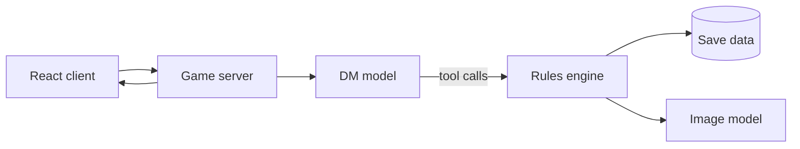

# 🏗️ Architecture & Build Plan

- Notion: https://app.notion.com/p/3ee2bc887e0581fc9decf2985c3a7759
- Fetched: 2026-10-03T15:15:58.647Z
- Last edited: 2026-10-03T15:15:58.557Z

---

<callout icon="📥" color="gray_bg">
	Migrated in full from the Claude Doc "AI Dungeon Master RPG — Design Doc" (James, Sep 24, 2026). Claude Code owns how this is implemented; design decisions that change here get logged in the Changelog.
</callout>
## Technical architecture
**LOCKED (James).** A TypeScript web app with a thin server that holds API keys and runs the DM loop. Every change deploys to a preview link you can playtest on a phone.

<table header-row="true">
<tr>
<td>Layer</td>
<td>Choice</td>
<td>Why</td>
</tr>
<tr>
<td>Client</td>
<td>React + TypeScript</td>
<td>Close to your React Native skills</td>
</tr>
<tr>
<td>Server</td>
<td>Node API routes</td>
<td>Keeps keys off the client</td>
</tr>
<tr>
<td>DM model</td>
<td>Claude via API, swappable</td>
<td>Tool use is the core mechanic</td>
</tr>
<tr>
<td>Rules engine</td>
<td>Plain TypeScript, unit-tested</td>
<td>Deterministic and easy for agents to test</td>
</tr>
<tr>
<td>Saves</td>
<td>JSON per game in a small database</td>
<td>Simple to inspect and debug</td>
</tr>
<tr>
<td>Images</td>
<td>An image-generation API behind one tool</td>
<td>Provider can change without touching the DM</td>
</tr>
<tr>
<td>Hosting</td>
<td>Preview deploys per pull request</td>
<td>Playtest from anywhere</td>
</tr>
</table>
The DM model sits behind one interface, so Grok or another model can be tried as DM later without changing the engine.
<callout icon="🔁" color="blue_bg">
	**Playtest:** server-side saving was pulled forward out of sequence so the Saren playthrough wouldn't be lost. The event log (full transcripts + per-turn summaries) and character "sheets of the soul" are new stored state; see <mention-page url="https://app.notion.com/p/3ee2bc887e0581b8bf19ec6d6517cfaa"/>.
</callout>
## Build plan
Six milestones (0 to 5), each broken into tasks small enough to queue from a phone and review as a pull request with a playable preview.
<table header-row="true">
<tr>
<td>#</td>
<td>Milestone</td>
<td>Done when</td>
</tr>
<tr>
<td>0</td>
<td>Repo, [CLAUDE.md](http://CLAUDE.md), preview deploys</td>
<td>A blank page deploys from a pull request</td>
</tr>
<tr>
<td>1</td>
<td>Text-only DM loop with dice</td>
<td>You can play a 15-minute scene in text</td>
</tr>
<tr>
<td>2</td>
<td>Persistent state and tools</td>
<td>The bread hat is still there after a reload</td>
</tr>
<tr>
<td>3</td>
<td>Character sheet, spell book, inventory</td>
<td>You can level up and pick a new spell</td>
</tr>
<tr>
<td>4</td>
<td>Generated portraits and scene art</td>
<td>Each new location gets a consistent illustration</td>
</tr>
<tr>
<td>5</td>
<td>Exploration prototype</td>
<td>One map area you can walk around</td>
</tr>
</table>
**Working with agents**
- Milestone 0 happens at a desk before the trip. Everything after can run from the Claude mobile app.
- One agent until milestone 2. Parallel agents after that, on separate menus or features.
- Every task ends with tests for the rules engine and a short playtest note in `DESIGN_NOTES.md`.
- Cursor with a second model reviews pull requests when you want another opinion.
