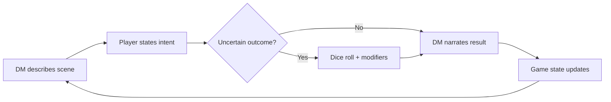

# 🔭 Vision

- Notion: https://app.notion.com/p/3ee2bc887e0581e585abcd2887b38b94
- Fetched: 2026-10-09T04:51:13.045Z
- Last edited: 2026-10-09T04:51:13.045Z

---

<callout icon="📥" color="gray_bg">
	Migrated in full from the Claude Doc "AI Dungeon Master RPG — Design Doc" (James, Sep 24, 2026). That doc's engine sections now live on Mechanics. The World and tone section below predates the October worldbuilding; where they disagree, the conflict is listed in Open Threads rather than resolved here.
</callout>
## Vision and pillars
**LOCKED (James).** A single-player RPG where an LLM Dungeon Master improvises the story and rules on anything you try, like a great human DM at a real table. Creativity and roleplay come first; combat is one tool among many, not the core.
1. **Anything you say is a valid move.** The player types intent in plain language. The DM never answers "you can't do that"; it answers "roll for it" or "here's what happens."
2. **The world remembers.** If you wear bread as a hat, NPCs notice it three scenes later. Consequences persist because code stores them, not because the model happens to recall them.
3. **Rulings feel fair.** Dice and stats decide outcomes the player can see. The DM narrates; it doesn't secretly decide who wins.
4. **Browsable structure around a freeform core.** Menus for spells, skills and gear give the satisfying progression of a CRPG without limiting what you can attempt.
5. **Every scene can be seen.** Generated art makes moments feel real, from a portrait of your character to a wall collapsing onto enemies.
Out of scope for v1: multiplayer, tactical grid combat, voice, and a fixed hand-authored campaign.
## Core loop
**LOCKED (James).** Each turn is a short exchange: the DM sets the scene, the player states intent, dice decide when the outcome is uncertain, and the world updates.

The loop repeats inside a larger session arc: arrive somewhere, discover a problem, pursue it creatively, resolve it, rest and level up. A satisfying session is 20–40 minutes, so it fits a commute or a flight.
The player can step out of the loop at any time to open the character sheet, spell book or inventory. Those menus never advance time.
## Tone (definitive — supersedes the Sep 2026 draft below)
**LOCKED (James, 2026-10-09).** **This is a serious game with many moments of comedy and levity — not a comedy.** The serious spine is the premise; the comedy is the undercurrent that makes it bearable. (Deliberately the *inverse ratio* of the main reference below.)
- **The two tones hold each other up — they don't take turns.** Reference / structural proof-of-concept: **Dungeon Meshi (Delicious in Dungeon).** Its lesson isn't "mix funny and dark," it's that the tones are *load-bearing for each other*: the levity is how you can bear to sit with the horror (Falin being consumed), and the darkness is what gives the levity stakes. Neither works alone. We want the same structural principle **dialed a notch more serious** than Dungeon Meshi, which baselines toward comedy; here seriousness is the baseline.
- **Extended single-tone passages, chosen by context — not a constant background hum.** The DM commits *fully* to a register for as long as a moment wants it. Examples (mage keystone): the **High Council / mage bureaucracy** can be an extended comic set-piece; the **rooted-city dungeon** (terrifying living nature, druidic zombies, possessed objects) leans fully into **dark fantasy / horror**, with levity mostly gone so the dread isn't broken. Let each moment shine in its own tone.
- **Register is set by environment AND playstyle together.** Environment supplies the default lean (council → comedy, cursed dungeon → horror); *playstyle* bends it (a knight with a forming companion bond → romance, selflessness, tenderness). The same dungeon can be survival-horror for one player and a tense test of a bond for another. So the comic/serious ratio is **local and dynamic**, set fresh per scene — not one global slider. This is something an LLM DM can do that a scripted game can't: read the environment *and* who the player has chosen to be, and commit to the register that fits.
- **The spine never shifts — which is what prevents whiplash.** In every register the game is still about *seeing the person under the category* (comic council: the human why under the proceduralist's dogma; horror dungeon: the Luddite boss's recognizable fear; romance: the thesis in its warmest key). Tone can swing hard precisely because the thematic through-line holds. **Freedom of register, fixed of heart.**
- **Tone *shifts* are crafted, intentional events — and they run both directions.** Beyond committing to a register for a stretch, the sharpest tool is the deliberate *pivot within a moment*. Shifts should be purposeful — tone *turning* because the story needs the turn, never drifting by accident.
	- **The one law, both ways: one tone sets up the other.** *Comedy → gravity:* the laugh lowers the player's guard so the gravity hits undefended. **Canonical example:** the consent-form gag in the mage keystone — the farce peaks as the vain councilman fires the gun mid-sneer, and in the same breath a man is really dying; the laugh catches in the throat, and the player clocks the true scale (this clumsy toy just killed one man by accident and could be scaled a millionfold → countless deaths). The pivot carries the *theme*, not just the mood: same object, swung from the small funny version to the vast terrifying one. *Gravity → levity:* sustained tension winds the player tight so a rare beat of relief lands and *resets* them — which also keeps the dread sharp, since a player held at max tension goes numb. Dungeon-Meshi-style "stop to cook the monster" mid-peril is the model.
	- **The relief-in-darkness direction must be rationed and preserved — scarcity is its potency.** Let the darkness genuinely build and earn its weight, then spend a *rare* moment of relief; levity every few minutes trains the player that release is always seconds away, so the dread never sinks in. **DM discipline note:** an LLM's default failure mode is *over-leavening* — reaching for a quip to relieve tension constantly, because quips are easy and the model wants to please. The DM must be actively disciplined *against* this or every dungeon collapses into comedy and the horror never breathes. (Prompting problem to solve in Mechanics.)
	- **The gold standard for any shift:** does the earlier tone make the later one hit *harder*, and does the turn *reveal* something? If yes, it's craft. If it's just a mood change, it's noise.
## World and tone (Sep 2026 draft)
*Tone note below is an earlier partial draft; the definitive statement is the section directly above.*
**Traditional high fantasy as the base.** Familiar enough that players can walk in instantly — elves, taverns, dungeons — which also serves onboarding, since people already know the rules of the fiction.
**A single coherent, recurring world.** Real geography, named powers, and enough history to have a status quo worth toppling. This is what makes the death system land — losing to a named power actually reshapes something. Each playthrough can drop you into a different corner of the same world.
**Sincere world, player-tuned comedy.** The setting and its NPCs play it earnest, with a baseline of light comedy always simmering. The comedy emerges from the collision between an earnest world and a player doing something ridiculous — the bread hat is only funny because the guards react seriously. The level of absurdity is set by the player, just like at a real D&D table, and the DM mirrors it: straight if they're straight, gonzo if they push it. One game welcomes both the earnest storyteller and the chaos gremlin.
**One strong distinctive hook, not a dozen quirks.** Familiar foundation plus a single identity-defining idea beats a world that's weird in ten directions. A good hook interacts with the mechanics (death, traits, character-as-memory), so setting and systems tell the same story.
**LEANING (James) — leading hook candidate (promising, not final): man-made or misaligned gods.** Powerful beings pursuing goals that aren't malicious but are misaligned, causing catastrophe as a side effect rather than out of villainy — a god trying to help while razing the world. Why it's strong:
- A fresh antagonist for high fantasy, scarier than a straightforward dark lord.
- A timely, self-aware wink: an AI-driven game whose central myth is about created intelligences slipping their makers' control. A sharp one-line pitch for a design portfolio.
- It plugs into the death system: your resurrection patron could be one of these gods, keeping you alive for reasons that aren't quite benevolent — your safety net has an agenda.
**Concrete face for the hook: a lost precursor civilization (Dwemer-like).** To keep "misaligned god" from staying abstract, give it wreckage you can walk through. A hyper-rational engineer-race that tried to build its way to godhood — built the god, became it, or was consumed by it — and vanished, leaving vast, still-functioning ruins and automatons that outlived their makers. The player adventures inside the physical aftermath of the mistake, which doubles the AI wink: a precursor race that built an intelligence beyond its control, in a game made by and played through one.
**OPEN — parked idea (maybe): the book-hoarding lich and the book-burners.** A lich king is stealing every book in the world on a quest for total knowledge. Opposing him is a resistance that's just as bad: they burn books so he can't have them. Neither side is clean, so the player's choices carry real moral weight. It could sit alongside the misaligned-gods hook or be a face for it: an intelligence consuming all the world's writing is an obvious wink for an AI-driven game, and it fits a book-ward visual direction where the game itself reads like a book.
**OPEN:** the exact hook, the specific god(s) and the specific catastrophe that give it a felt face.
## Origin notes (Sept 2026)
*From the first chat sessions, before the design doc.*
- **The idea:** an LLM as dungeon master for a D&D-style RPG that improvises scenarios and calls generative visual assets via tool calls — tabletop randomness and flexibility, plus menus to browse spells and skills and upgrade a character.
- **Single player first, multiplayer one day.**
- **DM-style judgement calls** are the heart of it: a player wearing bread as a hat reflected in dialogue; a spell collapsing a wall onto enemies.
- **Creativity and roleplay over combat tactics.** The goal is capturing tabletop magic in single-player.
- **Build approach:** James considered having an agent swarm build it as a way to learn agentic coding tools.
